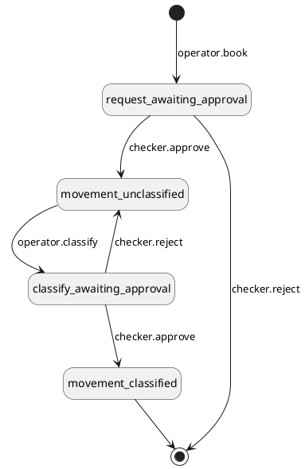
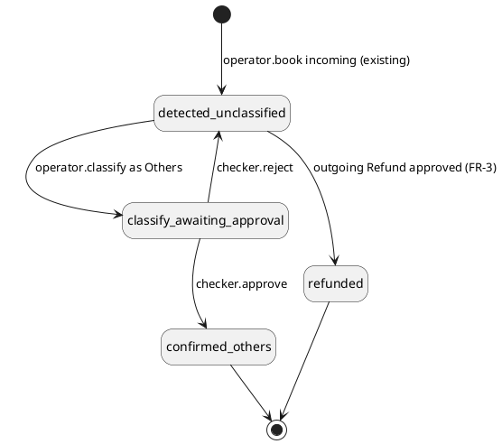

# PRD \- Manual Outgoing Movement Booking and Classification

## About the Document

### List of Personnel

| **Role** | **Name** |
| --- | --- |
| Product Manager | [TBD] |
| Tech Lead | [TBD] |
| Design | [TBD] |
| QA | [TBD] |
| Stakeholder | [TBD] |

---

## Overview

### Release Note

- Operators can now book an outgoing movement by hand, for money that left a venue without an instruction (a bank charge, a network fee). Booking records the facts only
- Booking and classifying are two separate steps, as in the existing incoming flow: a booked movement is saved as Unclassified and classified later
- Operators can classify a hand-booked outgoing movement as Venue charges (bank charge, network fee, other venue fee), Refund or Others
- Operators can also classify an unclassified incoming movement as **Others**, so that a wrong approved booking can be corrected with an opposite entry. The other incoming classifications (airdrop, interest, withdrawal reversal and so on) are not part of this PRD
- Each classification says whether it is tied to an account. A tied movement changes that account's balance and appears on its monthly statement; an untied one creates no balance change and does not appear on a statement
- Until an outgoing movement is classified it is listed as unclassified outgoing money. The venue balance has already dropped, so the venue always matches the bank
- A tied movement appears on the monthly statement of the month it happened (its transacted date), not the month it was classified
- Every booking and every classification is approved by a second operator

---

### Problem Statement

Today the only outgoing movement is instruction-led: a withdrawal or rebalance is created first and the movement is generated from it. Anything that leaves a venue without an instruction, such as a bank charge, cannot be recorded, so the venue balance drifts away from the bank.

Operators notice these gaps from a regular check or a reconciliation failure. Some are tied to a customer (for example a bank charge taken for that customer's withdrawal) and must reach that customer's balance and monthly statement. Others are paid by us (for example a monthly account maintenance fee). Money sent back to an unknown sender (a refund) is tied to nobody.

Booking by hand also makes mistakes possible (a wrong amount, a duplicate, a wrong account). An approved movement is never edited, so a mistake needs an opposite entry. The opposite of an outgoing movement is an incoming one, so this PRD also lets an operator classify an unclassified incoming movement as Others.

---

### Solution Overview

1. An operator books an outgoing movement that already happened at a venue (token or fiat), recording the venue, asset, amount, time and reference. There is no classification on the booking form, the same as the existing Book Incoming Movement.
2. A second operator approves the booking (maker-checker). The movement is created as `confirmed` and `unclassified`, the venue balance drops, and the amount is listed as unclassified outgoing money.
3. An operator classifies the movement in a separate step, with its own maker-checker request: what it is for (Venue charges, Refund, Others), and who bears it.
4. Each classification carries an account link rule (Required, Optional or None). A tied movement debits the account and appears on its monthly statement. An untied movement is paid by us, or (Refund) clears unknown funds. No new transaction type or menu is created: the classified movement is the record
5. When the classification takes effect, the amount is assigned to its final place: the customer account's balance falls, the amount is recorded as a company cost, or (for a Refund) the unknown funds being returned are cleared.
6. Movement lists and details show the new classifications, the account affected and the new fields.
7. A mistake in an approved movement is corrected with an opposite entry: the operator books an incoming movement with the existing Book Incoming Movement and classifies it **Others** with an explanation that names the original (FR-7). Both entries stay visible.
8. Manual first: operators book when they notice a gap. Automation comes later and only for what is frequent and feasible.

**In scope:**

- Book Outgoing Movement (token and fiat), facts only
- Classify a hand-booked outgoing movement, as a separate step after booking
- Classification catalogue, account link rules, balance effect and statement effect
- The unclassified outgoing balance, with the age of the oldest unclassified entry
- Network fee handling: stays on the movement when part of the same transfer, booked on its own when paid separately
- Maker-checker for every booking and every classification
- Classify an unclassified incoming movement as **Others** only (the correcting entry), with its balance and statement effect
- List, filter and detail changes on the Movement Management pages (Token and Fiat), for outgoing and for the incoming Others change

---

### Step-by-Step Use Cases

Every use case below uses the same two operators: **Alice** (the maker) and **Bob** (the checker). They can be any two different operators. The demo data in the prototype matches these examples.

#### How to read a use case

- **Booking** (UC-1) is always the first part. It records that money left a venue and lists it as unclassified.
- **Classifying** is a second, separate part. Each option below (Venue charges, Refund, Others) is one use case, split by who bears the amount where that changes the result.
- Every booking and every classification is approved by the other operator, so each use case has a "Bob approves" step.

#### UC-1: Book an outgoing movement (the first step of every use case)

**When:** the operator sees money that left a bank account or wallet with no withdrawal or rebalance behind it. The source is a bank statement line or a chain record.

| Step | Who | What happens |
| --- | --- | --- |
| 1 | Alice | Opens Movement Management > Outgoing Movement > Token or Fiat > **Book Outgoing Movement**. |
| 2 | Alice | **Fiat:** picks the **Venue** (a bank account). The bank account number fills in. **Token:** picks the **Blockchain**, then a **Venue** (a hot or cold wallet on that blockchain). The source address fills in. The venue's Total and Available balance for the chosen asset are shown under the Asset. |
| 3 | Alice | Picks the **Asset**, enters **Amount**, **Transacted at** and the **Reference** (bank reference or transaction hash). Optionally adds the beneficiary or destination, the payment rail (the charge bearer and charge bearer account then fill in from System > Charge Instructions and can be changed), and a note. An optional network fee can be entered on any chain. |
| 4 | Alice | Submits. A review window says in plain words what will happen: the amount stays unclassified until it is classified. A warning shows if the venue balance would go below zero, but the booking is never blocked. |
| 5 | System | Creates a maker-checker request. Nothing changes yet. |
| 6a | Bob (approves) | The movement is created as **Confirmed** and **Unclassified**. The venue balance drops and the amount is listed as unclassified outgoing money. |
| 6b | Bob (rejects) | Nothing is created. No balance changes. Alice can book again with the right details. |

**End state after 6a:** an unclassified movement with a **Classify** button, a banner "The money has already left the venue and is waiting to be classified", and the tag **Booked by hand**. It appears on no customer statement.

**Blocked cases:** the same reference at the same venue in the same direction is refused. An amount of zero is refused. A future date is refused.

#### UC-2: Venue charges, bank charge, paid by us

**Example:** the bank takes a monthly account maintenance fee of 25.00 SGD from Bank Venue V. It belongs to no customer.

| Step | Who | What happens |
| --- | --- | --- |
| 1 | Alice | Books the movement (UC-1): Bank Venue V, SGD, 25.00, reference from the bank statement. Bob approves. |
| 2 | Alice | Opens the unclassified movement (or its list row) and clicks **Classify**. |
| 3 | Alice | Chooses **Venue charges**, charge type **Bank charge**, and under "Charged to" chooses **We pay it (company cost)**. |
| 4 | Alice | Reads the effect line ("...paid by us. It is recorded as a company cost. No account balance changes.") and submits. The movement shows "ongoing maker checker request" and **View request**. |
| 5 | Bob | Approves. |

**End state:** classified as Venue charges, Bank charge, "We pay it (company cost)". It is recorded as a company cost and the unclassified outgoing amount falls by 25.00. No customer balance or statement is touched.

#### UC-3: Venue charges, bank charge, charged to a customer account

**Example:** DBS takes 30.00 SGD of charges from Bank Venue V for a MEPS payment where the sender pays. The charge belongs to the customer who made the withdrawal WD-2041 (Acme Treasury).

| Step | Who | What happens |
| --- | --- | --- |
| 1 | Alice | Books the movement (UC-1): Bank Venue V, SGD, 30.00. Optionally picks Payment rail MEPS: Charge bearer "Sender Pays (DEBT)" and the Charge bearer account (a DBS venue) fill in from System > Charge Instructions, and Alice changes them if the bank statement shows something else. Bob approves. |
| 2 | Alice | Clicks **Classify**. Chooses **Venue charges**, charge type **Bank charge**, "Charged to" **A customer account**, and picks **Acme Treasury**. |
| 3 | Alice | Enters Related transaction (chosen from the list) `WD-2041` and an Explanation, then submits. |
| 4 | System | Checks that the account has enough available balance. If not, it refuses with "The account does not have enough balance." and the operator chooses UC-2 (paid by us) instead. |
| 5 | Bob | Approves. |

**End state:** The account's total balance falls by 30.00, the unclassified outgoing amount falls by 30.00, and the movement shows **Appears on the monthly statement**, with the classification, the explanation and the reference. The statement line is read from the classified movement and is dated with the movement's transacted date, so it falls in the month the charge happened even if it is classified later.

#### UC-4: Venue charges, network fee paid separately (token)

**Example:** a Bitcoin withdrawal was sent, and its network fee of 0.0003 BTC was paid from another address, so it is not on the withdrawal. The operator sees it on the chain explorer.

| Step | Who | What happens |
| --- | --- | --- |
| 1 | Alice | Books a **Token** movement (UC-1): venue **Token Venue W** (blockchain Bitcoin and source address fill in), BTC, 0.0003, the transaction hash as the reference. No network fee is entered, because this movement *is* the fee. Bob approves. |
| 2 | Alice | Clicks **Classify**. Chooses **Venue charges**, charge type **Network fee**. |
| 3 | Alice | Chooses who bears it: **We pay it (company cost)**, or **A customer account** (for example Acme Main Account) when the fee belongs to a customer. Adds Related transaction (chosen from the list) `WD-2042` (the withdrawal it belongs to). This is **required for a Network fee**: without it the submit is blocked with "Choose the withdrawal this network fee belongs to." |
| 4 | Bob | Approves. |

**End state:** same effects as UC-2 (we pay it) or UC-3 (account), with charge type **Network fee**, so reports can total network fees however they were recorded.

**Not needed:** on a chain with a fee sponsor (Ethereum, Solana) no fee booking is made, because the sponsor pays. The booking form still shows the optional Network fee field on every chain, with a hint to leave it empty when a sponsor paid. A fee paid in the *same* transfer stays in the movement's own `networkFee` field and is not booked again.

#### UC-5: Venue charges, other venue fee

**Example:** a bank charges a 5.00 SGD statement-copy fee.

Steps are the same as UC-2 or UC-3. The only difference is the charge type, **Other venue fee**. Use it for any charge taken by a bank or a chain that is neither a bank charge nor a network fee. A fee that does not fit any charge type is classified **Others** (UC-7).

#### UC-6: Refund of unknown funds

**Example:** 200.00 USD arrived from an unknown sender (movement IM-3005). It is already recorded as received and unclassified (existing behavior). It must be sent back.

| Step | Who | What happens |
| --- | --- | --- |
| 1 | Alice | Sends the money back at the bank, then books it (UC-1): Bank Venue V, USD, **200.00**, the bank reference of the return. It must be booked at the venue that received the funds. Bob approves. The amount is listed as unclassified outgoing money. |
| 2 | Alice | Clicks **Classify** and chooses **Refund**. |
| 3 | Alice | Under "Refund Details" picks the unknown funds entry (IM-3005, 200.00 USD). Only unclassified incoming entries at the same venue and in the same asset are listed. No account is asked. |
| 3a | System | Compares the destination typed at booking (beneficiary name or destination address) with the original sender of the chosen entry. If both exist and differ, it shows a warning (the operator can still submit). If none was typed, it shows the original sender as the destination the refund will carry. |
| 4 | System | Checks that the entry is still unclassified, at the same venue, in the same asset, for the **same amount** (full refund only), and that no other pending request already refunds or classifies it. Otherwise it refuses with the reason. |
| 5 | Bob | Approves. |

**End state:** The unknown funds entry moves to status **Refunded** (it keeps classification Unclassified, because it was never classified as anything else) and no longer waits for a refund. The unclassified outgoing amount clears. No customer is credited, and nothing appears on a statement. The venue balance already rose by 200.00 when the funds arrived and dropped by 200.00 when the return was booked, so it matches the bank.

#### UC-7: Others (anything else)

**Example:** 40.00 SGD left Bank Venue V for a reason nobody can name yet. It is not a bank charge, a network fee or a refund.

| Step | Who | What happens |
| --- | --- | --- |
| 1 | Alice | Books the movement (UC-1). Bob approves. |
| 2 | Alice | Clicks **Classify** and chooses **Others**. |
| 3 | Alice | Chooses "Charged to" **A customer account** or **We pay it (company cost)**, and writes an **Explanation** of at least 10 characters. Submit is blocked until then. |
| 4 | Bob | Approves. |

**End state:** as in UC-2 or UC-3 depending on who bears it, with the explanation shown on the movement and, when tied to an account, on the monthly statement.

#### UC-8: Correcting a mistake

An approved movement is never edited. A mistake is fixed with an opposite entry: an **incoming** movement booked with the existing Book Incoming Movement and classified **Others** (FR-7). Both the original and the correction stay visible in the lists.

| Situation | What to do |
| --- | --- |
| The booking is wrong and **not yet approved** | Bob rejects it. Nothing was created, so nothing needs fixing. Alice books again |
| The classification is wrong and **not yet approved** | Bob rejects it. The movement stays Unclassified and Alice classifies it again |
| An approved booking is wrong (for example booked twice, or the wrong amount) and **still unclassified** | Steps below, case A |
| An approved classification is wrong (for example the wrong account was charged, or a charge that should have been paid by us) | Steps below, case B |
| A tied charge is blocked because the account does not have enough balance | The classification is refused. Classify the charge as **We pay it (company cost)** (UC-2) instead |
| An approved **Refund** was booked by mistake | Not correctable in this phase. See Out of Scope |

**Case A: a booking that never should have happened.** Example: OM-3006 (8.00 SGD at Bank Venue V) was booked twice by mistake. It is still Unclassified.

| Step | Who | What happens |
| --- | --- | --- |
| 1 | Alice | Books an **incoming** movement (Movement Management > Incoming Movement > Book Incoming Movement): Bank Venue V, SGD, 8.00, her own reference (for example `FIX-OM-3006`) and a note naming OM-3006. Bob approves. The venue balance rises by 8.00 and the amount is listed as unclassified incoming |
| 2 | Alice | Classifies the incoming entry **Others**, **We keep it (company income)**, Related transaction (chosen from the list) `OM-3006`, Explanation "Corrects OM-3006, booked twice". Bob approves |
| 3 | Alice | Classifies the original OM-3006 **Others**, **We pay it (company cost)**, with an explanation that names the correcting entry. Bob approves |

**End state:** the venue balance is back to what it was. The company cost of 8.00 and the company income of 8.00 cancel out, so the net cost is 0. Both unclassified totals are clear. Nothing touches a customer account.

**Case B: a charge that went to the wrong account.** Example: OM-3004 charged 12.50 SGD to Acme Main Account, but it belonged to Acme Treasury.

| Step | Who | What happens |
| --- | --- | --- |
| 1 | Alice | Books an incoming movement of 12.50 SGD at the same venue, with a note naming OM-3004. Bob approves |
| 2 | Alice | Classifies it **Others**, **Credited to** Acme Main Account, Related transaction (chosen from the list) `OM-3004`, Explanation "Corrects OM-3004, wrong account". Bob approves. Acme Main Account is credited 12.50 and the line appears on its monthly statement |
| 3 | Alice | Books a new outgoing movement of 12.50 SGD (a new reference) and classifies it Venue charges, Bank charge, charged to Acme Treasury. Bob approves each step |

**End state:** Acme Main Account is whole again, Acme Treasury carries the charge, and the venue balance is down by the one real 12.50 charge. The statement of Acme Main Account shows the charge and the credit, each with its explanation.

**Why the original is also classified in case A:** an unclassified booking stays in the unclassified outgoing total and ages past 7 days, so it needs a classification. Classifying it Others with an explanation is the record that it was a mistake.

#### Summary of options

| Option | Account link | Who bears it | Effect when classified | On a customer statement |
| --- | --- | --- | --- | --- |
| Venue charges: Bank charge, Network fee, Other venue fee | Optional | We pay it | Recorded as a company cost | No |
| Venue charges: Bank charge, Network fee, Other venue fee | Optional | A customer account | The account's balance falls | Yes |
| Refund | None | Nobody (clears unknown funds) | The unknown funds entry is cleared | No |
| Others | Optional | We pay it, or a customer account | As for Venue charges | Only when tied to an account |
| Incoming Others (the correcting entry, FR-7) | Optional | Credited to a customer account, or kept by us | The account's balance rises, or company income offsets company costs | Only when tied to an account |

---

### Out of Scope

| **Item** | **Reason** |
| --- | --- |
| CSV import of movements (incoming or outgoing) | Decision: not supported for now. Movements are booked one at a time |
| Securities movements | Decision: Token and Fiat only for now. The Securities tabs stay as they are |
| Automatic booking of fees (per-withdrawal fees, bank APIs, on-chain fee feeds) | Later phase. Frequent fees (per withdrawal) are worth automating; feasible sources include new DBS API integrations and dfns or a chain API. Needs feasibility work per bank and chain |
| Statement upload with OCR to book several movements | Later phase. For banks and brokers with no API, an operator uploads a PDF or spreadsheet, OCR extracts the lines, and the existing book-movement APIs are called |
| Editing a booked movement | Corrections are made by an opposite entry, not by editing (see UC-8 and FR-7) |
| Generating the customer monthly statement | The Monthly Entity Statement report exists. This PRD only defines which bookings feed it |
| Matching a booked movement against a bank or chain record during reconciliation | Only a duplicate check on the reference per venue is in scope. A "matched to statement" flag is a later phase |
| Incoming classifications other than Others (Airdrop, Interest, Withdrawal reversal, Unknown funds as a manual classification) and any change to Book Incoming Movement | Later phase, as its own PRD. Incoming booking and Confirm stay as they are today. This PRD adds exactly one incoming classification, **Others** (FR-7), as the correcting entry, and depends on one existing incoming fact: unknown funds are already recorded as received and unclassified (`detected`) |
| Correcting an approved Refund booked by mistake | Not in this phase. A Refund marks the unknown funds entry Refunded, and there is no way to reopen it. If a Refund was approved by mistake, the venue balance can be restored with an incoming Others entry (FR-7), but the unknown funds entry stays Refunded. Operations must handle it outside the product until a later phase adds reopening |
| Statement already issued for the month of the transacted date | The customer statement is generated by the Monthly Entity Statement report. This PRD only says the line belongs to the month of its transacted date. Whether a statement that was already issued is restated or the line moves to the next one is the report owner's decision |
| Flagging a possible double booking against an instruction-led movement, and a second duplicate key (amount and date) | Later phase. For now only the venue and reference are checked |
| An override for a tied charge when the account balance is insufficient | Not in this phase. The operator classifies the charge as paid by us instead |
| A Reverses field and a Reversal classification | Not in this phase. A wrong approved movement is corrected with an incoming Others entry that names the original in its explanation and Related transaction (see UC-8 and FR-7) |
| More classifications | Added later as catalogue data, without changing the pages |

---

### Actors

- **Operator (maker):** books a movement or classifies one. Every booking and every classification goes through maker-checker.
- **Operator (checker):** a different operator who approves or rejects. The maker cannot approve their own request.
- **Compliance user:** can view movements. Cannot book, classify or approve.
- **Permissions:** booking an outgoing movement needs `book-outgoing-movement`. Classifying an outgoing or an incoming movement needs `classify-movement`. Approving needs the maker-checker approval permission, and the approver must be a different user. Viewing needs movement read permission. Booking an incoming movement keeps its existing permission
- **Client user:** has no access to movement pages. A client sees only the effect on their own balance and monthly statement.
- **Bank or chain:** the external source of the discrepancy. Not integrated in this phase; the operator keys in what the bank statement or chain shows.

---

### Assumptions & Dependencies

- The Movement Management pages, maker-checker and the balance engine already exist and are reused. Incoming booking and Confirm are not touched
- A venue, an asset and a unified account already exist where a booking needs them
- Money that arrives from an unknown sender is already recorded by the existing incoming flow as an incoming movement in status `detected` and classification `unclassified`, and the venue balance is already credited at that moment (see the Incoming Token and Incoming Fiat PRDs). **Unknown funds** in this PRD means exactly that: an unclassified, detected incoming movement. A Refund clears such an entry (it moves to a new incoming status `refunded`), and an incoming **Others** classification clears it too (FR-7). Both are new, and both need the incoming movement to accept the new status and the new classification; this is the only change to incoming behaviour in this PRD The unclassified outgoing amount and the company cost are new views of movement data introduced by this PRD; how finance books them is outside this PRD
- The repo's venues are fiat venues (bank accounts, with expected, total and reserved balance per currency) and token venues (deposit, hot, cold and external wallets, each with a blockchain and address). The booking connects to these
- The repo's outgoing fiat record already has a payment rail, a charge bearer and a charge bearer account, and the outgoing token record already has a `networkFee` field. The booking form follows the same rules as the repo's Payment Details on a withdrawal: choosing a rail fills in the charge bearer and charge bearer account from the platform default in System > Charge Instructions (set per rail, for MEPS and TT only). The repo's charge bearer account is a **DBS fiat venue** (a bank account the charges are taken from; it links to the venue page), not a customer account, so it cannot be reused for `accountId`. DBS is the only bank provider the repo supports today (the fiat venue create page is fixed to DBS), and the rails, charge bearer and automated or manual payment processing are DBS payment concepts. The booking itself does not depend on them: it records what the bank statement shows. If another bank is added, its rails would differ
- The repo's Classify modal always sends a destination account. The backend must accept no account for untied classifications
- The Monthly Entity Statement report exists. This PRD assumes the statement line is read from the classified movement (classification, explanation, reference)
- The repo has no Adjustment transaction type or menu (Transaction Management has Deposit, Withdrawal, Rebalances and Settlement Instructions only), and this PRD does not add one. Whether the backend keeps its own record behind a tied balance change is a backend choice, not a new menu
- A network fee paid in the same transfer stays in the movement's own `networkFee` field and is not posted separately. The booked amount is the **whole amount that left the venue, network fee included**, and the venue balance drops by that amount only. The Network fee field records how much of it was fee, for information. `amountType` and `totalReceived` are shown as not applicable on a hand-booked movement
- A tied movement is dated with its **transacted date** (the platform already passes `transactedAt` to the balance service as the value date of a journal entry). The statement line appears in the month of the transacted date, even when the movement is classified later
- The book and classify calls are new: a `POST /v1/outgoing-movements/{token|fiat}` for booking, and one generic classify call that takes the classification code and accepts no account for untied classifications (see API Specifications)
- Each wallet has one blockchain and one address. On the Token form the operator picks the blockchain, then a venue on it, and the source address fills in

---

### Glossary

| **Term** | **Definition** |
| --- | --- |
| Movement-led | A movement recorded on its own, not generated from an instruction. |
| Instruction-led | A movement generated from a withdrawal request or a rebalance instruction. |
| Classification | What a movement is for. It decides the balance effect and what is shown on the movement. It is set in a separate Classify step after booking. |
| Unclassified | A booked movement that has not been classified yet. For an outgoing movement the venue balance has already dropped and the amount is listed as unclassified outgoing money. |
| Unclassified outgoing | The total of booked outgoing movements that are not classified yet. It is a view on Balances with the age of the oldest entry. It is a report, not a stored balance. |
| Company cost | An amount we pay ourselves (for example a bank maintenance fee), recorded against no customer. |
| Tied to an account | The movement changes a specific customer or house account balance. |
| Untied | The movement is paid or earned by us, or is unattributed. No account balance changes. |
| Umbrella classification | One classification that covers several related cases, with a sub-type field (for example Venue charges with a charge type). |
| Catch-all | The classification Others, which always needs an explanation. |
| Unknown funds | Money from an unknown sender that arrived at a venue. It is already recorded today as an incoming movement in status `detected` and classification `unclassified`, with the venue credited. A Refund (outgoing) or an incoming Others (FR-7) clears it. |
| Unclassified incoming | The total of incoming movements still `detected` and `unclassified`, including unknown funds waiting to be sent back. A view on Balances, like Unclassified outgoing. |
| Company income | An amount we keep ourselves (for example the correcting entry for a mistaken company cost). It offsets company costs. |
| Correcting entry | An incoming movement booked by hand and classified Others, with an explanation and Related transaction that name the original outgoing movement, used instead of editing an approved movement. |
| Payment rail | The bank network a fiat payment goes over. Outgoing: ACT, FAST, MEPS, TT. |
| Charge bearer | Who pays the bank charges on a payment: Beneficiary Pays (CRED), Sender Pays (DEBT) or Split (SHAR). Recorded for MEPS and TT. |
| Charge bearer account | The DBS fiat venue (bank account) the charges are taken from when the charge bearer is Sender Pays (DEBT) or Split (SHAR). It is set per rail as a default in System > Charge Instructions. It is not a customer account. |
| Maker-checker | Approval workflow requiring two different operators: one to initiate, one to approve |

---

## Functional Requirements

### Section 1: Classification Catalogue

Define what a hand-booked outgoing movement can be classified as, and whether each classification is tied to an account.

#### FR-1: \[System\] Classification Catalogue and Account Link Rules

**Requirement Details**

As the system, I want a catalogue of classifications, each with an account link rule, so that the Classify step offers the right choices and the balance and statement effect follow from the choice.

**Precondition:** The classification catalogue is configured. The catalogue is data, not code.

**Main Flow:**

1. The system holds a catalogue of classifications per direction. Each classification has an account link rule: **Required** (an account must be chosen), **Optional** (the operator chooses tied or untied), or **None** (never tied). The incoming catalogue in this phase adds one entry, Others (below); the rest of the incoming catalogue is a later phase.
2. The Classify step (FR-3) reads the catalogue and shows the classifications that apply to a hand-booked movement.
3. The classification's rule decides which fields the modal asks for (account, charge type, related transaction, explanation).

**Outgoing classifications**

| **Classification** | **Account link** | **Extra fields** | **When used** |
| --- | --- | --- | --- |
| Withdrawal | Required | none | Existing. Instruction-led only; not offered in the manual Classify step |
| Rebalance | None | none | Existing. Instruction-led only; not offered in the manual Classify step |
| Settlement | Required (the account of the obligation) | Obligation | From the Settlement Instruction PRD. Instruction-led; not offered in the manual Classify step |
| Venue charges | Optional | Charge type (required). **Fiat movement:** Bank charge or Other venue fee. **Token movement:** Network fee or Other venue fee | Any charge taken by a bank or chain. Umbrella for bank charges and network fees. A bank charge is never offered on a token movement, and a network fee never on a fiat movement, so reports can total each type correctly |
| Refund | None | The unknown funds entry it returns (an unclassified, detected incoming movement), required: "Choose the unknown funds entry to refund." | Sending back Unknown funds. Clears the entry |
| Others | Optional | Explanation (required) | Anything else |

**Incoming classifications (this phase)**

| **Classification** | **Account link** | **Extra fields** | **When used** |
| --- | --- | --- | --- |
| Deposit | Required | none | Existing. Not changed here and not offered for a correcting entry |
| Others | Optional | Explanation (required) | New. The correcting entry (FR-7) and any arrival that is neither a deposit nor unknown funds to refund. Credited to an account, or kept by us |

**Alternate Flows:**

- The account link rule is **Optional**: the operator chooses **A customer account** or **We pay it (company cost)** under "Charged to".
- The movement was booked by hand: Withdrawal, Rebalance and Settlement-by-instruction are not offered, because they are instruction-led.

**Design Constraints:**

- **Others** always requires an explanation of at least 10 characters, so that any unexpected case can still be recorded.
- The classification of a movement cannot be changed after approval. A mistake in an approved movement is corrected with an incoming Others entry (see UC-8 and FR-7).
- The catalogue is data, not code, so classifications can be added later without changing the pages.
- Venue charges is an umbrella term for bank charges and on-chain fees. The charge type lets reports total network fees however they were recorded (FR-5).
- **Decided:** Refund is included. It must reference the Unknown funds entry it returns, it must be booked at the venue that received the funds and in the same asset, it must equal that entry's amount (full refund only in this phase), only one pending request (a Refund or an incoming Others, FR-7) may target an entry, and it clears that entry by moving it to status `refunded`. The entry stays `detected` and `unclassified` until then.

**Mockups:**
Prototype: Movement Management > Outgoing Movement > Classify.

**Audit Log**

No audit operation of its own. The catalogue is configuration data; the classification actually chosen is audited in FR-3.

---

### Section 2: Booking and Classifying

Book an outgoing movement that no instruction created, then classify it as a separate step. Each step is approved by a second operator.

#### FR-2: \[Operator\] Book an Outgoing Movement

**Requirement Details**

As an operator, I want to record an outgoing movement that already happened at a venue so that the venue balance and the books match the bank or chain. Booking records the facts only. What the movement is for is set afterwards (FR-3).

**Precondition:** The operator has the book-outgoing-movement permission. The venue and asset are active.

**Main Flow:**

1. Operator opens Movement Management > Outgoing Movement > Token or Fiat > **Book Outgoing Movement**.
2. Operator completes the form (see Design Constraints) and submits.
3. System validates (see Validations) and shows a review modal with a plain-language summary ("25.00 SGD has left Bank Venue V. It is recorded as unclassified until an operator classifies it. The venue balance drops by 25.00 SGD"), what happens next, and a comment box.
4. On confirm, a maker-checker request is created. No balance changes yet.
5. A different operator reviews and approves. The maker cannot approve their own request.
6. On approval, the system re-runs all validations and creates the movement as `confirmed`, with origin `manual` (booked by hand), no execution method and classification `unclassified`, reduces the venue balance and lists the amount as unclassified outgoing money (FR-4).
7. The operator classifies the movement later (FR-3).

**Alternate Flows:**

- The checker rejects: nothing is created and no balance changes.
- A request is pending: no balance has changed.
- The booking would take the venue balance below zero: submission is allowed, a warning is shown to the maker and the checker, and the booking can still be approved (see Design Constraints).

**Validations:**

All checks run at both the maker and the checker step.

| **Check** | **Error Code** | **Error Message** |
| --- | --- | --- |
| Required fields present | `MISSING_REQUIRED_FIELD` | Supply all required fields. The form shows the message next to each missing field: "Choose a venue.", "Choose an asset.", "Enter an amount.", "Choose when it happened.", "Bank reference is required." or "Transaction hash is required." |
| Amount greater than zero | `INVALID_AMOUNT` | Amount must be greater than zero. |
| Venue supports the asset | `INVALID_SOURCE_VENUE` | The selected venue cannot be used for this asset. |
| Duplicate reference at the venue in the same direction | `ALREADY_EXISTS` | A movement with this reference already exists at this venue. |
| Transacted at not in the future | `INVALID_DATE` | The date cannot be in the future. |
| Approver is not the maker | `SELF_APPROVAL_NOT_PERMITTED` | The maker cannot approve their own request. |

**Design Constraints:**

- **Form layout.** One page, single column (max 640px, vertical labels), in three groups separated by dividers, each with a title and a one-line description:

  | **Group** | **Description shown** | **Fields** |
  | --- | --- | --- |
  | Movement Details (Token and Fiat) | Basic information about the movement | Type (Token or Fiat radio, as in the repo's create page). Token: Blockchain and Venue side by side ("Select a blockchain and a venue."). Fiat: Venue, then Bank account number (auto), then Asset |
  | Source and Destination Address (Token) | Specify where the funds are coming from and going to | Source address (auto, read only), Destination address (optional) |
  | Transaction Details (Token) / Amount and timing (Fiat) | The asset, how much, when it happened and the reference that proves it | Token: Asset, Balance (Total and Available, read only), Amount, Transaction hash, Transacted at (with UTC), Network fee (optional, every chain). Fiat: Amount, Transacted at, Bank reference |
  | Other details (Fiat), and Internal note (both) | Optional. Anything that helps the person who classifies it | Fiat: Beneficiary name, Payment rail, Charge bearer (MEPS and TT only), Charge bearer account (DEBT and SHAR only), Internal note. Token: Internal note |

- **Fields.**

  | **Field** | **Required** | **Rule** |
  | --- | --- | --- |
  | Type | Yes | Token or Fiat. Decides the asset list and the extra fields |
  | Venue | Yes | The venue the funds left from. Fiat: an active fiat venue (a bank account) that holds the currency. Token: an active **hot or cold wallet on the chosen blockchain**, picked from a list that stays disabled until a blockchain is chosen. Deposit and external wallets are never offered |
  | Asset | Yes | Only the assets the chosen venue holds. Chosen after the venue. Under it, a read-only **Balance** row shows the **Total** balance (what the booking lowers) and the **Available** balance (Total minus Reserved, the part not held for pending withdrawals) of that asset at that venue, in the asset's unit, for information only. It changes when the asset changes. The Expected balance is not shown, because a booking records money that already left and does not change it. The below-zero warning compares the amount with Total, not Available |
  | Amount | Yes | Greater than zero. Decimals from the asset. The whole amount that left the venue, network fee included |
  | Transacted at | Yes | Date and time it happened. Not in the future |
  | Reference | Yes | Transaction hash (token) or bank reference (fiat). Used for reconciliation and to detect duplicates |
  | Payment rail | Fiat, no | The repo's outgoing rails, each shown with its description: ACT, FAST (FAST and PayNow together), MEPS, TT. Only a label on a manual booking: nothing is sent. Choosing MEPS or TT fills in the charge bearer and charge bearer account from the default in System > Charge Instructions; choosing ACT or FAST clears them |
  | Charge bearer | Fiat, no | Shown only when the rail is MEPS or TT: Beneficiary Pays (CRED), Sender Pays (DEBT) or Split (SHAR), each with the repo's description. Filled from the Charge Instructions default for the rail and changeable, because it records who paid the charges as the bank statement shows them. If the rail has no default configured it starts empty |
  | Charge bearer account | Fiat, no | Shown only when the charge bearer is DEBT or SHAR (as in the repo; hidden for CRED). A DBS fiat venue, chosen from the list of DBS venues only, filled from the Charge Instructions default and changeable. It is the bank account the charges are taken from, not a customer account |
  | Beneficiary name | Fiat, no | Who the bank paid, if the statement shows it. Helps match the line to a bank record. Optional because the type is not known at booking: a fee has no beneficiary. Checked against the original sender when the movement is classified as a Refund |
  | Bank account number | Fiat, auto | Read only. The fiat venue's own bank account |
  | Blockchain | Token, yes | Chosen first. Lists the blockchains that have a hot or cold wallet. Changing it clears the venue and the asset. Error: "Choose a blockchain." |
  | Source address | Token, auto | Read only, marked required. The chosen wallet's own address. Empty until a venue is chosen |
  | Destination address | Token, no | Where it was sent, if known. Optional because the type is not known at booking: a network fee has no destination. Checked against the original sender's source address when the movement is classified as a Refund |
  | Network fee | Token, no | Always shown, on every chain, and never required. A hint says to leave it empty when a fee sponsor paid (EVM, SOL). Fill it only when the fee was paid in the same transfer; a fee paid separately is booked on its own (FR-5). For information only: it says how much of the Amount was fee and does not change the amount or the venue balance |
  | Internal note | No | Free text |

- Rail, charge bearer and charge bearer account use the same values, descriptions and show or hide rules as the repo's Payment Details on a withdrawal (the charge bearer shows for MEPS and TT, the account for DEBT and SHAR, and the account list is DBS venues only), with two differences: they are optional, and there is no "Edit details" or "default settings for this transfer" wording, because nothing is sent. The movement has no execution method (in the repo `manual` means a withdrawal that needs manual processing, which is not the same thing) and no fallback reason. It is told apart by its origin. Incoming booking keeps its own rail list (FAST, PayNow, ACT, TT, MEPS), which is unchanged.
- There is no classification, charge type, account, related transaction or explanation on the booking form. They are asked in the Classify step.
- **Blockchain first, then venue (Token).** The Token form follows the repo's create page: the operator picks the blockchain, then a venue from a list filtered to that blockchain, so the venue list stays short. The source is only a hot or cold wallet, each with one blockchain and one address, so choosing the venue fills in the source address, and the asset list shrinks to what that wallet holds. Unlike the repo's Book Incoming Movement, no address is pasted and there is no Find venue step, because the venues are our own few wallets and can be listed. The Fiat form has no blockchain, so it starts with the venue.
- **No balance block.** Booking records something that already happened, so it is never blocked by the venue balance. If the booking would take the venue below zero, the review modal and the approval screen show a warning ("Warning: the venue balance will go below zero. The money has already left, so the booking is allowed; check the reference and the venue balance."). After the request is approved or rejected the warning is no longer shown.
- **Venues.** The booking connects to the existing venues. A fiat venue is a bank account (Venue Management > Fiat Venues); a token venue is a wallet (Venue Management > Token Venues: hot, cold, deposit or external). The picker offers fiat venues, or hot and cold wallets, so an outside address is never chosen as a source. The venue balance shown on its page drops by the booked amount at approval (FR-4). Classifying does not change any venue balance.
- **Decided:** the source of a manual booking is a fiat venue, or a hot or cold wallet. Deposit wallets and external wallets are not offered as a source in this phase.
- Booking is idempotent on the venue, the reference and the direction. An outgoing and an incoming movement may share a reference (for example a bank return that quotes the original reference), but two outgoing movements may not. Where a bank reuses references, a second key (amount and date) may be needed.
- Where the beneficiary or destination is not entered, the detail page shows "-", not the venue name. Exception: a Refund with no entered destination shows the original sender of the refunded entry, tagged "From the refunded entry".
- **Decided:** the beneficiary and destination stay optional at booking, because the classification is not known yet and a fee or charge has no counterparty. The only manual classification with a real counterparty is Refund, whose counterparty is already recorded as the sender of the unknown funds entry, so Classify checks it there. No beneficiary bank account number is added: it is not recorded in this phase, and a name or address comparison is enough for a warning.
- **Decided:** a manual booking is checked only against the venue, the reference and the direction. Flagging a possible double booking against an instruction-led movement is a later phase.
- **Decided:** Mark as failed, Confirm and Manually process are hidden for manual outgoing bookings, because they are already `confirmed`. Only Classify is offered while unclassified.
- **Decided:** every booking and every classification needs one second operator, with no amount threshold.

**Mockups:**
Prototype: Movement Management > Outgoing Movement > Fiat > **Book Outgoing Movement**. Layout follows the repo's Book Incoming Movement page.

**Audit Log**

**Maker-Checker Convention:** FR-2 and FR-3 are both gated by the platform's standard maker-checker flow. The platform names each business operation twice:

- **On maker submission:** `<operation>_request`, recorded once. Its `internalMetadata` is just `mchRequestId`: the maker-checker request already stores the submitted payload.
- **On checker approval:** `<operation>`, the bare business operation with the real field values, recorded once.

There is no separate business-audit row when a checker rejects a request. The maker-checker framework tracks its own lifecycle.

| **Operation** | **Scope** | `externalMetadata` | `internalMetadata` | `externalSecurityMetadata` | `internalSecurityMetadata` |
| --- | --- | --- | --- | --- | --- |
| `outgoing_movement:create_request` | `internal_business` | — | `mchRequestId` | — | `clientIp`, `userAgent`, `browser` |
| `outgoing_movement:create_request` (failure) | `internal_business` | — | `mchRequestId`, `errorCode`, `errorDetail` | — | `clientIp`, `userAgent`, `browser` |
| `outgoing_movement:create` | `internal_business` | — | `movementId`, `venueId`, `assetId`, `amount`, `reference`, `transactedAt` | — | `clientIp`, `userAgent`, `browser` |

---

#### FR-3: \[Operator\] Classify a Hand-Booked Outgoing Movement

**Requirement Details**

As an operator, I want to classify a hand-booked outgoing movement as a separate step so that its amount is assigned to the right place and, where it is tied to an account, reaches that account's balance and monthly statement.

**Precondition:** The movement is `unclassified` and has no pending request. The operator has the classify-movement permission.

**Main Flow:**

1. On an `unclassified` hand-booked outgoing movement (list row action or detail page header) the operator clicks **Classify**. The modal offers the outgoing catalogue (FR-1) and asks for an account only where the rule needs one.
2. The modal shows the movement summary (amount, venue, reference) and the fields in groups, each with a short description:
   - **Classification Details** ("Choose what this payment is for."): the Classification select: Venue charges, Refund, Others. Venue charges also asks the Charge type, and only offers the types that fit the movement: Bank charge or Other venue fee for fiat, Network fee or Other venue fee for token.
   - **Refund Details** (Refund only, "The unknown funds this refund returns."): the Unknown funds entry being returned. Once chosen, an **Unknown funds to refund** panel appears under it: the entry (linked), the Amount to refund, this movement's amount with a Matches or Does not match tag, the venue it was received at, the date received and how many days ago, the original sender (fiat) or source address (token), and the bank reference or transaction hash. When the amounts differ, a note says to book a movement of the amount received. Then, the form compares the destination entered at booking with that entry's original sender (sender name for fiat, source address for token): a warning when both exist and differ, and a note naming the sender when nothing was entered. It never blocks submission.
   - **Allocation Details** ("Who should pay for this?"; for an incoming Others "Who should get this money?"), when the account link is Optional: **A customer account** or **We pay it (company cost)** (incoming: **We keep it (company income)**). Refund asks for neither.
   - **Additional Details** ("Anything that helps explain this classification."): Related transaction (a searchable selector: find the withdrawal a bank charge belongs to by its ID; **required when the charge type is Network fee**, optional otherwise) and the Explanation (required for Others). Once a Related transaction is chosen, a **Linked transaction details** panel appears under it so the operator can confirm it is the right one: the withdrawal or movement ID (linked, with its status), type, amount, venue, account, the destination (bank beneficiary and number, or address), and the transacted date. A warning shows when its venue differs from this movement's venue; it never blocks submission. **Refund does not show Related transaction**: the unknown funds entry it returns already is its link, and the system sets the Related transaction to that entry when the Refund is approved, so a second box would only be overwritten.
3. A plain-language effect line appears once the choice is complete (for a charge: after "Charged to" and, for an account, the account) and updates as the operator changes it ("30.00 SGD is classified as venue charges (bank charge), charged to Acme Treasury. That account balance falls and the line appears on its monthly statement").
4. On submit a maker-checker request is created. A different operator approves. The classification is set on the movement. If it is tied to an account, that account's balance changes and the movement appears on its monthly statement. No separate transaction is created.
5. The amount leaves the unclassified outgoing balance and takes its final effect as soon as the classification is approved, because the movement is already `confirmed`.

**Alternate Flows:**

- A classification request is pending: the movement shows "This entry has an ongoing maker checker request" and Classify is replaced by View request.
- The classification is untied (paid by us, or Refund): no account balance changes and no separate transaction is created.
- Refund is chosen, the booking has a destination and the entry has a sender, and they differ (compared ignoring case and spaces at the ends): a warning shows both values. The operator can still submit, because names are free text and the bank may show a different spelling.
- Refund is chosen and no destination was entered at booking: the form shows the original sender as the destination the refund will carry, and the detail page shows it in To.
- Refund is chosen: no account is asked. The operator picks the unknown funds entry being returned, which was already recorded as an unclassified incoming movement when it arrived, and the Refund clears it.
- Others is chosen: Submit is blocked until an explanation of at least 10 characters is entered.
- The checker rejects: the movement stays `unclassified`.

**Validations:**

All checks run at both the maker and the checker step.

| **Check** | **Error Code** | **Error Message** |
| --- | --- | --- |
| Classification chosen | `MISSING_REQUIRED_FIELD` | Choose a classification. |
| Charge type for Venue charges | `MISSING_REQUIRED_FIELD` | Choose a charge type. |
| Related transaction has the same type as the movement (and the same blockchain for token) | `INVALID_RELATED_TRANSACTION` | The related transaction must be a token record on the same blockchain. / The related transaction must be a fiat record. |
| Charge type matches the movement type: Bank charge only on fiat, Network fee only on token (Other venue fee on both) | `INVALID_CHARGE_TYPE` | This charge type does not apply to a token movement. / This charge type does not apply to a fiat movement. |
| Account when tied | `MISSING_REQUIRED_FIELD` | An account is required. |
| Account is active (tied) | `INVALID_RECORD_STATE` | The account cannot be used. It is not active. |
| Account has enough available balance (outgoing, tied): total minus reserved | `INSUFFICIENT_BALANCE` | The account does not have enough balance. |
| Who bears it chosen, when the account link is Optional | `MISSING_REQUIRED_FIELD` | Choose who bears it. |
| Unknown funds entry chosen (Refund) | `MISSING_REQUIRED_FIELD` | Choose the unknown funds entry to refund. |
| Refund entry still available: unclassified and `detected`, not yet refunded, same asset, no other pending request for it (a Refund or an incoming Others) | `INVALID_RECORD_STATE` | The unknown funds entry is no longer available to refund. / Another request is already refunding this entry. / Another request is already classifying this entry. |
| Refund venue matches: the refund is booked at the venue that received the funds | `INVALID_SOURCE_VENUE` | The refund must be booked at the venue that received the funds (the venue name is shown). |
| Refund equals the entry amount (full refund only in this phase) | `INVALID_AMOUNT` | The refund must equal the unknown funds entry amount (shown with the amount, for example 200.00 USD). |
| Explanation present for Others | `MISSING_REQUIRED_FIELD` | An explanation of at least 10 characters is required. |
| Movement still unclassified | `INVALID_RECORD_STATE` | The movement is no longer unclassified. |
| Approver is not the maker | `SELF_APPROVAL_NOT_PERMITTED` | The maker cannot approve their own request. |

**Design Constraints:**

- Classifying is only ever done through Classify, never on the booking form.
- The classified movement is the record the customer's monthly statement line comes from. If the backend keeps its own record behind a tied balance change, that is a backend choice and not a new menu.
- Tied example: Venue charges, Bank charge, charged to Acme Treasury for 30.00 SGD. When approved the account balance drops by 30.00, the unclassified outgoing amount drops by 30.00 and a statement line appears. The same charge paid by us drops the unclassified outgoing amount by 30.00 and is recorded as a company cost of 30.00.
- The Classify modal's request payload must accept no account for untied classifications (the repo's modal always sends one).
- Related transaction is a **searchable selector**, not a text box. The operator types part of an ID (for example `WD-20` or `OM-30`) and the list narrows to matching records, each shown as the ID, its kind and its amount (for example "WD-2041 · Withdrawal · movement OM-3007 · 2,000.00 SGD"). The list offers only records of the **same type** as the movement being classified: a fiat movement sees fiat records only, and a token movement sees token records on the **same blockchain** only (a Bitcoin network fee cannot relate to an Ethereum withdrawal). It does not limit by asset, because a fee is paid in the chain's own coin even when the withdrawal moved another token. It lists movements (the one being classified is left out) and the withdrawal, rebalance or deposit ID each one carries, with withdrawals and rebalances first. The same rule applies on an incoming Others entry. The selector is hidden when the classification is Refund. Choosing a row fills the field, with a **Clear** link to pick again. When the typed text matches nothing the list says "No transaction found for this ID." and nothing can be saved for it. The field stays optional. The choice is stored as a link (`relatedMovementRefId`), so only a record that exists can be chosen and a typing error cannot be saved. A reference to something outside this system goes in the Explanation.
- **Decided:** a tied outgoing classification is blocked when the account balance is insufficient. There is no override in this phase. The operator can classify the charge as **We pay it (company cost)** instead, which records it as a company cost.
- **Decided:** the maker of a booking may also classify it, because a different operator must approve the classification.
- **Decided:** there is no Reverses field or Reversal classification in this phase. A booking that is wrong before approval is rejected by the checker. A movement already approved is corrected by an incoming Others entry that names the original movement (UC-8, FR-7).

**Mockups:**
Prototype: Movement Management > Outgoing Movement > **Classify**. Reuses the existing Classify modal pattern.

**Audit Log**

Maker-checker gated (see Maker-Checker Convention in FR-2).

| **Operation** | **Scope** | `externalMetadata` | `internalMetadata` | `externalSecurityMetadata` | `internalSecurityMetadata` |
| --- | --- | --- | --- | --- | --- |
| `outgoing_movement:classify_request` | `internal_business` | — | `mchRequestId` | — | `clientIp`, `userAgent`, `browser` |
| `outgoing_movement:classify_request` (failure) | `internal_business` | — | `mchRequestId`, `errorCode`, `errorDetail` | — | `clientIp`, `userAgent`, `browser` |
| `outgoing_movement:classify` | `internal_business` | — | `movementId`, `classification`, `chargeType`, `accountId`, `borneBy`, `relatedTransactionId`, `relatedMovementId` (the unknown funds entry a Refund clears) | — | `clientIp`, `userAgent`, `browser` |

---

### Section 3: Effects

Define the balance and statement effect of each step, and how network fees are recorded.

#### FR-4: \[System\] Balance and Statement Effect

**Requirement Details**

As the system, I want every hand-booked outgoing movement to change balances in two steps so that the venue always matches the bank and the final place of the money is explained.

**Precondition:** A booking request (FR-2) or a classification request (FR-3) has been approved.

**Main Flow:**

1. **Step 1, at booking approval.** The venue balance drops by the amount, and the amount is listed as unclassified outgoing money.

   | **Effect** | **Result** |
   | --- | --- |
   | Venue balance | Drops by the amount |
   | Unclassified outgoing | Rises by the amount |

2. **Step 2, when the classification is approved.** The amount leaves the unclassified outgoing balance and takes its final effect.

   | **Case** | **Final effect** |
   | --- | --- |
   | Venue charges or Others, tied to an account | The customer account's total balance falls |
   | Venue charges or Others, paid by us | Recorded as a company cost |
   | Refund of unknown funds | The unknown funds entry is cleared (status `refunded`) and the unclassified outgoing amount clears with it |

3. **Incoming booking and classification (the correcting entry, FR-7).**

   | **Step** | **Effect** |
   | --- | --- |
   | Incoming booking approved (existing behaviour) | The venue balance rises by the amount and the amount is listed as unclassified incoming |
   | Others approved, credited to an account | The account's total balance rises, unclassified incoming falls, and the line appears on the monthly statement |
   | Others approved, kept by us | Recorded as company income that offsets company costs, and unclassified incoming falls. No account changes |

**Alternate Flows:**

- A step fails: it is not applied and no balance changes.
- Outgoing booked but not classified: the venue drops by the amount and the amount is listed as unclassified outgoing money. No account or statement is affected.
- Refund of 200 USD of unknown funds: the 200 was already recorded as received and unclassified when it arrived (existing, unchanged) and no account changes. The outgoing booking of the refund, once classified as Refund, clears that entry and the unclassified outgoing amount.

**Design Constraints:**

- A tied movement changes that account's total balance when it is classified and appears on the account's monthly statement with the classification, the explanation and the reference (read from the classified movement). The line is dated with the movement's **transacted date**, which is also passed to the balance service as the value date, so it falls in the month the movement happened. An outgoing tied line is a debit and an incoming tied line is a credit. An untied movement never appears on a customer statement. An unclassified movement does not appear on any statement.
- The venue balance changes at booking, so the venue matches the bank or chain at all times.
- Balances shows the unclassified outgoing total, and the unclassified incoming total (which includes the unknown funds still waiting for a refund). Both are visible to operators, and the company cost is shown net of company credits.
- **Aging.** Balances shows, for unclassified outgoing money, the age of the oldest unclassified entry. An entry older than 7 days, counted from its transacted date, is flagged, so money that left without an explanation does not sit unnoticed. The threshold is configuration.
- Each step is applied atomically. If it fails nothing is kept.
- A tied outgoing classification is blocked if the account balance is insufficient (FR-3).
- Unknown funds stay `detected` and unclassified until a Refund or an incoming Others is approved against them.
- How finance books the unclassified outgoing amount and the company cost is outside this PRD. This PRD defines only the balance effects above. Decided: an unclassified outgoing movement lowers the venue balance at booking, so the books match the bank, rather than staying off the books.
- **Decided:** a statement line shows the classification and charge type, the explanation and the reference. The exact customer-facing wording is the report owner's text, not part of this flow.

**Mockups:**
Prototype: Balances (Account Balances, Venues, Unclassified outgoing, Unknown funds awaiting refund, company costs) and the movement detail page.

**Audit Log**

No separate audit operation. Each balance change is traceable through the `movementId` on the `outgoing_movement:create` and `outgoing_movement:classify` rows (FR-2, FR-3).

---

#### FR-5: \[System\] Network Fee

**Requirement Details**

As the system, I want a clear rule for where a network fee is recorded so that fees are neither lost nor counted twice, now that some chains (BTC, and more in future) have no fee sponsor.

**Precondition:** An outgoing token movement exists, or a fee was paid on a chain.

**Main Flow:**

1. When the fee is part of the same chain transfer (or sponsored), it stays in the existing `networkFee` field of the movement. No separate record.
2. When the fee is paid separately from the transfer it belongs to (for example a BTC fee with no fee sponsor, paid from another address), the operator books it as its own outgoing movement (FR-2) and then classifies it (FR-3): classification **Venue charges**, charge type **Network fee**, with the original movement in Related transaction, which is **required** for a Network fee. The fee then also appears in the withdrawal's Linked Movement table (FR-6).

**Alternate Flows:**

- EVM and SOL transfers use a fee sponsor: no booking is needed.

**Design Constraints:**

- The charge type lets reports total network fees whichever way they were recorded.

**Mockups:**
Not applicable.

**Audit Log**

No new operations. A separately booked fee is audited through FR-2 and FR-3.

---

### Section 4: Views

Show the new classifications and details on the existing Movement Management pages.

#### FR-6: \[Operator\] Movement Lists and Details

**Requirement Details**

As an operator, I want the movement lists and details to show the new classifications, the account affected and the new fields so that I can find and understand any movement.

**Precondition:** The existing Movement Management pages (Token and Fiat tabs) are live. The operator has movement read permission.

**Main Flow:**

1. The Token and Fiat tabs on Outgoing Movement show the changes below. The Incoming Movement pages change only as listed under "Changes to the Incoming Movement pages".
2. Operators see **Book Outgoing Movement** on the outgoing lists.
3. An `unclassified` hand-booked outgoing movement shows a **Classify** action in the list row and on the detail page.

**Changes to the existing pages**

| **Item** | **Change** |
| --- | --- |
| Classification filter and column | Outgoing: Withdrawal, Rebalance, Settlement, Venue charges, Refund, Others, Unclassified |
| Account column or sub-line | The account a tied movement affects (name and account number). Otherwise "We pay it (company cost)"; "Cleared (refunded)" for a Refund; "-" while unclassified |
| Execution method | Not applicable for a booked outgoing movement (shown as "Not applicable (booked by hand)" on the detail page; the lists show no execution method column). The existing `manual` value keeps its meaning: a withdrawal that needs manual processing |
| Origin filter | New filter on both outgoing lists (the token list has no execution filters today): From a withdrawal or rebalance, or Booked by hand. It is how operators find hand-booked movements, since they carry no execution method |
| Execution method on the token detail | The repo shows `Automated` when the field is empty. It must show "Not applicable (booked by hand)" for a hand-booked movement instead |
| Token list | The classification filter has only Rebalance and Withdrawal today (no Unclassified): add the new values and Unclassified. The KYT status column and filter stay; a hand-booked movement shows "-" |
| Venue pages | The fiat and token venue pages already embed the outgoing movement list, so hand-booked movements appear there too. That is how an operator sees a venue balance and the booking that explains it together |
| Payment rail and charge bearer | The outgoing fiat list already has a Payment Rail filter and column; manually booked movements appear in them. The detail page shows the rail and, when set, the charge bearer |
| Header button | Outgoing lists get Book Outgoing Movement |
| Classify action | An `unclassified` movement shows Classify, replaced by View request while a request is pending |
| Linked transaction | Unchanged. An instruction-led movement links to its withdrawal or rebalance. A hand-booked movement has no linked transaction at booking. Once classified, a Related transaction that matches a record shows as a clickable link with the movement it points to, and the movement it points to lists the hand-booked movement in its **Linked movements** table with the origin "Booked by hand". A movement classified without a Related transaction shows no row |
| Withdrawal page, Linked Movement table | A fee linked to a withdrawal (a Related transaction on a movement classified as Venue charges, Network fee or any other classification) appears as an extra read-only row in the withdrawal's existing **Linked Movement** table, with Movement "Venue charges · Network fee" and the movement ID under it, Venue, Asset, Amount and Status. Clicking the row opens the fee movement. These rows are left out of the check that decides whether **Generate new movement** shows (the latest attempt failed), so a fee never counts as the latest attempt. The prototype has no withdrawal page: it shows the same link under Linked movements on the withdrawal's movement page |
| Detail | Adds Charge type, Charged to, Related transaction, Explanation and, for tied movements, a note "Appears on the monthly statement", shown once the movement is classified and tied. An unclassified movement shows a banner: "This movement is unclassified and requires operator review. The money has already left the venue and is waiting to be classified." |

**Changes to the Incoming Movement pages**

| **Item** | **Change** |
| --- | --- |
| Classification filter and column | Adds **Others** (existing: Deposit, Unclassified) |
| Status filter and column | Adds **Refunded** (existing: Detected, Confirmed) |
| Account column or sub-line | The account a tied Others credits (name and account number). "We keep it (company income)" for an untied Others. "Refunded (OM-xxxx)" for a refunded entry, linking to the refund. Otherwise unchanged |
| Classify modal | The existing modal offers Deposit only and always asks for an account. It now also offers **Others**, which asks "Credited to" an account or "We keep it (company income)", an optional Related transaction and a required Explanation (FR-7) |
| Detail | An unclassified entry keeps its banner. A refunded entry shows "This entry was refunded" with a link to the outgoing movement that cleared it. A classified Others shows Credited to, Related transaction, Explanation and, when tied, the note "Appears on the monthly statement" |
| Pending request | An entry with a pending Refund request (from an outgoing movement) or a pending Others request shows "This entry has an ongoing maker checker request" and View request instead of Classify |

**Details by type and origin**

The detail page is built from the same sections for every outgoing movement. Which rows show depends on whether the movement is Token or Fiat, and on whether it came from a withdrawal or rebalance (instruction-led) or was booked by hand. A booked-by-hand movement shows only what the operator entered, and marks the rest as not applicable.

| **Section** | **Rows** | **Instruction-led** | **Booked by hand** |
| --- | --- | --- | --- |
| Details, Token (two columns) | Left: Movement ID, Movement Type, Execution Status, Direction, Linked Transaction, Source Address, Amount, Amount Type, Transacted At, Created By, Updated By. Right: Movement Status, Execution Method, Classification, Asset, Venue, Destination Address, Total Received, Network Fee, Created At, Updated At | All | Same fields, same order. Execution Status shows Settled, Execution Method and Amount Type and Total Received show "Not applicable (booked by hand)", Linked Transaction "-", Source Address the venue's own address, Destination Address the typed text with an "Entered by hand" tag (or "-"), Network Fee the entered value ("-" if none), Created By and Updated By the maker |
| Additional Details (Token) | Left: Blockchain, Transaction Hash. Right: Destination ID, External ID | All | Blockchain and transaction hash as booked. For a movement booked by hand, Destination ID and External ID are hidden (the right column is empty) |
| Know Your Transactions (Token) | Status, Last Update, Elliptic Score (0-10), Elliptic Response, Update by Elliptic, with the KYT alert and actions | Shown | The section and its rows stay, each showing "Not applicable (booked by hand)", with the note "KYT does not apply: the money had already left when this movement was booked by hand". No KYT alert, and no Run KYT, Pass KYT, Fail KYT or Override actions. The KYT status `skipped` is used only for rebalances, so it is not reused here |
| Details, Fiat (two columns) | Left: Movement ID, Movement Type, Direction, Asset, From, Withdrawal Amount, Created By, Updated By. Right: Movement Status, Execution Method, Execution Status, Classification, Linked Transaction, To, Total Received, Created At, Updated At | All | Same fields, same order. Execution Method shows "Not applicable (booked by hand)", Execution Status Settled, Linked Transaction "-", To the typed beneficiary name with an "Entered by hand" tag (a Refund with nothing entered shows the original sender with a "From the refunded entry" tag; "Not applicable (the bank or chain itself)" for Venue charges; otherwise "-"), never a link to a whitelist |
| Payment Details (Fiat) | Left: Payment Rail, Charge Bearer Account, Bank Reference (Fallback Reason first when manual). Right: Charge Bearer, Payment Reference, Transacted At (Failure/Rejection Reason when there is one) | All that apply | Rail, bearer and bearer account as entered ("-" when empty), each rail and bearer with its description. Payment Reference shows "Not applicable (booked by hand)". No fallback reason |
| Whitelist Bank Account Details (Fiat) | Bank Account ID, Bank Account Number, Beneficiary Name, SWIFT/BIC Code, Country, Street Name, Building Name, Floor Number, Bank Country, Intermediary Bank Swift, Routing Code, Town/City, Postal Code, Building Number, Room Number | Shown | The section and rows stay. Beneficiary Name shows the typed name (or "-") and every other row "Not applicable (booked by hand)", with a note that bank account details are not recorded |
| Booking and Classification (added by this PRD) | Left: Origin, Charge type, Charged to. Right: Related transaction, Explanation, Internal note | Origin "Withdrawal or rebalance" | Origin "Booked by hand". Charge type, Charged to, Related transaction (a link when it matches a record) and Explanation appear once classified. Kept in its own section so the repo's sections above stay as they are |
| Maker-checker preview (Approvals) | Request type, a preview card of what was entered (the proposed booking or the proposed classification, with its effect sentence), approved and rejected notices | Today: Fail Outgoing Movement and Incoming Movement entity types, and a preview that reuses the movement Details | Needs new request types for booking and for classifying an outgoing movement, with the same preview and notices |
| Actions | Confirm, Mark as failed, Manually process, Override KYT, BTC fee rate | As today, by status | None, except Classify while unclassified (they are already `confirmed`) |

**Design Constraints:**

- The outgoing lists show movements in every status (`pending`, `submitted`, `confirmed`, `failed`) and execution status. Only instruction-led movements are ever pending, submitted or failed, and they keep today's actions. A booked-by-hand movement is always `confirmed` and `settled`, so a pending or failed one never exists.
- A booked-by-hand movement shows a "Booked by hand" tag with its status (under it on the lists, next to it on the detail page).
- From and To follow the repo's outgoing detail pages: From is the venue (fiat) or the venue plus its source address (token); To is the whitelisted destination, or the typed value for a manual booking. The account being debited (the repo's "Withdrawal Source") appears later as Charged to, once the movement is classified.
- Venue Balances (the prototype's Balances page) shows each venue's kind: Fiat venue (bank account), Hot wallet or Cold wallet.
- Filters, page and sort persist in the URL (the prototype keeps filters and page; it has no sort), and Export CSV exists on the lists, as on the existing pages.
- Detail pages use the repo's two-column layout: a grey label above a bold value.
- Mark as failed on an outgoing movement stays maker-checker (`fail_outgoing_movement`).
- When the sender, beneficiary or destination was not entered, the detail shows "-".

**Mockups:**
Prototype: Movement Management > Outgoing Movement > list and detail.

**Audit Log**

No new audit operations. `outgoing_movement:list`, `outgoing_movement:view`, `incoming_movement:list` and `incoming_movement:view` are read operations and are not audited, consistent with the platform's audit policy.

---

### Section 5: Correcting Entries

Fix an approved mistake with an opposite entry.

#### FR-7: [Operator] Classify an Unclassified Incoming Movement as Others

**Requirement Details**

As an operator, I want to classify an unclassified incoming movement as Others so that I can correct an approved outgoing mistake with an opposite entry, with the right balance and statement effect, and keep both entries visible.

**Precondition:** An incoming movement exists in status `detected` and classification `unclassified` (booked with the existing Book Incoming Movement), with no pending request. The operator has the classify-movement permission.

**Main Flow:**

1. On an unclassified incoming movement (list row action or detail page header) the operator clicks **Classify**. The modal offers **Others** (Deposit exists today and is not changed here).
2. The modal asks: **Credited to** (A customer account, or We keep it (company income)), the Account when tied, an optional **Related transaction** (for a correction, the movement it corrects) and a required **Explanation** of at least 10 characters.
3. A plain-language effect line appears: "8.00 SGD is classified as others, credited to Acme Main Account. That account balance rises and the line appears on its monthly statement." or "...kept by us. It is recorded as company income that offsets company costs. No account balance changes."
4. On submit a maker-checker request is created. A different operator approves.
5. On approval the movement becomes `confirmed` with classification `others`. Tied: the account's total balance rises and the line appears on its monthly statement. Untied: the amount is recorded as company income. The unclassified incoming total falls by the amount. No deposit transaction is created, and no Confirm step, KYT or name match applies, because this is not a deposit.

**Alternate Flows:**

- A request is pending on the entry (this Others or a Refund from an outgoing movement): the movement shows "This entry has an ongoing maker checker request" and View request.
- The checker rejects: the movement stays `detected` and `unclassified`.
- Deposit is not offered by this flow. Existing Deposit classification and Confirm are unchanged.

**Validations:**

All checks run at both the maker and the checker step.

| **Check** | **Error Code** | **Error Message** |
| --- | --- | --- |
| Classification chosen | `MISSING_REQUIRED_FIELD` | Choose a classification. |
| Credited to chosen | `MISSING_REQUIRED_FIELD` | Choose who bears it. |
| Account when tied | `MISSING_REQUIRED_FIELD` | An account is required. |
| Account is active (tied) | `INVALID_RECORD_STATE` | The account cannot be used. It is not active. |
| Explanation present | `MISSING_REQUIRED_FIELD` | An explanation of at least 10 characters is required. |
| Entry still unclassified and `detected` | `INVALID_RECORD_STATE` | The movement is no longer unclassified. |
| No pending Refund request points at the entry | `INVALID_RECORD_STATE` | A refund request is already pending for this entry. |
| Approver is not the maker | `SELF_APPROVAL_NOT_PERMITTED` | The maker cannot approve their own request. |

**Design Constraints:**

- A correction is two entries, never an edit. The original stays as booked. The explanation and Related transaction of the incoming entry name the original, and the original's own explanation names the correcting entry (UC-8).
- Others (incoming) credits an account only. It never debits one, so there is no balance check.
- There is no automatic link between the two entries and no check that the amounts match. The operator keeps them consistent, and the checker reviews the explanation.
- The incoming entry may be classified by the operator who booked it, because a different operator approves.
- An unclassified incoming entry is a candidate for a Refund (FR-3) and for Others, and, once the Settlement Instruction PRD is built, for Settlement (an arrival from a counterparty that matched no obligation, or the excess over an obligation). An operator must not classify as Others money that is waiting to be sent back or that settles an obligation. Settlement itself stays instruction-led and is not part of this PRD.

**Mockups:**
Prototype: Movement Management > Incoming Movement > Book Incoming Movement, then **Classify**.

**Audit Log**

Maker-checker gated (see Maker-Checker Convention in FR-2).

| **Operation** | **Scope** | `externalMetadata` | `internalMetadata` | `externalSecurityMetadata` | `internalSecurityMetadata` |
| --- | --- | --- | --- | --- | --- |
| `incoming_movement:classify_request` | `internal_business` | — | `mchRequestId` | — | `clientIp`, `userAgent`, `browser` |
| `incoming_movement:classify_request` (failure) | `internal_business` | — | `mchRequestId`, `errorCode`, `errorDetail` | — | `clientIp`, `userAgent`, `browser` |
| `incoming_movement:classify` | `internal_business` | — | `movementId`, `classification`, `accountId`, `borneBy`, `relatedTransactionId` | — | `clientIp`, `userAgent`, `browser` |

---

## Non-Functional Requirements

- **Atomicity:** booking, balance changes and the movement status are one transaction.
- **Idempotency:** booking is idempotent on venue and reference.
- **Audit:** every booking, classification, approval and rejection is recorded with user, time and values (see the Audit Log of each FR).
- **Performance:** lists respond within the existing limits; the catalogue is cached.
- **Security:** only operators; clients see nothing except their own statement line.

---

## Technical Specifications

### Data Model

#### Movement Data Model — Changes Only

Outgoing movements already exist. Unchanged fields (venue, asset, amount, `transactedAt`, reference, status, execution method, `networkFee`) are not repeated here.

**New fields** (`paymentRail` and `chargeBearer` already exist on outgoing fiat and are listed only to show how a manual booking fills them):

| **Field Name** | **Non-null** | **Mutable** | **Client Visible** | **Data Type** | **Field Profile** | **Description** | **Rules/Constraints** |
| --- | --- | --- | --- | --- | --- | --- | --- |
| `chargeType` | — | Y | — | text | `enum` | The kind of venue charge: `bank_charge`, `network_fee`, `other_venue_fee`. Set at classification. | Required when `classification` is `venue_charges`; null otherwise (FR-3). |
| `accountId` | — | Y | — | uuid | `uuid` | The account the movement affects. Empty at booking; set at classification. | Required or optional per the classification's account link rule (FR-1). |
| `borneBy` | — | Y | — | text | `enum` | Who bears an outgoing charge: `account` or `custodian`. Set at classification. | Only when the account link rule is Optional (FR-1). `borneBy` and `accountId` say who bears a classified venue charge in our books. The existing `chargeBearer` and charge bearer account say who pays the charges on the payment as instructed. The repo's charge bearer account is a DBS fiat venue, so `accountId` (a customer account) is a different field and does not reuse it. |
| `relatedTransactionId` | — | Y | — | text | `text_single_line` | A deposit, withdrawal or rebalance ID the movement relates to, as typed. Set at classification. | Optional, for example the withdrawal a bank charge belongs to. Kept as typed even when nothing matches. |
| `relatedMovementRefId` | — | Y | — | uuid | `uuid` | The movement the Related transaction chosen in the selector points to at classification (a movement ID, or the movement of a withdrawal or rebalance ID). Drives the clickable link and the target's Linked movements table. | Null when no Related transaction was chosen. Set from the selector at classification. |
| `transactionId` | — | Y | — | uuid | `uuid` | Existing field. Null for a hand-booked movement. For an instruction-led movement it already points at its withdrawal or rebalance. | Unchanged. |
| `explanation` | — | Y | — | text | `text_multi_line` | Free-text reason. Set at classification. | Required, at least 10 characters, when `classification` is `others` (outgoing or incoming). |
| `relatedMovementId` | — | Y | — | uuid | `uuid` | The unknown funds entry (an incoming movement) a Refund clears. Set at classification. | Required when `classification` is `refund`; null otherwise. Must point at an unclassified, `detected` incoming movement at the same venue, in the same asset and for the same amount (FR-3). |
| `refundedByMovementId` | — | Y | — | uuid | `uuid` | On the incoming movement: the outgoing Refund that cleared it. | Set when the Refund is approved; null otherwise. |
| `source` | Y | — | — | text | `enum` | How the movement came about: `instruction`, `settlement`, `manual`. | Booked movements are `manual`. |
| `paymentRail` | — | — | — | text | `enum` | Existing field on outgoing fiat: `act`, `fast_paynow`, `meps`, `tt`. Set at booking, as a label only. | Optional on a manual booking. |
| `chargeBearer` | — | — | — | text | `enum` | Existing field on outgoing fiat: `CRED`, `DEBT`, `SHAR`. | Optional; only when `paymentRail` is `meps` or `tt`. |
| `beneficiaryName` | — | — | — | text | `text_single_line` | Who the bank paid, on a manually booked outgoing fiat movement. | Optional. Null when not entered. |

**Incoming movement — new values only:**

| **Field Name** | **Description** | **Rules/Constraints** |
| --- | --- | --- |
| `status` | Existing field (`detected`, `confirmed`). Adds `refunded`: an unknown funds entry cleared by an approved Refund. | Reached only from `detected`, with classification `unclassified`. Final. |
| `classification` | Existing field (`unclassified`, `deposit`). Adds `others`. | Set by an approved incoming Others (FR-7). With `others` the status becomes `confirmed`. Cannot change once classified. |
| `accountId`, `borneBy`, `relatedTransactionId`, `explanation` | The same fields as on an outgoing movement, set at classification. | `borneBy` is `account` or `custodian`. For an incoming `custodian` the amount is company income. |

**Top-level field — new values only (no new column):**

| **Field Name** | **Non-null** | **Mutable** | **Client Visible** | **Data Type** | **Field Profile** | **Description** | **Rules/Constraints** |
| --- | --- | --- | --- | --- | --- | --- | --- |
| `classification` | Y | Y | — | text | `enum` | Existing field. Set to `unclassified` at booking and changed only by an approved classification (FR-3). | Outgoing: `withdrawal`, `rebalance`, `settlement`, `venue_charges`, `refund`, `others`, `unclassified`. Cannot change once classified. |

**New indexes:**

- unique on (`venueId`, reference, direction) — the venue-scoped duplicate guard (FR-2). An outgoing and an incoming movement may share a reference

#### ClassificationCatalogue Data Model

New configuration data (FR-1).

| **Field Name** | **Non-null** | **Mutable** | **Client Visible** | **Data Type** | **Field Profile** | **Description** | **Rules/Constraints** |
| --- | --- | --- | --- | --- | --- | --- | --- |
| `code` | Y | — | — | text | `alphanumeric` | The classification code, for example `venue_charges`. | Unique per direction. |
| `direction` | Y | — | — | text | `enum` | `outgoing` or `incoming`. In this phase `incoming` holds only Deposit (existing) and Others. | — |
| `label` | Y | Y | — | text | `text_single_line` | The name shown to operators. | — |
| `accountLinkRule` | Y | Y | — | text | `enum` | `required`, `optional` or `none` (FR-1). | — |
| `extraFields` | — | Y | — | json | `json` | Extra fields the Classify modal asks for (charge type, related transaction, explanation, obligation). | — |
| `balanceEffect` | Y | Y | — | json | `json` | The final balance effect for the tied and untied cases (FR-4). | — |
| `active` | Y | Y | — | boolean | — | Whether the classification is offered. | Defaults `true`. |

---

### Status Diagram

#### Manual Outgoing Booking Status

| **Status** | **Operator Label** | **Client Label** | **Meaning** | **Preconditions** | **Next States** | **Downstream Logic** |
| --- | --- | --- | --- | --- | --- | --- |
| `request_awaiting_approval` | Awaiting Approval | — | Booked, not yet approved. No movement exists. | — | `movement_unclassified`, rejected | None. No balance has changed. |
| `movement_unclassified` | Confirmed, Unclassified | — | Booking approved. The movement is `confirmed` with classification `unclassified`. The amount is listed as unclassified outgoing money. | Booking approved (FR-2) | `classify_awaiting_approval` | Venue balance drops and the amount is listed as unclassified (FR-4). |
| `classify_awaiting_approval` | Awaiting Approval | — | Classification proposed. Nothing changes yet. | Movement unclassified, no pending request | `movement_classified`, `movement_unclassified` | None. |
| `movement_classified` | Confirmed, Classified | — | Classification approved. The amount has left the unclassified outgoing balance. | Classification approved (FR-3) | — | Final balance effect, and the monthly statement line if tied (FR-4). Corrected only by an incoming Others entry (UC-8). |

On screen the movement shows one status (`Confirmed`) plus a classification tag (`Unclassified` or the classification), which together read as "Confirmed, Unclassified" or "Confirmed, Classified". The Approvals list shows the request as Awaiting Approval, Approved or Rejected.

#### Incoming Movement Used as a Correcting Entry or a Refund Target

| **Status** | **Operator Label** | **Meaning** | **Downstream Logic** |
| --- | --- | --- | --- |
| `detected` + `unclassified` | Detected, Unclassified | Existing. Booked or detected, venue credited, waiting to be classified, refunded or confirmed | Existing: the venue balance is already credited |
| `confirmed` + `others` | Confirmed, Others | New. An approved incoming Others (FR-7) | Tied: the account balance rises and the statement line appears. Untied: company income |
| `refunded` | Refunded | New. Cleared by an approved outgoing Refund | The unclassified incoming amount clears together with the unclassified outgoing amount |

The existing statuses of incoming movements, and the Deposit classification and Confirm step, are not changed by this PRD.

---

### API Specifications

For API specifications, refer to the OpenAPI spec on Apidog. The spec for the new outgoing booking and the extended classify request (no-account payload) is written by the devs from the table below.

What the repo calls today, so the new calls follow the same pattern:

| **Today (repo)** | **Needed** |
| --- | --- |
| `POST /v1/incoming-movements/{token\|fiat}` books an incoming movement, wrapped in `{ payload }`, and returns a `mchRequestId`. Shown only as the pattern to follow | A matching `POST /v1/outgoing-movements/{token\|fiat}` for FR-2, also returning a `mchRequestId` |
| `POST /v1/incoming-movements/{id}/classify-as-deposit` with `{ accountId }`, which returns a `mchRequestId`. Shown only as the pattern to follow | Outgoing has no classify call. Either one generic classify call that takes the classification code and its extra fields, or one call per classification. Recommended: one generic call, which suits a catalogue that is data (FR-1). It must accept no account for untied classifications |
| `GET /v1/outgoing-movements` filters by `classifications`, `executionMethods` and status | Add the new classification values and an origin filter |
| `POST /v1/incoming-movements/{id}/classify-as-deposit` takes `{ accountId }` and is the only incoming classify call | An incoming classify call that takes the classification code, so Others can be sent with or without `accountId`, plus `explanation` and `relatedTransactionId` (the same generic call recommended for outgoing, with a direction) |
| `GET /v1/incoming-movements` filters by `classifications` and status (`detected`, `confirmed`) | Add classification `others` and status `refunded` |

---

### Error Handling

Error codes are listed in the Validations table of each FR: `MISSING_REQUIRED_FIELD`, `INVALID_AMOUNT`, `INVALID_SOURCE_VENUE`, `INSUFFICIENT_BALANCE`, `ALREADY_EXISTS`, `INVALID_DATE`, `SELF_APPROVAL_NOT_PERMITTED`, `INVALID_RECORD_STATE`, `RECORD_NOT_FOUND`. An inactive account is refused with `INVALID_RECORD_STATE`. A refund booked at the wrong venue is refused with `INVALID_SOURCE_VENUE`.

---

## Appendix

### Research References

- Source notes supplied by the team: `Notes/Manual Movement Booking - Source Notes.md`
- Current behaviour of the Operator UI: `Notes/Repo - Current Movement and Transaction Process.md`
- Related PRDs: `PRD - Settlement Instruction - External Settlement.md`, `PRD - Counterparties.md`. The Incoming Token and Incoming Fiat PRDs (in Resources) describe how unknown funds are recorded on arrival
- Prototype (movement-led outgoing, plus incoming Others for correcting entries): `Prototypes/Movement-led Outgoing Prototype/index.html`
- Behaviour the effects rely on: `PRD - Phase 1B- Incoming Fiat.md` and `PRD - Phase 1A- Incoming Token.md` (the venue is credited when an unclassified incoming movement is booked, and `transactedAt` is the value date of a balance entry)
- Possible fee sources for later automation: new DBS API integrations (two Drive documents listed in the source notes); dfns or a direct chain API for on-chain fees
