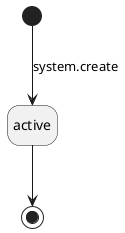
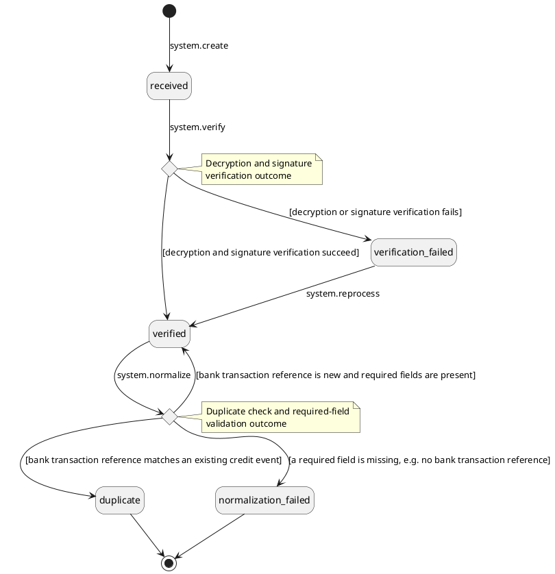
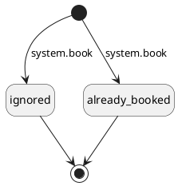

# PRD \- DBS P1: Incoming Fiat

## About the Document

### List of Personnel

| **Role** | **Name** |
| --- | --- |
| Product Manager | @Jordan Chong |
| Tech Lead | @Hossein Nasr Esfahan |
| Design | @Arfian |
| QA | @Widhi Putri |
| Stakeholder | \[TBD\] |

---

## Overview

### Release Note

- Clients can now view their own deposit instructions, including a unique virtual account number, directly on the platform instead of receiving them separately
- Fiat deposits are detected and credited automatically in most cases, without waiting on manual review
- A small number of deposits still need a closer look before they're credited, so nothing is credited automatically without a check when something looks unusual

---

### Problem Statement

Incoming fiat handling is fully manual today. Operators watch the DBS bank portal, book each incoming movement by hand with maker-checker approval, classify it to the right client account, and verify the depositor's name by eye. This is slow, does not scale with deposit volume, and depends on an operator noticing each transfer. Clients also have no way to see deposit instructions on the platform, so instructions are shared manually outside the system. The platform already has the fiat foundations (venues, movements, deposit transactions) from earlier phases, but no connection to the bank.

A legacy custody platform (v1) already receives DBS credit notifications for the same bank account. Some v1 clients will not migrate soon, so both platforms must run against the same bank account at the same time without losing or double-crediting deposits.

---

### Solution Overview

1. An operator enables VAN issuance on a fiat venue (a DBS bank account) and records its DBS corporate code.
2. When a client account is linked to that venue's group, the system generates a VAN and assigns it to the account.
3. The client selects a deposit currency and views the matching deposit instructions (VAN plus bank details) on the platform.
4. A depositor sends money to the VAN. DBS pushes a credit notification, which reaches the platform through the existing bank message router.
5. The bank connector decrypts and verifies the message, stores the raw payload, discards duplicates, and normalizes it into a single credit event format regardless of which notification channel it arrived on.
6. The platform books an incoming fiat movement automatically and resolves the VAN to the target account.
7. Every VAN-resolved credit is classified as a deposit automatically — the VAN determines the account. Depositor name verification then runs as the deposit's compliance check. On a match the deposit confirms and credits straight through.
8. If the depositor name is missing or does not match, the deposit is held before confirmation — the client sees it as pending. An operator reviews it and either confirms (optionally registering the depositor name as a depositor alias in the same approval) or rejects the deposit (maker-checker).
9. If the credit carries no VAN (it was sent directly to the master account) or an unknown VAN, the movement waits unclassified, visible on the existing incoming movements list, and the operator classifies it manually.
10. Credits addressed to v1 VANs are booked as `legacy_platform` movements. They auto-confirm, create no client transaction, and keep the venue balance equal to the true bank account balance. An operator can reclassify one back to unclassified when a depositor mistyped a VAN into the legacy format, so the existing manual classification flow can pick it up as a deposit.

**In scope:**

- Bank key material handling: reuse of the existing v1 PGP keys, stored in the platform's key management service
- VAN issuance configuration: a one-time, non-reversible enable action per venue, with maker-checker
- Deposit currency configuration: an operator sets the deposit method per currency (VAN-routed or direct to the master account) and optional routing details, independent of VAN issuance, with maker-checker
- VAN format is system-generated and distinguishable from legacy (v1) VANs by length alone, so both platforms can safely resolve credits against the same bank account
- Operator list and detail views of issued VANs — the platform is the system of record
- Automatic VAN issuance for accounts already linked to a venue group when that venue later becomes VAN-issuing
- The existing incoming movement create, list, and view operations are extended with the bank-context details captured on an automatically booked movement; the same details become optional fields on manual booking
- Duplicate protection across booking paths using the bank transaction reference, which becomes a required field on manual booking
- Depositor alias management: an operator-maintained, entity-level list of approved alternate depositor names, edited through maker-checker
- Reclassifying a `legacy_platform` movement back to unclassified requires maker-checker
- Basic operational visibility: counts of unclassified and name-match-failed movements, and signature verification failures
- UAT test support tooling (non-prod only): synthetic credit event injection and captured-notification replay, hard-disabled in production

---

### Out of Scope

| **Item** | **Reason** |
| --- | --- |
| Outgoing payments through the bank API (all rails) | Phase 2 of the banking integration |
| VAN registration with DBS (registration API and its KYC data requirements) | Unregistered VANs are supported by the bank; can be added later if the bank mandates it |
| Automated reconciliation against bank statements (intraday or end-of-day) | Deferred; manual booking and daily portal checks cover gaps |
| Refunding received deposits through the bank API | Deferred; handled manually. Bank references are stored for later use |
| Bank message router hardening (durable buffering, delivery replay) | Day-two work; delivery is assumed reliable in this phase |
| Migration of v1 VANs and v1 safe-name lists | Executed as a data migration when clients move platforms; not needed for launch |
| Other changes to the manual movement booking flow | Unchanged, except the bank transaction reference becomes required |
| Changing a venue's DBS corporate code once it is set | Immutable once set; changing it would need a supervised VAN re-issuance process, deferred |
| Disabling VAN issuance once it is enabled on a venue, and any edit to VAN issuance configuration | One-time, non-reversible action in this phase. Deposit currency configuration remains separately editable |
| Production operator tooling to replay stored raw messages (recovery/reprocessing use, in a live environment) | Good-to-have follow-up; the raw message log ships now so replay can be built later. Distinct from the UAT-only replay tool in In-Scope |
| Notification-silence alerting | Day-two; operations checks the bank portal directly for gaps |
| Automated compliance screening of depositors (KYT, sanctions) | Name verification is the only automated check in this phase; other screening is unchanged |

---

### Actors

- **Custody Client**: receives a VAN on their account and views deposit instructions on the platform. Sees their deposit transactions appear without operator involvement when the depositor name matches.
- **Custody Operator**: configures VAN issuance on venues, monitors the list of issued VANs, and resolves review exceptions on the existing incoming movements list. All configuration and alias changes go through maker-checker.
- **Depositor**: the party sending fiat to a client's VAN. May be the entity itself or a third party whose name differs from the entity's registered name.
- **DBS Bank**: pushes a credit notification for each incoming transfer. Retries a failed delivery exactly once. Provides no API to list issued VANs, which is why the platform keeps its own record of every VAN it issues.
- **Bank Message Router**: existing infrastructure that receives DBS notifications and forwards them. It sends all traffic to this platform and only v1-VAN traffic to the legacy platform.
- **Legacy Custody Platform (v1)**: continues to serve non-migrated clients on the same bank account. Its deposits appear on this platform only as `legacy_platform` movements.
- **QA / Engineering (non-prod only)**: uses the UAT test support tooling to exercise deposit scenarios and the notification-ingestion path without a live DBS connection. Not a production actor; has no access to this tooling once an environment is configured as prod.

---

### Assumptions & Dependencies

- The fiat foundations from earlier phases are live: fiat venues and venue groups, account-to-venue-group linking, the incoming movement pipeline with classification and confirmation, maker-checker, and balance service integration
- The bank message router exists and filters correctly: all credit notifications reach this platform, and only v1-VAN notifications reach v1. Router delivery is assumed reliable; hardening is deferred
- The existing v1 PGP key pair and the DBS public key are available for reuse; the bank supports unregistered VAN usage and multiple currencies on one corporate code
- v1 VAN bodies are 7-digit random numbers; v2 VAN bodies are 8 digits
- The depositor name, depositor account, and depositor bank fields on a credit notification are all optional at the bank level. A missing depositor name is a normal review case, not an error; a missing depositor account or depositor bank is simply carried empty
- A missed notification (both delivery attempts fail) is recovered through the existing manual booking flow, supported by a daily comparison against the bank portal
- Compliance review of the name matching rules runs in parallel with delivery; the rules may be amended after review
- For a single DBS bank account, VAN issuance and credit notification are always on together or both off; there is no state where one is on without the other
- A set of real, historical DBS credit notifications is available to seed the captured-notification replay tool. Scenario coverage beyond what those samples contain is provided by the synthetic credit event injector instead

---

### Glossary

| **Term** | **Definition** |
| --- | --- |
| VAN (virtual account number) | A unique account number assigned to one client account for receiving deposits. Money sent to it lands in the shared master bank account; the VAN identifies which client the deposit belongs to |
| Master account | The real DBS bank account (also called CASA) that physically holds the funds behind all VANs of a venue |
| Corporate code | A DBS-assigned code segment inside every VAN that ties it to the master account |
| Credit notification | A message DBS pushes when money arrives. Instant rails (e.g. FAST, PayNow) arrive in real time; non-instant rails (e.g. wires, RTGS) arrive during office hours on a separate channel |
| Credit event | The platform's normalized record of one incoming credit, identical in shape regardless of which notification channel delivered it |
| Bank transaction reference | The bank's unique reference for one credit. Used for duplicate detection. The depositor's own reference is not unique and is never used for this |
| Straight-through processing (STP) | A deposit that is booked, classified, and credited with no operator action |
| Depositor name verification | The check that the depositor's name matches the receiving entity before a deposit credits automatically |
| Name normalization | Cleaning a name before comparison: uppercase, punctuation and spacing cleanup, and removal of a fixed list of noise words such as titles (MR, MRS) and corporate suffixes (PTE, LTD) |
| Raw notification | The stored copy of one credit notification delivery, kept exactly as received. One exists per delivery, including duplicates and failed deliveries |
| Depositor alias | An operator-approved alternate depositor name registered on an entity (called a "safe name" on the legacy platform). Matches exactly or not at all |
| `legacy_platform` | Classification for a credit that belongs to the legacy platform. Booked for venue balance correctness only; creates no client transaction |
| Maker-checker | Approval workflow requiring two different operators: one to initiate, one to approve |
| Movement-led | Initiation mode where a movement is detected first and a transaction is created to explain it; used for deposits |

---

## Functional Requirements

### Section 1: VAN Issuance

Establish virtual account numbers (VANs) as the deposit routing mechanism: configure issuance on a fiat venue, generate and assign VANs to accounts, and give clients their deposit instructions.

#### FR-1: \[Operator\] Enable VAN Issuance on a Fiat Venue

**Requirement Details**

As an operator, I want to enable VAN issuance on a fiat venue and record its bank corporate code so that accounts linked to that venue's group can receive VANs.

**Precondition:** The fiat venue exists, is a bank venue, and its `venueProvider` is `dbs`.

**Main Flow:**

1. Operator opens the fiat venue configuration and enables VAN issuance by setting `vanEnabled: true` and supplying `dbsCorpCode`, the DBS corporate code tied to the venue's bank account, and `dbsVanPrefix`, the fixed digit prefix DBS puts at the start of every VAN it issues. This is a one-time, non-reversible action per venue (see Design Constraints).
2. System validates (see Validations).
3. A maker-checker request is created to enable VAN issuance. A second operator reviews and approves.
4. On approval, the system re-runs all validations (see Validations) and saves the configuration.
5. The venue is now VAN-issuing. Newly linked accounts receive VANs per FR-3; accounts already linked to the venue group receive VANs per FR-5, which also sets the venue's `pendingGeneration` flag until that backfill finishes. Deposit currencies for the venue are configured separately (FR-2).

The venue detail view surfaces `pendingGeneration` alongside `vanEnabled`, `dbsCorpCode`, and `dbsVanPrefix`, so an operator can see whether FR-5's backfill is still running.

**Validations:**

All checks run at both the maker and the checker step.

| **Check** | **Error Code** | **Error Message** |
| --- | --- | --- |
| Venue exists and is a fiat venue of bank type | `VENUE_NOT_FOUND` | Venue not found or not a bank venue |
| Venue's `venueProvider` is `dbs` | `INVALID_VENUE_REQUEST` | VAN issuance is only available for DBS venues |
| Venue's `vanEnabled` is not already `true` | `ALREADY_EXISTS` | VAN issuance has already been enabled for this venue |
| `dbsCorpCode` is exactly 3 numeric digits | `INVALID_FORMAT` | Corporate code must be a 3-digit number |
| `dbsVanPrefix` is exactly 3 numeric digits | `INVALID_FORMAT` | VAN prefix must be a 3-digit number |
| No other DBS venue in the same venue group has VAN issuance enabled | `ALREADY_EXISTS` | Another DBS venue in this venue group already issues VANs |
| `dbsCorpCode` is unique across VAN-issuing venues | `ALREADY_EXISTS` | Another venue already uses this corporate code |

**Design Constraints:**

- Exactly one DBS VAN-issuing venue is allowed per venue group. This keeps VAN assignment on account linking (FR-3) unambiguous. Today, an account can hold only a DBS VAN. A future phase could let other banks issue VANs to the same account. Downstream features must not assume an account has only one VAN. This is why deposit instructions return a list of entries, not a single entry (FR-6).
- Every bank-specific parameter includes the bank's name in its field name, for example `dbsCorpCode`. This way, a future bank's VAN parameters can use their own field names without conflicting with DBS's.  
  
**Mockups:**  
<https://www.figma.com/design/TGauoafjDX4bPaLNuC0asW/-FE-UI--Fiat-Venues-2.0--Operator-User-?node-id=2288-18967&t=qXW8CglIZi16yyBN-1>   

  

  

**Audit Log**

**Maker-Checker Convention:** FR-1, FR-2, FR-15's held-confirm path, FR-16, FR-17, and FR-19 are all gated by the platform's standard maker-checker flow. This is not a generic `mch_request:create`/`approve`/`reject` wrapper. The platform names each business operation twice instead:

- **On maker submission:** `&lt;operation&gt;_request` — recorded once, when the maker submits. Its `internalMetadata` is just `mchRequestId`: the maker-checker request record already stores the resource (type and ID) and the submitted payload, so this row doesn't restate them. Failures follow the same pattern: `&lt;operation&gt;_request` (failure), carrying `mchRequestId`, `errorCode`, `errorDetail`.
- **On checker approval:** `&lt;operation&gt;` — the bare business operation, with the real field-level values (before/after or the fields being set) — recorded once, when the checker approves.

There is no separate business-audit row when a checker rejects a request. The maker-checker request's own create/approve/reject lifecycle is tracked by the platform's maker-checker framework itself (a generic, resource-agnostic trail, separate from this business audit log) — a rejected request simply never reaches the "on approval" row.

> 🚩 **REVISIT:** `internalSecurityMetadata` was corrected from a guess (`ipAddress`, `userAgent`, `sessionId`) to `clientIp`, `userAgent`, `browser` — `sessionId` doesn't exist in the codebase, `browser` does (derived from User-Agent). Populated only for `operator`/`qa_engineering` actors (HTTP requests via Gin middleware); `system_user` rows correctly carry `—` (queue consumers, no HTTP request in scope).

Maker-checker gated (see Maker-Checker Convention above).

| **Operation** | **Scope** | `externalMetadata` | `internalMetadata` | `externalSecurityMetadata` | `internalSecurityMetadata` |
| --- | --- | --- | --- | --- | --- |
| `venue:enable_van_issuance_request` | `internal_business` | — | `mchRequestId` | — | `clientIp`, `userAgent`, `browser` |
| `venue:enable_van_issuance_request` (failure) | `internal_business` | — | `mchRequestId`, `errorCode`, `errorDetail` | — | `clientIp`, `userAgent`, `browser` |
| `venue:enable_van_issuance` | `internal_business` | — | `venueId`, `vanEnabled`, `dbsCorpCode`, `dbsVanPrefix` | — | `clientIp`, `userAgent`, `browser` |

---

#### FR-2: \[Operator\] Configure Deposit Currencies for a Venue

**Requirement Details**

As an operator, I want to set which currencies a fiat venue accepts and how each one is deposited so that clients see the right instructions for every currency.

**Precondition:** The venue is a fiat venue. The operator has venue configuration permission.

**Main Flow:**

1. Operator clicks **Edit Deposit Currencies** on the venue.
2. Operator supplies the full `currencyInstructions` map for the venue — one entry per currency this bank account accepts, keyed by currency code. One submission can add a new currency, edit an existing entry, or remove a currency by omitting it, in any combination. A currency whose current `depositMethod` is `van` cannot be removed this way (see Validations). Each entry carries a required `depositMethod` (`van` or `direct`, see Design Constraints) and an optional free-text `additionalInstructions` (e.g. intermediary bank information for USD wires).
3. System validates (see Validations).
4. A maker-checker request is created covering the whole submitted map, so adding, editing, or removing several currencies in one submission needs only a single approval. The request shows the before and after state of `currencyInstructions` so the checker can compare the diff. A second operator reviews and approves.
5. On approval, the system re-runs all validations (see Validations) and saves the configuration.

**Validations:**

All checks run at both the maker and the checker step.

| **Check** | **Error Code** | **Error Message** |
| --- | --- | --- |
| Every `currencyInstructions` key is a fiat currency defined in the asset catalogue | `UNSUPPORTED_VALUE` | One or more currencies are not recognised |
| Every `currencyInstructions` entry has a `depositMethod` | `MISSING_REQUIRED_FIELD` | Every supported currency needs a deposit method |
| A `depositMethod` of `van` requires VAN issuance to be enabled on the venue (FR-1) | `INVALID_ARGUMENT` | VAN deposit method requires VAN issuance to be enabled on this venue |
| No currency's `depositMethod` changes from `van` to `direct` | `INVALID_ARGUMENT` | A currency already issuing VANs cannot switch to direct deposit |
| No currency whose `depositMethod` is currently `van` is omitted from the submitted map | `INVALID_ARGUMENT` | A currency already issuing VANs cannot be removed |

**Design Constraints:**

- `depositMethod` on a `currencyInstructions` entry controls how deposit instructions are shown for that currency (FR-6). This lets a single venue mix VAN and non-VAN currencies, reflecting that DBS may enable VAN support for a currency only after this platform first supports it.
- A venue with no VAN issuance can still take direct deposits, since `currencyInstructions` can be configured on any fiat venue regardless of VAN issuance status.
- A currency's `depositMethod` may move from `direct` to `van` (the bank later turns VAN support on for that currency) but never from `van` back to `direct` in this phase — reverting would silently change deposit instructions a depositor may already be using, with no way to flag the change to them. For the same reason, a currency currently on `van` can never be removed from the map either: once a currency reaches `van`, its entry is permanent. A `direct` entry, which never had a live VAN, can be removed freely.
- `currencyInstructions` affects deposit instructions only (FR-6). It has no effect on how an incoming movement books or classifies (FR-9, FR-11).

**Example:**

```
{
  "currencyInstructions": {
    "USD": {
      "depositMethod": "van",
      "additionalInstructions": "For USD wires, route via intermediary: Citibank N.A. New York, SWIFT CITIUS33"
    },
    "SGD": { "depositMethod": "van" },
    "JPY": { "depositMethod": "direct" }
  }
}
```

This configuration supports three currencies (USD, SGD, JPY — the map's keys). USD and SGD deposit to the account's VAN; JPY has no VAN support yet and deposits directly to the venue's master account with a deposit reference (FR-6).  
  
**Mockups:**  
Add Deposit Currencies:  
<https://www.figma.com/design/TGauoafjDX4bPaLNuC0asW/-FE-UI--Fiat-Venues-2.0--Operator-User-?node-id=2298-28474&t=VoxR2HtC35nplDtJ-1> 

  
Edit Deposit Currencies:  
<https://www.figma.com/design/TGauoafjDX4bPaLNuC0asW/-FE-UI--Fiat-Venues-2.0--Operator-User-?node-id=2298-32530&t=VoxR2HtC35nplDtJ-1> 

**Audit Log**

Maker-checker gated (see Maker-Checker Convention above).

| **Operation** | **Scope** | `externalMetadata` | `internalMetadata` | `externalSecurityMetadata` | `internalSecurityMetadata` |
| --- | --- | --- | --- | --- | --- |
| `venue:configure_deposit_currencies_request` | `internal_business` | — | `mchRequestId` | — | `clientIp`, `userAgent`, `browser` |
| `venue:configure_deposit_currencies_request` (failure) | `internal_business` | — | `mchRequestId`, `errorCode`, `errorDetail` | — | `clientIp`, `userAgent`, `browser` |
| `venue:configure_deposit_currencies` | `internal_business` | — | `venueId`, `currencyInstructionsBefore`, `currencyInstructionsAfter` | — | `clientIp`, `userAgent`, `browser` |

---

#### FR-3: \[System\] Generate and Assign a VAN on Account Linking

**Requirement Details**

As the system, I want to generate and assign a VAN automatically when an account is linked to a VAN-issuing venue group so that the account can receive deposits without operator involvement.

**Precondition:** The venue group's venue has VAN issuance enabled (FR-1).

**Main Flow:**

1. The account link to the venue group is approved.
2. System generates an 8-digit VAN body of cryptographically random digits.
3. System composes the full VAN: the venue's `dbsVanPrefix` + `dbsCorpCode` + body (14 digits total).
4. System stores the VAN with status `active`, linked to the account and the venue.

**Alternate Flows:**

- Generated VAN collides with an existing one: the system regenerates and retries, up to a bounded number of attempts, then fails the assignment and records the failure for operator investigation.
- Account already holds an `active` VAN for this venue: the system keeps the existing VAN and does not generate a new one.

**Design Constraints:**

- Generation is idempotent per account-venue pair. Re-processing the same link event never produces a second VAN.
- The 8-digit body length is a platform invariant: it distinguishes this platform's VANs from the legacy platform's 7-digit bodies by length alone (see FR-13).
- VAN status values `pending`, `rejected`, and `closed` are reserved for a future bank-registration mode and are not used in this phase.

**Audit Log**

**Originating event:** `venue_group_link:create` (the account-to-venue-group linking flow's maker-checker approval, an earlier-phase feature outside this PRD, identified by the maker-checker resource `venue_group_link` and operation `CREATE`) · **Actor:** `operator` (checker)

That approval today produces only the generic maker-checker framework's own trail — there is no business-level audit row for the link itself. This PRD adds `venue_group_link:create`, recorded when the link is persisted, so VAN generation below has a real originating event to reference.

| **Operation** | **Scope** | `externalMetadata` | `internalMetadata` | `externalSecurityMetadata` | `internalSecurityMetadata` |
| --- | --- | --- | --- | --- | --- |
| `venue_group_link:create` | `internal_business` | — | `accountId`, `venueGroupId` | — | — |
| `van:create` | `internal_business` | — | `van`, `accountId`, `venueId` | — | — |
| `van:create` (failure) | `internal_business` | — | `accountId`, `venueId`, `errorCode`, `errorDetail` | — | — |

`venue_group_link:create`'s `internalSecurityMetadata` is empty because the approving operator's `clientIp`/`userAgent`/`browser` are captured on that earlier-phase flow's own `mch_request:approve` row, not duplicated here.

---

#### FR-4: \[Operator\] List and View Issued VANs

**Requirement Details**

As an operator, I want to list and inspect issued VANs so that I can verify assignments and investigate deposit routing questions.

**Precondition:** The operator has venue or account read permission.

**Main Flow:**

1. Operator opens the list of issued VANs and applies filters (see Filters).
2. System returns matching VANs with: full VAN, account (id and display), venue (id and display), status, and `createdAt`.
3. Operator opens one VAN to view these same fields in detail.

**Filters:**

| **Filter** | **Type** | **Allowed Values** |
| --- | --- | --- |
| VAN | text (partial match) | — |
| Accounts | id reference (multi) | any `accountIds` |
| Venues | id reference (multi) | any `venueIds` |
| Created at | date range (datetime) | — |

**Mockups:**  
<https://www.figma.com/design/lLcfXrnqWaIRk8Kt2Sjh3j/-FE-UI--Virtual-Account-Numbers--Operator-User-?node-id=26-8016&t=IFTMz6XgPgWUHeFI-1> 

---

#### FR-5: \[Operator/System\] Issue VANs to Already-Linked Accounts on a VAN-Issuing Venue

**Requirement Details**

As the system, I want to issue VANs to every account already linked to a venue group automatically in the background as soon as its venue becomes VAN-issuing, so that accounts receive VANs regardless of when they were linked, with no operator action needed to start or retry the run.

**Precondition:** VAN issuance is enabled on the venue (FR-1).

**Main Flow:**

1. The moment VAN issuance is approved on a venue (FR-1), the system sets the venue's `pendingGeneration` to `true` and starts a background run.
2. System finds all accounts linked to the venue's group that hold no `active` VAN for the issuing venue.
3. For each account, the system generates and assigns a VAN exactly as in FR-3, including validations and audit records. A failure on one account is caught and recorded (Prometheus); the run continues with the remaining accounts.
4. Once every account has been attempted, the system sets the venue's `pendingGeneration` back to `false`. This happens regardless of whether some accounts failed — a failed account doesn't hold the flag `true` waiting for resolution.

**Design Constraints:**

- This is a background process with no operator-facing trigger and no completion screen. `pendingGeneration` on the venue is the only progress signal, and it reflects whether the run is still working, not whether every account succeeded.
- This run is idempotent: accounts that already hold an `active` VAN are skipped, so a restarted or re-run process is always safe.
- No run-in-progress guard exists. There is only one way to start a run — VAN issuance approval — so the only overlap risk is the run itself restarting mid-flight (e.g. after a process restart); FR-3's per-account-venue uniqueness check makes a restart harmless — worst case is wasted work re-checking accounts already processed.
- The initial rollout is the same case: venues configured when this capability first ships are venues becoming VAN-issuing, so no separate launch backfill exists.
- Together, FR-3 (new links) and FR-5 (existing links) guarantee the invariant: every account linked to a VAN-issuing venue group holds an `active` VAN.
- Per-account failures are logged to Prometheus for engineering investigation; there is no operator-facing failure list in this phase.

**Audit Log**

**Originating event:** `venue:enable_van_issuance` (FR-1, automatic trigger right after approval) · **Actor:** `system_user`

| **Operation** | **Scope** | `externalMetadata` | `internalMetadata` | `externalSecurityMetadata` | `internalSecurityMetadata` |
| --- | --- | --- | --- | --- | --- |
| `van:create` | `internal_business` | — | `van`, `accountId`, `venueId` | — | — |
| `van:create` (failure) | `internal_business` | — | `accountId`, `venueId`, `errorCode`, `errorDetail` | — | — |

**Originating event:** operator presses "Generate VANs for accounts" on a VAN-issuing venue (manual trigger) · **Actor:** `operator`

| **Operation** | **Scope** | `externalMetadata` | `internalMetadata` | `externalSecurityMetadata` | `internalSecurityMetadata` |
| --- | --- | --- | --- | --- | --- |
| `van:create` | `internal_business` | — | `van`, `accountId`, `venueId` | — | `clientIp`, `userAgent`, `browser` |
| `van:create` (failure) | `internal_business` | — | `accountId`, `venueId`, `errorCode`, `errorDetail` | — | `clientIp`, `userAgent`, `browser` |

---

#### FR-6: \[Client\] View Deposit Instructions by Currency

**Requirement Details**

As a client, I want to select a deposit currency and view the matching deposit instructions so that I send funds to the right bank account with the right routing details for that currency.

**Precondition:** The client is authenticated and the account belongs to the client. The account is linked to at least one fiat venue group.

**Main Flow:**

1. Client retrieves the account's supported deposit currencies: the union of `currencyInstructions` keys across the fiat venues of the account's linked venue groups.
2. Client requests deposit instructions for the account with a required `currency`.
3. System validates (see Validations).
4. System returns one instruction entry per linked fiat venue that supports the currency. The entry's `depositMethod` is read from the venue's `currencyInstructions` for that currency:
    1. `van`: the account number to pay to is the account's full VAN at that venue.
    2. `direct`: the account number to pay to is the venue's master bank account number, and the entry additionally carries a deposit reference — the account's existing account number — that the depositor must key in with the transfer.
5. Every entry contains: the bank's name, the account number to pay to (per the rule above), the venue's beneficiary name (the account name a depositor enters), the bank's identifying codes (e.g. SWIFT/BIC), the bank's address, the deposit reference (only when `depositMethod` is `direct`), and the venue's `currencyInstructions.additionalInstructions` text for that currency when configured.
6. The client can see one or more deposit instruction entries per currency, one per linked venue that supports it. It is up to the client to choose which one to use.  
  
**Mockups:**  
<https://www.figma.com/design/OQPigv76tmAkDMlNTqJBhd/-FE-UI--Deposit-Fiat--Client-?node-id=379-11435&t=BmHfrSNth7OurN4H-1>   

   

   

   

   

**Validations:**

| **Check** | **Error Code** | **Error Message** |
| --- | --- | --- |
| Account is linked to at least one fiat venue group | `RECORD_NOT_FOUND` | No deposit instructions are available for this account yet |
| `currency` has a `currencyInstructions` entry on at least one of the account's linked fiat venues | `UNSUPPORTED_VALUE` | Deposits in this currency are not supported for this account |

**Design Constraints:**

- Instructions are read-only and derived entirely from the account's venue-group links and venue configuration at request time. Nothing is stored per request, and there is no history of past instructions shown to the client.
- The response is a list: a currency served by several linked fiat venues returns one entry per venue, and the client chooses which bank to pay.
- A `direct` entry's deposit reference is always the account's own account number, never the VAN, even when the account also holds an active VAN at that venue for a different currency.
- `bankAddress` is optional, matching the venue's own `bankAddress` field; it is omitted from the response when the venue has none configured.

**Examples:**

Step 1 — the client retrieves the currencies available for deposit:

```
GET /accounts/{accountId}/deposit-currencies

{
  "payload": ["SGD", "USD", "EUR", "JPY"],
  "totalRecords": 4,
  "limit": 100,
  "offset": 0
}
```

Step 2 — the client selects a currency and retrieves the matching instructions:

```
GET /accounts/{accountId}/deposit-instructions?currency=USD

{
  "payload": [
    {
      "bankName": "DBS Bank Ltd",
      "accountNo": "88512045678913",
      "beneficiaryName": "XYZ Custody Services Pte Ltd",
      "swiftBicCode": "DBSSSGSG",
      "bankAddress": "12 Marina Boulevard, Marina Bay Financial Centre, Singapore 018982",
      "additionalInstructions": "For USD wires, route via intermediary: Citibank N.A. New York, SWIFT CITIUS33"
    }
  ],
  "totalRecords": 1,
  "limit": 100,
  "offset": 0
}
```

`accountNo` is the account's full VAN. `bankAddress` is the venue's bank address, shown to the client alongside the SWIFT/BIC code, and is omitted when the venue has none configured. `additionalInstructions` is the venue's `currencyInstructions` text for the selected currency and is omitted when none is configured. A currency supported by several linked fiat venues returns one entry per venue:

```
GET /accounts/{accountId}/deposit-instructions?currency=USD

{
  "payload": [
    { "bankName": "DBS Bank Ltd", "accountNo": "88512045678913", "...": "..." },
    { "bankName": "Maybank Singapore Ltd", "accountNo": "77031234567890", "...": "..." }
  ],
  "totalRecords": 2,
  "limit": 100,
  "offset": 0
}
```

A currency whose `depositMethod` is `direct` (e.g. JPY, where this DBS venue has not turned on VAN support) returns the master account number and a deposit reference instead of a VAN:

```
GET /accounts/{accountId}/deposit-instructions?currency=JPY

{
  "payload": [
    {
      "bankName": "DBS Bank Ltd",
      "accountNo": "0123456789",
      "beneficiaryName": "XYZ Custody Services Pte Ltd",
      "swiftBicCode": "DBSSSGSG",
      "bankAddress": "12 Marina Boulevard, Marina Bay Financial Centre, Singapore 018982",
      "depositReference": "A-1234-5678-1234-0"
    }
  ],
  "totalRecords": 1,
  "limit": 100,
  "offset": 0
}
```

`accountNo` here is the venue's master bank account number, not a VAN. `depositReference` is the account's own account number; the depositor must include it with the transfer so operations can match the credit manually (see FR-14).

---

### Section 2: Credit Notification Ingestion

Receive DBS credit notifications through the bank message router, secure and store them, and turn them into one normalized credit event format.

Three records are involved, each with a distinct job:

| **Record** | **Created by** | **Contents** | **Purpose** |
| --- | --- | --- | --- |
| Raw notification | FR-7 — one per delivery | The payload exactly as delivered (still encrypted), plus received timestamp, channel, and a processing status | Permanent evidence of every delivery. Nothing is ever lost, even when processing fails. Duplicates and failures stay visible here |
| Credit event | FR-8 — one per unique credit | The parsed, normalized business fields: amount, currency, rail, VAN, depositor details, bank references | The channel-agnostic input to movement booking. Duplicate deliveries never reach this record |
| Incoming movement | FR-9 — one per credit event | The custody movement, following the existing incoming movement model | Drives classification, review, and the ledger booking |

The raw notification and the credit event are owned and stored by this platform's bank connector. The incoming movement lives in the existing movement pipeline. The three are linked by reference: a credit event records the raw notification it was derived from, a duplicate delivery's raw notification points to the credit event it duplicates, and a movement records its credit event — so any booked deposit traces back to the exact bytes the bank delivered.

The bank connector (FR-7, FR-8) and the movement pipeline (FR-9 onward) split the work along a facts-versus-decisions line. The bank connector only states facts about what arrived: the decrypted payload, and the raw VAN string located in it (if any). It never resolves that VAN's format, never looks up which account it belongs to, and never decides how a credit should be classified. Those decisions — format resolution, the VAN-to-account lookup, and classification — belong entirely to the movement pipeline, and apply the same way to a VAN keyed in manually (FR-10) as to one located in a bank notification.

Token deposits use a related but not identical split. The token connector resolves a deposit address to its wallet using mapping data pushed to it in advance, at address-creation time, so that lookup is a pre-loaded cache read, not a live decision. A VAN has no equivalent advance channel: it is generated and stored entirely inside this platform. Resolving a VAN to its account can only be a live lookup against the platform's own list of issued VANs. This is exactly the kind of decision the facts-versus-decisions split keeps out of the bank connector.

Example credit event (illustrative):

```
{
  "bankReference": "DBS20260712IRT0012345",
  "endToEndRef": "INV-2026-0871",
  "van": "88512045678913",
  "masterAccountNo": "0123456789",
  "amount": "25000.00",
  "currency": "SGD",
  "rail": "fast",
  "channel": "instant",
  "depositorName": "JOHN JAMES SMITH",
  "depositorAccountNo": "0012345678",
  "depositorBankId": "OCBCSGSG",
  "valueDate": "2026-07-12",
  "notifiedAt": "2026-07-12T03:15:42Z"
}
```

#### FR-7: \[Bank\] Receive and Acknowledge a Credit Notification

**Requirement Details**

As the bank (via the bank message router), I want to deliver a credit notification and receive a fast acknowledgment so that delivery is not retried unnecessarily.

**Precondition:** The platform's notification endpoints are registered with the router. PGP key material is configured.

**Main Flow:**

1. A notification arrives on one of two channels: instant (real-time rails) or intraday (non-instant rails, office hours).
2. System persists the raw payload immediately as a raw notification in the bank connector's own store, with: received timestamp, channel, and processing status `received`.
3. System acknowledges with HTTP 200.
4. Asynchronously, the system decrypts the payload with the platform's private key and verifies the bank's signature.
5. On success, the raw notification moves to processing status `verified` and continues to FR-8.

**Alternate Flows:**

- Persisting the raw notification fails: the system responds with a server error so the sender retries. Nothing else is processed.
- Decryption or signature verification fails: the raw notification moves to processing status `verification_failed` and processing stops. This failure mode is a key or routing misconfiguration, so it is an engineering concern, not an operator workflow — no operator screen exists for it. The payload is retained for forensics. A reprocess action re-attempts decryption and verification against the retained payload once the configuration is fixed, moving it forward to `verified` (and on into FR-8) without the bank needing to redeliver it.

**Design Constraints:**

- Acknowledgment always follows successful raw persistence, never full processing. The bank retries a failed delivery exactly once, so slow processing must never cost the retry. Refusing a delivery on decryption failure would gain nothing: a decryption failure is a configuration fault on the receiving side, so the bank's retry of the identical payload would fail identically — holding the payload and fixing the configuration is the only path that recovers the deposit.
- The raw payload log is append-only and keeps every delivery, including duplicates and failures. It is the recovery source if replay tooling is added later.
- The raw notification's processing status is a single field, overwritten at each transition, never holding more than one value at a time: `received` (this FR) → `verified` or `verification_failed` (this FR) → `duplicate` or `normalization_failed` (FR-8).
- Verification failures are exported as a Prometheus metric to the engineering team's dashboard, with an alert configured on that metric so a spike is caught proactively rather than only found by someone checking.
- 🚩 **REVISIT:** PGP key provisioning and rotation ownership need engineering confirmation — who generates the keypair, how the public key exchange with DBS happens, and whether a planned key rotation risks a verification-failure window before the new key propagates.
- 🚩 **REVISIT:** Verification failure is stated above as an engineering concern with no operator screen, but a reprocess action still exists to re-attempt decryption/verification. This requirement does not say who or what triggers reprocess (an operator action, an engineering script, or an automated retry) — the audit log assumes actor `operator` pending confirmation.

**Audit Log**

**Originating event:** `raw_notification:create` · **Actor:** `system_user` (bank connector — DBS delivery is an external, unrecorded trigger)

| **Operation** | **Scope** | `externalMetadata` | `internalMetadata` | `externalSecurityMetadata` | `internalSecurityMetadata` |
| --- | --- | --- | --- | --- | --- |
| `raw_notification:create` | `internal_business` | — | `rawNotificationId`, `channel`, `receivedAt` | — | — |
| `raw_notification:create` (failure) | `internal_business` | — | `errorCode`, `errorDetail` | — | — |
| `raw_notification:process` | `internal_business` | — | `rawNotificationId`, `status=verified` | — | — |
| `raw_notification:process` (failure) | `internal_business` | — | `rawNotificationId`, `status=verification_failed`, `errorCode`, `errorDetail` | — | — |

**Originating event:** `raw_notification:process` (reprocess path) · **Actor:** `operator` (assumed — see FR-7's Design Constraints in requirements.md)

| **Operation** | **Scope** | `externalMetadata` | `internalMetadata` | `externalSecurityMetadata` | `internalSecurityMetadata` |
| --- | --- | --- | --- | --- | --- |
| `raw_notification:process` | `internal_business` | — | `rawNotificationId`, `previousStatus`, `newStatus` | — | `clientIp`, `userAgent`, `browser` |

---

#### FR-8: \[System\] Deduplicate and Normalize a Credit Notification into a Credit Event

**Requirement Details**

As the system, I want to convert each verified notification into one normalized credit event and discard duplicates so that downstream booking is channel-agnostic and never double-credits.

**Precondition:** The raw notification is in processing status `verified` (FR-7).

**Main Flow:**

1. System parses the decrypted payload and extracts the bank transaction reference.
2. System checks for a duplicate: a credit event with the same bank transaction reference already exists.
3. System normalizes the payload into a credit event — a new record, separate from the raw notification (see the Section 2 overview) — holding: amount and currency (ISO alpha code, decimal handling corrected per currency), rail, channel, depositor details (name, account, bank), remittance information, bank references, the receiving `masterAccountNo` (the bank account the credit landed in), and timestamps converted to UTC.
4. System locates the VAN in the payload and hands it forward on the credit event as a raw string, unclassified. The two channels carry it in different fields; the normalizer resolves this so the credit event has a single VAN field. A credit sent directly to the master account carries no VAN; the credit event's VAN field is null, but `masterAccountNo` is always present. VAN format resolution happens once, in the movement pipeline (FR-9), the same shared logic a manually-keyed VAN goes through (FR-10).
5. System stores the credit event and hands it to movement booking (FR-9).

**Validations:**

| **Check** | **Error Code** | **Error Message** |
| --- | --- | --- |
| Bank transaction reference is present | `MISSING_REQUIRED_FIELD` | Notification has no bank transaction reference |

**Alternate Flows:**

- Duplicate bank transaction reference: the raw notification is marked `duplicate` and processing stops. No credit event is created.
- Bank transaction reference is missing (the one check in Validations above): the raw notification is marked `normalization_failed` for operator investigation. No credit event is created; the deposit is recoverable through the existing manual booking flow.

**Design Constraints:**

- The duplicate check uses the bank transaction reference only. The depositor's own reference legitimately repeats (e.g. the same payer paying twice) and must never be used for deduplication.
- Deduplication is enforced with a uniqueness guarantee at storage level, so two concurrent deliveries of the same notification cannot both create a credit event.
- This FR deduplicates deliveries of the same notification. A second, independent guard exists at movement level (FR-9) for the case where the same underlying credit was already booked through a different path, such as a manual booking.
- The credit event has the same shape whether it came from an instant notification or an intraday notification. No step after this FR may treat the two channels differently.

**Audit Log**

**Originating event:** `raw_notification:process` (FR-7) · **Actor:** `system_user`

| **Operation** | **Scope** | `externalMetadata` | `internalMetadata` | `externalSecurityMetadata` | `internalSecurityMetadata` |
| --- | --- | --- | --- | --- | --- |
| `credit_event:create` | `internal_business` | — | `bankReference`, `endToEndRef`, `amount`, `currency`, `rail`, `channel`, `depositorName`, `depositorAccountNo`, `depositorBankId`, `masterAccountNo`, `van`, `valueDate` | — | — |
| `credit_event:create` (failure) | `internal_business` | — | `rawNotificationId`, `errorCode`, `errorDetail` | — | — |
| `raw_notification:update` | `internal_business` | — | `rawNotificationId`, `status` (`duplicate` or `normalization_failed`), `duplicateOfCreditEventId`, `errorDetail` | — | — |

---

### Section 3: Automatic Movement Booking & Classification

Book every credit event as an incoming movement, classify VAN-resolved credits automatically, verify the depositor's name and confirm or hold accordingly, book legacy-platform credits for balance correctness, and leave everything else unclassified for manual review.

#### FR-9: \[System\] Book an Incoming Movement from a Credit Event

**Requirement Details**

As the system, I want to book an incoming movement for every credit event so that each bank credit is represented in the movement pipeline with full bank context.

**Precondition:** A credit event exists (FR-8). The credit event's `masterAccountNo` resolves to a fiat venue.

**Main Flow:**

1. System creates an incoming movement in status `detected`, classification `unclassified`, at the resolved venue.
2. The movement carries the bank context from the credit event: depositor name, depositor account and bank, bank transaction reference, depositor reference, rail, channel, amount, currency, and the raw VAN string (if the credit carries one). The existing `transactedAt` field is set to the credit event's value date. These fields — new and existing — are exposed on the incoming movement create, list, and view operations (FR-10).
3. System resolves the VAN's format by digit length. This is the one shared resolution point for every movement, whether the VAN came from a credit event or was keyed in manually on the existing booking action (FR-10): 14 digits is this platform's format, 13 digits is the legacy platform's format, any other length — or no VAN at all — resolves to none.
4. The movement proceeds to classification (FR-11) and, for VAN-resolved credits, depositor name verification (FR-12). Legacy-platform credits classify differently (FR-13).

**Alternate Flows:**

- `masterAccountNo` does not correspond to a fiat venue on this platform: the credit belongs to another platform sharing the bank relationship. The credit event is marked `ignored` and no movement is created; the raw notification remains available if the account is later configured as a venue. This differs from the `legacy_platform` case (FR-13), which applies to legacy-platform VANs arriving on a master account this platform does model.
- An incoming movement already exists at the venue with the same bank transaction reference (e.g. an operator booked the credit manually before the notification arrived): no second movement is created. The credit event is linked to the existing movement and marked `already_booked`, so the notification is accounted for without double-crediting.

**Design Constraints:**

- One credit event produces at most one movement. The credit event stores the created movement's id, and booking is idempotent on the credit event.
- The movement-level duplicate guard matches on the bank transaction reference within the venue. To make the guard reliable, the existing manual booking flow enforces the field at every fiat venue: booking an incoming movement without a bank transaction reference is rejected with `MISSING_REQUIRED_FIELD`. The manual flow is otherwise unchanged.
- Bank references are stored on the movement from day one. Future refund and reconciliation features depend on them, and the bank can only locate an original credit within a limited window.
- Depositor account, depositor bank, depositor reference, rail, and channel do not exist on movements for other asset types.
- Depositor account and depositor bank are supplied by the bank and are not always present on a notification. When absent, the movement carries them empty. This is the same treatment as a missing depositor name (FR-12).
- Resolving `masterAccountNo` to a venue must be an exact match on the venue's own bank account number, not a partial or "contains" match. This is a new lookup; it must not be built by reusing an existing partial-match search filter. 🚩 **REVISIT:** a similar partial-match pattern already exists for incoming token movements. Engineering should confirm this exact-match lookup is not built on top of that pattern by mistake.  
  
**Audit Log**

**Originating event:** `credit_event:create` (FR-8) · **Actor:** `system_user`

| **Operation** | **Scope** | `externalMetadata` | `internalMetadata` | `externalSecurityMetadata` | `internalSecurityMetadata` |
| --- | --- | --- | --- | --- | --- |
| `incoming_movement:create` | `internal_business` | — | `venueId`, `assetId`, `amount`, `depositorName`, `depositorAccountNo`, `depositorBankId`, `bankReference`, `depositorReference`, `rail`, `channel`, `transactedAt`, `creditEventId` | — | — |
| `credit_event:update` | `internal_business` | — | `creditEventId`, `status` (`ignored` or `already_booked`), `masterAccountNo`, `movementId` | — | — |
| `incoming_movement:create` (failure) | `internal_business` | — | `creditEventId`, `errorCode`, `errorDetail` | — | — |

---

#### FR-10: \[Operator\] Updates on Create, List and View Incoming Movement

**Requirement Details**

As an operator, I want the existing incoming movement create, list, and view operations to carry the same bank context fields as an automatically booked movement so that a manually booked deposit can record the same detail, and every fiat movement shows the same information regardless of how it was booked.

**Precondition:** The existing incoming movement create, list, and view operations (built in an earlier phase) are live.

**Main Flow:**

1. The existing manual "book incoming movement" action gains new optional fields, matching what an automatically booked movement receives from a credit event (FR-9): `van`, `depositorAccountNo`, `depositorBankId`, `depositorReference`, `rail`, and `channel`. `depositorName`, the bank transaction reference (`bankReference`), and `transactedAt` are existing fields on this action and stay unchanged.
2. If the operator supplied a `van`, the system runs it through the same shared resolution FR-9 applies to every movement, whether the VAN came from a credit event or was keyed in here: 14 digits is this platform's format, 13 digits is the legacy platform's format, any other length resolves to nothing. The format is computed at the time of booking; it is not stored as a separate field.
    - A 14-digit `van` that matches an issued VAN: the movement classifies and runs the compliance sequence exactly as an automatically booked credit does (FR-11, FR-12) — confirming immediately on a name match and an active destination account, or holding for operator review otherwise.
    - A 13-digit `van`: the movement classifies `legacy_platform` and confirms immediately, exactly as FR-13 does for the automatic path.
    - Any other case — no `van` supplied, a `van` of some other length, or a 14-digit `van` matching no issued VAN — the movement stays `unclassified`, unchanged from today, for the operator to classify manually.
3. The existing incoming movements list and detail return all of the fields above, new and existing, for every fiat movement, whether booked automatically (FR-9) or manually. A movement booked through the automatic path also carries `creditEventId`, a reference to the credit event it came from. A manually booked movement carries this field as null, since it has no credit event.
4. `nameMatchStatus` and `nameMatchFailureReason` are also visible on the list and detail, added separately by FR-14.

**Design Constraints:**

- Every new manual-entry field is optional. An operator manually booking a movement from a bank statement often does not have the depositor's account number or bank identifying code on hand, and the platform must not block a booking on data the operator cannot supply.
- `depositorAccountNo` and `depositorBankId` carry the same format rules whether entered manually or populated automatically (see schema.md): an absent value is always represented as null, never as an empty string.
- There is no validation of a manually entered `van` against anything, and no separate field for its format. The operator keys in whatever the bank statement shows. If the depositor themselves used the wrong VAN, the operator enters that same wrong value, and the system simply does not resolve it — the same outcome as any other non-matching VAN.  
  
**Mockups :**  
**Book Incoming Movement (Updated Version)**  
<https://www.figma.com/design/BNQK1sOo3nOz3viRCk8LNk/-FE-UI--Incoming-Fiat-Movement--Operator-User-?node-id=575-45957&t=1vHcequHSumFSGCb-1> 

  

  

  **Incoming Movement Details (Updated Version)**  
<https://www.figma.com/design/BNQK1sOo3nOz3viRCk8LNk/-FE-UI--Incoming-Fiat-Movement--Operator-User-?node-id=574-39352&t=1vHcequHSumFSGCb-1> 

  

  

**Audit Log**

No new audit operations for the create/list/view surface itself. `incoming_movement:list` and `incoming_movement:view` are read operations and are not audited, consistent with the platform's audit policy — none of FR-4, FR-6, FR-14, or FR-18 (also read operations) carry an audit section either.

When a manually-keyed `van` resolves (FR-9's shared resolution), this action fans out the same `incoming_movement:classify`, `incoming_movement:confirm`, and `unified_deposit:create`/`unified_deposit:update` rows FR-11/FR-12/FR-13 document. Those rows carry a conditional actor — `system_user` for the bank-notification path (FR-9), `operator` for the manual-booking path (FR-10) — with `internalSecurityMetadata` populated only on the `operator` variant, per the fan-out rule (security metadata follows the request context through the synchronous chain — see FR-1's Maker-Checker Convention note). See FR-11/FR-12/FR-13 below.

---

#### FR-11: \[System\] Classify a VAN-Resolved Credit

**Requirement Details**

As the system, I want to classify every VAN-resolved credit as a deposit automatically so that clean deposits move forward without operator involvement, and leave every other credit unclassified for manual review.

**Precondition:** A movement was booked and its VAN format resolved (FR-9), whether the VAN came from a credit event or was keyed in manually (FR-10).

**Main Flow:**

1. If the movement's VAN resolved to an account (a `platform`-format VAN, FR-9), the system classifies the movement as `deposit` with the resolved account as destination. This happens for every VAN-resolved credit, regardless of the eventual name-check outcome (FR-12): the VAN alone determines where the deposit belongs.
2. A deposit transaction is created movement-led in status `processing` and linked to the movement. `↑ Expected Client Account`; the client sees the pending deposit.
3. Depositor name verification runs next as the deposit's compliance check (FR-12).

**Alternate Flows:**

- The credit carries no VAN (sent directly to the master account) or a VAN that does not resolve to an account (an unrecognised length, or a 14-digit VAN that matches no issued VAN): the movement stays in status `detected`, classification `unclassified`. No transaction is created and the client sees nothing. The operator classifies it manually through the existing manual classification flow, using the depositor details already on the movement (FR-9). This is a normal, expected path — some depositors legitimately pay the master account directly.

**Design Constraints:**

- Classification answers where the money belongs; the name check (FR-12) answers whether it may be released. Separating the two mirrors the token deposit pipeline, where compliance checks (KYT, travel rule) run after classification and gate confirmation. Name verification is the fiat deposit's compliance check, and future fiat checks (if any) slot into the same stage.

**Audit Log**

**Originating event:** `incoming_movement:create` (FR-9, bank notification) or the manual booking action (FR-10, when a manually-keyed VAN resolves) · **Actor:** `system_user` (bank notification, FR-9) / `operator` (manual booking, FR-10)

| **Operation** | **Scope** | `externalMetadata` | `internalMetadata` | `externalSecurityMetadata` | `internalSecurityMetadata` |
| --- | --- | --- | --- | --- | --- |
| `incoming_movement:classify` | `internal_business` | — | `movementId`, `classification=deposit`, `destinationAccountId` | — | — / `clientIp`, `userAgent`, `browser` |
| `unified_deposit:create` | `external_business` | `depositId`, `status=processing`, `amount`, `assetTokenId` | `depositId`, `status=processing`, `amount`, `assetTokenId` | — | — / `clientIp`, `userAgent`, `browser` |
| `incoming_movement:classify` (failure) | `internal_business` | — | `movementId`, `errorCode`, `errorDetail` | — | — / `clientIp`, `userAgent`, `browser` |

`internalSecurityMetadata` pairs with the Actor line above in order: `—` for `system_user`, `clientIp`/`userAgent`/`browser` for `operator`.

> 🚩 **REVISIT:** All `unified_deposit:*` rows in this document were corrected against the actual metadata builder (`depositAuditMetadata`, shared by every deposit-status transition). Only two operations exist on this model: `unified_deposit:create` (this row) and `unified_deposit:update` (every subsequent status change — confirm/complete, reject). There is no per-action `unified_deposit:complete` or `unified_deposit:reject` operation; the transition shows up only in the `status`/`previousStatus` field values. Fields are also corrected to what the builder actually emits — `depositId`, `status`, `amount`, `assetTokenId`, plus `previousStatus` and `externalComment` where the transition carries them — dropping the invented `accountId`/`currency` fields. `movementId` is dropped from these rows: the deposit row is linked back to its movement via the shared originating event (see FR-1's Maker-Checker Convention note), not a duplicated field, so restating it here would be the same category of redundancy as the earlier `traceId` fix. Internal and external metadata carry identical field names on this model — they differ only in that `status`/`previousStatus` are remapped to client-facing labels on the external bucket, which this table can't show since it lists fields, not values.

---

#### FR-12: \[System\] Verify Depositor Name, Confirm or Record Failure

**Requirement Details**

As the system, I want to compare the depositor's name against the receiving entity's name and approved depositor aliases, and confirm or hold the deposit based on the result, so that only deposits from matching names credit automatically and every exception stays visible until an operator resolves it.

**Precondition:** The movement has been classified as `deposit`, so the receiving entity is known — by automatic classification (FR-11) or the existing manual classification flow, which also picks up a movement after reclassification (FR-19) resets it to `unclassified`.

**Main Flow:**

1. System normalizes the depositor name, the entity's registered name, and its depositor aliases: uppercase, Unicode normalization, punctuation stripped, whitespace collapsed.
2. System applies the match rules in order and stops at the first pass:
    1. Exact match between normalized depositor name and normalized entity name.
    2. Word-rearrangement match against the entity name: the same words in any order (`SMITH JOHN` matches `JOHN SMITH`).
    3. Exact match against any normalized depositor alias on the entity.
3. On a pass, system records `nameMatchStatus: passed`. Confirmation is also subject to the existing account-status gate that already applies to every incoming movement confirmation on this platform, for every asset type: if the destination account is `active`, the system confirms the movement in the same action: movement `detected` → `confirmed`, transaction `processing` → `completed`, journal entry `DR Deposit Suspense / CR Client Account`, `↓ Expected Client Account`. If the account is not `active`, the movement stays `detected` even though the name matched, with no client-visible signal that anything is blocked.
4. On a fail, system records `nameMatchStatus: failed` with `nameMatchFailureReason` set. The movement doesn't confirm: it stays `detected` with its transaction in `processing`.

**Alternate Flows:**

- Depositor name is absent from the credit event: `nameMatchStatus` is `failed` with `nameMatchFailureReason` set to `missing_depositor_name`. No matching is attempted.
- Once the account is reactivated, an operator confirms the movement again through the manual confirm action (FR-15).

**Design Constraints:**

- The account-status gate is inherited unchanged from the platform's existing confirmation flow, which already checks account status for every asset type.
- If the name match fails, it will require manual ops review. There is no automatic retry for the name match.
- Word rearrangement applies to the entity name only, never to aliases. An alias is an exact, deliberately approved literal.
- The compliance stage is uniform across classification modes. A deposit can be classified automatically by VAN (FR-11) or manually by an operator, including after reclassification (FR-19) resets a movement to `unclassified`. Either way, the same sequence follows: name verification, then automatic confirmation on a pass (subject to the account-status gate), or a hold on a fail. The manual confirm action (FR-15) handles both a failed name match and a passed match blocked by the account-status gate. This keeps one flow to build and maintain, and lets future classification modes, for example automatic classification by deposit reference for other banks, inherit the compliance gate with no new design.

**Examples:**

Entity name: `John Smith`. Registered depositor alias: `JOHN JAMES SMITH`.

| **Depositor name on the notification** | **After normalization** | **Outcome** |
| --- | --- | --- |
| `john smith.` | `JOHN SMITH` | Pass — rule 1, exact match on entity name |
| `Smith John` | `SMITH JOHN` | Pass — rule 2, same words in a different order |
| `John James Smith` | `JOHN JAMES SMITH` | Pass — rule 3, exact match on the alias |
| `James John Smith` | `JAMES JOHN SMITH` | Fail → review. It rearranges the alias, not the entity name, and aliases match exactly only |
| `J. Smith` | `J SMITH` | Fail → review. Not an exact match or a rearrangement |

Corporate example: entity `Acme Trading Pte Ltd` and depositor `ACME TRADING PTE. LTD.` both normalize to `ACME TRADING PTE LTD` — pass, rule 1.

**Audit Log**

**Originating event:** `incoming_movement:classify` (FR-11, bank notification, or the existing manual classification flow outside this PRD) or the manual booking action (FR-10, when a manually-keyed VAN resolves) · **Actor:** `system_user` (bank notification, FR-9/FR-11) / `operator` (manual booking, FR-10)

| **Operation** | **Scope** | `externalMetadata` | `internalMetadata` | `externalSecurityMetadata` | `internalSecurityMetadata` |
| --- | --- | --- | --- | --- | --- |
| `incoming_movement:confirm` | `internal_business` | — | `movementId`, `previousStatus=detected`, `newStatus=confirmed` | — | — / `clientIp`, `userAgent`, `browser` |
| `unified_deposit:update` | `external_business` | `depositId`, `status=completed`, `amount`, `assetTokenId`, `previousStatus` | `depositId`, `status=completed`, `amount`, `assetTokenId`, `previousStatus` | — | — / `clientIp`, `userAgent`, `browser` |

`internalSecurityMetadata` pairs with the Actor line above in order: `—` for `system_user`, `clientIp`/`userAgent`/`browser` for `operator`.

---

#### FR-13: \[System\] Classify and Confirm Legacy-Platform Credits

**Requirement Details**

As the system, I want to book credits addressed to legacy-platform VANs as legacy-platform movements so that the venue balance equals the true bank account balance while both platforms share the master account.

**Precondition:** A movement was booked and its VAN classified as legacy-platform by length (13 digits, FR-9), whether the VAN came from a credit event or was keyed in manually (FR-10).

**Main Flow:**

1. System classifies the movement as `legacy_platform`. No client transaction is created and no client or expected balance is touched.
2. System confirms the movement automatically: status `detected` → `confirmed`.
3. Confirmation posts the journal entry `DR Deposit Suspense / CR Legacy Platform Suspense`, clearing the suspense established at booking (FR-9). The venue balance stays equal to the true bank account balance; Legacy Platform Suspense holds the value belonging to the legacy platform's clients.

**Design Constraints:**

- `legacy_platform` movements are never visible to the client. They exist for venue balance correctness only.
- Confirmation is always automatic. Legacy-VAN traffic is high-volume, so holding it for manual confirmation would flood the operator queue. The correction path for a credit that lands here wrongly — a depositor mistyping a platform VAN into a 13-digit number — is reclassification (FR-19).

**Audit Log**

**Originating event:** `incoming_movement:create` (FR-9, bank notification) or the manual booking action (FR-10, when a manually-keyed VAN resolves) · **Actor:** `system_user` (bank notification, FR-9) / `operator` (manual booking, FR-10)

| **Operation** | **Scope** | `externalMetadata` | `internalMetadata` | `externalSecurityMetadata` | `internalSecurityMetadata` |
| --- | --- | --- | --- | --- | --- |
| `incoming_movement:classify` | `internal_business` | — | `movementId`, `classification=legacy_platform` | — | — / `clientIp`, `userAgent`, `browser` |
| `incoming_movement:confirm` | `internal_business` | — | `movementId`, `previousStatus=detected`, `newStatus=confirmed` | — | — / `clientIp`, `userAgent`, `browser` |
| `incoming_movement:classify` (failure) | `internal_business` | — | `movementId`, `errorCode`, `errorDetail` | — | — / `clientIp`, `userAgent`, `browser` |

`internalSecurityMetadata` pairs with the Actor line above in order: `—` for `system_user`, `clientIp`/`userAgent`/`browser` for `operator`.

---

### Section 4: Exception Review & Depositor Aliases

Give operators unclassified-movement and name-exception visibility directly on the existing incoming movements list, a single action that resolves a name exception and can also teach the system the depositor's name, and direct management of depositor aliases on the entity.

#### FR-14: \[Operator\] Surface Review Context on the Incoming Movements List

**Requirement Details**

As an operator, I want unclassified movements and failed name-match movements visible and filterable on the existing incoming movements list and detail so that I can find and resolve exceptions there, without a separate review screen.

**Precondition:** The existing incoming movements list and detail (built in an earlier phase) are live. The operator has incoming movement read permission.

**Main Flow:**

1. The existing incoming movements list gains `nameMatchStatus` as a visible field and filter option. Operators filter on `classification: unclassified` to find credits still waiting for manual classification (FR-11), and on `nameMatchStatus: failed` to find deposits held on a name exception (FR-12).
2. On the existing movement detail, when `nameMatchStatus` is `failed`, the system shows `nameMatchFailureReason`. An `unclassified` movement shows nothing extra — there is no resolved entity yet.

**Filters (addition to the existing incoming movements list filters):**

| **Filter** | **Type** | **Allowed Values** |
| --- | --- | --- |
| Name match status | enum (multi) | `passed`, `failed` |

**Mockups:**  
<https://www.figma.com/design/BNQK1sOo3nOz3viRCk8LNk/-FE-UI--Incoming-Fiat-Movement--Operator-User-?node-id=645-38855&t=1vHcequHSumFSGCb-1>   

---

####   
  
FR-15: \[Operator\] Confirm a Held Movement

**Requirement Details**

As an operator, I want to confirm a movement held for review, whether by a failed name check or by the account-status gate, optionally registering the depositor's name as a depositor alias, so that the hold can be released with a single action.

**Precondition:** The movement's confirmation is held for review — either its `nameMatchStatus` is `failed` (FR-12), or the name match passed but the destination account was not `active` at the time. It is classified as `deposit` with its transaction in `processing`. The operator has movement confirmation permission.

**Main Flow:**

1. Operator opens the movement (FR-14) and submits **Confirm**, supplying `addAlias` (default `false`) and an optional `internalComment` up front, in the same call every time.
2. System checks the destination account status first (see Validations). If not `active`, the request is rejected with `ACCOUNT_NOT_ACTIVE`: no confirm, no maker-checker request, no alias, and the name check is not run.
3. If the account is `active`, the system re-runs depositor name verification (FR-12) against the current entity name and aliases — for example, it may now pass because an alias was registered after the hold (FR-17).
4. If the name check now passes, the movement confirms immediately as a single-operator action, with no maker-checker: the compliance check has genuinely passed and there is nothing to bypass. Any submitted `internalComment` is still recorded against the movement. `addAlias` is skipped on this path even when submitted as `true` — there is no maker-checker step here to carry the alias registration.
5. If the name check still fails, a maker-checker request is created carrying the submitted `addAlias` and `internalComment`. A second operator reviews and approves.
6. On checker approval, the system re-runs all validations (see Validations), then confirms: movement `detected` → `confirmed`, transaction `processing` → `completed`, journal entry `DR Deposit Suspense / CR Client Account`, `↓ Expected Client Account`. The alias is created in the same action when `addAlias` is `true`.  
  
**Mockups:**  
<https://www.figma.com/design/BNQK1sOo3nOz3viRCk8LNk/-FE-UI--Incoming-Fiat-Movement--Operator-User-?node-id=577-66215&t=1vHcequHSumFSGCb-1> 

   

   

**Validations:**

| **Check** | **Error Code** | **Error Message** |
| --- | --- | --- |
| Movement is classified `deposit` with confirmation held for review | `INVALID_MOVEMENT_STATUS` | This movement is not awaiting confirmation |
| Destination account status is `active` | `ACCOUNT_NOT_ACTIVE` | The destination account is not active |
| `addAlias` is `true` when the depositor name is missing | `MISSING_REQUIRED_FIELD` | Cannot register an alias: the notification has no depositor name |

**Alternate Flows:**

- When `addAlias` is `true` and an identical normalized alias already exists on the entity (e.g. added concurrently): the alias step is skipped silently and the confirmation proceeds.
- Checker rejects the maker-checker request: the movement stays unchanged.

**Design Constraints:**

- Unlike FR-12's automatic path, this FR blocks outright on `ACCOUNT_NOT_ACTIVE` rather than silently holding: an operator manually confirming expects a clear result, not a no-op approval.
- Maker-checker on this confirmation exists for exactly one thing: releasing funds while the name check still fails, either as a one-time bypass or a bypass combined with alias registration. When the check passes, whether at first verification or at the re-check in step 3 after an alias was registered, no maker-checker is needed. The alias that made it pass already carried its own maker-checker approval.
- One maker-checker request covers both the decision and the alias, so the combined action costs operations a single approval round-trip.
- The maker and the checker must be different operators, per the standard maker-checker rule.
- A one-time release leaves no trace in the alias list by design. Releasing funds this one time must not make future matching easier. The same depositor fails verification again next time; this is intended.
- Confirm is the existing confirm action, shared across asset types. `addAlias` is a new optional field on that shared action; it applies to fiat movements only.

**Audit Log**

**Originating event:** `incoming_movement:confirm` (immediate path — name check now passes, no maker-checker) · **Actor:** `operator`

| **Operation** | **Scope** | `externalMetadata` | `internalMetadata` | `externalSecurityMetadata` | `internalSecurityMetadata` |
| --- | --- | --- | --- | --- | --- |
| `incoming_movement:confirm` | `internal_business` | — | `movementId`, `internalComment` | — | `clientIp`, `userAgent`, `browser` |
| `unified_deposit:update` | `external_business` | `depositId`, `status=completed`, `amount`, `assetTokenId`, `previousStatus` | `depositId`, `status=completed`, `amount`, `assetTokenId`, `previousStatus` | — | — |
| `incoming_movement:confirm` (failure) | `internal_business` | — | `movementId`, `errorCode`, `errorDetail` | — | `clientIp`, `userAgent`, `browser` |

Maker-checker gated (see Maker-Checker Convention above) when the name check still fails.

| **Operation** | **Scope** | `externalMetadata` | `internalMetadata` | `externalSecurityMetadata` | `internalSecurityMetadata` |
| --- | --- | --- | --- | --- | --- |
| `incoming_movement:confirm_request` | `internal_business` | — | `mchRequestId` | — | `clientIp`, `userAgent`, `browser` |
| `incoming_movement:confirm_request` (failure) | `internal_business` | — | `mchRequestId`, `errorCode`, `errorDetail` | — | `clientIp`, `userAgent`, `browser` |
| `incoming_movement:confirm` | `internal_business` | — | `movementId`, `internalComment` | — | `clientIp`, `userAgent`, `browser` |
| `unified_deposit:update` | `external_business` | `depositId`, `status=completed`, `amount`, `assetTokenId`, `previousStatus` | `depositId`, `status=completed`, `amount`, `assetTokenId`, `previousStatus` | — | — |
| `depositor_alias:create` | `internal_business` | — | `entityId`, `aliasName` | — | — |

---

#### FR-16: \[Operator\] Reject a Held Deposit

**Requirement Details**

As an operator, I want to reject a deposit held for review so that funds are not released to the wrong account.

**Precondition:** The movement's `nameMatchStatus` is `failed` (FR-12). It is classified as `deposit` with its transaction in `processing`. The operator has movement confirmation permission.

**Main Flow:**

1. Operator opens the deposit (FR-14) and chooses **Reject**, and attaches an `internalComment` with the internal reason and an `externalComment` with the reason shown to the client.
2. System validates (see Validations).
3. A maker-checker request is created, carrying both comments. A second operator reviews and approves.
4. On checker approval, the system re-runs all validations (see Validations), then: the deposit transaction moves to `rejected` with `externalComment` recorded on it, `↓ Expected Client Account`, the movement is unlinked and returns to classification `unclassified` with `internalComment` recorded on it, `nameMatchStatus` and `nameMatchFailureReason` are reset to `null`, and the pending deposit disappears from the client's view.

**Validations:**

All checks run at both the maker and the checker step.

| **Check** | **Error Code** | **Error Message** |
| --- | --- | --- |
| Movement's `nameMatchStatus` is `failed` | `INVALID_MOVEMENT_STATUS` | This movement is not held for review |
| `internalComment` is present | `MISSING_REQUIRED_FIELD` | An internal reason is required when rejecting a deposit |
| `externalComment` is present | `MISSING_REQUIRED_FIELD` | A reason is required when rejecting a deposit, for the client to see |

**Alternate Flows:**

- Checker rejects the maker-checker request: the deposit stays unchanged, still held for review.

**Design Constraints:**

- This reuses the platform's existing reject-deposit operation unchanged: `POST /incoming-movements/{incomingMovementId}/reject-deposit`. The behavior is the same as any other incoming-movement reject.
- The audit log retains the pre-reject `nameMatchStatus` and `nameMatchFailureReason` values for history. This is why this FR resets both fields to `null` on the movement rather than leaving them in place.
- Both `internalComment` and `externalComment` are required, matching the platform's reject-deposit convention: `internalComment` stays with the movement for ops history, `externalComment` is recorded on the deposit transaction and is visible to the client as the stated reason for the rejection.  
  
**Mockups:**  
<https://www.figma.com/design/BNQK1sOo3nOz3viRCk8LNk/-FE-UI--Incoming-Fiat-Movement--Operator-User-?node-id=584-94828&t=1vHcequHSumFSGCb-1> 

**Audit Log**

Maker-checker gated (see Maker-Checker Convention above). This FR reuses the platform's existing reject-deposit operation (AM-2492), so the real movement-side names are used here rather than an invented one; the deposit-side row uses the platform's generic `unified_deposit:update` operation (see red flag below).

| **Operation** | **Scope** | `externalMetadata` | `internalMetadata` | `externalSecurityMetadata` | `internalSecurityMetadata` |
| --- | --- | --- | --- | --- | --- |
| `incoming_movement:reject_deposit_request` | `internal_business` | — | `mchRequestId` | — | `clientIp`, `userAgent`, `browser` |
| `incoming_movement:reject_deposit_request` (failure) | `internal_business` | — | `mchRequestId`, `errorCode`, `errorDetail` | — | `clientIp`, `userAgent`, `browser` |
| `unified_deposit:update` | `external_business` | `depositId`, `status=rejected`, `amount`, `assetTokenId`, `previousStatus`, `externalComment` | `depositId`, `status`, `amount`, `assetTokenId`, `previousStatus`, `externalComment` | — | — |
| `incoming_movement:reject_deposit` | `internal_business` | — | `movementId`, `previousClassification`, `newClassification`, `internalComment` | — | — |

---

#### FR-17: \[Operator\] Edit Depositor Aliases on an Entity

**Requirement Details**

As an operator, I want to set the full list of depositor aliases on an entity so that known name variants credit automatically.

**Precondition:** The entity exists. The operator has entity management permission.

**Main Flow:**

1. Operator opens the entity's depositor aliases (FR-18) and submits the complete new list of alias names, replacing the existing list.
2. System normalizes each submitted alias name and validates the list (see Validations).
3. A maker-checker request is created, showing the before and after alias list so the checker can compare the two and see exactly which names were added or dropped.
4. A second operator reviews and approves.
5. On approval, the system re-runs all validations (see Validations) and replaces the entity's stored alias list with the submitted one. Each alias is stored in its raw form only — normalization runs live at match time, the same as every other name comparison (FR-12).
6. The change takes effect for all subsequent name verifications on that entity.  

   **Mockups:**  
<https://www.figma.com/design/xuWe3eVqX5C7Um2uaItL0f/-FE-UI--Entities--Operator-User-?node-id=1179-86275&t=mVGWVN0RnnqwSgKs-1> 

   

**Validations:**

| **Check** | **Error Code** | **Error Message** |
| --- | --- | --- |
| Every submitted alias is not empty after normalization | `INVALID_ARGUMENT` | One of the aliases contains no matchable content |
| No submitted alias, once normalized, equals the normalized entity name | `INVALID_ARGUMENT` | One of the aliases already matches the entity name; no alias is needed |
| No two submitted aliases normalize to the same value | `INVALID_ARGUMENT` | The list contains a duplicate alias |

**Design Constraints:**

- Editing the list has no side effects on existing movements. It does not scan or release held deposits — releasing a held deposit is always an explicit operator action (FR-15), whose confirm re-runs verification and passes without maker-checker once the alias exists.
- Dropping an alias from the list is not retroactive. Deposits already credited through it stay credited.

**Audit Log**

Maker-checker gated (see Maker-Checker Convention above).

| **Operation** | **Scope** | `externalMetadata` | `internalMetadata` | `externalSecurityMetadata` | `internalSecurityMetadata` |
| --- | --- | --- | --- | --- | --- |
| `entity:edit_depositor_aliases_request` | `internal_business` | — | `mchRequestId` | — | `clientIp`, `userAgent`, `browser` |
| `entity:edit_depositor_aliases_request` (failure) | `internal_business` | — | `mchRequestId`, `errorCode`, `errorDetail` | — | `clientIp`, `userAgent`, `browser` |
| `entity:edit_depositor_aliases` | `internal_business` | — | `entityId`, `aliasListBefore`, `aliasListAfter` | — | — |

---

#### FR-18: \[Operator\] List Depositor Aliases on an Entity

**Requirement Details**

As an operator, I want to see all depositor aliases registered on an entity so that I can audit what names credit automatically.

**Precondition:** The operator has entity read permission.

**Main Flow:**

1. Operator opens the entity's depositor aliases.
2. System returns the entity's alias list, each alias in its raw form.

**Design Constraints:**

- The list is scoped to the entity; no cross-entity alias search is provided in this phase.
- Aliases are operator-facing only. Clients never see the alias list.  
  
**Mockups:**

  Same as FR-17.

---

#### FR-19: \[Operator\] Reclassify a Legacy-Platform Movement to Unclassified

**Requirement Details**

As an operator, I want to reclassify a confirmed `legacy_platform` movement back to unclassified so that a credit can still reach the intended client account when the depositor keyed in one digit too few or too many. That mistake turns a 14-digit platform VAN into a string that resolves as the legacy platform's 13-digit format.

**Precondition:** The movement has classification `legacy_platform` (FR-13). The operator has classification permission.

**Main Flow:**

1. Operator opens the movement, chooses **Reclassify**, and attaches an `internalComment` documenting the cross-platform coordination.
2. System validates (see Validations).
3. A maker-checker request is created. A second operator reviews and approves.
4. On approval, the system re-runs all validations (see Validations), then posts the reversal journal entry `DR Legacy Platform Suspense / CR Deposit Suspense`, restoring the state the movement had before FR-13 confirmed it. The movement is unlinked and its classification is set back to `unclassified`.
5. The movement is now unclassified, the same as any other unresolved credit, and is picked up by the existing manual classification flow (FR-11's alternate flow) — including choosing the destination account and running depositor name verification (FR-12).

**Validations:**

All checks run at both the maker and the checker step.

| **Check** | **Error Code** | **Error Message** |
| --- | --- | --- |
| Movement is classification `legacy_platform` | `INVALID_MOVEMENT_STATUS` | This movement is not classified `legacy_platform`, so it cannot be reclassified |

**Design Constraints:**

- This is a rare correction path. The same credit also reached the legacy platform, where it sits as an unrecognised VAN in that platform's queue.
- 🚩 **REVISIT:** Reclassification is available regardless of how long ago the movement auto-confirmed. The platform has a general 7-day backdating limit elsewhere. Reclassifying a movement that confirmed further back than that could genuinely distort balances. This needs compliance confirmation before it ships as written.
- Reclassifying only returns the movement to `unclassified`. Picking a destination account and running name verification are the existing manual classification flow's job (FR-11), inherited for free once the movement is unclassified again.  
  
**Mockups:**  
<https://www.figma.com/design/BNQK1sOo3nOz3viRCk8LNk/-FE-UI--Incoming-Fiat-Movement--Operator-User-?node-id=585-12647&t=1vHcequHSumFSGCb-1>   

**Audit Log**

Maker-checker gated (see Maker-Checker Convention above). Reuses the existing `incoming_movement:classify` operation (see FR-11) rather than a separate name.

| **Operation** | **Scope** | `externalMetadata` | `internalMetadata` | `externalSecurityMetadata` | `internalSecurityMetadata` |
| --- | --- | --- | --- | --- | --- |
| `incoming_movement:classify_request` | `internal_business` | — | `mchRequestId` | — | `clientIp`, `userAgent`, `browser` |
| `incoming_movement:classify_request` (failure) | `internal_business` | — | `mchRequestId`, `errorCode`, `errorDetail` | — | `clientIp`, `userAgent`, `browser` |
| `incoming_movement:classify` | `internal_business` | — | `movementId`, `classification`, `internalComment` | — | — |

---

### Section 5: UAT Test Support Tooling

Let a non-prod environment exercise the full deposit workflow (FR-1 through FR-19) without a live DBS connection. This section is test infrastructure, not a customer- or operator-facing product capability: both FRs below are usable only by QA or engineering, only in a non-prod environment, and are never available in production.

Two separate entry points cover two separate concerns:

| **Entry point** | **Enters at** | **Exercises** | **Scenario coverage** |
| --- | --- | --- | --- |
| Synthetic credit event (FR-20) | FR-9, bypassing FR-7/FR-8 | Booking, VAN resolution, name verification, straight-through confirmation, review routing, aliasing, reclassification | Unlimited — any amount, currency, depositor name, or VAN can be authored directly |
| Captured notification replay (FR-21) | FR-7 | Decryption, signature verification, deduplication | Bounded to whatever scenarios were captured historically; no field inside a captured payload can be edited without invalidating its signature |

Most scenario testing should use FR-20. FR-21 exists only to prove the notification-ingestion boundary itself works, using real captured DBS deliveries rather than a purpose-built test signer. This phase does not build a UAT signing key or any mechanism to make the connector trust a non-DBS key.

#### FR-20: \[QA/Engineering\] Inject a Synthetic Credit Event

**Requirement Details**

As a QA or engineering user testing in a non-prod environment, I want to submit a credit event directly in its normalized shape so that I can exercise any booking, verification, or classification scenario without needing a real DBS notification to produce it.

**Precondition:** The environment is non-prod (see Design Constraints). The caller has test-tooling permission.

**Main Flow:**

1. Caller submits a payload matching the credit event shape (Section 2 example): bank transaction reference, end-to-end reference, amount, currency, rail, channel, depositor name / depositor account / depositor bank, master account number, VAN (or none, for a direct/master-account scenario), value date, and the notification timestamp. Any field may be set to any value — including a master account number that resolves to a specific venue or to none (exercising the `ignored` path, FR-9), a VAN that resolves to a specific account, or a depositor name deliberately chosen to pass or fail name verification.
2. System validates the payload (see Validations).
3. System stores the payload as a credit event exactly as FR-8 would have produced it.
4. System hands the credit event to FR-9 unchanged. Every downstream behavior (FR-9 through FR-19) runs exactly as it would for a real credit.

**Validations:**

Same as FR-8's.

| **Check** | **Error Code** | **Error Message** |
| --- | --- | --- |
| Bank transaction reference is present | `MISSING_REQUIRED_FIELD` | Notification has no bank transaction reference |

**Alternate Flows:**

- Bank transaction reference collides with an existing credit event, real or synthetic: rejected with `ALREADY_EXISTS`, so synthetic and real data can never collide silently in the same environment.

**Design Constraints:**

- Available only when a build/deploy-time environment flag marks the environment non-prod. The tool is hard-disabled by configuration in production, not merely permission-gated, so a role-permission misconfiguration alone cannot expose it in prod. FR-21 shares this same gating mechanism.
- No encryption, signature, or bank-connector logic is exercised. This tool starts the flow at FR-9's input, deliberately skipping FR-7 and FR-8 — coverage for the notification-ingestion boundary itself is FR-21's job.

**Audit Log**

Reuses `credit_event:create` and its failure row exactly as defined in FR-8 — same operation, same fields, same metadata shape (actor `qa_engineering` instead of `system_user`). No separate synthetic-injection operation.

---

#### FR-21: \[QA/Engineering\] Replay a Captured Bank Notification

**Requirement Details**

As a QA or engineering user testing in a non-prod environment, I want to replay a previously captured DBS notification so that I can verify decryption, signature verification, and deduplication without a live DBS connection.

**Precondition:** The environment is non-prod (see Design Constraints). A previously captured raw notification payload — the same encrypted bytes DBS originally delivered — is available. The caller has test-tooling permission.

**Main Flow:**

1. Caller submits a captured raw notification payload to the platform's notification endpoint, exactly as DBS originally delivered it.
2. System processes the payload exactly as FR-7 and FR-8 process any delivery: persist the raw notification, acknowledge, decrypt, verify signature, normalize, deduplicate.
3. On successful normalization, the resulting credit event proceeds to FR-9 onward unchanged.

**Alternate Flows:**

- The same captured payload is replayed a second time: exercises FR-8's duplicate-detection path.
- A deliberately corrupted copy of a captured payload is submitted: exercises FR-7's `verification_failed` path.

**Design Constraints:**

- Scenario coverage is bounded by whichever real deliveries were captured historically. A captured payload's signature is valid only for its original, unmodified content. No field inside it (depositor name, amount, VAN, currency) can be edited without invalidating the signature, so this tool cannot manufacture new scenarios.
- Available only when a build/deploy-time environment flag marks the environment non-prod. The tool is hard-disabled by configuration in production, not merely permission-gated, so a role-permission misconfiguration alone cannot expose it in prod. FR-20 shares this same gating mechanism.
- This FR defines replay only. Where captured payloads come from and how they are stored between capture and replay is an engineering concern, subject to the same handling care as any other real past bank data.

**Audit Log**

Reuses `raw_notification:create`, `raw_notification:process`, `credit_event:create`, and `raw_notification:update` exactly as defined in FR-7 and FR-8 — same operations, same fields, same metadata shape (actor `qa_engineering` instead of `system_user`). No separate replay operation.

---

## Non-Functional Requirements

N/A

---

## Technical Specifications

### Data Model

#### Venue Data Model — Changes Only

Venue already exists (`venueType: bank`). Four new fields are added below; all other existing fields — `venueType`, `assetType`, `venueProvider`, and the existing bank fields (`bankName`, `swiftBicCode`, `bankAccountName`, `accountNumber`, `beneficiaryName`, `bankAddress`) — are unchanged and not repeated here.

**New fields:**

| **Field Name** | **Non-null** | **Mutable** | **Client Visible** | **Data Type** | **Field Profile** | **Description** | **Rules/Constraints** |
| --- | --- | --- | --- | --- | --- | --- | --- |
| `vanEnabled` | Y | Y | — | boolean | — | Whether VAN issuance is enabled on this venue. Defaults `false`. | One-time transition from `false` to `true` only; never reverts once set (FR-1). |
| `dbsCorpCode` | — | — | — | text | `alphanumeric[min=3,max=3]` | DBS corporate code tied to the venue's bank account. Set together with `vanEnabled` when VAN issuance is enabled. | Exactly 3 numeric digits. Immutable once set (FR-1). |
| `dbsVanPrefix` | — | — | — | text | `alphanumeric[min=3,max=3]` | Fixed digit prefix DBS puts at the start of every VAN it issues for this venue. Set together with `vanEnabled` when VAN issuance is enabled. | Exactly 3 numeric digits. Immutable once set (FR-1). |
| `currencyInstructions` | — | Y | — | json | `json` | Per-currency deposit instructions for this venue, keyed by ISO currency code. One entry per currency the venue accepts for deposit. Typed per entry — see `Venue.currencyInstructions (entry)`. | — |
| `pendingGeneration` | Y | Y | — | boolean | — | Whether FR-5's background VAN backfill for this venue's already-linked accounts is still running. Defaults `false`. | Set `true` when VAN issuance is enabled (FR-1); set back to `false` once FR-5's run finishes, regardless of per-account failures (FR-5). |

**New indexes:**

- `uq_venue_dbscorpcode` unique on `dbsCorpCode` where `vanEnabled = true` — enforces a corporate code used by at most one VAN-issuing venue platform-wide (FR-1)

**New relationships:**

- `VAN.venueId` → `Venue.id` (many-to-one)

##### `Venue.currencyInstructions (entry)`

`currencyInstructions` is a map keyed by ISO 4217 currency alpha code — the key itself is the asset the entry applies to (one entry per currency, per `Venue.currencyInstructions` above). The fields below make up each entry's value.

| **Field Name** | **Non-null** | **Mutable** | **Client Visible** | **Data Type** | **Field Profile** | **Description** | **Rules/Constraints** |
| --- | --- | --- | --- | --- | --- | --- | --- |
| `asset` | Y | — | Y | text | `alphanumeric[min=3,max=3]` | ISO 4217 currency alpha code this entry applies to. Same value as the entry's map key, restated here so a consumer reading a single entry (e.g. a deposit-instruction response) doesn't need the surrounding map. | Immutable. A new currency adds a new map key; it never edits an existing entry's asset. |
| `depositMethod` | Y | Y | — | text | `enum` | How deposits in this currency are routed: `van` (pay to the account's VAN at this venue) or `direct` (pay to the venue's master account with a deposit reference). | May change `direct` → `van`. Never `van` → `direct`; an entry whose current value is `van` cannot be removed from the map (FR-2). |
| `additionalInstructions` | — | Y | Y | text | `text_multi_line` | Free-text instructions shown to the client alongside this currency's deposit instructions, e.g. intermediary bank routing for a wire. | — |

#### VAN Data Model

> Includes standard system fields: `id`, `createdAt`, `createdBy`, `updatedAt`, `updatedBy`. These are not repeated in the table below.

| **Field Name** | **Non-null** | **Mutable** | **Client Visible** | **Data Type** | **Field Profile** | **Description** | **Rules/Constraints** |  |  |  |
| --- | --- | --- | --- | --- | --- | --- | --- | --- | --- | --- |
| `van` | Y | — | Y | alphanumeric | `alphanumeric[min=14,max=14]` | Full virtual account number: the issuing venue's `dbsVanPrefix` (3 digits), followed by its `dbsCorpCode` (3 digits), followed by a randomly generated 8-digit body | — |  |  |  |
| `accountId` | Y | — | — | uuid | `uuid` | FK → Account. The account this VAN is issued to | — |  |  |  |
| `venueId` | Y | — | — | uuid | `uuid` | FK → Venue. The VAN-issuing fiat venue this VAN was issued at | — |  |  |  |
| `status` | Y | — | — | enum | `enum` | `active` \\ | `pending` \\ | `rejected` \\ | `closed`. Only `active` is assigned in this phase; the other values are reserved for a future bank-registration mode | — |

**Indexes:**

- `idx_van_account` on `accountId` — filter issued VANs by account, and look up an account's VANs when serving deposit instructions
- `idx_van_venue` on `venueId` — filter issued VANs by venue, and find a venue's issued VANs when generating VANs for already-linked accounts
- `uq_van_van` unique on `van` — enforces global VAN uniqueness; backs the collision check during generation and the partial-match VAN filter
- `uq_van_account_venue` unique on (`accountId`, `venueId`) — at most one VAN per account-venue pair; an account already holding an active VAN for a venue is never issued a second one

**Relationships:**

- `VAN.accountId` → `Account.id` (many-to-one)
- `VAN.venueId` → `Venue.id` (many-to-one)

#### RawNotification Data Model

> Includes standard system fields: `id`, `createdAt`, `createdBy`, `updatedAt`, `updatedBy`. These are not repeated in the table below.

| **Field Name** | **Non-null** | **Mutable** | **Client Visible** | **Data Type** | **Field Profile** | **Description** | **Rules/Constraints** |  |  |  |  |
| --- | --- | --- | --- | --- | --- | --- | --- | --- | --- | --- | --- |
| `rawPayload` | Y | — | — | json | `json` | The bank credit notification payload exactly as delivered by the bank message router, still encrypted. Opaque to the platform — never decoded or interpreted from this field (FR-7). | — |  |  |  |  |
| `channel` | Y | — | — | enum | `enum` | The delivery channel the notification arrived on: `instant` (real-time rails) \\ | `intraday` (non-instant rails, office hours) (FR-7). | — |  |  |  |
| `receivedAt` | Y | — | — | timestamp | `timestamp_tz` | Timestamp the raw payload was persisted, immediately on delivery, before decryption or verification (FR-7). | — |  |  |  |  |
| `status` | Y | Y | — | enum | `enum` | `received` \\ | `verified` \\ | `verification_failed` \\ | `duplicate` \\ | `normalization_failed`. Tracks this delivery's progress from receipt through decryption, verification, and normalization (FR-7, FR-8). | Transitions: `received` → `verified` or `verification_failed` (FR-7) → `duplicate` or `normalization_failed` (FR-8). A reprocess action re-attempts decryption and verification from `verification_failed`, moving the record forward to `verified` (FR-7). |
| `duplicateOfCreditEventId` | — | Y | — | uuid | `uuid` | FK → CreditEvent. Set only when `status` is `duplicate`: the credit event whose bank transaction reference this delivery repeats (FR-8). | Null unless `status` is `duplicate`. |  |  |  |  |

**Indexes:**

- `idx_rawnotification_status` on `status` — find deliveries stuck in `verification_failed` or `normalization_failed` for investigation and reprocessing (FR-7, FR-8)

**Relationships:**

- `RawNotification.duplicateOfCreditEventId` → `CreditEvent.id` (many-to-one)

#### CreditEvent Data Model

> Includes standard system fields: `id`, `createdAt`, `createdBy`, `updatedAt`, `updatedBy`. These are not repeated in the table below.

| **Field Name** | **Non-null** | **Mutable** | **Client Visible** | **Data Type** | **Field Profile** | **Description** | **Rules/Constraints** |  |
| --- | --- | --- | --- | --- | --- | --- | --- | --- |
| `bankReference` | Y | — | — | text | `alphanumeric` | Bank-assigned transaction reference for this credit, extracted from the decrypted payload. Used as the deduplication key: a delivery whose reference matches an existing credit event never produces a second record (FR-8). | See `uq_creditevent_bankreference`. |  |
| `endToEndRef` | — | — | — | text | `alphanumeric` | The depositor's own end-to-end reference / remittance information carried on the credit, e.g. an invoice number (FR-8). | Never used for deduplication — the same depositor reference can legitimately repeat across separate credits (FR-8). |  |
| `amount` | Y | — | — | decimal | `non_negative_amount` | Credit amount, with decimal handling corrected per currency (FR-8). | — |  |
| `currency` | Y | — | — | text | `alphanumeric[min=3,max=3]` | ISO 4217 currency alpha code (FR-8). | — |  |
| `rail` | Y | — | — | text | `text_single_line` | Payment rail the credit settled through, as reported by the bank, e.g. `fast` (FR-8, Section 2 example). | 🚩 **REVISIT:** requirements give one example value only; the full set of rails DBS can report is not enumerated. |  |
| `channel` | Y | — | — | text | `enum` | Delivery channel the underlying notification arrived on: `instant` \\ | `intraday`. Copied from the raw notification for context; no later step may treat the two differently (FR-8). | — |
| `depositorName` | — | — | — | text | `name_normalized` | Depositor's name as reported by the bank, compared against the receiving entity's name and aliases during depositor name verification (FR-9, FR-12). | Null when the notification carries no depositor name (FR-12). |  |
| `depositorAccountNo` | — | — | — | text | `alphanumeric` | Depositor's bank account number, when supplied by the bank (FR-9). | Null when the notification carries no depositor account (FR-9). |  |
| `depositorBankId` | — | — | — | text | \`text\_single\_line\[len=8\\ | 11\]\` | Depositor's bank identifying code, when supplied by the bank (FR-9). | Exactly 8 or exactly 11 characters (SWIFT/BIC format), never any other length. Null when the notification carries no depositor bank (FR-9). |
| `masterAccountNo` | Y | — | — | text | `alphanumeric` | The bank account the credit landed in. Resolves to a fiat venue during movement booking (FR-9). | — |  |
| `van` | — | — | — | text | `alphanumeric` | Virtual account number located in the payload, in whatever length the bank delivered, unclassified. Null when the credit was sent directly to the master account (FR-8). | Length is not constrained to the platform's own 14-digit format — a value that will resolve as `legacy` or `unknown` can carry a different length (FR-8). |  |
| `valueDate` | Y | — | — | timestamp | `timestamp_tz` | Value date reported on the credit (FR-8, Section 2 example). | — |  |
| `notifiedAt` | Y | — | — | timestamp | `timestamp_tz` | Timestamp the bank reported the notification at, converted to UTC (FR-8). | — |  |
| `rawNotificationId` | — | — | — | uuid | `uuid` | FK → RawNotification. The raw delivery this credit event was normalized from. | Null for a synthetic credit event injected directly at FR-9's input, which skips FR-7 and FR-8 entirely (FR-20). |  |
| `movementId` | — | Y | — | uuid | `uuid` | FK → IncomingMovement. The movement this credit event produced, or the pre-existing movement it matched by bank transaction reference (FR-9). | Set once. Booking is idempotent on this field: a credit event that already has a movement is never booked a second time (FR-9). Null when `status` is `ignored`. |  |
| `status` | — | Y | — | text | `enum` | Set only on an FR-9 exception path: `ignored` (`masterAccountNo` does not resolve to a fiat venue on this platform) \\ | `already_booked` (bank transaction reference matched a movement already booked through another path, e.g. manual booking) (FR-9). | Null when the movement was created normally — `movementId` is set instead. |

**Indexes:**

- `uq_creditevent_bankreference` unique on `bankReference` — enforces the storage-level dedup guarantee so two concurrent deliveries of the same notification can never both create a credit event; also rejects a synthetic credit event whose reference collides with an existing one, real or synthetic (FR-8, FR-20)
- `idx_creditevent_rawnotificationid` on `rawNotificationId` — trace a credit event back to the raw notification it was derived from
- `idx_creditevent_movementid` on `movementId` — look up the credit event behind a booked movement (FR-9)

**Relationships:**

- `CreditEvent.rawNotificationId` → `RawNotification.id` (many-to-one)
- `CreditEvent.movementId` → `IncomingMovement.id` (many-to-one)
- `RawNotification.duplicateOfCreditEventId` → `CreditEvent.id` (many-to-one)
- `IncomingMovement.details.creditEventId` → `CreditEvent.id` (many-to-one)

#### IncomingMovement Data Model — Changes Only

IncomingMovement already exists (table `incoming_movements`), shared across fiat and token incoming movements via a `type` discriminator (`fiat` \\| `token`). Unchanged fields, not repeated here: `venueId` + `venueKind` (the venue this movement was booked at, resolved polymorphically), `assetId`, `amount`, `type`, `status` (`detected` \\| `confirmed` \\| `failed`), `idempotencyKey`, `transactedAt`, `internalComment`, `mchRequestId`, `lockId`, and the `details` JSONB column that carries type-specific data, typed by `FiatMovementDetails` when `type = fiat`.

Three fields FR-9 needs already exist, not as new columns:

- Bank transaction reference: existing `details.bankReference`, already covered by a unique index on (`venueId`, `details-&gt;&gt;'bankReference'`) where `type = 'fiat'` — the venue-scoped duplicate guard FR-9 needs.
- Depositor's name: existing `details.depositorName`.
- Value date: existing top-level `transactedAt`. FR-9 sets it from the credit event's value date; no separate `valueDate` field is added.

`CreditEvent.bankReference` and `CreditEvent.depositorName` share these names deliberately, since FR-9 copies them onto the movement unchanged.

**New fields on **`details`** (extending **`FiatMovementDetails`**, which today only carries **`depositorName`** and **`bankReference`**):**

| **Field Name** | **Non-null** | **Mutable** | **Client Visible** | **Data Type** | **Field Profile** | **Description** | **Rules/Constraints** |  |
| --- | --- | --- | --- | --- | --- | --- | --- | --- |
| `van` | — | — | — | text | `alphanumeric` | Virtual account number, unclassified: the raw string from the credit event, or keyed in directly by the operator on a manual booking (FR-9, FR-10). | Null when the credit carries no VAN and the operator supplies none. Not constrained to 14 digits — a value that will resolve as `legacy` or `unknown` can carry a different length. Format is resolved on the fly (FR-9), never stored as a separate field. No validation against issued VANs for a manually-entered value (FR-10). |  |
| `depositorAccountNo` | — | — | — | text | `alphanumeric` | Depositor's bank account number, when supplied by the bank (FR-9). | Null when the credit carries no depositor account. |  |
| `depositorBankId` | — | — | — | text | \`text\_single\_line\[len=8\\ | 11\]\` | Depositor's bank identifying code, when supplied by the bank (FR-9). | Exactly 8 or exactly 11 characters (SWIFT/BIC format), never any other length. Null when the credit carries no depositor bank. |
| `depositorReference` | — | — | — | text | `alphanumeric` | The depositor's own end-to-end reference or remittance information carried on the credit (FR-9). | — |  |
| `rail` | — | — | — | text | `text_single_line` | Payment rail the credit settled through, as reported by the bank, e.g. `fast` (FR-9). | 🚩 **REVISIT:** requirements give one example value only; the full set of rails DBS can report is not enumerated. |  |
| `channel` | — | — | — | text | `enum` | Delivery channel the underlying credit notification arrived on: `instant` \\ | `intraday` (FR-9). | — |
| `creditEventId` | — | — | — | uuid | `uuid` | FK → CreditEvent. The credit event this movement was booked from. | Null for a movement booked through the existing manual booking flow, which has no credit event (FR-9). |  |
| `nameMatchStatus` | — | Y | — | text | `enum` | Depositor name verification outcome for a movement classified `deposit`: `passed` \\ | `failed` (FR-12). | Null for a movement not yet classified `deposit`. Reset to `null` on reject (FR-16). |
| `nameMatchFailureReason` | — | Y | — | text | `enum` | Reason `nameMatchStatus` is `failed`. Confirmed value: `missing_depositor_name`, when the credit carries no depositor name (FR-12). | 🚩 **REVISIT:** requirements name only the missing-depositor-name case; the value recorded when a depositor name is present but fails all three match rules is not specified. Null unless `nameMatchStatus` is `failed`; reset to `null` on reject (FR-16). |  |

**Top-level field — new value only (no new column):**

| **Field Name** | **Non-null** | **Mutable** | **Client Visible** | **Data Type** | **Field Profile** | **Description** | **Rules/Constraints** |
| --- | --- | --- | --- | --- | --- | --- | --- |
| `classification` | — | Y | — | text | `enum` | Existing field. Adds the value `legacy_platform`: a credit addressed to a legacy-platform VAN, booked and confirmed for venue balance correctness only, never visible to the client (FR-13). Existing values (`unclassified`, `deposit`, `rebalance`) are unchanged. | Reset from `legacy_platform` back to `unclassified` on reclassification (FR-19). |

**New indexes:**

- `idx_incomingmovement_namematchstatus` on `details-&gt;&gt;'nameMatchStatus'` where `type = 'fiat'` — filter the incoming movements list to deposits held on a name exception, e.g. `nameMatchStatus: failed` (FR-14)
- `idx_incomingmovement_crediteventid` on `details-&gt;&gt;'creditEventId'` where `type = 'fiat'` — trace a movement back to the credit event it was booked from (FR-9)

**New relationships:**

- `IncomingMovement.details.creditEventId` → `CreditEvent.id` (many-to-one)
- `CreditEvent.movementId` → `IncomingMovement.id` (many-to-one)

#### DepositorAlias Data Model

> Includes standard system fields: `id`, `createdAt`, `createdBy`, `updatedAt`, `updatedBy`. These are not repeated in the table below.

| **Field Name** | **Non-null** | **Mutable** | **Client Visible** | **Data Type** | **Field Profile** | **Description** | **Rules/Constraints** |
| --- | --- | --- | --- | --- | --- | --- | --- |
| `entityId` | Y | — | — | uuid | `uuid` | FK → Entity. The entity this depositor alias is registered against. | — |
| `aliasName` | Y | — | — | text | `name_normalized` | The depositor alias in its raw, as-submitted form. Normalization (uppercase, Unicode normalization, punctuation stripped, whitespace collapsed) runs live at match time and is not stored on this row. | Matched by exact normalized value only; word-rearrangement matching applies to the entity's registered name, never to aliases. |

**Indexes:**

- `idx_depositoralias_entityid` on `entityId` — look up all aliases for an entity (list on FR-18, match against on FR-12)
- `uq_depositoralias_entity_aliasname` unique on (`entityId`, `aliasName`) — prevents an exact duplicate raw alias on the same entity; the stronger normalized-duplicate check (FR-17) compares normalized values and is enforced at the application layer since the normalized form is not stored

**Relationships:**

- `DepositorAlias.entityId` → `Entity.id` (many-to-one)

---

### Status Diagram

#### VAN.status Status



| **Status** | **Operator Label** | **Client Label** | **Meaning** | **Preconditions** | **Next States** | **Downstream Logic** |
| --- | --- | --- | --- | --- | --- | --- |
| `active` | Active | — | The VAN is issued and assigned to an account. It can receive deposits. | — | — | A credit notification addressed to this VAN resolves to the linked account and classifies the movement as a deposit (FR-9, FR-11). |

`pending`, `rejected`, and `closed` are reserved enum values for a future bank-registration mode. No path in this phase creates or transitions to them, so they are not shown above.

---

#### RawNotification.status Status



| **Status** | **Operator Label** | **Client Label** | **Meaning** | **Preconditions** | **Next States** | **Downstream Logic** |
| --- | --- | --- | --- | --- | --- | --- |
| `received` | Received | — | The raw payload was persisted exactly as delivered, before decryption or verification. | — | `verified`, `verification_failed` | The delivery is acknowledged with HTTP 200. Decryption and signature verification start asynchronously. |
| `verified` | Verified | — | Decryption and signature verification succeeded. This is also the resting status once normalization completes successfully — there is no separate status value for a fully processed delivery. | — | `duplicate`, `normalization_failed` | Proceeds to deduplication and normalization into a credit event (FR-8). On success, the resulting credit event drives movement booking (FR-9). |
| `verification_failed` | Verification failed | — | Decryption or signature verification failed. | — | `verified` | Retained for forensics and surfaced through logs and monitoring as an engineering concern; no operator screen shows this. A reprocess action re-attempts decryption and verification against the retained payload once the underlying configuration issue is fixed. |
| `duplicate` | Duplicate | — | The bank transaction reference already exists on another credit event. This delivery repeats an earlier one. | — | — | No credit event is created. The record stores which credit event it duplicates. |
| `normalization_failed` | Normalization failed | — | The payload failed a required-field check during normalization, for example a missing bank transaction reference. | — | — | No credit event is created. Flagged for operator investigation; the deposit stays recoverable through the existing manual booking flow. |

---

#### CreditEvent.status Status



| **Status** | **Operator Label** | **Client Label** | **Meaning** | **Preconditions** | **Next States** | **Downstream Logic** |
| --- | --- | --- | --- | --- | --- | --- |
| `ignored` | Ignored | — | The credit event's `masterAccountNo` does not resolve to any fiat venue on this platform. The credit belongs to another platform sharing the bank relationship. | — | — | No movement is created. The underlying raw notification stays available if the account is later configured as a venue on this platform. |
| `already_booked` | Already booked | — | The bank transaction reference already matches an incoming movement booked through another path, for example manual booking. | — | — | No second movement is created. The credit event is linked to the existing movement so the notification is accounted for without double-crediting. |

Set only on these two exception paths (FR-9). On the normal path, `movementId` is set instead and this field stays null — not shown as a third state above.

---

### API Specifications

For API specifications, refer to the OpenAPI spec on Apidog.

---

### Error Handling

N/A

---

## Appendix

### Research References

- \[To be added by PM — include relevant research links, competitor analysis, design references\]
