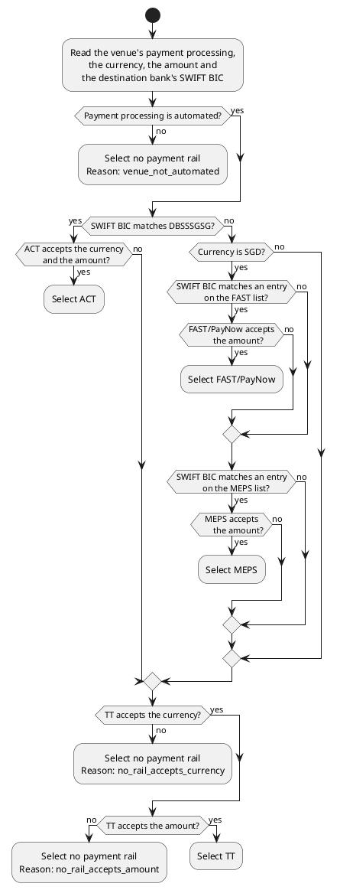
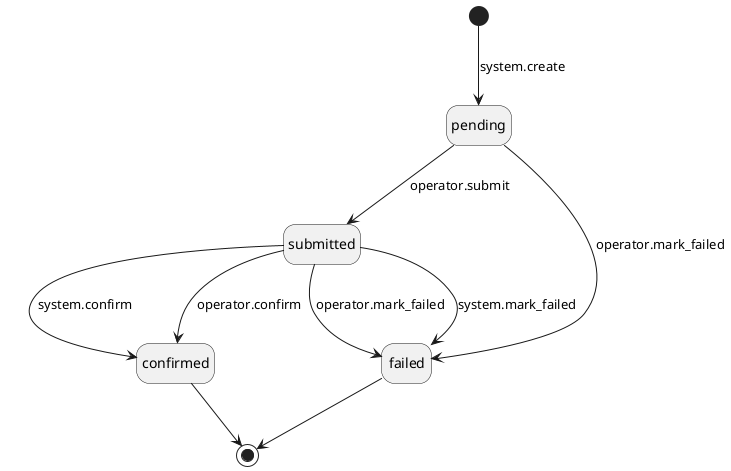
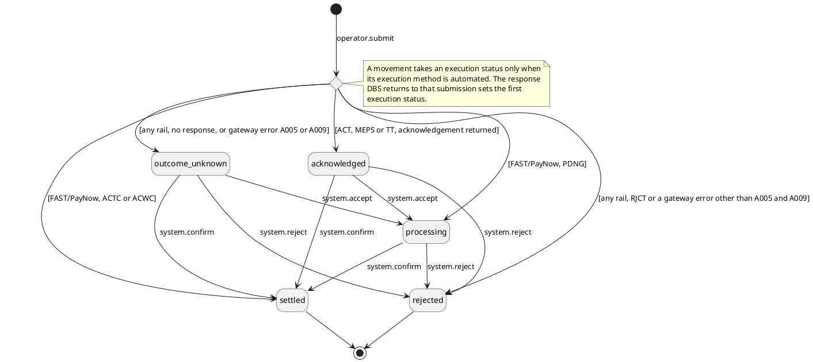

# PRD \- DBS P2: Payment APIs

## About the Document

### List of Personnel

| **Role** | **Name** |
| --- | --- |
| Product Manager | \[TBD\] |
| Tech Lead | \[TBD\] |
| Design | \[TBD\] |
| QA | \[TBD\] |
| Stakeholder | \[TBD\] |

---

## Overview

### Release Note

- When a fiat venue is set to Automated payment processing, the system sends its outgoing movements to the bank through the bank's payment APIs. An operator no longer re-enters them in the bank's portal.
- When an operator approves a withdrawal, the operator sees the payment rail the system selected. On MEPS and TT the operator also sees the charge bearer and the charge bearer account. The operator can override any of them before confirming.
- When a checker approves a fiat rebalance out of a fiat venue, the system creates the outgoing movement and resolves its rail and charge instruction at that moment.
- When the bank reports an outcome, the system updates the outgoing movement's settlement status on its own.
- If the bank's outcome never arrives, an operator can confirm or fail the outgoing movement by hand.
- Every manual confirmation or failure of a fiat outgoing movement needs a second operator's approval before it takes effect. This covers movements sent on the bank's portal and movements sent through the payment APIs.
- An operator can track an outgoing movement's processing status at every stage.

---

### Problem Statement

An outgoing movement is created when an operator approves a withdrawal and selects the fiat venue that processes it. The operator must then log in to the bank's portal and re-enter the movement's details. The operator returns later to record the bank's reference and confirm settlement. Re-keying by hand does not scale with payment volume, and every field an operator retypes carries a risk of error.

---

### Solution Overview

1. An operator approves a withdrawal and selects the fiat venue that processes the outgoing movement. A rebalance takes no such step: the checker's approval creates the outgoing movement.
2. When the selected venue's payment processing is Automated, the system selects the payment rail and, on MEPS and TT, the charge bearer and the charge bearer account.
3. At the withdrawal approval step, the operator reviews the resolved values and can override them. A rebalance movement takes them as they stand.
4. An operator clicks submit on the outgoing movement, and the system sends it to the bank through the payment API for that rail.
5. When the venue's payment processing is Manual, or no payment rail accepts the movement's currency, an operator processes the movement on the bank's portal.
6. The bank acknowledges the submission and reports the outcome later. The system matches each bank message back to the outgoing movement.
7. When the bank confirms settlement, the system completes the outgoing movement and releases the reserved funds. When the bank reports a failure, the system fails the outgoing movement and records the bank's reason.
8. When the bank's outcome never arrives, an operator confirms or fails the outgoing movement by hand. A bank message that arrives afterwards does not change the movement.
9. A second operator approves every manual confirmation and every manual failure before it takes effect.
10. An operator tracks an outgoing movement's processing status at every stage.

**In scope:**

- Configuration of a fiat venue's payment processing as Automated or Manual. The setting covers the venue as a whole and every currency it holds. A venue processes payments manually until an operator sets it to Automated.
- Operator-maintained lists of the banks that participate in FAST and of the banks that participate in MEPS.
- A platform-level default charge bearer and default charge bearer account for the MEPS rail and for the TT rail.
- Selection of the charge bearer account from the fiat venues whose bank is DBS. Any such venue is selectable, including a client-segregated one, so an operator can charge fees to a client.
- Operator override of the resolved values when an operator regenerates a failed outgoing movement.
- A named execution status for each stage of the bank's processing, so an operator can tell a movement the bank is still processing from one the bank has settled, and can find the ones whose outcome the bank never returned.
- Operator visibility into outgoing movements, filterable by status, execution method, execution status, payment rail, and payment reference.
- Uniform handling of an outgoing movement whether a withdrawal or a rebalance produced it.

---

### Out of Scope

| **Item** | **Reason** |
| --- | --- |
| Client submission of a withdrawal, corporate two-user approval, and the operator approval flow itself | Already built |
| Automating incoming fiat deposits, including credit notification and auto-classification | Covered by the incoming phase of the bank integration |
| Automated compliance screening (KYT, sanctions, name screening) on withdrawals | Already built and unchanged |
| Detection, alerting, or automated remediation of a bank status update that contradicts an outcome an operator already recorded, including matching a returned-funds deposit back to the original outgoing movement | Operators reconcile against the bank's own records outside the platform |
| Payment rails beyond Book Transfer (ACT), high-value domestic (MEPS), Telegraphic Transfer (TT), and FAST/PayNow | No bank specification available for any other rail |
| Client-facing visibility of an outgoing movement | A client sees the withdrawal transaction and its status. A movement is an operator-facing record |
| Notifying an operator when an outgoing movement is rejected, fails, or reaches no outcome at the bank | Deferred to a later phase |

---

### Actors

- **Operator User**: The platform user who runs fiat payments. An operator sets which fiat venues process payments automatically. At the withdrawal approval step, an operator reviews the resolved rail and charge instruction, and overrides them where needed. An operator submits the outgoing movement to the bank. An operator monitors outgoing movements end to end and resolves rejections and failures. Where a venue is not automated, an operator processes the movement on the bank's portal. An operator can confirm or fail a submitted movement by hand, and a second operator approves that outcome as the checker.
- **DBS**: The settlement bank. Its payment APIs receive each eligible outgoing movement, and it reports the submission and settlement outcome back to the platform.
- **Bank Event Service**: The service that owns the endpoint DBS posts to. It verifies each message DBS sends and routes the message to the platform that sent the payment.

---

### Assumptions & Dependencies

- DBS is the only bank whose payment APIs are integrated. Payment processing can only be set to Automated on a DBS fiat venue.
- DBS provisions API access before go-live: an organisation ID, PGP encryption keys, and a registered endpoint for the acknowledgements DBS posts. This is an external setup step.
- The endpoint registered with DBS is shared with the legacy custody platform, and both platforms send payments from bank accounts at DBS. The Bank Event Service owns that endpoint and routes each payment acknowledgement to one platform.
- A DBS bank account holds balances in more than one currency. The charge bearer account does not have to match the currency of the outgoing movement, and DBS applies the charge in that account.
- Charges are paid from a single operational account, so one platform default charge bearer account per rail is enough.
- A movement holds one maker-checker request at a time, and a request awaiting approval blocks the other operator actions on that movement.
- A rebalance's outgoing movement is built today as a token movement, so the fiat rebalance leg is new build.

---

### Glossary

| **Term** | **Definition** |
| --- | --- |
| Payment processing | A setting on a fiat venue naming who sends the venue's outgoing movements to the bank. Automated means the platform sends them through the bank's payment APIs. Manual means an operator sends them on the bank's portal. |
| Execution method | How a single outgoing movement left the platform, Automated or Manual. It takes the venue's payment processing setting. |
| Execution status | How far the bank has taken an outgoing movement the platform submitted to it. It runs alongside the movement's own status, and the bank's messages set it. |
| Payment rail | The payment method used to send an outgoing movement: Book Transfer (ACT), high-value domestic transfer (MEPS), Telegraphic Transfer (TT), or FAST/PayNow. |
| ACT | DBS's Book Transfer payment method, used for transfers between DBS accounts. |
| MEPS | DBS's high-value domestic Singapore-dollar payment method. |
| TT | Telegraphic Transfer. DBS's payment method for outward international or cross-currency payments. |
| FAST/PayNow | A real-time Singapore-dollar payment rail between DBS/POSB and other participating banks in Singapore. It can address the recipient by bank account (FAST) or by a registered proxy such as a mobile number (PayNow). |
| Payment reference | A 16-character reference the platform generates for one outgoing movement and sends as the payment instruction's customer reference. The bank returns it on every later message about that payment, and the platform matches each message back to the movement by it. |
| Charge bearer | Who pays the bank charges on a MEPS or TT outgoing movement. The bank accepts three values: beneficiary pays all charges (CRED), sender pays all charges (DEBT), or sender pays the bank's charges and beneficiary pays the agent bank's charges (SHAR). The bank applies SHAR when no value is sent. |
| Charge bearer account | The bank account the sender's share of bank charges is debited from. The bank debits the account the outgoing movement is sent from when no value is sent. |
| Bank Event Service | The service that holds the endpoint DBS posts to, decrypts and verifies each message, and routes it to the platform that sent the payment. It serves this platform and the legacy custody platform. |
| Legacy custody platform | The earlier custody platform that runs alongside this one and sends its own payments from bank accounts at DBS. |

---

## Functional Requirements

### Section 1: Payment Automation Configuration

#### FR-1: \[Operator\] Set the Payment Processing on a Fiat Venue

**Requirement Details**

As an operator, I want to set a fiat venue's payment processing to `automated` so that outgoing movements at that venue reach DBS through its payment APIs.

**Precondition:** The operator is authenticated and holds venue configuration permission.

**Main Flow:**

1. Operator sets the venue's payment processing to `automated` or to `manual`.
2. System validates the submission (see Validations).
3. System creates a maker-checker request holding the before and after state of the setting.
4. A second operator reviews the request and approves it.
5. On approval, the system re-runs the full check set (see Validations) and saves the setting on the venue.

**Validations:**

All checks run at both the maker step and the checker step.

| **Check** | **Error Code** | **Error Message** |
| --- | --- | --- |
| Venue exists and is a fiat venue of bank type | `VENUE_NOT_FOUND` | Venue not found or not a bank venue |
| Payment processing is one of `manual`, `automated` | `UNSUPPORTED_VALUE` | The payment processing is not one of the accepted values |
| Venue's bank is DBS, when the payment processing is `automated` | `INVALID_VENUE_REQUEST` | Automated payment processing is only available for DBS venues |

**Design Constraints:**

- A fiat venue's payment processing is `manual` until an operator sets it to `automated`.
- The venue holds one maker-checker edit lock, so a second operator cannot start another venue edit while this submission awaits approval.
- The system reads this setting each time it resolves a movement's execution method (FR-4), so a change made after a movement is created leaves that movement unchanged (FR-7).
- The setting applies to the venue as a whole and covers every currency the venue holds.
- 🚩 **DATA PATCH:** Every fiat venue created before this setting exists needs its payment processing set to `manual` by a one-time data migration, so no venue carries an empty value.

**Audit Log**

**Originating event:** `venue:set_payment_processing_request` · **Actor:** `operator` (maker)

| **Operation** | **Scope** | `externalMetadata` | `internalMetadata` | `externalSecurityMetadata` | `internalSecurityMetadata` |
| --- | --- | --- | --- | --- | --- |
| `venue:set_payment_processing_request` | `internal_business` | — | `resource`, `operation` | — | `clientIp`, `userAgent`, `browser` |
| `venue:set_payment_processing_request` (failure) | `internal_business` | — | `errorCode`, `errorDetail` | — | `clientIp`, `userAgent`, `browser` |

**Originating event:** `venue:set_payment_processing` · **Actor:** `operator` (checker)

| **Operation** | **Scope** | `externalMetadata` | `internalMetadata` | `externalSecurityMetadata` | `internalSecurityMetadata` |
| --- | --- | --- | --- | --- | --- |
| `venue:set_payment_processing` | `internal_business` | — | `paymentProcessing`, `previousPaymentProcessing` | — | `clientIp`, `userAgent`, `browser` |
| `venue:set_payment_processing` (failure) | `internal_business` | — | `errorCode`, `errorDetail` | — | `clientIp`, `userAgent`, `browser` |

**Originating event:** `mch_request:reject` · **Actor:** `operator` (checker)

| **Operation** | **Scope** | `externalMetadata` | `internalMetadata` | `externalSecurityMetadata` | `internalSecurityMetadata` |
| --- | --- | --- | --- | --- | --- |
| `mch_request:reject` | `internal_business` | — | `resource`, `operation`, `internalComment` | — | `clientIp`, `userAgent`, `browser` |

**Mockups:**  
<https://www.figma.com/design/TGauoafjDX4bPaLNuC0asW/-FE-UI--Fiat-Venues-2.0--Operator-User-?node-id=2428-12459&t=6qtTfnjCz5KhpFhV-1> 

---

#### FR-2: \[Operator\] Set the Platform Default Charge Instruction for Each Remittance Rail

**Requirement Details**

As an operator, I want to set the default charge bearer and charge bearer account for MEPS and for TT so that an outgoing movement on either rail resolves its charge instruction without operator input.

**Precondition:** The operator is authenticated and holds platform settings permission.

**Main Flow:**

1. Operator opens the default charge instruction settings.
2. Operator selects the default charge bearer for MEPS and the default charge bearer for TT, each from `CRED`, `DEBT`, and `SHAR`.
3. Operator selects the default charge bearer account for each rail whose default charge bearer is `DEBT` or `SHAR`, from the fiat venues whose bank is DBS.
4. System validates the submission (see Validations).
5. System saves the settings and records the operator and the time of the change.

**Validations:**

| **Check** | **Error Code** | **Error Message** |
| --- | --- | --- |
| Each default charge bearer is one of `CRED`, `DEBT`, `SHAR` | `UNSUPPORTED_VALUE` | The charge bearer is not one of the accepted values |
| Each supplied default charge bearer account references an existing fiat venue of bank type | `VENUE_NOT_FOUND` | Venue not found or not a bank venue |
| Each of those venues has DBS as its bank | `INVALID_VENUE_REQUEST` | The charge bearer account must be a DBS venue |
| A default charge bearer account is supplied for each rail whose default charge bearer is `DEBT` or `SHAR` | `MISSING_REQUIRED_FIELD` | A default charge bearer account is required when the charge bearer is `DEBT` or `SHAR` |
| No default charge bearer account is supplied for a rail whose default charge bearer is `CRED` | `INVALID_ARGUMENT` | A charge bearer account applies only when the charge bearer is `DEBT` or `SHAR` |

**Design Constraints:**

- The platform holds one charge bearer for MEPS and one for TT, each with its own charge bearer account. A save replaces all of those values together, so a movement never resolves one value from an older save and another from a newer one.
- A saved change applies to movements resolved after the save (FR-4). A movement that already carries a resolved charge bearer keeps it.
- The system sends the selected venue's recorded bank account number to DBS as the charge bearer account, not the venue identifier.

**Audit Log**

**Originating event:** `charge_instruction_default:update` · **Actor:** `operator`

| **Operation** | **Scope** | `externalMetadata` | `internalMetadata` | `externalSecurityMetadata` | `internalSecurityMetadata` |
| --- | --- | --- | --- | --- | --- |
| `charge_instruction_default:update` | `internal_business` | — | `rail`, `chargeBearer`, `previousChargeBearer`, `chargeBearerAccount`, `previousChargeBearerAccount` | — | `clientIp`, `userAgent`, `browser` |
| `charge_instruction_default:update` (failure) | `internal_business` | — | `errorCode`, `errorDetail`, `rail`, `chargeBearer` | — | `clientIp`, `userAgent`, `browser` |

**Mockups:**  
<https://www.figma.com/design/jUT6BS7kaGqR7qUa4bo5Ta/-FE-UI--Charge-Bank-Configuration--Operator-User-?node-id=28-9451&t=NSXqYzXwSjHCL67T-1> 

---

#### FR-3: \[Operator\] Maintain the FAST and MEPS Participating Bank Lists

**Requirement Details**

As an operator, I want to maintain the set of banks that participate in FAST and the set that participate in MEPS so that rail selection sends an SGD movement on a rail its destination bank reaches.

**Precondition:** The operator is authenticated and holds platform settings permission.

**Main Flow:**

1. Operator opens the participating bank list settings.
2. Operator submits the FAST participating bank list and the MEPS participating bank list, each as a set of SWIFT BICs.
3. System validates the submission (see Validations).
4. System saves both lists and records the operator and the time of the change.

**Validations:**

| **Check** | **Error Code** | **Error Message** |
| --- | --- | --- |
| Each SWIFT BIC on either list holds exactly 8 or 11 characters | `INVALID_SWIFT_CODE` | SWIFT code must be exactly 8 or 11 characters |
| Neither the FAST participating bank list nor the MEPS participating bank list holds the same SWIFT BIC twice | `INVALID_ARGUMENT` | The FAST or MEPS participating bank list holds a duplicate SWIFT BIC |

**Design Constraints:**

- A save replaces the whole of each list, so a list never mixes entries from two saves.
- Rail selection reads the participating bank list in force at the moment it resolves a movement (FR-4).

**Audit Log**

**Originating event:** `participating_bank:update` · **Actor:** `operator`

| **Operation** | **Scope** | `externalMetadata` | `internalMetadata` | `externalSecurityMetadata` | `internalSecurityMetadata` |
| --- | --- | --- | --- | --- | --- |
| `participating_bank:update` | `internal_business` | — | `rail`, `swiftBics`, `previousSwiftBics` | — | `clientIp`, `userAgent`, `browser` |
| `participating_bank:update` (failure) | `internal_business` | — | `errorCode`, `errorDetail`, `rail` | — | `clientIp`, `userAgent`, `browser` |

Mockups:  
<https://www.figma.com/design/EW0bTP3dvEvPo415uRIuMr/-FE-UI--Payment-Rail-Banks--Operator-User-?node-id=25-19115&t=iaq0mrJAcZIsJg0F-1>   

---

#### FR-4: \[System\] Resolve the Execution Method, Payment Rail, and Charge Instruction for a Fiat Payment

**Requirement Details**

As the system, I want to resolve the execution method, payment rail, charge bearer, and charge bearer account for a payment at a fiat venue so that the approval screen and movement creation read one answer from one rule set.

**Precondition:** The caller supplies a fiat venue, an amount, a currency, and a destination. The destination is a whitelisted bank account or a fiat venue.

**Main Flow:**

1. System reads the venue's payment processing setting (FR-1).
    1. The setting is `automated`: the system continues to step 2.
    2. The setting is `manual`: the system returns the execution method `manual`, the fallback reason `venue_not_automated`, and no payment rail, charge bearer, or charge bearer account.
2. System selects the payment rail from the destination bank's SWIFT BIC, the currency, and the amount (see Rail Selection Logic).
    1. The logic selects a rail: the system sets the execution method to `automated`.
    2. The logic selects no payment rail: the system returns the execution method `manual`, the fallback reason the logic gives, and no payment rail, charge bearer, or charge bearer account.
3. System reads the charge bearer and the charge bearer account for the selected rail from the platform defaults (FR-2), when that rail is MEPS or TT.
    1. The platform default charge bearer for the selected rail is `CRED`: the system returns that charge bearer and no charge bearer account.
4. System returns the execution method, the payment rail, the charge bearer, the charge bearer account, and the fallback reason.

**Rail Selection Logic:**

**Rail Acceptance Table:**

| **Rail** | **Currencies accepted** | **Minimum** | **Maximum** |
| --- | --- | --- | --- |
| ACT | AED, AUD, BND, CAD, CHF, CNH, DKK, EGP, EUR, GBP, HKD, IDR, INR, JPY, KRW, LKR, NOK, NZD, PHP, SAR, SEK, SGD, THB, TWD, USD, ZAR | 1 for IDR, JPY, KRW and TWD. 0.01 for every other currency | 99,999,999,999.00 for IDR. 999,999,999.00 for JPY and KRW. 999,999,999.99 for every other currency |
| FAST/PayNow | SGD | 0.01 | 200,000.00 |
| MEPS | SGD | 1.01 | 999,999,999.99 |
| TT | AED, AUD, BHD, BND, CAD, CHF, CNH, DKK, EUR, GBP, HKD, HUF, IDR, INR, JPY, KRW, KWD, LKR, MUR, MYR, NOK, NZD, PHP, PLN, QAR, SAR, SEK, SGD, THB, TWD, USD, VND, ZAR | 1 for IDR, JPY, KRW, TWD and VND. 0.01 for every other currency | 99,999,999,999.00 for IDR. 999,999,999.00 for JPY, KRW and VND. 999,999,999.99 for every other currency |

**Design Constraints:**

- This resolution writes nothing. Each caller acts on the values it returns: the approval screen shows them (FR-5), and movement creation records them (FR-7).
- The destination bank's SWIFT BIC comes from the whitelisted bank account for a withdrawal, and from the destination fiat venue for a rebalance (FR-6).
- The system reads the venue setting, the platform defaults, and the participating bank lists at the moment it resolves, so two calls on the same inputs return different values after an operator changes one of them.
- The rail acceptance table is fixed in the build. It changes when DBS publishes a new message specification, not through operator configuration.
- The system matches the destination bank against the FAST participating bank list and the MEPS participating bank list an operator maintains (FR-3).
- A SWIFT BIC matches an entry when the destination bank's SWIFT BIC starts with that entry, so an 8-character entry matches every branch of that bank. The system matches `DBSSSGSG` the same way.
- TT is the last rail the logic tries, so a payment no earlier rail carries goes on TT whenever TT accepts its currency and amount. An SGD payment above the FAST maximum, to a bank on the FAST list but not on the MEPS list, therefore goes on TT.

---

### Section 2: Movement Approval, Creation, and Visibility

#### FR-5: \[Operator\] Review and Override the Resolved Payment Rail and Charge Instruction

**Requirement Details**

As an operator, I want to see and override the payment rail and charge instruction before the system creates an outgoing movement so that the movement reaches DBS on the rail and charge terms I intend.

**Precondition:** The operator is authenticated and holds transaction approval permission. A withdrawal is in `under_review` status and awaits the operator's approval, or a fiat outgoing movement has failed and its transaction accepts a replacement (see Alternate Flows).

**Main Flow:**

1. Operator opens the approval step for a withdrawal and selects the fiat venue that processes the outgoing movement.
2. System resolves the payment rail and the charge instruction for the selected venue and shows them to the operator (FR-4).
    1. The resolution returns the execution method `manual`: the system shows the fallback reason the resolution returned, and shows no payment rail and no charge instruction.
    2. The resolved payment rail is ACT or FAST/PayNow: the system shows no charge bearer and no charge bearer account.
    3. The resolved charge bearer is `CRED`: the system hides the charge bearer account.
3. Operator keeps each value the system shows or supplies an override.
4. Operator selects an overriding charge bearer account from the fiat venues whose bank is DBS, when the charge bearer the operator confirms is `DEBT` or `SHAR`.
5. Operator confirms the approval.
6. System creates the outgoing movement with the confirmed execution method, payment rail, charge bearer, and charge bearer account (FR-7).

**Alternate Flows:**

- The operator regenerates a failed outgoing movement: the operator opens the regeneration step, the system resolves against the source venue the replacement movement uses, and the flow runs from step 2.

**Design Constraints:**

- The operator overrides the payment rail, the charge bearer, and the charge bearer account, and never the execution method, so a resolution that returns `manual` offers the operator no rail and no charge instruction to supply.
- The values the operator confirms are the values creation records (FR-7), so a change to the platform defaults or to a participating bank list after screen load leaves the confirmed payment rail and charge instruction unchanged.
- Creation runs the full check set on the confirmed values (FR-7), so an override reaches a movement only when it passes the same checks as a resolved value.
- When an operator regenerates a failed movement, the system resolves the payment details again (FR-4) and the operator can override them again.

**Audit Log**

**Originating event:** `unified_withdrawal:generate_underlying_outgoing_movement` · **Actor:** `operator`

| **Operation** | **Scope** | `externalMetadata` | `internalMetadata` | `externalSecurityMetadata` | `internalSecurityMetadata` |
| --- | --- | --- | --- | --- | --- |
| `unified_withdrawal:generate_underlying_outgoing_movement` | `internal_business` | — | `venueId`, `executionMethod`, `paymentRail`, `chargeBearer`, `chargeBearerAccount`, `fallbackReason` | — | `clientIp`, `userAgent`, `browser` |
| `unified_withdrawal:generate_underlying_outgoing_movement` (failure) | `internal_business` | — | `errorCode`, `errorDetail`, `venueId`, `paymentRail`, `chargeBearer` | — | `clientIp`, `userAgent`, `browser` |

**Originating event:** `unified_withdrawal:regenerate_outgoing_movement` · **Actor:** `operator`

| **Operation** | **Scope** | `externalMetadata` | `internalMetadata` | `externalSecurityMetadata` | `internalSecurityMetadata` |
| --- | --- | --- | --- | --- | --- |
| `unified_withdrawal:regenerate_outgoing_movement` | `internal_business` | — | `venueId`, `executionMethod`, `paymentRail`, `chargeBearer`, `chargeBearerAccount`, `fallbackReason` | — | `clientIp`, `userAgent`, `browser` |
| `unified_withdrawal:regenerate_outgoing_movement` (failure) | `internal_business` | — | `errorCode`, `errorDetail`, `venueId`, `paymentRail`, `chargeBearer` | — | `clientIp`, `userAgent`, `browser` |

**Originating event:** `unified_rebalance:regenerate_outgoing_movement` · **Actor:** `operator`

| **Operation** | **Scope** | `externalMetadata` | `internalMetadata` | `externalSecurityMetadata` | `internalSecurityMetadata` |
| --- | --- | --- | --- | --- | --- |
| `unified_rebalance:regenerate_outgoing_movement` | `internal_business` | — | `venueId`, `executionMethod`, `paymentRail`, `chargeBearer`, `chargeBearerAccount`, `fallbackReason` | — | `clientIp`, `userAgent`, `browser` |
| `unified_rebalance:regenerate_outgoing_movement` (failure) | `internal_business` | — | `errorCode`, `errorDetail`, `venueId`, `paymentRail`, `chargeBearer` | — | `clientIp`, `userAgent`, `browser` |

Mockups:  
<https://www.figma.com/design/0hwU9K9w041Ty5IE36Cmfv/-FE-UI--Withdrawal-Transaction-2.0--Operator-User-?node-id=468-31344&t=89awcy0j0eOBSxCu-1> 

---

#### FR-6: \[System\] Create the Outgoing Movement for an Approved Fiat Rebalance

**Requirement Details**

As the system, I want to create the outgoing movement of a fiat rebalance when its checker approves it so that the movement carries a payment rail and a charge instruction without a further operator step.

**Precondition:** A rebalance whose asset is a fiat currency, whose source is a fiat venue, and whose destination is a fiat venue awaits a checker's approval. The maker submitted the asset, the amount, the source venue, and the destination venue when the rebalance was created.

**Main Flow:**

1. Checker approves the rebalance.
2. System resolves the execution method, the payment rail, the charge bearer, and the charge bearer account from the source venue, the amount, the currency, and the destination venue (FR-4).
3. System creates the outgoing movement with the values the resolution returned (FR-7).

**Design Constraints:**

- The rebalance carries no payment rail and no charge instruction, so the movement takes what the resolution returns at the moment the checker approves it (FR-4).
- The check set on the resolved values (FR-7) runs inside the checker's approval, so a failed check leaves the rebalance unapproved.
- The checker's approval and the movement's creation commit in one atomic step, so an approved fiat rebalance always carries its outgoing movement.
- An operator can override a rebalance movement's payment rail and charge instruction only by regenerating a failed movement (FR-5), and never at the checker's approval.

**Audit Log**

**Originating event:** `mch_request:create` · **Actor:** `operator` (maker)

| **Operation** | **Scope** | `externalMetadata` | `internalMetadata` | `externalSecurityMetadata` | `internalSecurityMetadata` |
| --- | --- | --- | --- | --- | --- |
| `outgoing_movement:create` | `internal_business` | — | `transactionId`, `venueId`, `amount`, `assetId`, `executionMethod`, `paymentRail`, `chargeBearer`, `chargeBearerAccount`, `fallbackReason` | — | — |
| `balance:update` | `internal_business` | — | `venueId`, `assetId`, `amount`, `balanceType` | — | — |
| `mch_request:create` (failure) | `internal_business` | — | `errorCode`, `errorDetail`, `venueId`, `paymentRail`, `chargeBearer` | — | — |

---

#### FR-7: \[System\] Create an Outgoing Movement with Its Execution Method, Payment Rail, and Charge Instruction

**Requirement Details**

As the system, I want to record the execution method, payment rail, and charge instruction on each outgoing movement I create at a fiat venue.

**Precondition:** An operator has confirmed the payment values for a withdrawal or for a replacement movement (FR-5), or a checker has approved a fiat rebalance out of a fiat venue (FR-6). The caller supplies the execution method, the payment rail, the charge bearer, the charge bearer account, and the fallback reason. The amount, the currency, the source fiat venue, and the destination are known.

**Main Flow:**

1. System takes the values the caller supplies (see Alternate Flows).
2. System validates the supplied values against the amount, the currency, the source venue, and the destination (see Validations).
3. System creates the outgoing movement in `pending` status and records the execution method, the payment rail, the charge bearer, and the charge bearer account on it.

**Alternate Flows:**

- The caller supplies the execution method `manual`: the system creates the movement with that execution method, records the fallback reason and no payment rail, charge bearer, or charge bearer account, and an operator processes the movement on the bank's portal.

**Validations:**

The checks on the payment rail, the charge instruction, and the destination bank details run when the supplied execution method is `automated`. Every other check runs on each creation.

| **Check** | **Error Code** | **Error Message** |
| --- | --- | --- |
| Execution method is one of `manual`, `automated` | `UNSUPPORTED_VALUE` | The execution method is not one of the accepted values |
| Source venue is a fiat venue of bank type | `VENUE_NOT_FOUND` | Venue not found or not a bank venue |
| Destination is a fiat venue of bank type, when a rebalance owns the movement | `INVALID_VENUE_REQUEST` | The destination of a fiat rebalance must be a bank venue |
| Payment rail is one of `act`, `fast_paynow`, `meps`, `tt` | `UNSUPPORTED_VALUE` | The payment rail is not one of the integrated rails |
| Charge bearer is one of `CRED`, `DEBT`, `SHAR` | `UNSUPPORTED_VALUE` | The charge bearer is not one of the accepted values |
| Destination has a SWIFT BIC and a bank country code recorded | `MISSING_REQUIRED_FIELD` | The destination is missing the SWIFT BIC or the bank country |
| Payment rail accepts the movement's currency (FR-4) | `INVALID_ARGUMENT` | The selected payment rail does not accept this currency |
| Movement amount is within the payment rail's minimum and maximum for that currency (FR-4) | `INVALID_ARGUMENT` | The amount is outside the limits the selected payment rail accepts for this currency |
| A charge bearer is present, when the payment rail is MEPS or TT | `MISSING_REQUIRED_FIELD` | A charge bearer is required for this payment rail |
| A charge bearer account is present, when the payment rail is MEPS or TT and the charge bearer is `DEBT` or `SHAR` | `MISSING_REQUIRED_FIELD` | A charge bearer account is required when the charge bearer is `DEBT` or `SHAR` |
| Charge bearer and charge bearer account are absent, when the payment rail is ACT or FAST/PayNow | `INVALID_ARGUMENT` | This payment rail carries no charge bearer |
| Charge bearer account is absent, when the charge bearer is `CRED` | `INVALID_ARGUMENT` | A charge bearer account applies only when the charge bearer is `DEBT` or `SHAR` |
| Charge bearer account references a fiat venue whose bank is DBS | `INVALID_VENUE_REQUEST` | The charge bearer account is no longer a DBS venue |

**Design Constraints:**

- The system records what the caller supplies and resolves nothing of its own, so one movement carries one set of values from one resolution (FR-4).
- This is the one place the payment values are checked, so an operator's override (FR-5) and a resolved rebalance value (FR-6) pass the same check set.
- The recorded payment rail selects which DBS payment API receives the movement at submission (FR-9).
- Every outgoing movement holds an earmark for its amount at its source venue. When a withdrawal owns the movement, the system takes that earmark as it creates the movement. When a rebalance owns the movement, the system takes that earmark in the same step that approves the rebalance and creates the movement (FR-6).
- A replacement movement takes a new earmark at the source venue it uses, because the failure released the earmark held by the movement it replaces (see Settlement and Failure by Owning Transaction, FR-10).

**Audit Log**

**Originating event:** `unified_withdrawal:generate_underlying_outgoing_movement` · **Actor:** `operator`

| **Operation** | **Scope** | `externalMetadata` | `internalMetadata` | `externalSecurityMetadata` | `internalSecurityMetadata` |
| --- | --- | --- | --- | --- | --- |
| `outgoing_movement:create` | `internal_business` | — | `transactionId`, `venueId`, `amount`, `assetId`, `executionMethod`, `paymentRail`, `chargeBearer`, `chargeBearerAccount`, `fallbackReason` | — | `clientIp`, `userAgent`, `browser` |
| `balance:update` | `internal_business` | — | `venueId`, `assetId`, `amount`, `balanceType` | — | `clientIp`, `userAgent`, `browser` |
| `outgoing_movement:create` (failure) | `internal_business` | — | `errorCode`, `errorDetail`, `venueId`, `paymentRail`, `chargeBearer`, `chargeBearerAccount` | — | `clientIp`, `userAgent`, `browser` |

**Originating event:** `unified_withdrawal:regenerate_outgoing_movement` · **Actor:** `operator`

| **Operation** | **Scope** | `externalMetadata` | `internalMetadata` | `externalSecurityMetadata` | `internalSecurityMetadata` |
| --- | --- | --- | --- | --- | --- |
| `outgoing_movement:create` | `internal_business` | — | `transactionId`, `venueId`, `amount`, `assetId`, `executionMethod`, `paymentRail`, `chargeBearer`, `chargeBearerAccount`, `fallbackReason` | — | `clientIp`, `userAgent`, `browser` |
| `balance:update` | `internal_business` | — | `venueId`, `assetId`, `amount`, `balanceType` | — | `clientIp`, `userAgent`, `browser` |
| `outgoing_movement:create` (failure) | `internal_business` | — | `errorCode`, `errorDetail`, `venueId`, `paymentRail`, `chargeBearer`, `chargeBearerAccount` | — | `clientIp`, `userAgent`, `browser` |

---

#### FR-8: \[Operator\] View and Filter Outgoing Movements by Their Payment Processing Details

**Requirement Details**

As an operator, I want to list and inspect outgoing movements with their payment processing details so that I can track how each payment reached DBS and find the ones that need attention.

**Precondition:** The operator is authenticated and holds outgoing movement read permission. The outgoing movements list and detail are live.

**Main Flow:**

1. Operator opens the outgoing movements list and applies filters (see Filters).
2. System validates the request (see Validations).
3. System returns each matching movement with its execution method, payment rail, execution status, and payment reference, alongside the fields the list already returns.
4. Operator opens one movement (see Validations).
5. System returns the charge bearer, the charge bearer account, the fallback reason recorded on a manual movement, and the reason recorded for a delivery failure or a rejection.

**Filters:**

| **Filter** | **Type** | **Allowed Values** |
| --- | --- | --- |
| Statuses | enum (multi) | `pending`, `submitted`, `confirmed`, `failed` |
| Execution Statuses | enum (multi) | `outcome_unknown`, `acknowledged`, `processing`, `settled`, `rejected` |
| Payment Rails | enum (multi) | `act`, `fast_paynow`, `meps`, `tt` |
| Execution Methods | enum (multi) | `automated`, `manual` |
| Payment Reference | text (exact match) | — |

**Validations:**

| **Check** | **Error Code** | **Error Message** |
| --- | --- | --- |
| Requested movement exists and is an outgoing movement | `RECORD_NOT_FOUND` | Outgoing movement not found |

**Design Constraints:**

- The list and the detail read the payment values recorded on the movement at creation (FR-7), so a later edit to the venue setting or to the platform defaults never changes what an earlier movement shows.
- A movement whose execution method is `manual` carries no payment rail and no execution status, so either filter returns only movements the platform submitted through a DBS payment API.
- The execution status filter is how an operator finds a movement DBS rejected, and how an operator finds one whose outcome DBS never returned.
- Every execution status value reports what DBS did with the payment instruction.
- The fiat set holds `outcome_unknown`, `acknowledged`, `processing`, `settled`, and `rejected`.
- A fiat movement takes its execution status from the fiat set alone, and a token movement takes its execution status from the token set alone.

**Mockups:**  
<https://www.figma.com/design/uwKndIm3RT7FEKfJo9Z1hV/-FE-UI--Outgoing-Fiat-Movement--Operator-User-?node-id=307-10391&t=UcKrjggRrdFqmtTh-1> 

---

### Section 3: Submission to DBS

#### FR-9: \[Operator\] Submit an Eligible Outgoing Movement to DBS Through the Resolved Rail

**Requirement Details**

As an operator, I want to submit an eligible outgoing movement to the DBS payment API for its resolved rail so that the payment leaves the platform without me re-entering it on the bank's portal.

**Precondition:** The operator is authenticated and holds outgoing movement submission permission. An outgoing movement is in `pending` status at a fiat venue with an `active` source account. A movement with an execution method of `automated` carries a recorded payment rail and charge instruction (FR-7).

**Main Flow:**

1. Operator opens the outgoing movement and clicks submit.
2. System validates the operator's submission (see Validations).
3. When the movement's execution method is `automated`, the system runs the steps below (see Alternate Flows).
4. System generates a payment reference for the movement and records it on the movement.
    1. The payment reference holds 16 characters: the fixed prefix `HX`, the submission date in Singapore time as `YYMMDD`, and 8 characters the system draws at random from the digits `0` to `9` and the uppercase letters `A` to `Z`.
    2. If the value the system generates is already recorded on another movement, the system generates the payment reference again.
    3. The system matches every acknowledgement and status update DBS sends back to this movement by its payment reference (FR-13).
5. System builds the payment instruction that the movement's recorded payment rail requires.
6. System populates the instruction with the movement's amount, currency, source venue bank account number, destination bank account details, and payment reference.
7. System adds the charge bearer and the charge bearer account to the instruction (see Alternate Flows).
8. System sends the instruction to the DBS payment API that serves the recorded payment rail.
    1. The response DBS returns sets the movement's execution status (FR-10, FR-11).
    2. Each later status update DBS sends changes the execution status (FR-13).
9. System records the submitted instruction and the submission timestamp on the movement.
10. System moves the movement to `submitted` once the instruction has left the platform (see Alternate Flows).

**Alternate Flows:**

- The movement's execution method is `manual`: the system records the submission and moves the movement to `submitted` without generating a payment reference or building an instruction.
- The recorded payment rail is ACT or FAST/PayNow: the system sends no charge bearer and no charge bearer account.
- The recorded charge bearer is `CRED`: the system sends the charge bearer and omits the charge bearer account.
- The instruction never leaves the platform, because the system cannot build it, cannot encrypt and sign it (FR-16), or cannot reach the DBS payment API: the system keeps the movement in `pending`, sets no execution status, and records the delivery failure as the reason.
- The instruction reaches DBS and DBS returns no response: the system leaves the movement in `submitted` with no delivery failure, and an operator records the outcome (FR-14, FR-15).

**Validations:**

| **Check** | **Error Code** | **Error Message** |
| --- | --- | --- |
| Movement is in `pending` status at the moment of submission | `INVALID_MOVEMENT_STATUS` | This outgoing movement is not pending submission |
| No other submission of this outgoing movement is in progress | `RECORD_LOCKED` | A submission of this outgoing movement is already in progress |
| Charge bearer account still references a DBS venue, when the rail is MEPS or TT and the charge bearer is `DEBT` or `SHAR` | `INVALID_VENUE_REQUEST` | The charge bearer account is no longer a DBS venue |
| Destination holds every detail the recorded payment rail requires | `MISSING_REQUIRED_FIELD` | The destination is missing details this payment rail requires |
| No maker-checker request on this outgoing movement awaits approval | `MCH_REVIEW_IN_PROGRESS` | A maker-checker request on this outgoing movement awaits approval |

**Design Constraints:**

- The system holds one payment reference per outgoing movement, so each status update DBS sends matches exactly one movement (FR-13).
- A movement whose instruction never left the platform keeps its payment reference, so a later submission of that movement carries the same reference.
- Each instruction leaves the platform encrypted and signed (FR-16).

**Audit Log**

**Originating event:** `outgoing_movement:submit` · **Actor:** `operator`

| **Operation** | **Scope** | `externalMetadata` | `internalMetadata` | `externalSecurityMetadata` | `internalSecurityMetadata` |
| --- | --- | --- | --- | --- | --- |
| `outgoing_movement:submit` | `internal_business` | — | `paymentReference`, `messageId`, `paymentRail`, `venueId`, `amount`, `assetId`, `chargeBearer`, `chargeBearerAccount`, `submittedAt` | — | `clientIp`, `userAgent`, `browser` |
| `outgoing_movement:submit` (failure) | `internal_business` | — | `errorCode`, `errorDetail`, `deliveryFailureReason`, `paymentReference`, `paymentRail` | — | `clientIp`, `userAgent`, `browser` |

**Mockups:**  
<https://www.figma.com/design/uwKndIm3RT7FEKfJo9Z1hV/-FE-UI--Outgoing-Fiat-Movement--Operator-User-?node-id=308-25809&t=UcKrjggRrdFqmtTh-1> 

---

### Section 4: Bank Outcome Processing

#### FR-10: \[System\] Resolve a FAST/PayNow Outcome from the Submission Response

**Requirement Details**

As the system, I want to resolve a FAST/PayNow movement's outcome from the response DBS returns at submission so that a real-time payment reaches its final status in one exchange.

**Precondition:** An outgoing movement with a recorded payment rail of FAST/PayNow is in `submitted` status, and the system has sent its payment instruction to the DBS FAST/PayNow API (FR-9).

**Main Flow:**

1. System receives the response DBS returns to the submission.
2. System reads the transaction status, the bank reference, DBS's transaction reference, the settlement amount, and the payment date from the response.
3. If the transaction status is `ACTC` or `ACWC`, the system moves the movement to `confirmed` and sets its execution status to `settled` (see Alternate Flows).
4. System records the bank reference as the movement's bank reference, and the payment date DBS returned as the movement's transacted-at date.
5. System posts the journal entry for the movement and releases the earmarks a confirmation releases (see Settlement and Failure by Owning Transaction).

**Settlement and Failure by Owning Transaction:**

| **Owning transaction** | **Journal entry on confirmation** | **Earmarks released on confirmation** | **Earmarks released on failure** |
| --- | --- | --- | --- |
| Withdrawal | `DR Client Account / CR Source Venue` | Client account, source venue | Source venue |
| Rebalance | `DR In-Transit / CR Source Venue` | Source venue | Source venue |

**Alternate Flows:**

- The transaction status is `RJCT`, or the DBS API gateway returns an error code other than `A005` and `A009` in place of a transaction status: the system moves the movement to `failed`, sets its execution status to `rejected`, records the reject code and the status description as the failure reason, and releases the earmarks a failure releases.
- The transaction status is `PDNG`: the system keeps the movement in `submitted`, sets its execution status to `processing`, and an operator records the outcome (FR-14, FR-15).
- The DBS API gateway returns error code `A005` or `A009`, or no response arrives: the system keeps the movement in `submitted`, sets its execution status to `outcome_unknown`, and an operator records the outcome (FR-14, FR-15).

**Design Constraints:**

- A settled outcome and a rejected outcome are both final, so no later message changes the movement's status.
- The execution status `outcome_unknown` says DBS returned no transaction status, so the platform does not know whether DBS holds the payment.
- A movement DBS reports as failed fails that movement alone, and the transaction that owns it stays open for a replacement movement (FR-5).
- Gateway error codes `A005` and `A009` report that DBS could not answer, not that DBS refused the payment, so they leave the outcome unknown rather than failing the movement.

**Audit Log**

**Originating event:** `outgoing_movement:submit` · **Actor:** `operator`

| **Operation** | **Scope** | `externalMetadata` | `internalMetadata` | `externalSecurityMetadata` | `internalSecurityMetadata` |
| --- | --- | --- | --- | --- | --- |
| `outgoing_movement:confirm` | `internal_business` | — | `executionStatus`, `txnStatus`, `bankReference`, `bankTransactionReference`, `settlementAmount`, `transactedAt` | — | `clientIp`, `userAgent`, `browser` |
| `balance:journal_entry` | `internal_business` | — | `debitAccount`, `creditAccount`, `amount`, `assetId` | — | `clientIp`, `userAgent`, `browser` |
| `balance:update` | `internal_business` | — | `accountId`, `venueId`, `assetId`, `amount`, `balanceType` | — | `clientIp`, `userAgent`, `browser` |
| `unified_withdrawal:complete` | `external_business` | `amount`, `assetId`, `transactedAt` | `venueId` | — | `clientIp`, `userAgent`, `browser` |
| `unified_rebalance:complete` | `internal_business` | — | `venueId`, `amount`, `assetId` | — | `clientIp`, `userAgent`, `browser` |
| `outgoing_movement:fail` | `internal_business` | — | `executionStatus`, `txnStatus`, `rejectCode`, `statusDescription` | — | `clientIp`, `userAgent`, `browser` |
| `outgoing_movement:update_execution_status` | `internal_business` | — | `executionStatus`, `previousExecutionStatus`, `txnStatus` | — | `clientIp`, `userAgent`, `browser` |
| `outgoing_movement:confirm` (failure) | `internal_business` | — | `errorCode`, `errorDetail`, `paymentReference`, `txnStatus` | — | `clientIp`, `userAgent`, `browser` |

---

#### FR-11: \[System\] Record DBS's Acknowledgement or Immediate Rejection of an ACT, MEPS or TT Submission

**Requirement Details**

As the system, I want to record the response DBS returns to a submitted ACT, MEPS or TT movement so that the platform knows whether DBS took the payment instruction in for processing.

**Precondition:** An outgoing movement with a recorded payment rail of ACT, MEPS or TT is in `submitted` status, carries a payment reference, and has had its payment instruction sent to the DBS payment API for that rail (FR-9).

**Main Flow:**

1. System receives the response DBS returns to the submission.
2. System reads the acknowledgement type, the transaction status, the reject code, the status description, and DBS's message and transaction identifiers from the response.
3. System records those values on the submitted movement (see Alternate Flows).
4. System sets the movement's execution status to `acknowledged` and keeps the movement in `submitted`.

**Alternate Flows:**

- The response carries a transaction status of `RJCT`, or the DBS API gateway returns an error code other than `A005` and `A009` in place of a transaction status: the system moves the movement to `failed`, sets its execution status to `rejected`, records the reject code and the status description as the rejection reason, and releases the earmarks a failure releases (see Settlement and Failure by Owning Transaction, FR-10).
- The DBS API gateway returns error code `A005` or `A009`, or no response arrives: the system keeps the movement in `submitted`, sets its execution status to `outcome_unknown`, and an operator records the outcome (FR-14, FR-15).

**Design Constraints:**

- An acknowledgement confirms only that DBS holds the instruction, and the settlement outcome arrives later as a separate status update (FR-13).
- A rejection at submission fails the movement alone, and the transaction that owns it stays open for a replacement movement (FR-5).

**Audit Log**

**Originating event:** `outgoing_movement:submit` · **Actor:** `operator`

| **Operation** | **Scope** | `externalMetadata` | `internalMetadata` | `externalSecurityMetadata` | `internalSecurityMetadata` |
| --- | --- | --- | --- | --- | --- |
| `outgoing_movement:update_execution_status` | `internal_business` | — | `executionStatus`, `previousExecutionStatus`, `acknowledgementType`, `txnStatus`, `bankTransactionReference` | — | `clientIp`, `userAgent`, `browser` |
| `outgoing_movement:fail` | `internal_business` | — | `executionStatus`, `txnStatus`, `rejectCode`, `statusDescription` | — | `clientIp`, `userAgent`, `browser` |
| `balance:update` | `internal_business` | — | `accountId`, `venueId`, `assetId`, `amount`, `balanceType` | — | `clientIp`, `userAgent`, `browser` |
| `outgoing_movement:update_execution_status` (failure) | `internal_business` | — | `errorCode`, `errorDetail`, `paymentReference`, `txnStatus` | — | `clientIp`, `userAgent`, `browser` |

---

#### FR-12: \[Bank Event Service\] Receive, Verify, and Route a DBS Payment Acknowledgement

**Requirement Details**

As the Bank Event Service, I want to receive each acknowledgement DBS posts, verify it, and route it to the platform that sent the payment, so that DBS posts to one endpoint while this platform and the legacy platform each receive only the acknowledgements for their own payments.

**Precondition:** DBS posts every ACT, MEPS and TT acknowledgement to the Bank Event Service's endpoint. PGP key material for the DBS payment APIs is configured on the service. The routing rule that separates this platform's payments from the legacy platform's payments is configured on the service.

**Main Flow:**

1. Service receives an acknowledgement DBS posts to the registered endpoint.
2. Service persists the raw payload in its own store with the received timestamp and a processing status of `received`.
3. Service acknowledges the delivery with HTTP 200.
4. Service decrypts the payload and verifies DBS's signature (FR-16) (see Alternate Flows).
5. Service moves the raw acknowledgement to processing status `verified` and reads the customer reference the acknowledgement carries.
6. If the customer reference is a payment reference this platform issues, then the service delivers the decrypted acknowledgement to this platform (FR-13).
7. If the customer reference is not a payment reference this platform issues, then the service forwards the raw payload to the legacy platform unchanged.

**Alternate Flows:**

- Decryption or signature verification fails: the service moves the raw acknowledgement to processing status `verification_failed`, routes it to neither platform, and keeps the payload for investigation.
- The customer reference is absent from the payload: the service moves the raw acknowledgement to processing status `unroutable`, routes it to neither platform, and keeps the payload for investigation.

**Design Constraints:**

- Every payment reference this platform issues carries the fixed prefix `HX` and holds 16 characters (FR-9), and the service routes on that format.
- The service owns the endpoint, the key material, and the routing rule, and it delivers each acknowledgement routed here as decrypted fields.

**Audit Log**

**Originating event:** `raw_acknowledgement:create` · **Actor:** `system_user`

| **Operation** | **Scope** | `externalMetadata` | `internalMetadata` | `externalSecurityMetadata` | `internalSecurityMetadata` |
| --- | --- | --- | --- | --- | --- |
| `raw_acknowledgement:create` | `internal_business` | — | `processingStatus`, `receivedAt` | — | — |
| `raw_acknowledgement:process` | `internal_business` | — | `processingStatus`, `previousProcessingStatus`, `paymentReference`, `routedTo` | — | — |
| `raw_acknowledgement:create` (failure) | `internal_business` | — | `errorCode`, `errorDetail` | — | — |

---

#### FR-13: \[System\] Apply a DBS ACT, MEPS or TT Status Update to the Matching Outgoing Movement

**Requirement Details**

As the system, I want to apply each status update DBS sends to the outgoing movement its payment reference identifies so that settlement is confirmed or failure is flagged without operator action.

**Precondition:** An outgoing movement with a recorded payment rail of ACT, MEPS or TT carries a payment reference (FR-9). The Bank Event Service routes acknowledgements to this platform (FR-12).

**Main Flow:**

1. System receives a status update the Bank Event Service routes to it (FR-12).
2. System matches the status update to the outgoing movement its payment reference identifies (see Alternate Flows).
3. System records the acknowledgement type, the transaction status, the reject code, the status description, DBS's transaction reference, the bank reference, the settlement amount, and the settlement date on the movement.
4. If the status update is an ACK2 carrying `ACCP` or `ACWC`, then the system sets the movement's execution status to `processing` and keeps the movement in `submitted`.
5. If the status update is an ACK3 carrying `ACSP` or `ACWC`, then the system moves the movement to `confirmed` and sets its execution status to `settled`.
6. System records the bank reference as the movement's bank reference, and the settlement date the ACK3 carries as the movement's transacted-at date.
7. System posts the journal entry for the movement and releases the earmarks a confirmation releases (see Settlement and Failure by Owning Transaction, FR-10).

**Alternate Flows:**

- The status update carries `RJCT`: the system moves the movement to `failed`, sets its execution status to `rejected`, records the reject code and the status description as the failure reason, and releases the earmarks a failure releases (see Settlement and Failure by Owning Transaction, FR-10).
- The matched movement is already in `confirmed` or `failed` status: the system stores the status update against the movement and leaves the movement's status, its execution status, its bank reference, and the ledger unchanged.
- The payment reference the status update carries matches no outgoing movement: the system records no status update and changes no movement, and the Bank Event Service keeps the payload in its own store for investigation (FR-12).

**Design Constraints:**

- The system applies one status update per movement at a time, so two updates arriving together never settle the same movement twice.
- Whichever reaches the movement first, a DBS status update or an operator's recorded outcome (FR-14, FR-15), fixes the movement's final status.
- The ACK3 settlement date is the only date the platform records, so an earlier update changes no date on the movement.
- A movement whose execution status is `outcome_unknown` takes a status update the same way, because DBS can hold an instruction it returned no submission response for (FR-11).

**Audit Log**

**Originating event:** `outgoing_movement:update_execution_status` · **Actor:** `system_user`

| **Operation** | **Scope** | `externalMetadata` | `internalMetadata` | `externalSecurityMetadata` | `internalSecurityMetadata` |
| --- | --- | --- | --- | --- | --- |
| `payment_acknowledgement:create` | `internal_business` | — | `acknowledgementType`, `applicationOutcome`, `txnStatus`, `paymentReference` | — | — |
| `outgoing_movement:update_execution_status` | `internal_business` | — | `executionStatus`, `previousExecutionStatus`, `acknowledgementType`, `txnStatus` | — | — |
| `outgoing_movement:confirm` | `internal_business` | — | `executionStatus`, `txnStatus`, `bankReference`, `bankTransactionReference`, `settlementAmount`, `transactedAt` | — | — |
| `balance:journal_entry` | `internal_business` | — | `debitAccount`, `creditAccount`, `amount`, `assetId` | — | — |
| `balance:update` | `internal_business` | — | `accountId`, `venueId`, `assetId`, `amount`, `balanceType` | — | — |
| `unified_withdrawal:complete` | `external_business` | `amount`, `assetId`, `transactedAt` | `venueId` | — | — |
| `unified_rebalance:complete` | `internal_business` | — | `venueId`, `amount`, `assetId` | — | — |
| `outgoing_movement:fail` | `internal_business` | — | `executionStatus`, `txnStatus`, `rejectCode`, `statusDescription` | — | — |
| `outgoing_movement:update_execution_status` (failure) | `internal_business` | — | `errorCode`, `errorDetail`, `paymentReference`, `acknowledgementType` | — | — |

---

### Section 5: Manual Resolution and Integration Integrity

#### FR-14: \[Operator\] Mark a Fiat Outgoing Movement as Failed Under Maker-Checker

**Requirement Details**

As an operator, I want to mark a fiat outgoing movement as failed and have a second operator approve it so that a payment the bank never settled reaches a final status under a two-person control.

**Precondition:** The operator is authenticated and holds outgoing movement outcome permission. A fiat outgoing movement exists.

**Main Flow:**

1. Maker opens the outgoing movement and clicks mark as failed.
2. Maker adds an internal comment, where the maker has one to record.
3. System validates the maker's submission (see Validations).
4. System creates a maker-checker request holding the movement and the failure outcome, and sets the movement's maker-checker lock.
5. Checker approves the request (see Alternate Flows).
6. System re-runs the full check set (see Validations).
7. System moves the movement to `failed`.
8. System releases the earmarks a failure releases (see Settlement and Failure by Owning Transaction, FR-10).

**Alternate Flows:**

- The checker rejects the request: the system leaves the movement in its current status, clears the maker-checker lock, and records the rejection against the movement.

**Validations:**

| **Check** | **Error Code** | **Error Message** | **When checked** |
| --- | --- | --- | --- |
| Movement exists and is a fiat outgoing movement | `RECORD_NOT_FOUND` | Outgoing movement not found | Maker and checker |
| Movement is in `pending` or `submitted` status | `INVALID_MOVEMENT_STATUS` | Only a pending or submitted outgoing movement can be marked as failed | Maker and checker |
| No submission of this outgoing movement is in progress | `RECORD_LOCKED` | A submission of this outgoing movement is in progress | Maker and checker |
| Movement holds no maker-checker request awaiting approval | `MCH_REVIEW_IN_PROGRESS` | A maker-checker request on this outgoing movement awaits approval | Maker |
| Movement's recorded values match the values the maker captured | `STALE_RECORD` | The outgoing movement changed after the request was raised | Checker |

**Design Constraints:**

- DBS can cancel or fail a payment it has already accepted, and DBS may send no status update saying so. An operator can fail a movement whose execution status is `processing`.
- The movement holds one maker-checker lock, so an operator's failure and an operator's confirmation never run on it at once (FR-15).
- A failure an operator records fails that movement alone, and the transaction that owns it stays open for a replacement movement (FR-5).
- When a DBS status update arrives after an operator failed the movement, the system stores the update and leaves the movement unchanged (FR-13).

**Audit Log**

**Originating event:** `outgoing_movement:fail_request` · **Actor:** `operator` (maker)

| **Operation** | **Scope** | `externalMetadata` | `internalMetadata` | `externalSecurityMetadata` | `internalSecurityMetadata` |
| --- | --- | --- | --- | --- | --- |
| `outgoing_movement:fail_request` | `internal_business` | — | `resource`, `operation`, `internalComment` | — | `clientIp`, `userAgent`, `browser` |
| `outgoing_movement:fail_request` (failure) | `internal_business` | — | `errorCode`, `errorDetail` | — | `clientIp`, `userAgent`, `browser` |

**Originating event:** `outgoing_movement:fail` · **Actor:** `operator` (checker)

| **Operation** | **Scope** | `externalMetadata` | `internalMetadata` | `externalSecurityMetadata` | `internalSecurityMetadata` |
| --- | --- | --- | --- | --- | --- |
| `outgoing_movement:fail` | `internal_business` | — | `previousStatus`, `executionStatus`, `internalComment` | — | `clientIp`, `userAgent`, `browser` |
| `balance:update` | `internal_business` | — | `accountId`, `venueId`, `assetId`, `amount`, `balanceType` | — | `clientIp`, `userAgent`, `browser` |
| `outgoing_movement:fail` (failure) | `internal_business` | — | `errorCode`, `errorDetail` | — | `clientIp`, `userAgent`, `browser` |

**Originating event:** `mch_request:reject` · **Actor:** `operator` (checker)

| **Operation** | **Scope** | `externalMetadata` | `internalMetadata` | `externalSecurityMetadata` | `internalSecurityMetadata` |
| --- | --- | --- | --- | --- | --- |
| `mch_request:reject` | `internal_business` | — | `resource`, `operation`, `internalComment` | — | `clientIp`, `userAgent`, `browser` |

**Mockups:**  
<https://www.figma.com/design/uwKndIm3RT7FEKfJo9Z1hV/-FE-UI--Outgoing-Fiat-Movement--Operator-User-?node-id=308-107545&t=UcKrjggRrdFqmtTh-1> 

---

#### FR-15: \[Operator\] Confirm a Fiat Outgoing Movement Under Maker-Checker

**Requirement Details**

As an operator, I want to record the bank's settlement of a fiat outgoing movement and have a second operator approve it so that the movement settles on the bank's own evidence under a two-person control.

**Precondition:** The operator is authenticated and holds outgoing movement outcome permission. A fiat outgoing movement exists.

**Main Flow:**

1. Maker opens the outgoing movement and clicks confirm.
2. Maker supplies the bank's reference and the transacted-at date, both read from the bank's portal.
3. System validates the maker's submission (see Validations).
4. System creates a maker-checker request holding the movement, the confirmation outcome, and the supplied values, and sets the movement's maker-checker lock.
5. Checker opens the request and compares the supplied values against the bank's portal.
6. Checker approves the request (see Alternate Flows).
7. System re-runs the full check set (see Validations).
8. System moves the movement to `confirmed` and records the supplied bank reference and transacted-at date.
9. System posts the journal entry for the movement and releases the earmarks a confirmation releases (see Settlement and Failure by Owning Transaction, FR-10).

**Alternate Flows:**

- The checker rejects the request: the system leaves the movement in `submitted`, clears the maker-checker lock, and records the rejection against the movement.

**Validations:**

| **Check** | **Error Code** | **Error Message** | **When checked** |
| --- | --- | --- | --- |
| Movement exists and is a fiat outgoing movement | `RECORD_NOT_FOUND` | Outgoing movement not found | Maker and checker |
| Movement is in `submitted` status | `INVALID_MOVEMENT_STATUS` | Only a submitted outgoing movement takes a confirmation | Maker and checker |
| Bank reference and transacted-at date are both supplied | `MISSING_REQUIRED_FIELD` | A confirmation needs the bank's reference and the transacted-at date | Maker and checker |
| Transacted-at date falls on or after the movement's submission date | `INVALID_ARGUMENT` | The transacted-at date precedes the submission date | Maker and checker |
| Transacted-at date falls on or before today in Singapore time | `INVALID_ARGUMENT` | The transacted-at date is in the future | Maker and checker |
| Bank reference is recorded on no other outgoing movement | `ALREADY_EXISTS` | Another outgoing movement carries this bank reference | Maker and checker |
| Movement holds no maker-checker request awaiting approval | `MCH_REVIEW_IN_PROGRESS` | A maker-checker request on this outgoing movement awaits approval | Maker |
| Movement's recorded values match the values the maker captured | `STALE_RECORD` | The outgoing movement changed after the request was raised | Checker |

**Design Constraints:**

- The checker's approval is the authoritative gate, so a DBS status update that lands while the request waits moves the movement to its own final status and the stale-record check then refuses the approval.

**Audit Log**

**Originating event:** `outgoing_movement:confirm_request` · **Actor:** `operator` (maker)

| **Operation** | **Scope** | `externalMetadata` | `internalMetadata` | `externalSecurityMetadata` | `internalSecurityMetadata` |
| --- | --- | --- | --- | --- | --- |
| `outgoing_movement:confirm_request` | `internal_business` | — | `resource`, `operation` | — | `clientIp`, `userAgent`, `browser` |
| `outgoing_movement:confirm_request` (failure) | `internal_business` | — | `errorCode`, `errorDetail` | — | `clientIp`, `userAgent`, `browser` |

**Originating event:** `outgoing_movement:confirm` · **Actor:** `operator` (checker)

| **Operation** | **Scope** | `externalMetadata` | `internalMetadata` | `externalSecurityMetadata` | `internalSecurityMetadata` |
| --- | --- | --- | --- | --- | --- |
| `outgoing_movement:confirm` | `internal_business` | — | `previousStatus`, `bankReference`, `transactedAt` | — | `clientIp`, `userAgent`, `browser` |
| `balance:journal_entry` | `internal_business` | — | `debitAccount`, `creditAccount`, `amount`, `assetId` | — | `clientIp`, `userAgent`, `browser` |
| `balance:update` | `internal_business` | — | `accountId`, `venueId`, `assetId`, `amount`, `balanceType` | — | `clientIp`, `userAgent`, `browser` |
| `unified_withdrawal:complete` | `external_business` | `amount`, `assetId`, `transactedAt` | `venueId` | — | `clientIp`, `userAgent`, `browser` |
| `unified_rebalance:complete` | `internal_business` | — | `venueId`, `amount`, `assetId` | — | `clientIp`, `userAgent`, `browser` |
| `outgoing_movement:confirm` (failure) | `internal_business` | — | `errorCode`, `errorDetail` | — | `clientIp`, `userAgent`, `browser` |

**Originating event:** `mch_request:reject` · **Actor:** `operator` (checker)

| **Operation** | **Scope** | `externalMetadata` | `internalMetadata` | `externalSecurityMetadata` | `internalSecurityMetadata` |
| --- | --- | --- | --- | --- | --- |
| `mch_request:reject` | `internal_business` | — | `resource`, `operation`, `internalComment` | — | `clientIp`, `userAgent`, `browser` |

**Mockups**:  
<https://www.figma.com/design/uwKndIm3RT7FEKfJo9Z1hV/-FE-UI--Outgoing-Fiat-Movement--Operator-User-?node-id=308-91748&t=UcKrjggRrdFqmtTh-1> 

---

#### FR-16: \[System\] Secure and Verify Every Message Exchanged with the DBS Payment APIs

**Requirement Details**

As the system, I want to encrypt, sign, and verify every message the platform exchanges with DBS so that only DBS reads a payment instruction and only DBS can change a movement's outcome.

**Precondition:** DBS has issued the platform an organisation ID, an API key, and a PGP key pair, and the Bank Event Service has registered the acknowledgement endpoint with DBS (FR-12).

**Main Flow:**

1. System builds each outbound message as a header, a body, and a signature.
2. System sets the header with the API key and the organisation ID DBS issued to the platform.
3. System generates a message identifier unique across every message the platform sends to DBS.
    1. If the value the system generates is already used on a message the platform sent, the system generates the identifier again.
4. System stamps the message with the current Singapore time.
5. System encrypts the body with DBS's public PGP key.
6. System signs the hash of the message with the platform's private key and carries the signature in the message.
7. System sends the message to DBS over HTTPS.
8. System receives DBS's response and verifies its signature with DBS's public key (see Validations).
9. System decrypts the body with the platform's private PGP key (see Validations).
10. System passes the decrypted response to the handler for the outgoing movement whose instruction it answers.

**Alternate Flows:**

- The DBS API gateway returns a rejection as plain JSON: the system reads the error code and the description from the response without decrypting a body.

**Validations:**

Every check below runs on an inbound message DBS sends.

| **Check** | **Error Code** | **Error Message** |
| --- | --- | --- |
| Inbound signature verifies against DBS's public key | `UNAUTHENTICATED` | The message signature does not verify against DBS's key |
| Inbound body decrypts with the platform's private PGP key | `INTERNAL_ERROR` | The message body could not be decrypted |
| Inbound organisation ID matches the organisation ID DBS issued to the platform | `UNAUTHORIZED` | The message carries another organisation's identifier |

**Design Constraints:**

- The system verifies the signature and decrypts the body before it reads any field, so an unverified message never reaches an outgoing movement.
- The system holds the platform's private key and DBS's public key in a key store outside the payment instruction path, and it writes neither a key nor a decrypted body to a log.
- Every timestamp the platform sends carries Singapore time, because DBS reads the timestamp in that zone.
- The message identifier addresses one message the platform sends, and the payment reference addresses the outgoing movement across every message about it (FR-9).
- Each submission (FR-9), each acknowledgement (FR-11), and each status update (FR-13) passes through this protection.
- The platform verifies and decrypts each response DBS returns to a submission it sent, and the Bank Event Service verifies and decrypts each acknowledgement DBS posts to the registered endpoint (FR-12).
- Each failed check on an inbound message is exported as a metric to the engineering team's monitoring dashboard, and each metric carries an alert.

---

## Non-Functional Requirements

N/A

---

## Technical Specifications

### Data Model

Introduced by this PRD.

#### ChargeInstructionDefault Data Model

> Includes standard system fields: `id`, `createdAt`, `createdBy`, `updatedAt`, `updatedBy`. These are not repeated in the table below.

| **Field Name** | **Non-null** | **Mutable** | **Client Visible** | **Data Type** | **Field Profile** | **Description** | **Rules/Constraints** |
| --- | --- | --- | --- | --- | --- | --- | --- |
| `rail` | Y | — | — | enum | `enum` | Remittance rail the default applies to — `meps` \| `tt` | — |
| `chargeBearer` | Y | Y | — | enum | `enum` | Default charge bearer sent to DBS — `CRED` \| `DEBT` \| `SHAR` | — |
| `chargeBearerAccount` | — | Y | — | uuid | `uuid` | FK → Venue, the DBS fiat venue whose bank account number is sent as the charge bearer account | Required when `chargeBearer` is `DEBT` or `SHAR`. Absent when `chargeBearer` is `CRED`. Venue is a fiat venue of bank type whose bank is DBS |

**Indexes:**

- `uq_charge_instruction_default_rail` unique on `rail` — one default row per remittance rail
- `idx_charge_instruction_default_charge_bearer_account` on `chargeBearerAccount` — finds the defaults pointing at a venue when that venue changes

**Relationships:**

- `ChargeInstructionDefault.chargeBearerAccount` → `Venue.id` (many-to-one)

#### ParticipatingBank Data Model

> Includes standard system fields: `id`, `createdAt`, `createdBy`, `updatedAt`, `updatedBy`. These are not repeated in the table below.

| **Field Name** | **Non-null** | **Mutable** | **Client Visible** | **Data Type** | **Field Profile** | **Description** | **Rules/Constraints** |
| --- | --- | --- | --- | --- | --- | --- | --- |
| `rail` | Y | — | — | enum | `enum` | Participating bank list this entry belongs to — `fast` \| `meps` | — |
| `swiftBic` | Y | — | — | alphanumeric | `alphanumeric[min=8,max=11]` | SWIFT BIC of a bank on the list | Holds exactly 8 or 11 characters; matched as a prefix of a destination bank's SWIFT BIC |

**Indexes:**

- `uq_participating_bank_rail_swift_bic` unique on (`rail`, `swiftBic`) — one entry per SWIFT BIC on each list, and the lookup rail selection runs

#### PaymentInstruction Data Model

> Includes standard system fields: `id`, `createdAt`, `createdBy`, `updatedAt`, `updatedBy`. These are not repeated in the table below.

| **Field Name** | **Non-null** | **Mutable** | **Client Visible** | **Data Type** | **Field Profile** | **Description** | **Rules/Constraints** |
| --- | --- | --- | --- | --- | --- | --- | --- |
| `outgoingMovement` | Y | — | — | uuid | `uuid` | FK → OutgoingMovement | One row per submission attempt of the movement |
| `messageId` | Y | — | — | alphanumeric | `alphanumeric` | Identifier carried in the message header | Unique across every message the platform sends to DBS |
| `requestPayload` | Y | — | — | json | `json` | Message the platform sends to DBS, as built before encryption and signing | Shape is the one the rail's DBS message specification defines |
| `responsePayload` | — | Y | — | json | `json` | Response DBS returns in the same exchange as the submission | Empty when DBS returns no response |
| `submittedAt` | — | Y | — | timestamptz | `timestamp_tz` | Time the instruction left the platform | Empty while the instruction has not left the platform |
| `deliveryFailureReason` | — | Y | — | text | `remark_single_line` | Reason the instruction never left the platform | Empty once `submittedAt` holds a value |

**Indexes:**

- `idx_payment_instruction_outgoing_movement` on `outgoingMovement` — list every submission attempt of one movement
- `uq_payment_instruction_message_id` unique on `messageId` — one identifier per message the platform sends to DBS

**Relationships:**

- `PaymentInstruction.outgoingMovement` → `OutgoingMovement.id` (many-to-one)

#### PaymentAcknowledgement Data Model

> Includes standard system fields: `id`, `createdAt`, `createdBy`, `updatedAt`, `updatedBy`. These are not repeated in the table below.
> 
> 
> 
> Holds the acknowledgements DBS posts to the shared endpoint. The response DBS returns in the same exchange as a submission is recorded on `PaymentInstruction`.

| **Field Name** | **Non-null** | **Mutable** | **Client Visible** | **Data Type** | **Field Profile** | **Description** | **Rules/Constraints** |
| --- | --- | --- | --- | --- | --- | --- | --- |
| `outgoingMovement` | Y | — | — | uuid | `uuid` | FK → OutgoingMovement, resolved from the payment reference the message carries | — |
| `acknowledgementType` | Y | — | — | enum | `enum` | Acknowledgement stage DBS reports — `ack2` \| `ack3` | — |
| `payload` | Y | — | — | json | `json` | Acknowledgement DBS posts, as decrypted | Shape is the one the rail's DBS message specification defines |
| `applicationOutcome` | Y | — | — | enum | `enum` | Whether the message changed the movement — `applied` \| `stored_only` | `stored_only` when the movement is already `confirmed` or `failed` |

**Indexes:**

- `uq_payment_acknowledgement_movement_type` unique on (`outgoingMovement`, `acknowledgementType`) — one acknowledgement of each stage per movement, and the lookup that reads every acknowledgement recorded against one movement

**Relationships:**

- `PaymentAcknowledgement.outgoingMovement` → `OutgoingMovement.id` (many-to-one)

## Extended entities

Already on the platform. Only the fields this PRD adds or changes are listed. A foreign key pointing at an entity with no block here refers to an existing model specified where it was built.

#### Venue Data Model

> Existing model (`standard_venues`). Only the fields this PRD adds or changes are listed.
> 
> 
> 
> `bankSwiftBic` and `bankAccountNumber` already exist as `swiftBicCode` and `accountNumber` inside the `metadata` JSONB (`BankMeta`), and the venue edit lock already exists as `mch_request_id`. None of them change here. `venue_provider` already carries the `dbs` discriminator this PRD selects on.

| **Change** | **Field Name** | **Non-null** | **Mutable** | **Client Visible** | **Data Type** | **Field Profile** | **Description** | **Rules/Constraints** |
| --- | --- | --- | --- | --- | --- | --- | --- | --- |
| New | `paymentProcessing` | Y | Y | — | enum | `enum` | How outgoing movements at the venue reach the bank — `manual` \| `automated` | Defaults to `manual`. Takes `automated` only on a fiat venue of bank type whose bank is DBS. Changed under maker-checker |

#### OutgoingMovement Data Model

> Existing model (`outgoing_movements`). Only the fields this PRD adds or changes are listed.
> 
> 
> 
> Every value that applies to a fiat movement alone sits in the existing `details` JSONB (`FiatOutgoingMovementDetails`), alongside `executionMethod` and `bankReference`, which already sit there. `mchRequestId` holds the maker-checker lock and the submission lock, and does not change here.

| **Change** | **Field Name** | **Non-null** | **Mutable** | **Client Visible** | **Data Type** | **Field Profile** | **Description** | **Rules/Constraints** |
| --- | --- | --- | --- | --- | --- | --- | --- | --- |
| Changed | `details` | Y | Y | — | json | `json` | Typed by the movement's asset — see `OutgoingMovement.details (fiat)` | — |
| Changed | `executionStatus` | — | Y | — | enum | `enum` | Adds the fiat values: `outcome_unknown` \| `acknowledged` \| `processing` \| `settled` \| `rejected` | A fiat movement takes a value from the fiat set alone, and a token movement from the token set alone |

##### `OutgoingMovement.details (fiat)`

> Existing structure. Only the fields this PRD adds or changes are listed.

| **Change** | **Field Name** | **Non-null** | **Mutable** | **Client Visible** | **Data Type** | **Field Profile** | **Description** | **Rules/Constraints** |
| --- | --- | --- | --- | --- | --- | --- | --- | --- |
| Changed | `executionMethod` | Y | Y | — | enum | `enum` | Adds the value `automated` — `manual` \| `automated` | — |
| New | `paymentRail` | — | Y | — | enum | `enum` | Rail the platform submits the movement through — `act` \| `fast_paynow` \| `meps` \| `tt` | Absent when `executionMethod` is `manual` |
| New | `chargeBearer` | — | Y | — | enum | `enum` | Party bearing the charges — `CRED` \| `DEBT` \| `SHAR` | Present when `paymentRail` is `meps` or `tt`; absent when `paymentRail` is `act` or `fast_paynow` |
| New | `chargeBearerAccount` | — | Y | — | uuid | `uuid` | FK → Venue whose bank account number DBS charges | Present when `chargeBearer` is `DEBT` or `SHAR`; venue's bank is DBS |
| New | `fallbackReason` | — | Y | — | enum | `enum` | Why the movement goes to the bank's portal — `venue_not_automated` \| `no_rail_accepts_currency` \| `no_rail_accepts_amount` | Present when `executionMethod` is `manual` |
| New | `paymentReference` | — | Y | — | alphanumeric | `alphanumeric[min=16,max=16]` | Reference DBS echoes on every message about the movement | Prefix `HX`, submission date in Singapore time as `YYMMDD`, 8 characters from `0`–`9` and `A`–`Z`. Unique (`paymentReference`) |
| New | `submittedAt` | — | Y | — | timestamptz | `timestamp_tz` | Time the payment instruction left the platform | — |
| New | `bankTransactionReference` | — | Y | — | alphanumeric | `alphanumeric` | DBS's transaction reference | — |
| New | `settlementAmount` | — | Y | — | decimal | `non_negative_amount` | Amount DBS reported as settled | — |
| New | `deliveryFailureReason` | — | Y | — | text | `remark_single_line` | Reason the payment instruction never left the platform | — |
| New | `failureReason` | — | Y | — | text | `remark_single_line` | Reject code and status description DBS returned for a rejected payment | — |

---

### Status Diagram

#### OutgoingMovement.status Status

| **Status** | **Operator Label** | **Client Label** | **Meaning** | **Preconditions** | **Next States** | **Downstream Logic** |
| --- | --- | --- | --- | --- | --- | --- |
| `pending` | Pending | — | The movement is created and has not left the platform | Automated submission needs the execution method `automated`, no submission in progress, and no maker-checker request awaiting approval; an operator's failure needs a checker's approval | `submitted`, `failed` | Earmarks the amount at the source venue; records the execution method, the payment rail, the charge bearer, and the charge bearer account |
| `submitted` | Submitted | — | The payment instruction left the platform and DBS has returned no final outcome | An operator's confirmation needs a bank reference, a transacted-at date, and a checker's approval; an operator's failure needs a checker's approval | `confirmed`, `failed` | Records the submission time; an `automated` movement also records its payment reference and its submitted instruction, and DBS's messages set its execution status from this point |
| `confirmed` | Confirmed | — | DBS settled the payment | — | — | Posts the journal entry (`DR Client Account / CR Source Venue` for a withdrawal, `DR In-Transit / CR Source Venue` for a rebalance); releases the earmarks a confirmation releases; records the bank reference and the transacted-at date |
| `failed` | Failed | — | The payment did not settle | — | — | Releases the source venue earmark; records the failure reason; leaves the owning transaction open for a replacement movement |

#### OutgoingMovement.executionStatus Status

| **Status** | **Operator Label** | **Client Label** | **Meaning** | **Preconditions** | **Next States** | **Downstream Logic** |
| --- | --- | --- | --- | --- | --- | --- |
| `outcome_unknown` | Outcome unknown | — | DBS returned no transaction status, so the platform does not know whether DBS holds the payment | A later status update reaches the movement only when the payment rail is ACT, MEPS, or TT | `processing`, `settled`, `rejected` | Movement stays `submitted`; an operator records the outcome under maker-checker |
| `acknowledged` | Acknowledged | — | DBS took the instruction in for processing | Payment rail is ACT, MEPS, or TT | `processing`, `settled`, `rejected` | Movement stays `submitted` |
| `processing` | Processing | — | DBS accepted the payment and has reported no settlement | — | `settled`, `rejected` | Movement stays `submitted`; an operator can mark the movement as failed; a FAST/PayNow movement takes no further execution status, so an operator records its outcome |
| `settled` | Settled | — | DBS reported the payment as settled | — | — | Moves the movement to `confirmed`; posts the journal entry and releases the earmarks a confirmation releases; records the bank reference and the settlement date |
| `rejected` | Rejected | — | DBS refused the payment | — | — | Moves the movement to `failed`; records the reject code and the status description as the failure reason; releases the source venue earmark |

---

### API Specifications

For API specifications, refer to the OpenAPI spec on Apidog.

---

### Error Handling

N/A

---

## Appendix

### Research References

- \[To be added by PM — include relevant research links, competitor analysis, design references\]
