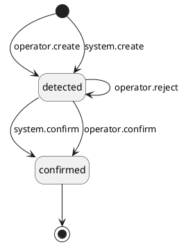

# PRD \- Phase 1A: Incoming Token

## About the Document

### List of Personnel

| **Role** | **Name** |
| --- | --- |
| Product Manager | @Jordan Chong |
| Tech Lead | @Hossein Nasr Esfahan |
| Design | @Arfian |
| QA | @Widhi Putri |
| Stakeholder | – |

---

## Overview

### Release Note

- Token deposits and incoming transfers now use the same standard handling as fiat. Clients and operators see no change in how they work.
- Operators can now manually classify, or reclassify, an incoming token when the System cannot handle it automatically.
- Prepares the platform for new incoming transaction types (e.g. trade settlement, refunds, reversals) and external-wallet workflows.

---

### Problem Statement

The current `TokenDeposit` entity was built before the platform adopted a standard, asset-agnostic model for recording asset movements (the Transaction + Movement model). Fiat already uses this model, and securities will too. Token is the only asset class still left out. This creates three problems:

- **Inconsistency.** Token incoming assets are recorded and accounted for differently from every other asset class. This forces shared services (balance, reporting, audit) to add token-only logic.
- **It blocks new transaction types.** Upcoming incoming flows — external trade settlement, refund, reversal, and others — are variations of the standard incoming pipeline (detect → classify → link). They cannot be built cleanly on the fixed, deposit-only `TokenDeposit` model.
- **It is too rigid for edge cases.** The current model has a single fixed path: a detected deposit becomes a Unified Deposit. It does not allow other manual classifications, reclassification, or manual booking.

---

### Solution Overview

The token incoming flow moves to the standard Transaction + Movement model. A new `IncomingMovement` entity replaces `TokenDeposit`. Every incoming token arrival becomes a row in the shared incoming-movement table.

The flow has four stages:

1. **Trigger.** Assets begin moving to a venue we control.
    1. *Deposit:* a client sends tokens to their assigned deposit address.
    2. *Rebalance:* when a rebalance's outgoing leg is processed, the System applies an expected balance on the destination venue. No arrival row is created until the arrival is detected.
2. **Detection and classification.** The Dfns wallet webhook reports the arrival. It fires only after the chain reaches enough confirmations, so detection already means the transfer is final.
    1. *Deposit (movement-led):* the System creates the movement, then auto-classifies it as a `deposit` by matching the destination address to its deposit wallet and account. It links to (or creates) the `Unified Deposit`.
    2. *Rebalance (auto-matched):* the System matches the webhook to the rebalance's outgoing leg by `txHash` and destination venue, creates the arrival row already classified, and confirms it at once. Compliance is skipped.
    3. *Unknown:* if the arrival matches no deposit wallet and no rebalance outgoing leg, it stays unclassified until an operator classifies it by hand as `deposit` or `rebalance` (with maker-checker). An operator can also create a record by hand when the System misses an arrival.
3. **Compliance.** The deposit path runs KYT and Travel Rule checks. The rebalance path skips them — it is an internal movement between our own venues.
4. **Confirmation.** Confirmation waits on the checks passing, not on venue finality (finality already holds at detection).
    1. *Deposit:* once classification and compliance pass and the account is active, the movement is confirmed and the client account is credited; the `Unified Deposit` completes. If compliance fails, the operator rejects it (with maker-checker): the `Unified Deposit` is rejected, the expected balance is reversed, and the movement returns to unclassified to be handled again.
    2. *Rebalance:* with no compliance needed, the matched movement is confirmed at once and cleared to In-Transit; the `Unified Rebalance` updates.

**In scope:**

- New `IncomingMovement` entity replacing `TokenDeposit`, supporting both arrival paths: movement-led deposits and auto-matched rebalance arrivals.
- Auto-classification of deposits by destination address → deposit wallet → account, linking to (or creating) the `Unified Deposit`.
- Rebalance arrivals auto-matched at detection to the `Unified Rebalance` by `txHash` and destination venue, with an expected balance applied on the destination venue from the outgoing leg.
- Operator manual classification and reclassification (as `deposit` or `rebalance`) with maker-checker, plus manual creation of a record when detection misses an arrival.
- Deposit confirmation (automatic when compliance passes and the account is active, otherwise single-operator) and rejection (maker-checker), with the matching balance effects.
- Standard suspense, expected-balance, and In-Transit accounting across the movement lifecycle.
- Hybrid rebalance: the new `IncomingMovement` is the arrival leg; the departure leg stays on the existing token withdrawal entities until Phase 1B.
- Hard cutover from `TokenDeposit` (old entity retired).

---

### Out of Scope

| **Item** | **Reason** |
| --- | --- |
| Database migration of existing `TokenDeposit` records | Existing data is disposable (pilot/UAT) — hard cutover, no backfill or reconciliation needed |
| `unknown` classification and refund handling | Manual classification in this phase is limited to `deposit` and `rebalance`; the `unknown` classification and the refund path it routes to are net-new — deferred to a later phase |
| `pending_refund` SLA alerts | Depends on the refund path, which is deferred |
| Outgoing token migration (merging the token withdrawal entities) | Delivered in Token Standardisation Phase 1B |
| Full rebalance relink (migrating the departure leg) | Delivered in Token Standardisation Phase 1C, after the outgoing entity exists |
| View-only external wallet venue | Delivered in Token Standardisation Phase 1E |
| Rebalance arrival mismatch handling (partial arrival, or an unrelated transfer sharing the `txHash`) | A `txHash` + destination venue match auto-confirms the arrival. We control the rebalance, so a mismatched or colliding arrival is unlikely — asset/amount verification and any review path are deferred |
| Client-facing access to `IncomingMovement` records directly | Clients interact with the `Unified Deposit`; the movement is an internal record (same as today) |

---

### Actors

-  **System**: detects incoming token arrivals via Dfns wallet webhooks, de-duplicates by `txHash`, creates `IncomingMovement` records, auto-classifies deposits by destination address, auto-matches rebalance arrivals to their `Unified Rebalance`, runs balance updates, and links to the `Unified Deposit` or `Unified Rebalance`.
- **Operator**: views `IncomingMovement` records; manually classifies unclassified arrivals as `deposit` or `rebalance` and reclassifies rejected ones (with maker-checker); manually creates a record when auto-detection misses an arrival; confirms deposits (single-operator) and rejects them (with maker-checker).
- **Compliance User**: reviews and resolves the KYT and Travel Rule sub-statuses on the deposit path.
- **Client**: has no direct access to `IncomingMovement` records; sees a limited subset of fields surfaced through their `Unified Deposit` (same as today).

---

### Assumptions & Dependencies

- The `Unified Deposit` and `Unified Rebalance` entities expose a linkage field to an `IncomingMovement`.
- The destination-address → deposit-wallet → account mapping is queryable at classification time.

---

### Glossary

| **Term** | **Definition** |
| --- | --- |
| `IncomingMovement` (`type: token`) | A record of an incoming token arrival at a custody venue — a row in the shared incoming-movement table, discriminated by a `type` field (`token`/`fiat`/`security`), replacing the legacy `TokenDeposit` for tokens. Incoming and outgoing movements are separate tables, so there is no `direction` field. Carries both the instruction context and the venue fact (amount, `txHash`, status). |
| `Unified Deposit` | The asset-agnostic record of a client deposit, to which a deposit-classified `IncomingMovement` is linked. |
| `Unified Rebalance` | The asset-agnostic record of an internal movement of assets between custody venues, to which a rebalance-classified `IncomingMovement` is linked. |
| Movement-led | An arrival detected with no pre-existing instruction — created on detection, then classified and linked. The path for deposits. |
| Instruction-led (auto-matched) | An arrival the System expects from one of its own instructions. No movement row exists before detection — the detected arrival is matched to the rebalance's outgoing leg by `txHash` and destination venue, classified, linked, and confirmed at once. The path for rebalance arrivals. |
| Deposit Suspense | A holding balance account credited when an incoming movement is detected but not yet attributed. It returns to zero once the movement is confirmed or rejected. |
| In-Transit | A bridging balance account that holds assets which have left a source venue but not yet arrived at the destination. It returns to zero when both rebalance legs complete. |
| Expected balance | A display-only credit that shows a pending inflow. It cannot be spent. Shown on the client account for deposits; held on the destination venue for rebalance arrivals. |

---

## Functional Requirements

### Section 1: Manual Recording Foundation

Delivers the first testable slice of the new incoming-movement model for tokens: an operator manually creates an incoming token movement (FR-1) and lists or views the records (FR-2). Token incoming assets are recorded as rows in the shared incoming-movement table with `type: token`. The row's fields, classification values (`unclassified` / `deposit` / `rebalance`), and status lifecycle are specified in the Data Model and Status Diagram.

A movement created in this section books its suspense balance (`DR Venue / CR Deposit Suspense`) and is created as `unclassified`. It then stays `unclassified`. This section does not classify the movement, create a `Unified Deposit`, or confirm and credit the client. Those steps arrive in Section 2.

This section is additive and runs alongside the existing `TokenDeposit` flow. `TokenDeposit` remains the live operational path for token deposits. Operators continue to use it for real deposit processing until Section 2 ships. Section 1 changes nothing in `TokenDeposit` and retires nothing. Clients have no access to incoming-movement rows (same as today).

#### FR-1: \[Operator\] Manually Create an Incoming Token Movement

**Requirement Details**

As a Custody Operator, I want to manually create an incoming token movement so that arrivals the System fails to detect automatically can still be recorded in the new model.

**Main Flow:**

1. Operator (maker) submits a create request via the operator API, supplying: venue, blockchain, source address, destination address, asset, amount, `txHash`, and `transactedAt` (the on-chain transaction time). In the UI, the destination address field is the lookup that helps the operator select the matching venue. All fields are mandatory.
2. System validates the submission and returns any errors immediately (see Validations).
3. A different operator (checker) reviews and approves the submission.
4. On checker approval, System re-validates the submission (see Validations) — this check is authoritative.
5. If valid, System creates the row from the supplied values — `type`: `token`, `status`: `detected`, `classification`: `unclassified`, `kytStatus`: `null`, `travelRuleStatus`: `null`, venue, asset, amount, and `transactedAt` — with the token-specific facts (blockchain, source address, destination address, `txHash`) held in the typed `details` structure.
6. System books the suspense balance for the arrival: journal entry `DR Venue / CR Deposit Suspense` (venue, asset, amount), with `transactedAt` carried onto the entry. The movement stays `detected` / `unclassified`. No `Unified Deposit` is created and the client is not credited in this section.

**Validations:** *(all checks run at both the maker submission — for immediate feedback — and checker approval, which is authoritative)*

| **Check** | **Error Code** | **Error Message** |
| --- | --- | --- |
| Source and destination addresses are well-formed for the blockchain | `RECORD_NOT_FOUND` ✏️ | The address could not be found for the specified blockchain. ✏️ |
| The supplied venue exists | `RECORD_NOT_FOUND` ✏️ | The specified venue could not be found. |
| The destination address belongs to the supplied venue | `INVALID_ARGUMENT` ✏️ | The destination address does not belong to the specified venue. |
| The asset is a supported token asset on the specified blockchain | `INVALID_ARGUMENT` ✏️ | The asset is not supported on the specified blockchain. |
| Amount is greater than zero | `INVALID_FORMAT` ✏️ | Amount must be greater than zero. |
| `transactedAt` is not in the future | `INVALID_ARGUMENT` 🔄 | The transaction time cannot be in the future. |
| No row already exists for this `txHash` on this blockchain network | `ALREADY_EXISTS` 🔄 | A movement already exists for this transaction hash. |

**Design Constraints:**

- Requires maker-checker; the same operator may not both create and approve. All validations run at submission (immediate maker feedback) and are re-run at checker approval, which is authoritative.
- `transactedAt` is the on-chain transaction timestamp (the economic effectiveness date), distinct from `createdAt` (when the row was booked). It is carried onto the suspense journal entry booked at creation.
- The dedup key (`txHash` + blockchain) is checked only within the incoming-movement table, no need to dedup against token deposit table.
- No auto-classification in this section.

**Audit Log**

**Originating event:** `mch_request:create` · **Actor:** `operator` (maker)

| **Operation** | **Scope** | `externalMetadata` | `internalMetadata` | `externalSecurityMetadata` | `internalSecurityMetadata` |
| --- | --- | --- | --- | --- | --- |
| `mch_request:create` | `internal_business` | — | `resource`, `operation`, `mchRequestId`, `venueId`, `assetId`, `amount`, `blockchain`, `sourceAddress`, `destinationAddress`, `txHash`, `transactedAt` | — | `ipAddress`, `userAgent`, `sessionId` |
| `mch_request:create` (failure) | `internal_business` | — | `errorCode`, `errorDetail` | — | `ipAddress`, `userAgent`, `sessionId` |

**Originating event:** `mch_request:approve` · **Actor:** `operator` (checker)

| Operation | Scope | `externalMetadata` | `internalMetadata` | `externalSecurityMetadata` | `internalSecurityMetadata` |
| --- | --- | --- | --- | --- | --- |
| `mch_request:approve` | `internal_business` | — | `mchRequestId`, `resource`, `operation` | — | `ipAddress`, `userAgent`, `sessionId` |
| `incoming_movement:create` | `internal_business` | — | `mchRequestId`, `makerId`, `venueId`, `assetId`, `amount`, `blockchain`, `sourceAddress`, `destinationAddress`, `txHash`, `transactedAt` | — | `ipAddress`, `userAgent`, `sessionId` |
| `balance:journal_entry` | `internal_business` | — | `debitAccount`, `creditAccount`, `venueId`, `assetId`, `amount`, `transactedAt` | — | `ipAddress`, `userAgent`, `sessionId` |
| `balance:update` | `internal_business` | — | `venueId`, `assetId`, `amount`, `balanceType` | — | `ipAddress`, `userAgent`, `sessionId` |
| `mch_request:approve` (failure) | `internal_business` | — | `errorCode`, `errorDetail` | — | `ipAddress`, `userAgent`, `sessionId` |

**Originating event:** `mch_request:reject` · **Actor:** `operator` (checker)

| **Operation** | **Scope** | `externalMetadata` | `internalMetadata` | `externalSecurityMetadata` | `internalSecurityMetadata` |
| --- | --- | --- | --- | --- | --- |
| `mch_request:reject` | `internal_business` | — | `mchRequestId`, `internalComment` | — | `ipAddress`, `userAgent`, `sessionId` |

**Mockups:**  
<https://www.figma.com/design/VsYUWXhJNc9019uUi5RlC3/-FE-UI--Incoming-Token-Movement--Operator-User-?node-id=20-15494&t=kwsCSGFGQdP5WeOt-1> 

---

#### FR-2: \[Operator\] List and View Incoming Token Movements

**Requirement Details**

As a Custody Operator, I want to list and view incoming token movements so that I can monitor arrivals, validate the new model against `TokenDeposit`, and investigate records.

**Precondition:** At least one incoming-movement row with `type: token` exists.

**Main Flow:**

1. Operator queries incoming token movements via the operator API.
2. System returns a paginated list of rows matching the applied filters (see Filters). Each row shows summary fields: movement ID, venue, asset, amount, status, classification, `txHash`, `createdAt`, and `transactedAt`.
3. Operator selects a row to view its full detail, which shows the linked transaction (the `Unified Deposit` or `Unified Rebalance` it is attributed to, if any) and the typed `details` structure (for token: blockchain, source/destination address, and `txHash`).

**Filters:**

| **Filter** | **Type** | **Allowed Values** |
| --- | --- | --- |
| ID | text (exact match) | any `incomingMovementId` |
| Classifications | enum (multi) | `unclassified`, `deposit`, `rebalance` |
| Amount | number range |  |
| Venue type | enum (multi) | deposit wallet, omnibus hot wallet, omnibus cold wallet |
| Venue Address (destination address) | text (exact match) | — |
| Asset | id reference (multi) | any `assetIds` |
| Blockchain | id reference (multi) | any `blockchainIds` |
| Transaction hash | text (exact match) | — |
| Transacted at | date range (datetime) | — |
| Created At | date range (datetime) |  |
| Statuses | enum (multi) | `detected`, `confirmed` |

**Alternate Flows:**

- No rows match the applied filters: System returns an empty list.

**Design Constraints:**

- Results are sorted by `createdAt` descending by default.
- This list is scoped to incoming movements with `type: token`; fiat and security incoming movements have their own equivalents.
- There is no client-facing list of incoming-movement rows.
- The status `confirmed`, and classification `deposit`, and `rebalance` filter values are present in the UI but match no rows in Section 1. The only rows that exist are created by FR-1 in `detected` / `unclassified`. These filter values begin to return results once Section 2 populates those states. The linked-transaction detail is likewise empty until Section 2.  
  
**Mockups:**  
<https://www.figma.com/design/VsYUWXhJNc9019uUi5RlC3/-FE-UI--Incoming-Token-Movement--Operator-User-?node-id=20-13064&t=kwsCSGFGQdP5WeOt-1>   

  

---

### Section 2: Detection, Classification, Balances and Confirmation

Makes the incoming-movement rows the source of truth for token arrivals and retires `TokenDeposit`. 

#### FR-3: \[System\] Detect and Create Incoming Token Movement (Unclassified)

**Requirement Details**

As the System, I want to create an incoming-movement row when the Dfns webhook reports an arrival so that arrivals are recorded in the new model.

**Precondition:** A Dfns wallet webhook reports an incoming on-chain transfer (it fires only after the required confirmations, so finality already holds).

**Main Flow:**

1. System receives the webhook carrying `txHash`, blockchain, source address, destination address, asset, amount, and the on-chain transaction timestamp.
2. System de-duplicates (see Validations) and checks for a rebalance match: an open `Unified Rebalance` whose **token withdrawal request (later replaced by outgoing movement)** carries the same `txHash` and whose destination venue is the venue the arrival was detected at.
3. If a rebalance match is found: System creates the row already classified — status `detected`, `classification: rebalance`, `kytStatus: skipped`, `travelRuleStatus: skipped`, linked to the matched `Unified Rebalance` — and confirms it immediately (FR-9). A matched rebalance arrival has nothing to wait for: classification is known, compliance is skipped, and finality already holds.
4. Otherwise System creates a new row: status `detected`, `classification: unclassified`, `transactionId: null`, `kytStatus: null`, `travelRuleStatus: null`, the token-specific facts (blockchain, source address, destination address, `txHash`) in the typed `details` structure, and `transactedAt` set from the on-chain transaction timestamp.

**Validations:**

| **Check** | **Error Code** | **Error Message** |
| --- | --- | --- |
| No `detected` or `confirmed` movement already records this `txHash` on this blockchain network | `ALREADY_EXISTS` 🔄 | A movement already exists for this transaction hash. |

**Alternate Flows:**

- The `txHash` matches a row already in `detected` / `confirmed`: the webhook is a duplicate and is ignored.

**Design Constraints:**

- System books the suspense balance at detection: journal entry `DR Venue / CR Deposit Suspense` (venue, asset, amount) — the same entry FR-1 books on manual creation, and it is booked for matched rebalance arrivals too (see FR-9, uniform balance path). Auto-classification of the newly created row is FR-6.
- The rebalance match requires both conditions: the `txHash` equals the outgoing leg's `txHash`, and the arrival venue equals the rebalance's destination venue. The venue condition is what excludes a UTXO change output, which returns to the source venue under the same `txHash`.
- If the outgoing leg's `txHash` is not yet recorded in the System when the arrival is detected (for example, a transfer execute  
d outside the System), no match occurs. The movement stays `detected` / `unclassified` and an operator classifies it manually (F  
R-7).
- Webhook processing is idempotent on `txHash` + blockchain network; this is also the dedup key used by manual creation (FR-1).
- 🚩 **Known limitation (this phase):**`txHash` + network cannot disambiguate multiple transfers that share one `txHash` (EVM batch / multi-event transactions, UTXO multi-output transactions) — a second same-transaction transfer into our venues would be rejected as a duplicate. Refining the key with a per-transfer index (EVM log / native trace index, UTXO output index) is deferred pending confirmation that the provider supplies it.
- When this FR ships, the incoming-movement model takes over arrival detection and `TokenDeposit` is retired: it no longer detects arrivals, books balances, creates `Unified Deposits`, or runs compliance. The cutover is atomic to avoid double-booking

**Audit Log**

**Originating event:** `incoming_movement:detect` · **Actor:** `system_user`

> 🚩 **REVISIT:** Originating event assumes the inbound Dfns wallet webhook is an external, unrecorded trigger, so `incoming_movement:detect` is our first recorded step. If inbound blockchain events are themselves recorded as audit rows (e.g. a `blockchain_event:received` from Blockchain Events Management), repoint this as a fan-out of that event.

| Operation | Scope | `externalMetadata` | `internalMetadata` | `externalSecurityMetadata` | `internalSecurityMetadata` |
| --- | --- | --- | --- | --- | --- |
| `incoming_movement:detect` | `internal_business` | — | `venueId`, `assetId`, `amount`, `blockchain`, `sourceAddress`, `destinationAddress`, `txHash`, `transactedAt` | — | — |
| `balance:journal_entry` | `internal_business` | — | `debitAccount`, `creditAccount`, `venueId`, `assetId`, `amount`, `transactedAt` | — | — |
| `balance:update` | `internal_business` | — | `venueId`, `assetId`, `amount`, `balanceType` | — | — |
| `incoming_movement:confirm` | `internal_business` | — | `txHash`, `blockchain`, `unifiedRebalanceId` | — | — |
| `incoming_movement:detect` (failure) | `internal_business` | — | `errorCode`, `errorDetail`, `txHash`, `blockchain` | — | — |

---

#### FR-4: \[System\] Apply Expected Venue Balance for a Rebalance Arrival

**Requirement Details**

As the System, I want to apply an expected balance on the destination venue when a rebalance's outgoing leg is processed so that the upcoming arrival is visible in venue projections while the transfer is in transit.

**Precondition:** A `Unified Rebalance` exists and its outgoing leg has been processed, yielding the destination venue.

**Main Flow:**

1. On processing of the rebalance outgoing leg, System applies the venue-level expected balance: `↑ Expected Venue Balance` (destination venue, asset, rebalance leg amount).

**Design Constraints:**

- No incoming-movement row is created before the arrival is detected. The arrival is recorded at detection and auto-matched to the `Unified Rebalance` by `txHash` and destination venue (FR-3), or classified manually (FR-7).
- The expected venue balance is a display-only projection. It is cleared when the arrival is confirmed (FR-9).
- Application is idempotent on the rebalance leg.
- 🚩 **REVISIT:** if the rebalance outgoing leg fails after processing (for example, a dropped on-chain transaction), the arrival never comes and the expected venue balance must be reversed. Confirm the reversal trigger with engineering — it is tied to the legacy withdrawal failure path this phase (see FR-9 design constraints on the Phase 1A hybrid).

**Audit Log**

**Originating event:** `token_withdrawal:broadcast` · **Actor:** `system_user`

| Operation | Scope | `externalMetadata` | `internalMetadata` | `externalSecurityMetadata` | `internalSecurityMetadata` |
| --- | --- | --- | --- | --- | --- |
| `balance:update` | `internal_business` | — | `venueId`, `assetId`, `amount`, `balanceType`, `unifiedRebalanceId` | — | — |
| `balance:update` (failure) | `internal_business` | — | `errorCode`, `errorDetail`, `unifiedRebalanceId` | — | — |

---

~~Section 2: Classification, Balances and Confirmation (Cutover)~~

~~Makes the incoming-movement rows authoritative. At cutover, detection books suspense, classification creates/links the Unified Deposit and applies balances, confirmation credits the client, and TokenDeposit is retired. These ship together as one atomic cutover because they replace TokenDeposit's balance and Unified Deposit handling. They cannot run in parallel without double-booking.~~

~~FR-5: \[System\] Cut Over to Incoming Movement and Retire TokenDeposit~~

~~Requirement Details~~

~~As a platform architect, I want the incoming-movement rows to become the source of truth and TokenDeposit retired so that balances and Unified Deposits are driven by the standardised model.~~

~~Precondition: The Section 1 foundation is in production and has been validated against TokenDeposit.~~

~~Main Flow:~~

1. ~~Detection (FR-3) now books DR Venue / CR Deposit Suspense for every arrival — both a newly created unclassified row and a matched pending rebalance movement (the latter is cleared again within the same confirm operation, FR-9).~~
2. ~~Rebalance pre-creation (FR-4) now applies the venue-level expected balance on the destination venue: ↑ Expected Venue Balance (destination venue, asset, rebalance leg amount).~~
3. ~~The KYT and Travel Rule sub-workflows are re-pointed to run against the deposit-classified incoming movement — their outcomes are recorded as kytStatus and travelRuleStatus on the movement. TokenDeposit no longer runs them.~~
4. ~~TokenDeposit is retired: it no longer detects arrivals, books balances, creates Unified Deposits, or runs compliance. The incoming-movement model takes over these responsibilities.~~

~~Design Constraints:~~

- ~~Hard cutover; existing TokenDeposit records are not migrated (pilot/UAT data is disposable).~~
- ~~The cutover is atomic — balance, Unified Deposit, and compliance responsibility moves from TokenDeposit to the incoming-movement model in a single release to avoid double-booking.~~
- ~~KYT and Travel Rule are the existing implementations re-pointed onto the incoming movement, not rewritten. In Section 1 they continue to run on TokenDeposit.~~

---

#### FR-6: \[System\] Auto-classify a Detected Deposit

**Requirement Details**

As the System, I want to auto-classify a newly detected unlinked movement as a deposit when its destination resolves to a known deposit wallet so that the `Unified Deposit` is created and the client sees the expected inflow.

**Precondition:** A movement exists in `detected` status with `classification: unclassified` and `transactionId: null`.

**Main Flow:**

1. System resolves the movement's venue to its linked client account.
2. 🚩 **Developer check:** Confirm whether this resolution and classification step runs synchronously as part of the detection or creation flow, or asynchronously via a scheduled job — particularly for movements created manually (FR-1). On a successful resolution, System sets `classification: deposit`, sets `kytStatus: pending` and `travelRuleStatus: not_declared` on the movement, and creates a `Unified Deposit` for that account and asset (transaction type `deposit`, initiation mode `movement_led`, status `processing`).
3. System applies the expected balance update: `↑ Expected Client Account` (destination account, asset, amount).

**Alternate Flows:**

- The destination does not resolve to a known deposit wallet, and no rebalance outgoing leg matched at detection (FR-3): the movement stays `detected` / `unclassified` and waits for operator manual classification (FR-7).

**Design Constraints:**

- Auto-classification considers only the `deposit` path; `rebalance` arrivals are auto-matched at detection (FR-3), and any other case goes to manual classification.

**Audit Log**

**Originating event:** `incoming_movement:classify` · **Actor:** `system_user`

| **Operation** | **Scope** | `externalMetadata` | `internalMetadata` | `externalSecurityMetadata` | `internalSecurityMetadata` |
| --- | --- | --- | --- | --- | --- |
| `incoming_movement:classify` | `internal_business` | — | `classification`, `kytStatus`, `travelRuleStatus`, `accountId` | — | — |
| `unified_deposit:create` | `external_business` | `amount`, `assetId`, `accountId` | `venueId`, `incomingMovementId` | — | — |
| `balance:update` | `internal_business` | — | `accountId`, `assetId`, `amount`, `balanceType` | — | — |
| `incoming_movement:classify` (failure) | `internal_business` | — | `errorCode`, `errorDetail` | — | — |

---

---

#### FR-7: \[Operator\] Manually Classify or Reclassify an Incoming Token Movement

**Requirement Details**

As a Custody Operator, I want to manually classify an unclassified movement as a deposit or rebalance so that arrivals auto-classification could not resolve are still attributed.

**Precondition:** A movement is in `detected` status with `classification: unclassified`.

**Main Flow:**

1. Operator (maker) classifies the movement via the operator API, specifying `deposit` (with destination account) or `rebalance` (with the target `Unified Rebalance`).
2. A different operator (checker) reviews the proposed classification and approves or rejects.
3. On checker approval, System sets the classification and links the movement:
    - `deposit`: sets `kytStatus: pending` and `travelRuleStatus: not_declared`, links to (or creates) the `Unified Deposit`, and applies `↑ Expected Client Account` (as FR-6).
    - `rebalance`: sets `kytStatus: skipped` and `travelRuleStatus: skipped`, and links to the specified `Unified Rebalance` (no client expected balance).

**Validations:** *(all checks run at both the maker submission — for immediate feedback — and checker approval, which is authoritative)*

| **Check** | **Error Code** | **Error Message** |
| --- | --- | --- |
| The movement is in `detected` status with `classification: unclassified` | `INVALID_RECORD_STATE` 🔄 | The movement is not in a classifiable state. |
| Classification is one of `deposit` or `rebalance` | `UNSUPPORTED_VALUE` 🔄 | Classification must be deposit or rebalance. |
| For `deposit`: the destination account exists | `ACCOUNT_NOT_FOUND` 🔄 | The destination account could not be found. |
| For `deposit`: the destination account is active | `ACCOUNT_NOT_ACTIVE` | The destination account is not active. |
| For `rebalance`: the target `Unified Rebalance` exists | `RECORD_NOT_FOUND` 🔄 | The rebalance could not be found. |

**Alternate Flows:**

- Checker rejects the proposed classification: no change is made; the movement remains `unclassified`.

**Design Constraints:**

- Classification (and reclassification) requires maker-checker; the same operator may not both propose and approve.
- A previously rejected movement (FR-10) returns to `unclassified` and is reclassified through this same flow. Reclassifying it as `deposit` creates a **new** `Unified Deposit` — the rejected deposit is not reused.
- Only `deposit` and `rebalance` are available this phase; the `unknown` classification and refund path are out of scope.

**Audit Log**

**Originating event:** `mch_request:create` · **Actor:** `operator` (maker)

| **Operation** | **Scope** | `externalMetadata` | `internalMetadata` | `externalSecurityMetadata` | `internalSecurityMetadata` |
| --- | --- | --- | --- | --- | --- |
| `mch_request:create` | `internal_business` | — | `resource`, `operation`, `mchRequestId`, `classification`, `accountId`, `unifiedRebalanceId` | — | `ipAddress`, `userAgent`, `sessionId` |
| `mch_request:create` (failure) | `internal_business` | — | `errorCode`, `errorDetail` | — | `ipAddress`, `userAgent`, `sessionId` |

**Originating event:** `mch_request:approve` · **Actor:** `operator` (checker)

| **Operation** | **Scope** | `externalMetadata` | `internalMetadata` | `externalSecurityMetadata` | `internalSecurityMetadata` |
| --- | --- | --- | --- | --- | --- |
| `mch_request:approve` | `internal_business` | — | `mchRequestId`, `resource`, `operation` | — | `ipAddress`, `userAgent`, `sessionId` |
| `incoming_movement:classify` | `internal_business` | — | `mchRequestId`, `makerId`, `classification`, `kytStatus`, `travelRuleStatus`, `accountId`, `unifiedRebalanceId` | — | `ipAddress`, `userAgent`, `sessionId` |
| `unified_deposit:create` | `external_business` | `amount`, `assetId`, `accountId` | `mchRequestId`, `makerId`, `venueId`, `incomingMovementId` | — | `ipAddress`, `userAgent`, `sessionId` |
| `balance:update` | `internal_business` | — | `accountId`, `assetId`, `amount`, `balanceType` | — | `ipAddress`, `userAgent`, `sessionId` |
| `mch_request:approve` (failure) | `internal_business` | — | `errorCode`, `errorDetail` | — | `ipAddress`, `userAgent`, `sessionId` |

**Originating event:** `mch_request:reject` · **Actor:** `operator` (checker)

| **Operation** | **Scope** | `externalMetadata` | `internalMetadata` | `externalSecurityMetadata` | `internalSecurityMetadata` |
| --- | --- | --- | --- | --- | --- |
| `mch_request:reject` | `internal_business` | — | `mchRequestId`, `internalComment` | — | `ipAddress`, `userAgent`, `sessionId` |

**Mockups:**  
<https://www.figma.com/design/VsYUWXhJNc9019uUi5RlC3/-FE-UI--Incoming-Token-Movement--Operator-User-?node-id=21-6616&t=kwsCSGFGQdP5WeOt-1> 

---

#### FR-8: \[System / Operator\] Confirm Deposit Movement

**Requirement Details**

As the System or an operator, I want to confirm a classified deposit once its checks pass so that the client account is credited and the `Unified Deposit` completes.

**Precondition:** A movement is in `detected` status with `classification: deposit`, linked to a `Unified Deposit` in `processing` status.

**Main Flow:**

1. System verifies the movement's `kytStatus` is `passed` or `overridden_to_passed`, and `travelRuleStatus` is `passed` or `overridden_to_passed`, and that the destination account is `active`.
2. System transitions the movement to `confirmed` and the linked `Unified Deposit` to `completed`. (NOTE: the current final unified deposit status for token is `confirmed`, we should change this to `completed` and it is meant to be different from the final status of movement)
3. System applies the confirmation balance updates: journal entry `DR Deposit Suspense / CR Client Account` (destination account, asset, amount), and `↓ Expected Client Account`.

**Validations:**

| **Check** | **Error Code** | **Error Message** |
| --- | --- | --- |
| The movement is in `detected` status with `classification: deposit` | `INVALID_RECORD_STATE` 🔄 | The movement is not in a confirmable state. |
| The linked `Unified Deposit` is in `processing` status | `INVALID_RECORD_STATE` 🔄 | The linked deposit is not in a confirmable state. |

**Alternate Flows:**

- Compliance has passed and the account is `active`: confirmation is automatic.
- Compliance has passed but auto-confirmation did not occur: an operator may confirm manually (single-operator; no maker-checker).
- The destination account is not `active`: the movement is held at `detected` — it is not confirmed and the expected balance never clears to `total`. No frozen/blocked status is exposed; the client perceives normal venue-confirmation delay. An operator must manually re-confirm once the account returns to `active`.
- KYT or Travel Rule has failed: the movement cannot be confirmed; further compliance review is required, as a failure may be a false negative. The operator resolves it via rejection (FR-10) or escalates for compliance re-evaluation.

**Design Constraints:**

- 🔄 NOTE: the existing KYT and TR functionality from previous [PRD](https://team-1602221989898.atlassian.net/wiki/spaces/AM/pages/2309750845/1.3+KYT+and+Travel+Rule) should be ported from token deposit to incoming movement (token). This includes run KYT, submit TR declaration, pass / fail, etc.
- KYT and Travel Rule are existing compliance sub-workflows carried over unchanged; this phase does not alter them.
- Confirmation is single-operator because the decision that matters (classification) already passed maker-checker on the manual path, and is made by the System on the auto path.

**Audit Log**

**Originating event:** `incoming_movement:confirm` · **Actor:** `system_user` (auto-confirm)

| **Operation** | **Scope** | `externalMetadata` | `internalMetadata` | `externalSecurityMetadata` | `internalSecurityMetadata` |
| --- | --- | --- | --- | --- | --- |
| `incoming_movement:confirm` | `internal_business` | — | `accountId`, `assetId`, `amount`, `kytStatus`, `travelRuleStatus` | — | — |
| `unified_deposit:complete` | `external_business` | `amount`, `assetId`, `accountId` | `venueId`, `incomingMovementId` | — | — |
| `balance:journal_entry` | `internal_business` | — | `debitAccount`, `creditAccount`, `accountId`, `assetId`, `amount`, `transactedAt` | — | — |
| `balance:update` | `internal_business` | — | `accountId`, `assetId`, `amount`, `balanceType` | — | — |
| `incoming_movement:confirm` (failure) | `internal_business` | — | `errorCode`, `errorDetail` | — | — |

**Originating event:** `incoming_movement:confirm` · **Actor:** `operator` (manual confirm)

| **Operation** | **Scope** | `externalMetadata` | `internalMetadata` | `externalSecurityMetadata` | `internalSecurityMetadata` |
| --- | --- | --- | --- | --- | --- |
| `incoming_movement:confirm` | `internal_business` | — | `accountId`, `assetId`, `amount`, `kytStatus`, `travelRuleStatus` | — | `ipAddress`, `userAgent`, `sessionId` |
| `unified_deposit:complete` | `external_business` | `amount`, `assetId`, `accountId` | `venueId`, `incomingMovementId` | — | `ipAddress`, `userAgent`, `sessionId` |
| `balance:journal_entry` | `internal_business` | — | `debitAccount`, `creditAccount`, `accountId`, `assetId`, `amount`, `transactedAt` | — | `ipAddress`, `userAgent`, `sessionId` |
| `balance:update` | `internal_business` | — | `accountId`, `assetId`, `amount`, `balanceType` | — | `ipAddress`, `userAgent`, `sessionId` |
| `incoming_movement:confirm` (failure) | `internal_business` | — | `errorCode`, `errorDetail` | — | `ipAddress`, `userAgent`, `sessionId` |

---

**Mockups:**  
<https://www.figma.com/design/VsYUWXhJNc9019uUi5RlC3/-FE-UI--Incoming-Token-Movement--Operator-User-?node-id=24-17120&t=kwsCSGFGQdP5WeOt-1> 

---

#### FR-9: \[System\] Confirm Rebalance Arrival Movement

**Requirement Details**

As the System, I want to confirm a matched rebalance arrival immediately so that the destination venue balance is settled and the `Unified Rebalance` can complete.

**Precondition:** A movement is classified `rebalance` and linked to a `Unified Rebalance` — either auto-matched at detection (FR-3) or manually classified by an operator (FR-7).

**Main Flow:**

1. The arrival is already linked to a `Unified Rebalance` — either auto-matched at detection by `txHash` and destination venue (FR-3) or manually classified by an operator (FR-7). The match is sufficient; asset and amount are not re-asserted (see Design Constraints).
2. Because compliance is skipped (`kytStatus` / `travelRuleStatus`: `skipped`) and finality already holds at detection, the System confirms the movement immediately — it goes straight to `confirmed` without staying in `detected`.
3. System applies the confirmation balance update: journal entry `DR Deposit Suspense / CR In-Transit` (destination venue, asset, amount); the venue-level expected balance applied at the outgoing leg (FR-4), is cleared.
4. System updates the linked `Unified Rebalance` to reflect the confirmed arrival leg. The `Unified Rebalance` completes if the token withdrawal request linked to the rebalance is also already confirmed.

**Validations:** None — the detection-time match (FR-3) or the approved manual classification (FR-7) is what authorises confirmation.

**Alternate Flows:**

- The rebalance's outgoing (departure) leg is not yet confirmed: the `Unified Rebalance` is not yet completed; it completes only when both legs are confirmed.

**Design Constraints:**

- The rebalance path skips compliance — it is an internal movement between our own venues (`kytStatus` and `travelRuleStatus`: `skipped`).
- Confirmation is automatic — no operator action and no maker-checker.
- The `txHash` + destination venue match alone confirms the arrival; asset, amount, and source address are recorded for audit but not asserted.
- **Uniform balance path:** every detected arrival books `DR Venue / CR Deposit Suspense` (FR-1, FR-3), so every rebalance confirmation — auto-matched or manually classified — clears the same `DR Deposit Suspense / CR In-Transit`. There is no separate no-suspense path.
- Mismatch handling (partial arrival, or an unrelated transfer sharing the `txHash`) is out of scope this phase. We control the rebalance, so a mismatched or colliding arrival is unlikely.
- Phase 1A is hybrid: the arrival leg is this incoming-movement row, while the departure leg stays on the legacy token withdrawal entities (migrated in Phase 1B). The `Unified Rebalance` links both legs.

**Audit Log**

**Originating event:** `incoming_movement:confirm` · **Actor:** `system_user`

| **Operation** | **Scope** | `externalMetadata` | `internalMetadata` | `externalSecurityMetadata` | `internalSecurityMetadata` |
| --- | --- | --- | --- | --- | --- |
| `incoming_movement:confirm` | `internal_business` | — | `txHash`, `blockchain`, `unifiedRebalanceId`, `assetId`, `amount` | — | — |
| `balance:journal_entry` | `internal_business` | — | `debitAccount`, `creditAccount`, `venueId`, `assetId`, `amount`, `transactedAt` | — | — |
| `balance:update` | `internal_business` | — | `venueId`, `assetId`, `amount`, `balanceType` | — | — |
| `unified_rebalance:update` | `internal_business` | — | `unifiedRebalanceId`, `arrivalLegStatus` | — | — |
| `incoming_movement:confirm` (failure) | `internal_business` | — | `errorCode`, `errorDetail` | — | — |

---

---

#### FR-10: \[Operator\] Reject a Classified Deposit

**Requirement Details**

As a Custody Operator, I want to reject a deposit — rejecting the linked `Unified Deposit` — when its compliance checks fail so that the expected credit is reversed and the movement returns to unclassified to be classified again.

**Precondition:** A movement is in `detected` status with `classification: deposit`, linked to a `Unified Deposit` in `processing` status (typically after a KYT or Travel Rule failure).

**Main Flow:**

1. Operator (maker) rejects the deposit via the operator API, supplying an `externalComment` and an optional `internalComment`.
2. A different operator (checker) reviews and approves the rejection.
3. On checker approval, System transitions the linked `Unified Deposit` to `rejected` and reverses the expected balance: `↓ Expected Client Account`.
4. System unlinks the movement (`transactionId: null`), resets `kytStatus` and `travelRuleStatus` to `null`, and returns it to `classification: unclassified` in `detected` status.

**Validations:** *(checks run at both the maker submission — for immediate feedback — and checker approval, which is authoritative)*

| **Check** | **Error Code** | **Error Message** |
| --- | --- | --- |
| The movement is classified as `deposit` and linked to a `processing` `Unified Deposit` | `INVALID_RECORD_STATE` 🔄 | The movement is not in a rejectable state. |

**Alternate Flows:**

- Checker rejects the rejection request: no change is made; the movement remains classified as `deposit`.

**Design Constraints:**

- Rejection requires maker-checker; the same operator may not both propose and approve.
- The movement is never destroyed — rejection returns it to `unclassified` (the Deposit Suspense booking from detection is preserved), so it can be reclassified via FR-7.
- The rejected `Unified Deposit` remains as an audit record.

**Audit Log**

**Originating event:** `mch_request:create` · **Actor:** `operator` (maker)

| **Operation** | **Scope** | `externalMetadata` | `internalMetadata` | `externalSecurityMetadata` | `internalSecurityMetadata` |
| --- | --- | --- | --- | --- | --- |
| `mch_request:create` | `internal_business` | — | `resource`, `operation`, `mchRequestId`, `externalComment`, `internalComment`, `incomingMovementId` | — | `ipAddress`, `userAgent`, `sessionId` |
| `mch_request:create` (failure) | `internal_business` | — | `errorCode`, `errorDetail` | — | `ipAddress`, `userAgent`, `sessionId` |

**Originating event:** `mch_request:approve` · **Actor:** `operator` (checker)

| **Operation** | **Scope** | `externalMetadata` | `internalMetadata` | `externalSecurityMetadata` | `internalSecurityMetadata` |
| --- | --- | --- | --- | --- | --- |
| `mch_request:approve` | `internal_business` | — | `mchRequestId`, `resource`, `operation` | — | `ipAddress`, `userAgent`, `sessionId` |
| `unified_deposit:reject` | `external_business` | `externalComment`, `amount`, `assetId`, `accountId` | `mchRequestId`, `makerId`, `internalComment`, `venueId`, `incomingMovementId` | — | `ipAddress`, `userAgent`, `sessionId` |
| `balance:update` | `internal_business` | — | `accountId`, `assetId`, `amount`, `balanceType` | — | `ipAddress`, `userAgent`, `sessionId` |
| `incoming_movement:unclassify` | `internal_business` | — | `mchRequestId`, `makerId` | — | `ipAddress`, `userAgent`, `sessionId` |
| `mch_request:approve` (failure) | `internal_business` | — | `errorCode`, `errorDetail` | — | `ipAddress`, `userAgent`, `sessionId` |

**Originating event:** `mch_request:reject` · **Actor:** `operator` (checker)

| **Operation** | **Scope** | `externalMetadata` | `internalMetadata` | `externalSecurityMetadata` | `internalSecurityMetadata` |
| --- | --- | --- | --- | --- | --- |
| `mch_request:reject` | `internal_business` | — | `mchRequestId`, `internalComment` | — | `ipAddress`, `userAgent`, `sessionId` |

**Mockups Deposit Transaction List & Views:**  
<https://www.figma.com/design/Xizb2ZkYYyheVUJwXIycs8/-FE-UI--Deposit-Transaction-2.0--Operator-User-?node-id=159-2585&t=e5kSZpZiFPYAK6Zz-1>

  
**Mockups Reject Deposit:**  
<https://www.figma.com/design/Xizb2ZkYYyheVUJwXIycs8/-FE-UI--Deposit-Transaction-2.0--Operator-User-?node-id=190-16020&t=e5kSZpZiFPYAK6Zz-1> 

---

## Non-Functional Requirements

N/A

---

## Technical Specifications

### Data Model

This data model introduces the `IncomingMovement` entity (`type: token`), replacing `TokenDeposit`. The `IncomingMovement` table is a shared, asset-agnostic table discriminated by `type`; this PRD specifies only the `token` type. Clients have no direct access to `IncomingMovement` records — they interact with the `Unified Deposit`.

---

#### IncomingMovement Data Model

> Includes standard system fields: `id`, `createdAt`, `createdBy`, `updatedAt`, `updatedBy`. These are not repeated in the table below.

| **Field Name** | **Non-null** | **Mutable** | **Client Visible** | **Data Type** | **Field Profile** | **Description** | **Rules/Constraints** |
| --- | --- | --- | --- | --- | --- | --- | --- |
| `type` | Y | — | — | varchar | `enum` | Asset class discriminator. This PRD introduces `token`. | Values: `token`, `fiat`, `security` |
| `status` | Y | Y | — | varchar | `enum` | Movement lifecycle status. | Values: `detected`, `confirmed` |
| `classification` | Y | Y | — | varchar | `enum` | Break-resolution outcome. Initialised to `unclassified` at detection; updated on classification (FR-6, FR-7); reset to `unclassified` on deposit rejection (FR-10). | Values: `unclassified`, `deposit`, `rebalance` |
| `venueId` | Y | — | — | uuid | `uuid` | FK → Venue. The custody venue at which the asset arrived. | — |
| `assetId` | Y | — | — | uuid | `uuid` | FK → Asset. | — |
| `amount` | Y | — | — | decimal | `non_negative_amount` | Arriving amount, set from the operator submission or webhook payload (FR-1, FR-3). | Must be greater than zero. |
| `transactionId` | — | Y | — | uuid | `uuid` | FK → Unified Deposit or Unified Rebalance. Set at rebalance auto-match at detection (FR-3) or on classification (FR-6, FR-7); null while `unclassified`. Reset to null on deposit rejection (FR-10). | — |
| `transactedAt` | Y | — | — | timestamptz | `timestamp_tz` | On-chain transaction timestamp (economic effectiveness date), set from the webhook payload or operator submission. Propagates to balance journal entries. | Must not be in the future when set by an operator (FR-1). |
| `kytStatus` | — | Y | — | varchar | `enum` | KYT compliance check outcome. `null` while `unclassified` — including after a deposit rejection returns the movement to `unclassified` (FR-10). Set to `pending` on deposit classification (FR-6, FR-7); `skipped` on rebalance auto-match or classification (FR-3, FR-7). 🚩 | Values: `pending`, `passed`, `failed`, `skipped`, `unsupported` |
| `travelRuleStatus` | — | Y | — | varchar | `enum` | Travel Rule compliance check outcome. `null` while `unclassified` — including after a deposit rejection returns the movement to `unclassified` (FR-10). Set to `not_decalred` on deposit classification (FR-6, FR-7); `skipped` on rebalance auto-match or classification (FR-3, FR-7). 🚩 | Values: `not_declared`, `declared`, `passed`, `failed`, `skipped` |
| `mchRequestId` | — | Y | — | uuid | `uuid` | FK → MCH Request. Set when a maker initiates a maker-checker update on the movement — classification/reclassification (FR-7) or deposit rejection (FR-10) — and cleared when that request resolves (approved or rejected). While set, no other operator may start a concurrent update on the movement. Not used for create (FR-1), where the row does not yet exist. | — |
| `details` | Y | — | — | json | `json` | Asset-class-specific facts, typed by `type`. See `IncomingMovement.details (token)`. | — |

**Indexes:**

- `idx_incoming_movement_type_status` on `(type, status)` — list filtering by asset class and lifecycle state (FR-2)
- `idx_incoming_movement_type_classification` on `(type, classification)` — break-resolution worklist queries (FR-7)
- `idx_incoming_movement_venue_id` on `venueId` — venue-scoped filtering (FR-2)
- `idx_incoming_movement_asset_id` on `assetId` — asset-scoped filtering (FR-2)
- `idx_incoming_movement_transaction_id` on `transactionId` — reverse-lookup from Unified Deposit / Unified Rebalance
- `idx_incoming_movement_transacted_at` on `transactedAt` — date-range filter (FR-2)
- `idx_incoming_movement_tx_hash` on `((details-&gt;&gt;'txHash'), (details-&gt;&gt;'blockchain'))` (functional) — dedup check on `txHash` + blockchain network (FR-1, FR-3)

**Relationships:**

- `IncomingMovement.venueId` → `Venue.id` (many-to-one)
- `IncomingMovement.assetId` → `Asset.id` (many-to-one)
- `IncomingMovement.transactionId` → `UnifiedDeposit.id` or `UnifiedRebalance.id` (many-to-one; polymorphic by `classification`)
- `IncomingMovement.mchRequestId` → `MchRequest.id` (many-to-one)

> 🚩 **Open question — **`kytStatus`** / **`travelRuleStatus`** placement.** These are kept at the movement level for Phase 1A (token-only); the confirmation gate ANDs the two (`kytStatus == passed AND travelRuleStatus == passed`, or both `skipped` for rebalance). We are **unsure whether they belong here or inside **`details (token)`**.** They are token-specific — fiat and securities have neither check — so on the shared, asset-agnostic table they would sit permanently null for non-token rows. The likely future shape is a shared `complianceStatus` roll-up at the movement level with the asset-specific checks pushed into each `details` blob. Revisit when the second asset class (fiat/securities) is introduced. That is when the roll-up becomes worth adding.

---

##### `IncomingMovement.details (token)`

| **Field Name** | **Non-null** | **Mutable** | **Client Visible** | **Data Type** | **Field Profile** | **Description** | **Rules/Constraints** |
| --- | --- | --- | --- | --- | --- | --- | --- |
| `blockchain` | Y | — | — | uuid | `uuid` | FK → Blockchain. The blockchain network on which the transaction occurred. | — |
| `sourceAddress` | Y | — | — | varchar | `alphanumeric` | On-chain address from which the transfer originated. | Must be a valid format for the blockchain (FR-1). |
| `destinationAddress` | Y | — | — | varchar | `alphanumeric` | On-chain address at which the transfer arrived; must belong to the specified venue. | Must be a valid format for the blockchain and belong to `venueId` (FR-1). |
| `txHash` | Y | — | — | varchar | `alphanumeric` | On-chain transaction hash. Combined with `blockchain`, forms the dedup key across `IncomingMovement` rows. | — |

### Status Diagram

The `status` field on `IncomingMovement` (`type: token`) tracks the venue-fact lifecycle of an incoming token movement. Incoming-movement rows are operator-internal — clients have no access to them — so every status has no client label.

---

#### IncomingMovement.status Status

| **Status** | **Operator Label** | **Client Label** | **Meaning** | **Preconditions** | **Next States** | **Downstream Logic** |
| --- | --- | --- | --- | --- | --- | --- |
| `detected` | Detected | — | The arrival has been observed at the venue (webhook or manual entry); finality already holds. Awaiting classification, compliance, and the account-status gate before confirmation.A rebalance arrival auto-matched at detection (FR-3) passes through this status and confirms immediately. | — | `detected`, `confirmed` | — |
| `confirmed` | Confirmed | — | Venue finality is confirmed and the movement is settled — a deposit credited to the client, or a rebalance arrival cleared to In-Transit. Terminal. | Confirm as a deposit requires `kytStatus == passed`, `travelRuleStatus == passed`, and the destination account `active` (FR-8).Confirm as a rebalance requires the link to a `Unified Rebalance` — auto-matched (FR-3) or manually classified (FR-7). | — | — |

### API Specifications

For API specifications, refer to the OpenAPI spec on Apidog.

### Error Handling

N/A

---

## Appendix

### Research References

- \[To be added by PM — include relevant research links, competitor analysis, design references\]

---

## Summary of Changes

**2026-07-23 — FR-1 error-code alignment (ticket [AM-2484](https://team-1602221989898.atlassian.net/browse/AM-2484)).** QA runs on the FR-1 create flow found the backend returns different error codes from those the PRD specified. Per the PM decision that the current backend behavior is the intended behavior, the FR-1 validation error codes have been updated to match it. ✏️ marks every field changed in this revision.

| **FR-1 validation check** | **Previous** | **Updated ✏️** | **Basis (QA test)** |
| --- | --- | --- | --- |
| Source/destination address well-formed for the blockchain | `INVALID_FORMAT` | `RECORD_NOT_FOUND` | Backend resolves the address by lookup and returns `RECORD_NOT_FOUND` (AM-T1774). Message also aligned to not-found wording. |
| The supplied venue exists | `VENUE_NOT_FOUND` | `RECORD_NOT_FOUND` | Backend returns the generic `RECORD_NOT_FOUND` (AM-T1775). |
| Destination address belongs to the supplied venue | `INVALID_VENUE_REQUEST` | `INVALID_ARGUMENT` | Backend returns `INVALID_ARGUMENT` (AM-T1776). |
| Asset is a supported token asset on the blockchain | `INVALID_ASSET_TYPE` | `INVALID_ARGUMENT` | Backend returns `INVALID_ARGUMENT` (AM-T1777). |
| Amount is greater than zero | `INVALID_AMOUNT` | `INVALID_FORMAT` | Backend returns `INVALID_FORMAT` (AM-T1778). |

**Deliberately not changed:**

- `transactedAt` not in the future — already `INVALID_ARGUMENT`, which matches the backend (AM-T1779, passed).
- Duplicate `txHash` at approval — PRD retains `ALREADY_EXISTS` as the intended response. The backend currently throws `INTERNAL_ERROR` (AM-T1781); this is a backend defect for engineering to fix, not a spec change.
- Error *messages* were left in their existing PRD wording (except row 1, adjusted to fit the not-found code). Per the PM guidance on the ticket, messages pass QA when the meaning is equivalent and grammatical; they need not match the backend word-for-word.
