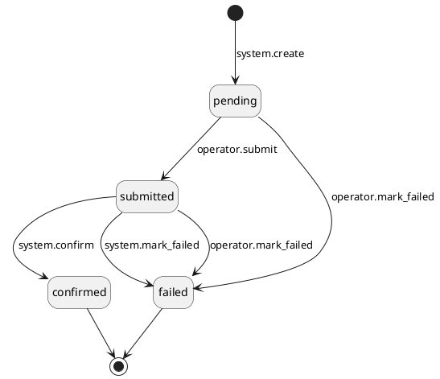
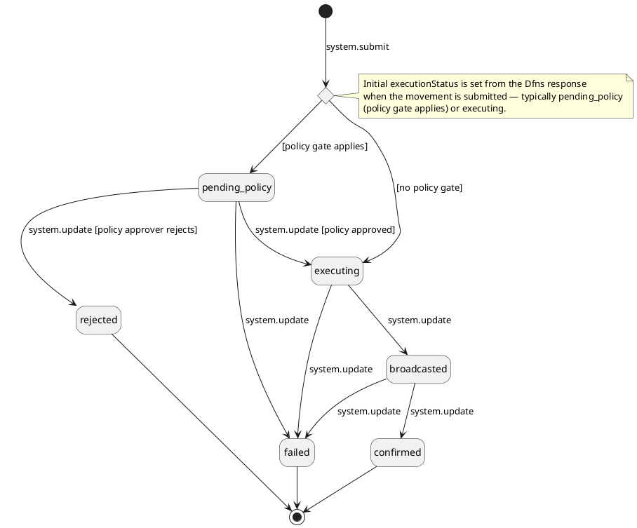
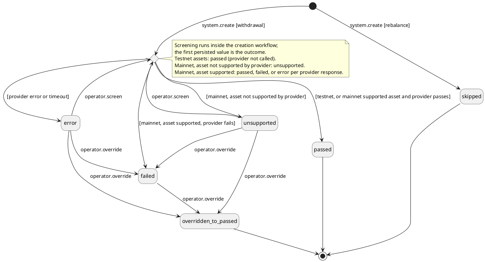
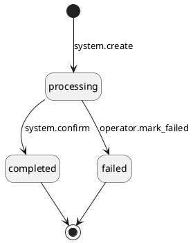

# PRD \- Phase 1B: Outgoing Token

## About the Document

### List of Personnel

| **Role** | **Name** |
| --- | --- |
| Product Manager | @Jordan Chong |
| Tech Lead | @Hossein Nasr Esfahan |
| Design | @Arfian |
| QA | @Widhi Putri |
| Stakeholder | – |

---

## Overview

### Release Note

- Token withdrawals now use the same standard handling as fiat and securities. Clients and operators see no change in how they work.
- Each token withdrawal is now a single record from start to finish, instead of two records that operators had to reconcile.
- Prepares the platform for new outgoing classifications (e.g. refunds, reversals, write-offs), the upcoming Dfns cold wallet, and external-wallet workflows.

---

### Problem Statement

Today a token withdrawal is recorded across two separate token-layer entities. The `Token Withdrawal Request` carries the instruction, approval routing, compliance, and earmark context. The `Token Withdrawal Transaction` is created only at on-chain confirmation and carries the settled venue fact: the transaction hash, on-chain timestamp, and balance deduction. Both were built before the platform adopted the standard, asset-agnostic Transaction + Movement model. Fiat already uses this model, and securities will too. Token outgoing is the only outgoing path still left out. This creates three problems:

- **Inconsistency.** Token outgoing assets are recorded and accounted for differently from every other asset class. This forces shared services (balance, reporting, audit) to add token-only logic, and it splits one real-world withdrawal across two records that must be matched by transaction hash.
- **It blocks new classifications.** Upcoming outgoing flows — refund, reversal, write-off, and others — are variations of the standard outgoing pipeline (instruct → execute → confirm, or detect → investigate → classify). They cannot be built cleanly on the fixed, withdrawal-only request/transaction pair.
- **Operational complexity.** Venue execution steps (policy approval, signing, broadcast, confirmation), the mark-as-failed flow, and regeneration of a fresh attempt all have to be coordinated across two separate records. A single movement carrying both the instruction context and the venue fact removes that complexity.

---

### Solution Overview

The token outgoing flow moves to the standard Transaction + Movement model. A new `OutgoingMovement` entity replaces the `Token Withdrawal Request` and `Token Withdrawal Transaction` pair — one row carrying both the instruction context and the venue fact. The `Unified Withdrawal` is the Transaction layer (business intent) and is unchanged; it is relinked to the new movement.

The flow follows the standard instruction-led outgoing pipeline:

1. **Instruction.** A client submits a withdrawal against their account, asset, amount, and a whitelisted destination address; the client account balance is earmarked. Corporate clients route through a second client-user approval first; individual and service users enter operator review directly. An operator can also create a withdrawal on a client's behalf with maker-checker.
2. **Cancellation.** While the withdrawal is in operator review (`under_review`), the client user may cancel it. While a corporate withdrawal is awaiting client approval, cancellation is not available — the client approver rejects it instead. Both paths land at `cancelled`: the status records a client-initiated negative action, whether an actual cancellation or an approver rejection. Cancellation releases the client account earmark and closes the `Unified Withdrawal`. Once the operator approves and the movement is created, cancellation is no longer available.
3. **Approval.** An operator approves the withdrawal and selects the source venue. The System creates the `OutgoingMovement` (`pending`) and earmarks the source venue. Rejecting releases the client earmark and creates no movement.
4. **Compliance.** The System runs KYT wallet screening on the destination address immediately before submission. Name screening of the whitelisted address owner is handled at whitelisting time and is not repeated here.
5. **Submission and execution.** Once compliance passes, an operator submits the movement to the venue (`submitted`). Submission is an explicit operator action, carried over from the current flow — a movement never leaves the platform automatically. The account must be `active` at submission. The venue then progresses through its own execution sub-statuses (for a Dfns hot wallet: policy approval, broadcast, confirmation) while the platform status stays `submitted`. The transaction hash is recorded once broadcast.
6. **Confirmation.** On on-chain confirmation the movement is confirmed, the client account is debited, the source venue is credited, all earmarks are released, and the `Unified Withdrawal` completes.
7. **Failure and regeneration.** A failed execution attempt makes the movement terminal and releases the source-venue earmark (maker-checker). The operator then regenerates a new `OutgoingMovement` against the same `Unified Withdrawal` (single-operator; the client account earmark is retained, and a new source-venue earmark is created for the newly selected venue), or marks the whole withdrawal failed (maker-checker), which releases the client account earmark. The same recovery pattern applies to the rebalance outgoing leg: regenerate a new movement against the same `Unified Rebalance`, or mark the rebalance failed.

**Also in scope:**

- Platform status lifecycle: `pending` → `submitted` → `confirmed` / `failed`.
- Venue execution sub-statuses (`pending_policy`, `broadcasted`, `confirmed`) as a venue-layer field, updated from Dfns webhooks while the platform status stays `submitted`.
- Account status gates: active account required at approval (movement not created if blocked) and at submission (movement held at `pending` if blocked).
- Operator list and detail view of outgoing token movements; operator and client views of the withdrawal surfaced through the `Unified Withdrawal`.
- Dfns hot-wallet execution behavior unchanged — this phase is a data model refactor only.
- `Unified Rebalance` outgoing leg relinked to `OutgoingMovement` alongside the withdrawal path.
- Rebalance failure handling (new): mark a rebalance failed after its movement failed, or regenerate a new movement against the same rebalance. Today a rebalance whose outgoing leg fails stays at `processing` forever; this phase closes that gap and introduces the terminal `failed` status for rebalances.
- Hard cutover of both withdrawal and rebalance outgoing paths (legacy `Token Withdrawal Request` / `Token Withdrawal Transaction` pair retired for both).

---

### Out of Scope

| **Item** | **Reason** |
| --- | --- |
| Dfns cold wallet (replacing the in-house 2-of-3 HSM signing ceremony) | Delivered in Token Standardisation Phase 1C |
| View-only external wallet outgoing (manual book + classify) | Delivered in Token Standardisation Phase 1D |
| Movement-led outgoing investigation (mystery outflows classified as fee, clawback, write-off, out-of-band withdrawal) | The investigation pipeline and its classifications are net-new — deferred to a later phase |
| New outgoing classifications (refund, reversal) | Net-new classifications this foundation enables — deferred to a later phase |
| Database migration of existing `Token Withdrawal Request` / `Token Withdrawal Transaction` records | Existing data is disposable (pilot/UAT) — hard cutover, no backfill or reconciliation needed |
| Whitelisted address creation and management | Already built; withdrawals target an existing approved whitelisted address |
| Client-facing access to `OutgoingMovement` records directly | Clients interact with the `Unified Withdrawal`; the movement is an internal record (same as today) |

---

### Actors

- **Custody Client (submitter / approver / direct individual / service user):** submits a token withdrawal against an account, asset, amount, and whitelisted destination address. Corporate clients submit (submitter) and approve (a different approver) before operator review; individual clients and service users enter operator review directly. Can cancel a withdrawal while it is in operator review (while it awaits client approval, the approver rejects instead).
- **Custody Operator:** creates a withdrawal on a client's behalf (maker-checker); approves or rejects a withdrawal for execution and selects the source venue (single-operator); submits the movement to the venue (single-operator, the explicit "process" action); marks a movement, a withdrawal, or a rebalance failed (maker-checker); regenerates a new movement for a withdrawal or a rebalance (single-operator).
- **Compliance User:** reviews and resolves the KYT sub-status on the withdrawal movement.
- **System:** creates the `OutgoingMovement` on operator approval, runs compliance, creates the venue transfer when the operator submits, tracks venue execution sub-statuses, confirms the movement from venue webhooks, records the transaction hash and on-chain timestamp, applies balance updates, and links to the `Unified Withdrawal`.
- **Client:** has no direct access to `OutgoingMovement` records; sees a limited subset of fields surfaced through their `Unified Withdrawal` (same as today).

---

### Assumptions & Dependencies

- Token Standardisation Phase 1A has shipped: the shared movement model and the incoming-movement table exist, so this phase adds the outgoing-movement counterpart rather than introducing the model.
- The `Unified Withdrawal` and `Unified Rebalance` entities expose a linkage field to an `OutgoingMovement`.
- **This phase starts after the Outgoing Fiat PRD (Fiat Phase 1c) is delivered.** That PRD builds the withdrawal layer asset-agnostically at the `Unified Withdrawal` level, and those capabilities already operate on token withdrawals without change. They are therefore dependencies of this PRD, not requirements in it: client submission (with earmark and client-type routing), corporate client approve/reject, client cancellation, operator create-on-behalf (maker-checker), operator review approve/reject scaffolding (including the account status gates), mark-withdrawal-as-failed, movement regeneration gating (one active attempt per withdrawal), the outgoing-movement list/view endpoints, and the operator and client unified-withdrawal views. This PRD specifies only the token-specific deltas on top of that layer.
- Operator failure actions (mark movement failed, mark withdrawal failed, mark rebalance failed) are **maker-checker**. They release earmarks, so they change money state and need a second pair of eyes. This restores the legacy token behaviour and becomes the platform-wide rule. The Outgoing Fiat PRD specifies these actions as single-operator (and the fiat implementation was built that way); it must be amended to match. Regeneration is **single-operator** — it re-executes an already-approved instruction, and the new movement still passes KYT and the operator submit step.
- The rebalance outgoing-leg relink is **in scope for this phase**. This supersedes the token phasing roadmap, which placed the rebalance relink in a separate later phase.
- Delivery is planned in two stages. Stage 1 cuts over the rebalance outgoing leg and builds the happy-path movement pipeline on it (create, visibility, submit, confirm); the client withdrawal flow stays on the legacy entities and is not changed. Stage 2 cuts over the withdrawal path, retires the legacy pair, and adds compliance and failure handling (mark-as-failed, regeneration). The functional requirements are ordered by these stages.

---

### Glossary

| **Term** | **Definition** |
| --- | --- |
| `OutgoingMovement` (`type: token`) | A record of an outgoing token movement from a custody venue — a row in the shared outgoing-movement table, discriminated by a `type` field (`token`/`fiat`/`security`), replacing the legacy `Token Withdrawal Request` and `Token Withdrawal Transaction` pair for tokens. Incoming and outgoing movements are separate tables, so there is no `direction` field. Carries both the instruction context (approval, compliance, earmark references) and the venue fact (amount, external ID, `txHash`, timestamps, status). |
| `Unified Withdrawal` | The asset-agnostic record of a client withdrawal — the Transaction layer (business intent) — to which an `OutgoingMovement` is linked. Structurally unchanged in this phase; only relinked to the new movement. |
| `Unified Rebalance` | The asset-agnostic record of an internal movement of assets between custody venues. Its outgoing leg migrates to `OutgoingMovement` in this phase alongside the withdrawal path. |
| Instruction-led | An outgoing movement created from a pre-existing instruction (the `Unified Withdrawal`). The transaction exists first; the movement is the execution of it. |
| Earmark | A reserved portion of a balance that reduces `available` without changing `total`, preventing double-spending while an outgoing operation is in flight. Applied at two levels: the client account at instruction, and the source venue at movement creation. |
| Venue execution sub-status | A venue-layer field tracking how far the venue has progressed in executing the movement (`pending_policy`, `broadcasted`, `confirmed`). The platform status stays `submitted` throughout; only a terminal venue outcome moves the platform status to `confirmed` or `failed`. |
| `pending_policy` | A venue execution sub-status meaning the venue's policy engine has not yet approved the movement. Set when Dfns reports this state via webhook; the platform reflects the Dfns-reported state. |
| KYT | Know-Your-Transaction screening of the withdrawal — the compliance check carried over from the existing token withdrawal flow and recorded on the movement. |
| Mark-as-failed | An operator action (maker-checker) that makes an execution attempt terminal and releases the source-venue earmark. It does not by itself fail the transaction; the operator either regenerates a new movement or separately fails the whole withdrawal or rebalance. |
| Regeneration | Creating a new `OutgoingMovement` against the same `Unified Withdrawal` or `Unified Rebalance` after a prior movement failed (single-operator). The source-venue earmark is released when the prior movement fails, allowing the operator to select a different venue; a new source-venue earmark is created for the regenerated movement. For withdrawals, the client account earmark is retained across attempts. |
| Source venue | The custody venue (omnibus hot wallet, deposit wallet, or cold wallet) the assets leave from; selected by the operator at the approval step. |

---

## Functional Requirements

**Foundation delivered by the Outgoing Fiat PRD.** The Outgoing Fiat PRD (Fiat Phase 1c) builds the withdrawal layer once, at the `Unified Withdrawal` level. That layer is asset-agnostic. It already works for token withdrawals without change. This PRD assumes that layer is delivered (see Assumptions & Dependencies). The following capabilities are therefore not repeated as requirements in this document:

| **Capability** | **Delivered by** |
| --- | --- |
| Client withdrawal submission (earmark, client-type routing, OTP) | Outgoing Fiat PRD, FR-1 |
| Operator create-on-behalf (maker-checker) | Outgoing Fiat PRD, FR-2 |
| Corporate client approve / reject | Outgoing Fiat PRD, FR-3 and FR-4 |
| Client cancellation from `under_review` | Outgoing Fiat PRD, FR-5 |
| Operator review: approve flow, account status gates, venue earmark mechanics | Outgoing Fiat PRD, FR-6 |
| Operator reject | Outgoing Fiat PRD, FR-7 |
| Movement lifecycle mechanics: submit / confirm / mark-as-failed state handling, settlement legs, earmark releases | Outgoing Fiat PRD, FR-8 – FR-10 |
| Mark withdrawal as failed (amended to maker-checker — see Assumptions & Dependencies) | Outgoing Fiat PRD, FR-11 |
| Movement regeneration gating (one active attempt per withdrawal) | Outgoing Fiat PRD, FR-12 |
| Outgoing movement list / view endpoints | Outgoing Fiat PRD, FR-13 |
| Operator and client unified-withdrawal views | Outgoing Fiat PRD, FR-14 and FR-15 |

The FRs below cover only the token deltas on that shared layer, plus the capabilities that are new in this phase: movement-level compliance, automated venue submission, execution status tracking, and the rebalance relink.

**Delivery order.** The sections are ordered so a team can build and release them in sequence, in two stages.

- **Stage 1 (Sections 1–2)** does not change the existing token withdrawal flow. The legacy `Token Withdrawal Request` / `Token Withdrawal Transaction` path keeps working for client withdrawals. The only workflow that changes is the rebalance outgoing leg, which cuts over to `OutgoingMovement` first. The rebalance leg is operator-only and internal, so the risk to client workflows is minimal. It also uses the movement pipeline end to end (create, list/view, submit, execution status, confirm), so every Stage 1 FR is testable through rebalances.
- **Stage 2 (Sections 3–5)** cuts the client withdrawal path over to `OutgoingMovement`, retires the legacy pair, and adds compliance and failure handling.

### Section 1: Rebalance Cutover and Movement Visibility (Stage 1)

The rebalance outgoing leg moves to the `OutgoingMovement` model first.

#### FR-1: \[System\] Create Token OutgoingMovement on Rebalance Approval

**Requirement Details**

As the System, I want to create an `OutgoingMovement` with `type: token` when a rebalance passes maker-checker approval so that the outgoing leg uses the standard movement model instead of the legacy `Token Withdrawal Request`.

**Precondition:** An operator (maker) has created a rebalance specifying the source venue, destination venue, asset, and amount. The maker-checker request has been approved.

**Main Flow:**

1. System creates the `Unified Rebalance` at `processing` and applies the source-venue earmark (`↑ Reserved Source Venue`) — existing behaviour, unchanged.
2. System creates the `OutgoingMovement` in `pending` status, linked to the `Unified Rebalance`, with `type: token`. The token `details` structure is initialised with `kytStatus: skipped`. This replaces the legacy `Token Withdrawal Request` step in the same workflow.
3. System records the `OutgoingMovement` as the rebalance's active execution attempt, in place of the legacy record.
4. System applies the expected balance on the destination venue: `↑ Expected Venue Balance` (destination venue, asset, amount), so the upcoming arrival is visible in venue projections (Token Phase 1A behaviour).

**Design Constraints:**

- Rebalance creation validations (maker-checker rules, venue checks, amount checks) are existing behaviour and are not restated here.
- Compliance is not required for rebalance movements. A rebalance is an internal movement between custody venues. `details.kytStatus` is set to `skipped` at creation. KYT screening is not triggered.
- From this FR, the legacy `Token Withdrawal Request` is retired for the rebalance outgoing leg. The withdrawal path stays on the legacy pair until FR-6 (Stage 2).
- The incoming-leg auto-match from Token Phase 1A reads the outgoing leg's `txHash` and destination venue through the `Unified Rebalance`. This match must keep working when the outgoing leg is an `OutgoingMovement`.
- The expected balance is applied once per rebalance, at creation. It is not re-applied on regeneration (FR-12) and is not touched at movement failure (FR-10). It is cleared by the arrival's confirmation (Token Phase 1A behaviour) or reversed when the rebalance is failed (FR-13).
- 🚩 **REVISIT:** this FR assumes the expected balance is applied at rebalance creation, matching the current implementation. Confirm the application point with engineering. If it is applied at a different point, align this FR and the reversal in FR-13 so the reversal removes exactly what was applied.  
  
**Mockups:**

  
**Audit Log**

**Originating event:** `mch_request:create` (new) · **Actor:** operator (maker)

| **Operation** | **Scope** | `externalMetadata` | `internalMetadata` | `externalSecurityMetadata` | `internalSecurityMetadata` |
| --- | --- | --- | --- | --- | --- |
| `mch_request:create` (new) | `internal_business` | — | `resource`, `operation`, `mchRequestId`, proposed payload: `amount`, `assetId`, `sourceVenueId`, `destinationVenueId` | — | `client_ip`, `user_agent`, `browser` |
| — (failure row: `mch_request:create:failed`) | `internal_business` | — | `errorType`, `errorCode` | — | `errorMessage` |

**Originating event:** `mch_request:approve` (new) · **Actor:** operator (checker) — fan-out; all rows carry the checker as actor

| **Operation** | **Scope** | `externalMetadata` | `internalMetadata` | `externalSecurityMetadata` | `internalSecurityMetadata` |
| --- | --- | --- | --- | --- | --- |
| `mch_request:approve` (new) | `internal_business` | — | `makerId`, `mchRequestId` | — | `client_ip`, `user_agent`, `browser` |
| `unified_rebalance:create` (new) | `internal_business` | — | `rebalanceId`, `amount`, `assetId`, `sourceVenueId`, `destinationVenueId`, `makerId`, `mchRequestId` | — | `client_ip`, `user_agent`, `browser` |
| `outgoing_movement:create` | `internal_business` | — | `movementId`, `rebalanceId`, `amount`, `assetId`, `venueId`, `kytStatus`, `makerId`, `mchRequestId` | — | `client_ip`, `user_agent`, `browser` |
| `balance:update` (new) | `internal_business` | — | source-venue earmark and destination-venue expected balance: `amount`, `assetId`, `venueId`, `makerId`, `mchRequestId` | — | — |
| — (approval-execution failure row: `mch_request:approve:failed`; the request stays `awaiting_approval`) | `internal_business` | — | `errorType`, `errorCode`, `makerId`, `mchRequestId` | — | `errorMessage` |

**Originating event:** `mch_request:reject` (new) · **Actor:** operator (checker) — no fan-out

| **Operation** | **Scope** | `externalMetadata` | `internalMetadata` | `externalSecurityMetadata` | `internalSecurityMetadata` |
| --- | --- | --- | --- | --- | --- |
| `mch_request:reject` (new) | `internal_business` | — | `makerId`, `mchRequestId`, `internalComment` | — | `client_ip`, `user_agent`, `browser` |

#### FR-2: \[Operator\] View Token Movements in List and Detail

**Requirement Details**

As an operator, I want token movements to appear in the outgoing-movement list and detail views with their token-specific fields so that I can monitor the token execution pipeline alongside fiat.

**Precondition:** The operator is authenticated. The outgoing-movement list and detail endpoints exist (Outgoing Fiat PRD FR-13).

**Main Flow:**

1. Operator queries outgoing movements. Rows with `type: token` are returned alongside fiat rows with the shared summary fields, plus the token `details` structure (including `kytStatus`).
2. Operator selects a token movement to view its full detail. The detail includes the token `details` structure (blockchain, destination address, `txHash`, `externalId`, `kytStatus`), the execution status and its history, and the full KYT response body.

**Filters:**

| **Filter** | **Type** | **Allowed Values** |
| --- | --- | --- |
| Types | `enum (multi)` | `fiat`, `token` |
| Classification | `enum (multi)` | `withdrawal`, `rebalance` |
| KYT statuses | `enum (multi)` | any `details.kytStatus` value |
| Transaction hash | `text (exact match)` | — |

**Design Constraints:**

- The table above lists only the filters this phase adds. The shared filters (status, venue, asset, dates) come from the Outgoing Fiat PRD FR-13 and apply to token rows unchanged.
- In Stage 1, only rebalance movements exist. `details.kytStatus` is `skipped` for rebalances. The KYT response body in `details` is empty. Withdrawal movements appear once FR-6 ships.
- There is no client-facing list of `OutgoingMovement` records. Client visibility stays on the unified withdrawal view (FR-7).  
  
**Mockups:**  
<https://www.figma.com/design/2LRTPtku3e12ggDmg57Y32/-FE-UI--Outgoing-Token-Movement--Operator-User-?node-id=23-4293&t=eXmw05P1z3AWe8CO-1>   

  

### Section 2: Movement Submission and Confirmation (Stage 1)

New in this phase: venue-connected execution. On the fiat path, the operator executes the payment outside the system and then records it. For Dfns-hosted wallets, the operator's submit action itself triggers the venue: the System creates the Dfns transfer, tracks the venue's execution progress, and confirms from Dfns webhooks. The status lifecycle (`pending` → `submitted` → `confirmed` / `failed`), settlement legs, and earmark releases are the shared mechanics from the Outgoing Fiat PRD FR-8/FR-9.

These FRs are written for both withdrawal and rebalance movements. In Stage 1 they are tested through rebalances. In Stage 2 the withdrawal path uses them without modification.

#### FR-3: \[Operator\] Submit OutgoingMovement to Venue

**Requirement Details**

As an operator, I want to submit a ready `OutgoingMovement` to the Dfns venue so that on-chain execution starts only after a person has decided it should.

Submission is an explicit operator action (the "process" action in the operator platform) — nothing is sent to the venue automatically.

**Precondition:** The operator is authenticated with the `operator_user` role. The `OutgoingMovement` is in `pending` status.

**Main Flow:**

1. Operator opens the movement and clicks Process.
2. System validates (see Validations).
3. System creates the transfer at the Dfns venue.
4. System transitions the `OutgoingMovement` to `submitted` and records the `externalId` assigned by Dfns.
5. System sets the initial `executionStatus` to the value reported by Dfns — typically `pending_policy` when a policy gate applies, otherwise `executing`.

**Validations:**

| **Check** | **Error Code** | **Error Message** |
| --- | --- | --- |
| Movement is in `pending` status | `INVALID_MOVEMENT_STATUS` | Submit requires movement status "pending", got "{currentStatus}". |
| `details.kytStatus` is `passed`, `overridden_to_passed`, or `skipped` | `KYT_NOT_PASSED` | The movement has not passed KYT screening. |
| For withdrawal movements: the linked client account is `active` | `ACCOUNT_NOT_ACTIVE` | The account is not active. |

**Alternate Flows:**

- Account is not `active` at submission time: the submit is rejected and the movement stays at `pending`. The client perceives normal operational delay. The operator submits again after the account returns to `active`. Rebalance movements have no client account and skip this check.

**Design Constraints:**

- This operator step is the last human checkpoint before assets leave custody: operations can hold a movement back even after screening passes.
- Account status is checked at submission independently of the approval step. A movement that passed approval may still be blocked at submission if the account status changed in the interim.
- System-initiated submission (auto-submit on KYT pass) is out of scope for this phase.
- Venue-connected submission applies to Dfns-hosted wallets only. When non-Dfns token venues are added in a future phase, movements against those venues will follow the manual operator-recorded flow used for fiat.
- The `externalId` from Dfns is used to match incoming webhooks to this movement.  
  
**Mockup:**  
<https://www.figma.com/design/2LRTPtku3e12ggDmg57Y32/-FE-UI--Outgoing-Token-Movement--Operator-User-?node-id=25-5784&t=cw85rj467NXN8TLm-1>   

  

**Audit Log**

**Originating event:** `outgoing_movement:submit` · **Actor:** operator

| **Operation** | **Scope** | `externalMetadata` | `internalMetadata` | `externalSecurityMetadata` | `internalSecurityMetadata` |
| --- | --- | --- | --- | --- | --- |
| `outgoing_movement:submit` | `internal_business` | — | `movementId`, `externalId`, `executionStatus` | — | `client_ip`, `user_agent`, `browser` |
| — (failure row: `outgoing_movement:submit:failed`) | `internal_business` | — | `errorType`, `errorCode`, `movementId` | — | `errorMessage` |

#### FR-4: \[System\] Update Execution Status

**Requirement Details**

As the System, I want to update the execution status when Dfns sends a webhook so that the platform reflects the current execution state at the venue without changing the platform movement status.

**Precondition:** A Dfns webhook is received.

**Main Flow:**

1. System receives a Dfns webhook for an outgoing movement.
2. System validates (see Validations).
3. System updates the `executionStatus` on the `OutgoingMovement` to the reported value.
4. If the webhook includes a `txHash`: System records the `txHash` on the movement.
5. Platform movement status remains `submitted`.
6. System returns acknowledgement to Dfns.

**Validations:**

| **Check** | **Error Code** | **Error Message** |
| --- | --- | --- |
| An `OutgoingMovement` with the matching `externalId` exists | `RECORD_NOT_FOUND` | Movement not found for this venue reference. |
| The movement is in `submitted` status | `INVALID_MOVEMENT_STATUS` | Status update requires movement status "submitted", got "{currentStatus}". |
| Reported execution status is a known value | `UNSUPPORTED_VALUE` | Unknown execution status. |

**Alternate Flows:**

- Terminal failure: If the reported execution status is `failed` (processing failed) or `rejected` (rejected by a policy approver), System transitions the `OutgoingMovement` to `failed` and releases the source-venue earmark (`↓ Reserved Source Venue`). The linked withdrawal or rebalance remains at `processing`. For a withdrawal, the client account earmark is retained until the operator regenerates a new movement (FR-11) or fails the withdrawal (Outgoing Fiat PRD FR-11). For a rebalance, the operator regenerates a new movement (FR-12) or fails the rebalance (FR-13).

**Design Constraints:**

- `executionStatus` is a first-class column on the `OutgoingMovement`, not a field inside the JSON `details`, so it can be queried and indexed, and can extend to fiat and securities movements in later phases without a schema migration. Only a terminal venue outcome moves the platform status to `confirmed` or `failed`.
- The `executionStatus` values map 1:1 to the Dfns webhook statuses:

| **Dfns status** | `executionStatus` | **Meaning** |
| --- | --- | --- |
| Pending | `pending_policy` | Awaiting policy approval |
| Executing | `executing` | Being processed by Dfns |
| Broadcasted | `broadcasted` | Submitted to the mempool |
| Confirmed | `confirmed` | Confirmed on-chain — triggers movement confirmation (FR-5) |
| Failed | `failed` | Processing failed — terminal; movement transitions to `failed` |
| Rejected | `rejected` | Rejected by a policy approver — terminal; movement transitions to `failed` |

- The `txHash` is recorded when `executionStatus` is `broadcasted`, before on-chain finality is confirmed.
- Webhook routing is by `externalId`. In Stage 1, webhooks for legacy token withdrawals continue on the legacy path; only webhooks matching an `OutgoingMovement` use this flow.  
  
**Mockups:**

  
**Audit Log**

**Originating event:** `outgoing_movement:update_execution_status` (new) · **Actor:** `system_user`

| **Operation** | **Scope** | `externalMetadata` | `internalMetadata` | `externalSecurityMetadata` | `internalSecurityMetadata` |
| --- | --- | --- | --- | --- | --- |
| `outgoing_movement:update_execution_status` (new) | `internal_business` | — | `movementId`, `executionStatus`, `txHash` | — | — |
| `outgoing_movement:fail` (only when the reported status is terminal: `failed` or `rejected`) | `internal_business` | — | `movementId`, `executionStatus` | — | — |
| `balance:update` (new; only on terminal failure — source-venue earmark release) | `internal_business` | — | `amount`, `assetId`, `venueId` | — | — |
| — (failure row: `outgoing_movement:update_execution_status:failed`) | `internal_business` | — | `errorType`, `errorCode` | — | `errorMessage` |

#### FR-5: \[System\] Confirm OutgoingMovement

**Requirement Details**

As the System, I want to confirm an OutgoingMovement when Dfns reports on-chain finality so that balances are settled, earmarks are released, and the linked transaction is updated.

**Precondition:** A Dfns webhook reporting on-chain confirmation is received. The `OutgoingMovement` is in `submitted` status.

**Main Flow:**

1. System receives the confirmation webhook from Dfns.
2. System transitions the `OutgoingMovement` to `confirmed` and records the on-chain `transactedAt` timestamp from Dfns.
3. For a withdrawal movement, System applies the shared confirmation effects (as Outgoing Fiat PRD FR-9): journal entry `DR Client Account / CR Source Venue`, release of the client account and source-venue earmarks, and transition of the Unified Withdrawal to `completed`.
4. System returns acknowledgement to Dfns.

**Alternate Flows:**

- Rebalance outgoing leg confirmation: journal entry is `DR In-Transit / CR Source Venue`. The source-venue earmark is released. The Unified Rebalance stays at `processing` and completes only when both legs are confirmed — whichever leg is confirmed last triggers completion.

**Design Constraints:**

- Unlike the fiat path (where the operator records the bank confirmation), the venue facts here — `txHash` and `transactedAt` — come from the Dfns webhook, not from operator input.
- 🚩 **REVISIT:** this confirmation path is Dfns-specific (webhook finality signals, Dfns-reported fields). Non-Dfns token venues in a future phase will need a different confirmation path, possibly operator-recorded.
- Journal posting, earmark releases, and status transitions are atomic (shared mechanics).
- The `transactedAt` timestamp is the on-chain time reported by Dfns, not the system clock time at processing.
- Both the withdrawal and rebalance branches of this FR are built in Stage 1. Only the rebalance branch is reachable until FR-6 ships.  
  
**Mockup:**  
<https://www.figma.com/design/2LRTPtku3e12ggDmg57Y32/-FE-UI--Outgoing-Token-Movement--Operator-User-?node-id=33-17251&t=cw85rj467NXN8TLm-1>   

**Audit Log**

**Originating event:** `outgoing_movement:confirm` · **Actor:** `system_user`

Withdrawal path:

| **Operation** | **Scope** | `externalMetadata` | `internalMetadata` | `externalSecurityMetadata` | `internalSecurityMetadata` |
| --- | --- | --- | --- | --- | --- |
| `outgoing_movement:confirm` | `internal_business` | — | `movementId`, `txHash`, `transactedAt` | — | — |
| `balance:update` (new) | `internal_business` | — | settlement journal entry and earmark releases: `debitAccountId`, `creditAccountId`, `amount`, `assetId`, `transactedAt` | — | — |
| `unified_withdrawal:complete` | `external_business` | `amount`, `assetId`, `txHash`, `transactedAt` | `movementId`, `venueId` | — | — |
| — (failure row: `outgoing_movement:confirm:failed`) | `internal_business` | — | `errorType`, `errorCode` | — | `errorMessage` |

Rebalance path:

> 🚩 **REVISIT:** `unified_rebalance:complete` is emitted by whichever leg confirms last. If the outgoing leg confirms after the incoming leg, this flow triggers rebalance completion and the row below is emitted. If the incoming leg confirms last, completion fires there instead and this row is not emitted. Confirm with engineering which handler owns the completion row; the handler that does not complete the rebalance must not emit `unified_rebalance:complete`.

| **Operation** | **Scope** | `externalMetadata` | `internalMetadata` | `externalSecurityMetadata` | `internalSecurityMetadata` |
| --- | --- | --- | --- | --- | --- |
| `outgoing_movement:confirm` | `internal_business` | — | `movementId`, `txHash`, `transactedAt` | — | — |
| `balance:update` (new) | `internal_business` | — | in-transit journal entry and source-venue earmark release: `amount`, `assetId`, `venueId`, `transactedAt` | — | — |
| `unified_rebalance:complete` (new) | `internal_business` | — | `rebalanceId`, `movementId` | — | — |
| — (failure row: `outgoing_movement:confirm:failed`) | `internal_business` | — | `errorType`, `errorCode` | — | `errorMessage` |

### Section 3: Withdrawal Cutover and Views (Stage 2)

The client withdrawal path cuts over to the movement model. The operator approval flow itself (venue selection, validations, account status gate, source-venue earmark, transition to `processing`) is the shared flow from the Outgoing Fiat PRD FR-6 and is unchanged. What changes is the entity created for token venues. The withdrawal views are updated in the same stage so QA can verify the cutover end to end.

#### FR-6: \[System\] Create Token OutgoingMovement on Withdrawal Approval

**Requirement Details**

As the System, I want to create an `OutgoingMovement` with `type: token` when the operator approves a token withdrawal so that the token execution leg uses the standard movement model instead of the legacy request/transaction pair.

**Precondition:** An operator has approved a token `Unified Withdrawal` with a selected source venue, passing the shared approval validations and the account status gate.

**Main Flow:**

1. System creates the `OutgoingMovement` in `pending` status, linked to the Unified Withdrawal, with `type: token`.
2. System populates the token `details` structure: blockchain, destination address (snapshotted from the whitelisted address), `txHash` (null at creation), and `externalId` (null at creation).
3. System applies the source-venue earmark and transitions the Unified Withdrawal to `processing` (shared mechanics, unchanged).
4. System triggers KYT screening on the movement (FR-8).

**Design Constraints:**

- **Hard cutover.** From this FR, no `Token Withdrawal Request` or `Token Withdrawal Transaction` records are created. The legacy pair is fully retired (the rebalance leg cut over in FR-1). Existing data is disposable (pilot/UAT), so there is no backfill or reconciliation.
- The withdrawal-to-attempt linkage records the `OutgoingMovement` as the active execution attempt, in place of the legacy token withdrawal record.
- The approval flow's validations, venue checks, and earmark behaviour come from the Outgoing Fiat PRD FR-6.
- Destination address fields are snapshotted into the movement `details` at creation. If the whitelisted address is later modified or revoked, the movement keeps the values captured at approval time. The whitelisted-address ID is kept as an auditable link.  
  
**Mockups:**  
<https://www.figma.com/design/0hwU9K9w041Ty5IE36Cmfv/-FE-UI--Withdrawal-Transaction-2.0--Operator-User-?node-id=373-36327&t=GtUPNnyM8qZzrJC2-1> 

  
  
<https://www.figma.com/design/2LRTPtku3e12ggDmg57Y32/-FE-UI--Outgoing-Token-Movement--Operator-User-?node-id=23-4293&t=jIxXrXB05tmCX4et-1>   

  
**Audit Log**

**Originating event:** `unified_withdrawal:generate_underlying_outgoing_movement` · **Actor:** operator

This is the existing withdrawal-approval event; this phase adds the token movement-creation row under it. KYT screening runs inside this workflow, so its row (FR-8) is emitted under this event.

| **Operation** | **Scope** | `externalMetadata` | `internalMetadata` | `externalSecurityMetadata` | `internalSecurityMetadata` |
| --- | --- | --- | --- | --- | --- |
| `outgoing_movement:create` | `internal_business` | — | `movementId`, `withdrawalId`, `amount`, `assetId`, `venueId`, `blockchain`, `destinationAddress`, `whitelistedAddressId` | — | `client_ip`, `user_agent`, `browser` |
| `outgoing_movement:screen_kyt` (new) | `internal_business` | — | `movementId`, `kytStatus` | — | `client_ip`, `user_agent`, `browser` |
| `balance:update` (new; source-venue earmark) | `internal_business` | — | `amount`, `assetId`, `venueId` | — | — |
| `entity:disable` (only on a provider `failed` result from KYT screening) | `internal_business` | — | `entityId`, `movementId`, `kytStatus` | — | — |
| — (failure row: `unified_withdrawal:generate_underlying_outgoing_movement:failed`) | `internal_business` | — | `errorType`, `errorCode` | — | `errorMessage` |

####   
  
  
FR-7: \[System\] Show Execution Data from OutgoingMovement in Withdrawal Views

**Requirement Details**

As an operator or client user, I want the withdrawal detail views to keep showing execution data (attempt status, transaction hash, settlement time) after the cutover so that the data-model change does not break or change what I see.

Today these views read execution data from the legacy `Token Withdrawal Request` / `Token Withdrawal Transaction` records. After FR-6 those records no longer exist for new withdrawals, so the views must read from the linked `OutgoingMovement` records instead.

**Precondition:** FR-6 has shipped. A token withdrawal created after the cutover has `OutgoingMovement` records as its execution attempts; the legacy records do not exist for it.

**Main Flow:**

1. Operator or client user opens the withdrawal detail view.
2. System reads the execution data from the withdrawal's linked `OutgoingMovement` records.
3. Operator view lists every linked `OutgoingMovement` in creation order (a withdrawal has more than one after regeneration). Each shows: `movementId`, `status`, execution status, `txHash`, source venue, `createdAt`, `transactedAt`, and the token `details` including `kytStatus`.
4. Client view shows the same fields as today — `status` (read from the withdrawal), `txHash` (when available), `transactedAt` (when confirmed). `txHash` and `transactedAt` are now read from the most recent linked `OutgoingMovement`. The client sees no visible change.

**Design Constraints:**

- This FR changes the data source only. Screen layout, access rules, and field visibility stay as defined in the Outgoing Fiat PRD FR-14/FR-15.
- Fields hidden from clients stay hidden: `externalId`, `internalComment`, source venue, `details.kytStatus`.
- Only the most recent movement is shown to the client. Earlier failed attempts are operator-only.
- Not to be confused with FR-2: FR-2 is the movements list, where each row is a movement. This FR is the withdrawal detail, where the movements appear as a section inside one withdrawal.

### Section 4: Compliance (Stage 2)

New in this phase: KYT screening moves to the movement level. Token withdrawals require KYT wallet screening of the destination address before submission. The screening result is stored in `details.kytStatus`. The Compliance User may resolve a `failed` or `unsupported` result after manual review (FR-9). Rebalance movements skip KYT, so this section only applies to withdrawal movements and ships with the withdrawal cutover.

#### FR-8: \[System\] Run KYT Screening on OutgoingMovement

**Requirement Details**

As the System, I want to run KYT screening on the withdrawal destination address after the `OutgoingMovement` is created so that compliance is verified before assets are submitted to the venue.

**Precondition:** An `OutgoingMovement` with `type: token` exists in `pending` status for a Unified Withdrawal (not a rebalance). `details.kytStatus` is not yet set (first run), or holds a non-passing result and an operator re-runs the screening (see Design Constraints).

**Main Flow:**

1. System checks whether the asset is supported by the KYT provider. Each asset carries a provider-support configuration. If the asset is not supported, the provider is not called (see Alternate Flows).
2. System submits the destination address to the KYT provider.
3. System updates `details.kytStatus` on the `OutgoingMovement` with the provider result.
4. If KYT passes: the movement becomes ready for submission. An operator submits it when ready (FR-3).
5. If KYT fails: the movement is held at `pending` (see Alternate Flows).

**Alternate Flows:**

- KYT fails: the `OutgoingMovement` remains at `pending` with `details.kytStatus` set to the failed result. System also disables the client entity that owns the account, recording the movement reference as the status-change reason. The Unified Withdrawal remains at `processing`. The Compliance User reviews the result (FR-9).
- Asset not supported by the KYT provider (mainnet): the provider is not called. System sets `details.kytStatus: unsupported`. The movement is held at `pending`, the same way as a failed result. The Compliance User records a manual verdict — pass or fail (FR-9) — or the operator takes a failure action (FR-10, or Outgoing Fiat PRD FR-11).
- Asset not supported by the KYT provider (testnet network): System sets `details.kytStatus: passed` without calling the provider. The movement becomes ready for submission (FR-3).
- KYT provider call fails (timeout or provider error): System sets `details.kytStatus: error` with the failure reason. The movement is held at `pending` until an operator re-runs the screening (see Design Constraints) or takes a failure action (FR-10, or Outgoing Fiat PRD FR-11). An `error` result cannot be overridden (FR-9).
- Rebalance movements: `details.kytStatus` is `skipped` from creation (FR-1). The KYT provider is not called. The movement is ready for submission from creation.

**Design Constraints:**

- `details.kytStatus` is never surfaced to the client. The Unified Withdrawal status does not change during KYT screening.
- A KYT status of `failed`, `unsupported`, or `error` does not automatically fail the `OutgoingMovement` or the Unified Withdrawal. The operator conducts internal review and then takes an explicit action: mark the movement failed (FR-10) or fail the whole withdrawal (Outgoing Fiat PRD FR-11).
- KYT semantics (statuses, provider-support configuration, provider integration) are carried over from the existing token withdrawal flow. This phase relocates them onto the movement; it does not redesign them.
- Screening runs inside the movement-creation workflow (carried-over behaviour): the movement is persisted with the screening outcome already recorded. There is no observable "screening in progress" state; on a re-run, the previous result stays in place until the new result replaces it.
- **Re-running the screening.** An operator can re-run KYT screening on a movement that is still at `pending`; the new result replaces the old one. This is the remedy for an `error` result, and for an `unsupported` asset after the provider adds support for it. There is no automatic retry: a provider failure is recorded and waits for a person to act.
- **Entity disabling.** A `failed` result from the provider is treated as a serious risk signal: the client entity is disabled at screening time, blocking further activity by that entity until it is re-enabled through the existing entity-status flow (out of scope here). This applies only to a provider `failed` result — not to `unsupported` or `error`, and not to a manual override to failed (FR-9).  
  
**Mockups:**  
<https://www.figma.com/design/2LRTPtku3e12ggDmg57Y32/-FE-UI--Outgoing-Token-Movement--Operator-User-?node-id=145-30850&t=w7t8FcfMX2mngIvU-1> 

**Audit Log**

Screening runs inside the movement-creation workflow, so the screening row is emitted under the creating event (FR-6 for approval, FR-11 for regeneration) — see those tables. The rows below cover the operator-initiated re-run and the entity-disable side effect.

**Originating event:** `outgoing_movement:rescreen_kyt` (new) · **Actor:** operator

| **Operation** | **Scope** | `externalMetadata` | `internalMetadata` | `externalSecurityMetadata` | `internalSecurityMetadata` |
| --- | --- | --- | --- | --- | --- |
| `outgoing_movement:rescreen_kyt` (new) | `internal_business` | — | `movementId`, `previousKytStatus`, `kytStatus` | — | `client_ip`, `user_agent`, `browser` |
| `entity:disable` (only on a provider `failed` result) | `internal_business` | — | `entityId`, `movementId`, `kytStatus` | — | — |
| — (failure row: `outgoing_movement:rescreen_kyt:failed`) | `internal_business` | — | `errorType`, `errorCode` | — | `errorMessage` |

The `entity:disable` row is also emitted under the creating event (FR-6, FR-11) when the first screening returns a provider `failed` result.

#### FR-9: \[Compliance User\] Override KYT Status on OutgoingMovement

**Requirement Details**

As a compliance user, I want to override the KYT status on an `OutgoingMovement` after a manual review so that a movement the provider could not clear can proceed, or a movement the provider could not screen can be given a manual verdict.

Which override is allowed depends on the current result:

| **Current **`details.kytStatus` | **Allowed override** | **Purpose** |
| --- | --- | --- |
| `failed` | `overridden_to_passed` | Clear a false-positive provider result. |
| `unsupported` | `overridden_to_passed` or `failed` | Record a manual verdict for an asset the provider cannot screen. |

A `passed` result cannot be overridden. An `error` result cannot be overridden either — the remedy there is to re-run the screening (FR-8).

**Precondition:** The compliance user is authenticated with the `compliance` user type. The `OutgoingMovement` has `type: token` and a Unified Withdrawal as its transaction (rebalance movements skip KYT).

**Main Flow:**

1. Compliance user views the `OutgoingMovement` with the full KYT details.
2. Compliance user submits the override, specifying the new status and a required `internalComment`.
3. System validates (see Validations).
4. System updates `details.kytStatus` to the submitted value and stores the `internalComment`.
5. If the new status is `overridden_to_passed`: the movement becomes ready for submission. An operator submits it when ready (FR-3).
6. If the new status is `failed` (from `unsupported`): the movement stays held at `pending`. The operator then takes a failure action: mark the movement failed (FR-10) or fail the whole withdrawal (Outgoing Fiat PRD FR-11).
7. System returns the updated `OutgoingMovement`.

**Validations:**

| **Check** | **Error Code** | **Error Message** |
| --- | --- | --- |
| `OutgoingMovement` exists | `RECORD_NOT_FOUND` | Movement not found. |
| `OutgoingMovement` is in `pending` status (not yet submitted to the venue) | `INVALID_MOVEMENT_STATUS` | The movement can no longer be overridden. |
| The requested override is allowed for the current `details.kytStatus` (see the table above) | `INVALID_RECORD_STATE` | This override is not allowed from the current KYT status. |
| `internalComment` is provided | `MISSING_REQUIRED` | An internal comment is required when overriding the KYT status. |

**Design Constraints:**

- 🚩 **KNOWN GAP — do not copy the legacy backend:** the legacy override endpoint accepts either override value without checking the current KYT result. The allowed-override table above is enforced only by the operator dashboard UI today. A developer porting the legacy service as-is will carry this gap over. The movement-level API must enforce the table server-side (the `INVALID_RECORD_STATE` check in Validations); the UI check alone is not sufficient.
- A `passed` movement that compliance has concerns about is handled outside this FR: submission is an operator action (FR-3), so the movement is simply not submitted, and the operator marks it failed (FR-10) or fails the withdrawal (Outgoing Fiat PRD FR-11).
- `overridden_to_passed` is kept distinct from `passed` so the record shows the result came from a manual decision, not from the provider.
- For an `unsupported` asset, the override is the normal path, not an exception: every withdrawal of that asset needs this manual review step until the provider supports the asset.
- Overriding to `failed` stores the same `failed` value that a provider failure stores, but it must not disable the client entity — that side effect applies only to a provider `failed` result at screening time (FR-8).  
  
**Mockups:**  
**KYT Status Failed:**  
<https://www.figma.com/design/2LRTPtku3e12ggDmg57Y32/-FE-UI--Outgoing-Token-Movement--Operator-User-?node-id=145-30851&t=A2ZeE2usdCfVYNGW-1> 

    
**KYT Status Unsupported**  
<https://www.figma.com/design/2LRTPtku3e12ggDmg57Y32/-FE-UI--Outgoing-Token-Movement--Operator-User-?node-id=147-34907&t=A2ZeE2usdCfVYNGW-1> 

  

**Audit Log**

**Originating event:** `outgoing_movement:override_kyt` (new) · **Actor:** compliance user

| **Operation** | **Scope** | `externalMetadata` | `internalMetadata` | `externalSecurityMetadata` | `internalSecurityMetadata` |
| --- | --- | --- | --- | --- | --- |
| `outgoing_movement:override_kyt` (new) | `internal_business` | — | `movementId`, `previousKytStatus`, `kytStatus`, `internalComment` | — | `client_ip`, `user_agent`, `browser` |
| — (failure row: `outgoing_movement:override_kyt:failed`) | `internal_business` | — | `errorType`, `errorCode` | — | `errorMessage` |

### Section 5: Movement Failure and Regeneration (Stage 2)

Marking a movement failed and regenerating a new attempt are used together by operations. This section covers both withdrawals and rebalances.

#### FR-10: \[Operator\] Mark Token OutgoingMovement as Failed

**Requirement Details**

As a Custody Operator, I want to mark a token OutgoingMovement as failed, subject to maker-checker, so that a failed execution attempt is formally recorded and the source-venue earmark is released.

**Precondition:** The operator is authenticated with the `operator_user` role.

**Main Flow:**

1. Operator (maker) submits a mark-as-failed request, specifying the movement and an optional `internalComment`.
2. System validates the request and returns any errors immediately (see Validations).
3. A different operator (checker) reviews the request and approves or rejects.
4. On checker approval, System re-validates (see Validations); this check is authoritative.
5. If valid, System transitions the `OutgoingMovement` to `failed` and releases the source-venue earmark (`↓ Reserved Source Venue`).

**Validations:** *(checks marked "Both" run at maker submission and checker approval; checks marked "Maker only" run at maker submission only)*

| **Check** | **Error Code** | **Error Message** | **When** |
| --- | --- | --- | --- |
| Movement is in `pending` or `submitted` status | `INVALID_MOVEMENT_STATUS` | Fail requires movement status "pending" or "submitted", got "{currentStatus}". | Both |
| No maker-checker request is already pending for this movement | `MCH_REVIEW_IN_PROGRESS` | A pending maker-checker approval exists for this movement. | Maker only |

**Alternate Flows:**

- Checker rejects the request: no change to the `OutgoingMovement`.

**Design Constraints:**

- Marking a `submitted` movement failed asserts the venue outcome manually (for example, a dropped transaction) — used when no failure webhook arrives; a webhook-reported failure is handled automatically (FR-4 Alternate Flow). The execution status history is retained for audit.
- For a withdrawal movement, the Unified Withdrawal remains at `processing`. The operator then regenerates a new movement (FR-11) or fails the whole withdrawal (Outgoing Fiat PRD FR-11). The client account earmark is retained until then.
- For a rebalance movement, the Unified Rebalance remains at `processing`. The operator then regenerates a new movement (FR-12) or fails the rebalance (FR-13). The destination-venue expected balance is not touched here; it is reversed only when the rebalance is failed (see FR-1 and FR-13).  
  
**Mockups:**  
<https://www.figma.com/design/2LRTPtku3e12ggDmg57Y32/-FE-UI--Outgoing-Token-Movement--Operator-User-?node-id=132-20527&t=cw85rj467NXN8TLm-1>   

  
**Audit Log**

**Originating event:** `mch_request:create` (new) · **Actor:** operator (maker)

| **Operation** | **Scope** | `externalMetadata` | `internalMetadata` | `externalSecurityMetadata` | `internalSecurityMetadata` |
| --- | --- | --- | --- | --- | --- |
| `mch_request:create` (new) | `internal_business` | — | `resource`, `operation`, `mchRequestId`, `movementId`, `internalComment` | — | `client_ip`, `user_agent`, `browser` |
| — (failure row: `mch_request:create:failed`) | `internal_business` | — | `errorType`, `errorCode` | — | `errorMessage` |

**Originating event:** `mch_request:approve` (new) · **Actor:** operator (checker) — fan-out; all rows carry the checker as actor

| **Operation** | **Scope** | `externalMetadata` | `internalMetadata` | `externalSecurityMetadata` | `internalSecurityMetadata` |
| --- | --- | --- | --- | --- | --- |
| `mch_request:approve` (new) | `internal_business` | — | `makerId`, `mchRequestId` | — | `client_ip`, `user_agent`, `browser` |
| `outgoing_movement:fail` | `internal_business` | — | `movementId`, `internalComment`, `makerId`, `mchRequestId` | — | `client_ip`, `user_agent`, `browser` |
| `balance:update` (new; source-venue earmark release) | `internal_business` | — | `amount`, `assetId`, `venueId`, `makerId`, `mchRequestId` | — | — |
| — (approval-execution failure row: `mch_request:approve:failed`; the request stays `awaiting_approval`) | `internal_business` | — | `errorType`, `errorCode`, `makerId`, `mchRequestId` | — | `errorMessage` |

**Originating event:** `mch_request:reject` (new) · **Actor:** operator (checker) — no fan-out

| **Operation** | **Scope** | `externalMetadata` | `internalMetadata` | `externalSecurityMetadata` | `internalSecurityMetadata` |
| --- | --- | --- | --- | --- | --- |
| `mch_request:reject` (new) | `internal_business` | — | `makerId`, `mchRequestId`, `internalComment` | — | `client_ip`, `user_agent`, `browser` |

#### FR-11: \[Operator\] Regenerate Withdrawal OutgoingMovement

**Requirement Details**

As an operator, I want to regenerate a new token OutgoingMovement against a withdrawal whose previous movement failed, selecting the source venue for the new attempt, so that the withdrawal can be retried without the client resubmitting.

**Precondition:** The operator is authenticated with the `operator_user` role.

**Main Flow:**

1. Operator initiates regeneration, specifying the `sourceVenueId` for the new movement and an optional `internalComment`.
2. System validates (see Validations).
3. System creates a new `OutgoingMovement` (`pending`, `type: token`) linked to the same Unified Withdrawal, with a fresh token `details` snapshot, and applies a new source-venue earmark (`↑ Reserved Source Venue`).
4. System triggers KYT screening (FR-8). The new movement then follows the standard pipeline: once KYT passes, an operator submits it to the venue (FR-3).

**Validations:**

| **Check** | **Error Code** | **Error Message** |
| --- | --- | --- |
| Withdrawal is in `processing` status | `INVALID_RECORD_STATE` | Withdrawal is not in processing. |
| No active movement exists on the withdrawal (the prior movement was marked failed, deactivating its attempt) | `INVALID_RECORD_STATE` | An active movement already exists for this withdrawal. |
| Selected source venue exists | `VENUE_NOT_FOUND` | Source venue not found. |
| Selected source venue is operational and supports the withdrawal asset | `INVALID_SOURCE_VENUE` | The selected venue cannot be used for this withdrawal. |
| Selected source venue has sufficient available balance to cover the withdrawal amount | `VENUE_INSUFFICIENT_BALANCE` | Insufficient available balance at the selected source venue. |

**Design Constraints:**

- Single-operator action; no maker-checker. Regeneration re-executes an instruction that was already approved: the withdrawal passed client submission and operator review. The new movement still passes KYT (FR-8) and the operator submit step (FR-3) before assets move.
- The operator may select a different source venue from the failed attempt: that attempt's venue earmark was already released when the movement was marked failed (FR-10).
- The client account earmark is retained across attempts. No new client earmark is created.  
  
**Mockups:**  
<https://www.figma.com/design/0hwU9K9w041Ty5IE36Cmfv/-FE-UI--Withdrawal-Transaction-2.0--Operator-User-?node-id=401-27907&t=GtUPNnyM8qZzrJC2-1> 

  

**Audit Log**

**Originating event:** `unified_withdrawal:regenerate_outgoing_movement` · **Actor:** operator

| **Operation** | **Scope** | `externalMetadata` | `internalMetadata` | `externalSecurityMetadata` | `internalSecurityMetadata` |
| --- | --- | --- | --- | --- | --- |
| `outgoing_movement:create` | `internal_business` | — | `movementId`, `withdrawalId`, `amount`, `assetId`, `venueId`, `blockchain`, `destinationAddress`, `whitelistedAddressId`, `internalComment` | — | `client_ip`, `user_agent`, `browser` |
| `outgoing_movement:screen_kyt` (new) | `internal_business` | — | `movementId`, `kytStatus` | — | `client_ip`, `user_agent`, `browser` |
| `balance:update` (new; source-venue earmark) | `internal_business` | — | `amount`, `assetId`, `venueId` | — | — |
| `entity:disable` (only on a provider `failed` result from KYT screening) | `internal_business` | — | `entityId`, `movementId`, `kytStatus` | — | — |
| — (failure row: `unified_withdrawal:regenerate_outgoing_movement:failed`) | `internal_business` | — | `errorType`, `errorCode` | — | `errorMessage` |

#### FR-12: \[Operator\] Regenerate Rebalance OutgoingMovement

**Requirement Details**

As a Custody Operator, I want to regenerate a new token OutgoingMovement against a rebalance whose previous movement failed, ~~selecting the source venue for the new attempt, ~~so that the rebalance can be retried without creating a new rebalance.

**Precondition:** The operator is authenticated with the `operator_user` role.

**Main Flow:**

1. Operator initiates regeneration, without specifying the `sourceVenueId` since it is already defined in the rebalance transaction for the new movement and an optional `internalComment`.
    1. When generating new outgoing movement for withdrawal, the operator can select a new source venue. But, for rebalance, we do not allow the operator to select a new source venue since the source venue is already chosen in the rebalance entry. So, the source venue will be auto-selected by the system instead.
2. System validates (see Validations).
3. System creates a new `OutgoingMovement` (`pending`, `type: token`, `details.kytStatus: skipped`) linked to the same Unified Rebalance, and applies a new source-venue earmark (`↑ Reserved Source Venue`).
4. The movement waits at `pending` until an operator submits it (FR-3). Compliance is skipped, as at creation (FR-1).

**Validations:**

| **Check** | **Error Code** | **Error Message** |
| --- | --- | --- |
| Unified Rebalance is in `processing` status | `INVALID_RECORD_STATE` | Rebalance is not in processing. |
| No active movement exists on the rebalance (the prior movement was marked failed, deactivating its attempt) | `INVALID_RECORD_STATE` | An active movement already exists for this rebalance. |
| ~~Selected source venue exists~~ | ~~VENUE\_NOT\_FOUND~~ | ~~Source venue not found.~~ |
| ~~Selected source venue is operational and supports the rebalance asset~~ | ~~INVALID\_SOURCE\_VENUE~~ | ~~The selected venue cannot be used for this rebalance.~~ |
| Selected source venue has sufficient available balance to cover the rebalance amount | `VENUE_INSUFFICIENT_BALANCE` | Insufficient available balance at the selected source venue. |

**Design Constraints:**

- Single-operator action; no maker-checker. The rebalance instruction (venues, asset, amount) already passed maker-checker at creation, and the new movement still passes the operator submit step (FR-3) before assets move.
- The destination venue is fixed by the approved rebalance and cannot be changed here. Only the source venue may differ from the failed attempt. Changing the destination requires failing this rebalance (FR-13) and creating a new one.
- The incoming-leg auto-match from Token Phase 1A must read the `txHash` of the rebalance's active (latest) movement, since a regenerated rebalance has more than one movement.
- No new expected balance is applied on regeneration (see FR-1): the expectation stays valid across attempts because the destination venue cannot change.
- This capability is new for rebalances. Today a rebalance has no retry path; the withdrawal regeneration flow is extended to cover it.

**Audit Log**

**Originating event:** `unified_rebalance:regenerate_outgoing_movement` (new) · **Actor:** operator

| **Operation** | **Scope** | `externalMetadata` | `internalMetadata` | `externalSecurityMetadata` | `internalSecurityMetadata` |
| --- | --- | --- | --- | --- | --- |
| `outgoing_movement:create` | `internal_business` | — | `movementId`, `rebalanceId`, `amount`, `assetId`, `venueId`, `internalComment` | — | `client_ip`, `user_agent`, `browser` |
| `balance:update` (new; source-venue earmark) | `internal_business` | — | `amount`, `assetId`, `venueId` | — | — |
| — (failure row: `unified_rebalance:regenerate_outgoing_movement:failed`) | `internal_business` | — | `errorType`, `errorCode` | — | `errorMessage` |

#### FR-13: \[Operator\] Mark Rebalance as Failed

**Requirement Details**

As a Custody Operator, I want to fail a Unified Rebalance whose execution attempt failed, subject to maker-checker, so that the rebalance is definitively closed instead of staying at `processing` forever.

**Precondition:** The operator is authenticated with the `operator_user` role.

**Main Flow:**

1. Operator (maker) submits a mark-rebalance-as-failed request, specifying the rebalance and an optional `internalComment`.
2. System validates the request and returns any errors immediately (see Validations).
3. A different operator (checker) reviews the request and approves or rejects.
4. On checker approval, System re-validates (see Validations); this check is authoritative.
5. If valid, System transitions the Unified Rebalance to `failed`.
6. System reverses the expected balance on the destination venue, if one was applied for this rebalance (`↓ Expected Venue Balance`).

**Validations:** *(checks marked "Both" run at maker submission and checker approval; checks marked "Maker only" run at maker submission only)*

| **Check** | **Error Code** | **Error Message** | **When** |
| --- | --- | --- | --- |
| Unified Rebalance is in `processing` status | `INVALID_RECORD_STATE` | Rebalance status is not processing. | Both |
| Latest `OutgoingMovement` for this rebalance is in `failed` status | `INVALID_MOVEMENT_STATUS` | The latest movement is not failed. | Both |
| No maker-checker request is already pending for this rebalance | `MCH_REVIEW_IN_PROGRESS` | A pending maker-checker approval exists for this rebalance. | Maker only |

**Alternate Flows:**

- Checker rejects the request: no change to the Unified Rebalance.

**Design Constraints:**

- This FR introduces the terminal `failed` status for rebalances. Today a rebalance whose outgoing leg fails stays at `processing` forever; this phase closes that gap.
- The source-venue earmark was already released when the movement was marked failed (FR-10). This action releases no earmarks; its balance effect is only the expected-balance reversal on the destination venue. A rebalance involves no client account, so there is no client earmark to release.
- The expected balance is a display-only projection of a future arrival, normally cleared by the arrival itself (Token Standardisation Phase 1A PRD). Failing the rebalance means the arrival will never come, so this FR is where the projection is removed.  
  
**Mockups:**  
**Mark Rebalance as failed:**  
  
  
**Mark withdrawal as failed:**  
<https://www.figma.com/design/0hwU9K9w041Ty5IE36Cmfv/-FE-UI--Withdrawal-Transaction-2.0--Operator-User-?node-id=407-66129&t=GtUPNnyM8qZzrJC2-1> 

  
**Audit Log**

**Originating event:** `mch_request:create` (new) · **Actor:** operator (maker)

| **Operation** | **Scope** | `externalMetadata` | `internalMetadata` | `externalSecurityMetadata` | `internalSecurityMetadata` |
| --- | --- | --- | --- | --- | --- |
| `mch_request:create` (new) | `internal_business` | — | `resource`, `operation`, `mchRequestId`, `rebalanceId`, `internalComment` | — | `client_ip`, `user_agent`, `browser` |
| — (failure row: `mch_request:create:failed`) | `internal_business` | — | `errorType`, `errorCode` | — | `errorMessage` |

**Originating event:** `mch_request:approve` (new) · **Actor:** operator (checker) — fan-out; all rows carry the checker as actor

| **Operation** | **Scope** | `externalMetadata` | `internalMetadata` | `externalSecurityMetadata` | `internalSecurityMetadata` |
| --- | --- | --- | --- | --- | --- |
| `mch_request:approve` (new) | `internal_business` | — | `makerId`, `mchRequestId` | — | `client_ip`, `user_agent`, `browser` |
| `unified_rebalance:fail` (new) | `internal_business` | — | `rebalanceId`, `internalComment`, `makerId`, `mchRequestId` | — | `client_ip`, `user_agent`, `browser` |
| `balance:update` (new; destination-venue expected balance reversal) | `internal_business` | — | `amount`, `assetId`, `venueId`, `makerId`, `mchRequestId` | — | — |
| — (approval-execution failure row: `mch_request:approve:failed`; the request stays `awaiting_approval`) | `internal_business` | — | `errorType`, `errorCode`, `makerId`, `mchRequestId` | — | `errorMessage` |

**Originating event:** `mch_request:reject` (new) · **Actor:** operator (checker) — no fan-out

| **Operation** | **Scope** | `externalMetadata` | `internalMetadata` | `externalSecurityMetadata` | `internalSecurityMetadata` |
| --- | --- | --- | --- | --- | --- |
| `mch_request:reject` (new) | `internal_business` | — | `makerId`, `mchRequestId`, `internalComment` | — | `client_ip`, `user_agent`, `browser` |

---

## Non-Functional Requirements

N/A

---

## Technical Specifications

### Data Model

This schema introduces the `OutgoingMovement` entity with `type: token`, replacing the legacy `Token Withdrawal Request` / `Token Withdrawal Transaction` pair for outgoing token movements. The `OutgoingMovement` table is a shared, asset-agnostic table discriminated by `type`; this PRD specifies only the `token` variant. The `Unified Withdrawal` entity and the base outgoing movement pipeline were contributed by the Outgoing Fiat PRD. This schema documents the token-specific delta: the `executionStatus` column (introduced here, designed to extend to other asset classes) and the `OutgoingMovement.details (token)` structure. Pre-existing entities (`UnifiedWithdrawal`, `UnifiedRebalance`, `Venue`, `Asset`, `Blockchain`, `WhitelistedAddress`, `MchRequest`) are not re-documented here.

---

#### OutgoingMovement Data Model

> Includes standard system fields: `id`, `createdAt`, `createdBy`, `updatedAt`, `updatedBy`. These are not repeated in the table below.

| **Field Name** | **Non-null** | **Mutable** | **Client Visible** | **Data Type** | **Field Profile** | **Description** | **Rules/Constraints** |
| --- | --- | --- | --- | --- | --- | --- | --- |
| `type` | Y | — | — | varchar | `enum` | Asset class discriminator. This PRD introduces `token`. | Values: `token`, `fiat`, `security`. |
| `status` | Y | Y | — | varchar | `enum` | Movement lifecycle status. | Values: `pending`, `submitted`, `confirmed`, `failed`. Terminal states: `confirmed`, `failed`. |
| `transactionId` | Y | — | — | uuid | `uuid` | FK → `UnifiedWithdrawal.id` or `UnifiedRebalance.id`, polymorphic, discriminated by `transactionType`. | — |
| `transactionType` | Y | — | — | varchar | `enum` | Discriminates the `transactionId` FK target. Also used for movement-list filtering. | Values: `withdrawal`, `rebalance`. |
| `venueId` | Y | — | — | uuid | `uuid` | FK → `Venue.id`. Source custody venue selected by the operator at approval. | — |
| `assetId` | Y | — | — | uuid | `uuid` | FK → `Asset.id`. | Must match the asset on the linked transaction. |
| `amount` | Y | — | — | decimal | `non_negative_amount` | Amount leaving the source venue. | Must be greater than zero. Must match the linked transaction amount. |
| `executionStatus` | — | Y | — | varchar | `enum` | Venue-layer execution sub-status, mapped 1:1 from the Dfns webhook statuses (see FR-4). First-class column for querying and indexing, designed to extend to fiat and securities in later phases. Null while `status` is `pending`. | Values: `pending_policy`, `executing`, `broadcasted`, `confirmed`, `failed`, `rejected`. Terminal: `confirmed`, `failed`, `rejected`. |
| `transactedAt` | — | Y | — | timestamptz | `timestamp_tz` | On-chain timestamp reported by the venue at confirmation. Null until `confirmed`. Propagates to balance journal entries. | Set from the Dfns webhook at confirmation (FR-5); not the system clock time at processing. |
| `internalComment` | — | Y | — | varchar | `remark_single_line` | Operator-only comment. Set on mark-as-failed (FR-10) and regeneration (FR-11, FR-12) actions. | — |
| `mchRequestId` | — | Y | — | uuid | `uuid` | FK → `MchRequest.id`. Set while a maker-checker request is active on this movement (mark-as-failed). Cleared when the request resolves. | While set, no concurrent maker-checker operation may be started on this movement. |
| `details` | Y | Y | — | json | `json` | Asset-class-specific fields, typed by `type`. See `OutgoingMovement.details (token)`. | — |

**Indexes:**

- `idx_outgoing_movement_type_status` on `(type, status)` — list filtering by asset class and lifecycle state (FR-2)
- `idx_outgoing_movement_transaction_id` on `transactionId` — reverse-lookup from UnifiedWithdrawal / UnifiedRebalance and active-attempt check
- `idx_outgoing_movement_venue_id` on `venueId` — venue-scoped list filtering (FR-2)
- `idx_outgoing_movement_asset_id` on `assetId` — asset-scoped filtering (FR-2)
- `idx_outgoing_movement_transaction_type` on `transactionType` — transaction-type filter (FR-2)
- `idx_outgoing_movement_execution_status` on `executionStatus` — execution sub-status queries
- `idx_outgoing_movement_created_at` on `createdAt` — date-range filtering
- `idx_outgoing_movement_transacted_at` on `transactedAt` — settlement-date range filtering
- `idx_outgoing_movement_external_id` on `((details-&gt;&gt;'externalId'), type)` (functional) — webhook routing by Dfns transfer ID (FR-4)
- `idx_outgoing_movement_tx_hash` on `((details-&gt;&gt;'txHash'), type)` (functional) — transaction hash exact-match filter (FR-2)
- `idx_outgoing_movement_kyt_status` on `((details-&gt;&gt;'kytStatus'), type)` (functional) — KYT status filter (FR-2)

**Relationships:**

- `OutgoingMovement.transactionId` → `UnifiedWithdrawal.id` (many-to-one; when `transactionType` is `withdrawal`)
- `OutgoingMovement.transactionId` → `UnifiedRebalance.id` (many-to-one; when `transactionType` is `rebalance`)
- `OutgoingMovement.venueId` → `Venue.id` (many-to-one)
- `OutgoingMovement.assetId` → `Asset.id` (many-to-one)
- `OutgoingMovement.mchRequestId` → `MchRequest.id` (many-to-one)

---

##### `OutgoingMovement.details (token)`

| **Field Name** | **Non-null** | **Mutable** | **Client Visible** | **Data Type** | **Field Profile** | **Description** | **Rules/Constraints** |
| --- | --- | --- | --- | --- | --- | --- | --- |
| `blockchain` | Y | — | — | uuid | `uuid` | FK → `Blockchain.id`. Network on which the transaction is executed. | — |
| `destinationAddress` | Y | — | — | varchar | `alphanumeric` | On-chain destination address. For withdrawal movements, snapshotted from the whitelisted address at approval (FR-6). For rebalance movements, the destination venue's deposit address. | — |
| `whitelistedAddressId` | — | — | — | uuid | `uuid` | FK → `WhitelistedAddress.id`. Auditable reference to the source whitelisted address. Null for rebalance movements. | Retained even if the whitelisted address is later modified or revoked. |
| `txHash` | — | Y | — | varchar | `alphanumeric` | On-chain transaction hash. Null at creation; recorded when `executionStatus` becomes `broadcasted` (FR-4). | — |
| `externalId` | — | Y | — | varchar | `alphanumeric` | Dfns transfer ID assigned at submission. Null at creation; set when the movement transitions to `submitted` (FR-3). Used to route incoming Dfns webhooks to this movement. | — |
| `kytStatus` | — | Y | — | varchar | `enum` | KYT screening outcome. Null at withdrawal-movement creation until screening runs (FR-8). Set to `skipped` at rebalance-movement creation (FR-1). | Values: `passed`, `failed`, `unsupported`, `error`, `overridden_to_passed`, `skipped`. |
| `kytResponse` | — | Y | — | json | `json` | Raw KYT provider response payload. Null until the provider is called. Not decomposed — stored as received from the provider. | Not surfaced to clients. Not called for rebalance movements or testnet assets. |

---

### Status Diagram

#### OutgoingMovement.status

| **Status** | **Operator Label** | **Client Label** | **Meaning** | **Preconditions** | **Next States** | **Downstream Logic** |
| --- | --- | --- | --- | --- | --- | --- |
| `pending` | Pending | — | Movement created and awaiting operator submission. For withdrawal movements: not submittable until `details.kytStatus` reaches a passing value (`passed`, `overridden_to_passed`). For rebalance movements: `details.kytStatus` is `skipped` and the movement is submittable immediately. | — | `submitted`, `failed` | Source-venue earmark applied (`↑ Reserved Source Venue`). For withdrawal movements: KYT screening triggered automatically. |
| `submitted` | Submitted | — | Movement submitted to the Dfns venue. Dfns transfer created; on-chain execution in progress. Platform status unchanged while `executionStatus` updates from Dfns webhooks. | — | `confirmed`, `failed` | `externalId` recorded from Dfns response. `executionStatus` initialised from Dfns response. |
| `confirmed` | Confirmed | — | On-chain confirmation received from Dfns. Balances settled. Terminal state. | — | — | For withdrawal movements: journal entry `DR Client Account / CR Source Venue`; client account earmark and source-venue earmark released; linked `Unified Withdrawal` transitions to `completed`. For rebalance movements: journal entry `DR In-Transit / CR Source Venue`; source-venue earmark released; linked `Unified Rebalance` completes when both legs are confirmed. |
| `failed` | Failed | — | Movement definitively failed — either by operator action (maker-checker) or triggered automatically by a terminal `executionStatus` from a Dfns webhook. Terminal state. | — | — | Source-venue earmark released (`↓ Reserved Source Venue`). For withdrawal movements: client account earmark retained; linked `Unified Withdrawal` remains at `processing`. For rebalance movements: linked `Unified Rebalance` remains at `processing`. |

---

#### OutgoingMovement.executionStatus

Tracks the venue-layer execution sub-status reported by Dfns while the platform movement status remains `submitted`. Null when `status` is `pending`. The values map 1:1 to the Dfns webhook statuses: Pending → `pending_policy`, Executing → `executing`, Broadcasted → `broadcasted`, Confirmed → `confirmed`, Failed → `failed`, Rejected → `rejected`. Note for implementation: the current Dfns integration models only a subset of these statuses (`CREATED`, `Pending`, `Broadcasted`, `Confirmed`), so handling `Executing`, `Failed`, and `Rejected` is new work in this phase.

| **Status** | **Operator Label** | **Client Label** | **Meaning** | **Preconditions** | **Next States** | **Downstream Logic** |
| --- | --- | --- | --- | --- | --- | --- |
| `pending_policy` | Pending policy approval | — | Dfns policy engine has not yet approved the movement (Dfns: Pending). Platform `status` remains `submitted`. | Movement `status` is `submitted`. | `executing`, `rejected`, `failed` | No balance change. |
| `executing` | Executing | — | Dfns is processing the transfer (Dfns: Executing). Platform `status` remains `submitted`. | Movement `status` is `submitted`. | `broadcasted`, `failed` | No balance change. |
| `broadcasted` | Broadcasted | — | Dfns has submitted the transaction to the mempool (Dfns: Broadcasted). `txHash` recorded on the movement. Platform `status` remains `submitted`. | Movement `status` is `submitted`. | `confirmed`, `failed` | `txHash` recorded on movement. |
| `confirmed` | Confirmed | — | Dfns has reported on-chain finality (Dfns: Confirmed). Triggers `OutgoingMovement.status → confirmed`. Terminal state. | Movement `status` is `submitted`. | — | `OutgoingMovement.status` transitions to `confirmed`; settlement effects applied (see `OutgoingMovement.status`). `transactedAt` recorded from Dfns webhook. |
| `failed` | Failed at venue | — | Dfns has reported a processing failure (Dfns: Failed). Triggers `OutgoingMovement.status → failed`. Terminal state. | Movement `status` is `submitted`. | — | `OutgoingMovement.status` transitions to `failed`; source-venue earmark released (`↓ Reserved Source Venue`). |
| `rejected` | Rejected by policy | — | A Dfns policy approver rejected the transfer (Dfns: Rejected). Triggers `OutgoingMovement.status → failed`. Terminal state. | Movement `status` is `submitted`. | — | `OutgoingMovement.status` transitions to `failed`; source-venue earmark released (`↓ Reserved Source Venue`). |

---

#### OutgoingMovement.details.kytStatus

KYT screening applies to withdrawal movements only. In the current implementation, screening runs inside the movement-creation workflow itself, so the first persisted `kytStatus` is already the screening outcome (a `pending` value exists in memory during creation but is overwritten before the record is saved, and is never observable). Rebalance movements are created with `kytStatus: skipped`. In this diagram, `operator.override` represents an action performed by a Compliance User (a distinct operator-side role with the `compliance` user type). `operator.screen` represents an operator re-running KYT screening on a movement whose platform status is still `pending`.

| **Status** | **Operator Label** | **Client Label** | **Meaning** | **Preconditions** | **Next States** | **Downstream Logic** |
| --- | --- | --- | --- | --- | --- | --- |
| `passed` | Passed | — | KYT provider cleared the destination address. Movement is ready for submission. Terminal state. | — | — | Movement submittable via operator submit action. |
| `failed` | Failed | — | KYT provider flagged the destination address as high-risk. Movement held at `pending`. | — | `overridden_to_passed` | Client entity disabled. This side effect applies only to a provider `failed` result — not to a compliance override to `failed` from `unsupported`. |
| `unsupported` | Unsupported | — | Asset not supported by the KYT provider on mainnet. Movement held at `pending` for manual review. The normal path for every withdrawal of an unsupported asset until the provider adds support. | — | `overridden_to_passed`, `failed`, `passed`, `unsupported`, `error` | No balance change. Awaiting compliance override or operator re-screen. |
| `error` | Screening error | — | KYT provider call failed due to a timeout or provider error. Movement held at `pending` until the operator re-runs screening. Cannot be overridden — only re-screened. | — | `passed`, `overridden_to_passed`,`failed`, `unsupported`, `error` | No balance change. |
| `overridden_to_passed` | Overridden to passed | — | Compliance user manually cleared the movement after reviewing a `failed` or `unsupported` result. Distinct from `passed` to preserve the audit record of the manual decision. Movement is ready for submission. Terminal state. | `internalComment` must be provided at override. | — | Movement submittable via operator submit action. |
| `skipped` | Skipped | — | KYT screening not applicable — set at creation for rebalance movements. Movement is ready for submission from creation. Terminal state. | — | — | No provider call. Movement submittable immediately. |

---

#### UnifiedRebalance.status

The `failed` value already exists in the platform's rebalance status vocabulary, but no flow sets it today — a rebalance whose outgoing leg fails stays at `processing` indefinitely. This phase introduces the transition into `failed`.

| **Status** | **Operator Label** | **Client Label** | **Meaning** | **Preconditions** | **Next States** | **Downstream Logic** |
| --- | --- | --- | --- | --- | --- | --- |
| `processing` | Processing | — | Rebalance maker-checker approved; outgoing movement created and execution in progress. | — | `completed`, `failed` | `OutgoingMovement` created in `pending` status. Source-venue earmark applied (`↑ Reserved Source Venue`). Expected balance applied on destination venue (`↑ Expected Venue Balance`). |
| `completed` | Completed | — | Both outgoing and incoming legs confirmed. Assets transferred. Terminal state. | — | — | Expected destination venue balance cleared by incoming leg confirmation. All earmarks released. |
| `failed` | Failed | — | Outgoing leg definitively failed and operator closed the rebalance via maker-checker. No further execution attempts. Terminal state. | Latest `OutgoingMovement` for this rebalance must be in `failed` status. | — | Expected destination venue balance reversed (`↓ Expected Venue Balance`). Source-venue earmark was already released when the movement was marked failed. |

---

### API Specifications

For API specifications, refer to the OpenAPI spec on Apidog.

---

### Error Handling

N/A

---

## Appendix

### Research References

- \[To be added by PM — include relevant research links, competitor analysis, design references\]
