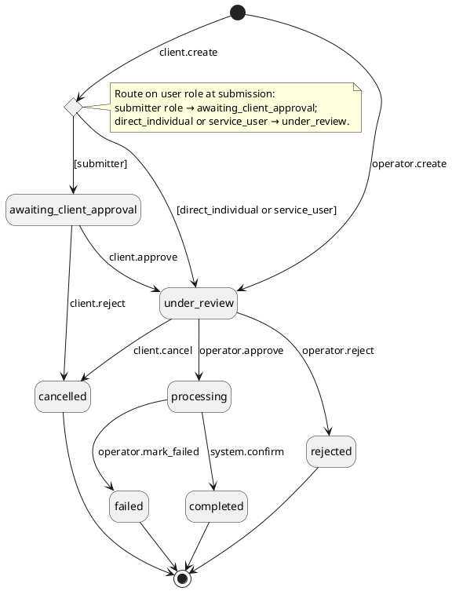
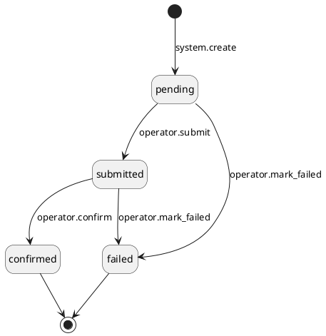

# PRD \- Phase 1C: Outgoing Fiat

## About the Document

### List of Personnel

| Role | Name |
| --- | --- |
| Product Manager | @Jordan Chong |
| Tech Lead | @Hossein Nasr Esfahan |
| Design | @Arfian |
| QA | @Widhi Putri |
| Stakeholder | NA |

---

## Overview

### Problem Statement

Following Phase 1B (incoming fiat deposits), the platform can receive and credit fiat assets but has no mechanism for clients to withdraw them. Clients holding fiat balances cannot instruct outgoing payments to their bank accounts, which blocks the core custody use case of asset repatriation. Operators have no workflow to process, execute, or track outgoing fiat payments.

---

### Goals

- Clients can submit unified withdrawal requests to pre-approved bank destinations (Whitelisted Bank Accounts)
- Corporate clients can apply their existing submitter/approver approval flow to withdrawals
- Clients can cancel their own pending withdrawals before operator execution begins
- Operators can approve or reject withdrawal requests; maker-checker applies only when an operator creates a withdrawal on behalf of a client
- Operators can record payment submission and settlement confirmation against outgoing movements manually
- Fiat venue balances and client account balances are debited accurately using double-entry accounting on confirmation
- Clients can view their unified withdrawal transactions and current status
- The architecture reuses the standard instruction-led withdrawal pipeline so future phases (DBS API integration) require no structural redesign

---

### In Scope

- Client unified withdrawal submission: source account, fiat asset, amount, whitelisted bank account ID (WBA); earmark applied at creation
- Corporate client approval phase: `awaiting_client_approval` → `under_review` (approver approves) or `cancelled` (approver rejects)
- Client withdrawal cancellation while `under_review` (before operator creates the movement)
- Operator approval of withdrawal: creates outgoing movement (`pending`), applies venue earmark, transaction → `processing`
- Operator rejection of withdrawal: transaction → `rejected`, client earmark released, no movement created
- Operator-created withdrawal on behalf of client (maker-checker): operator creates the withdrawal transaction; requires two-person approval before the transaction record exists
- Operator submit movement: records DBS payment execution, movement `pending` → `submitted`, operator supplies bank reference / DBS transaction ID
- Operator confirm movement: records DBS settlement, movement `submitted` → `confirmed`, transaction → `completed`; balance journal entry `DR Client Account / CR Source Venue`; all earmarks released
- Operator mark transaction failed (instruction-level): transaction → `failed`, all earmarks released
- Operator list/get outgoing fiat movements with filters
- Operator list/get unified withdrawal transactions (platform-wide) with filters; operator detail includes unmasked WBA fields, bank reference, timestamps
- Client list/get unified withdrawal transactions on their account; destination shown as masked WBA label + masked IBAN
- Fiat-specific outgoing movement `details` structure: `bankAccountNumber`, `beneficiaryName`, `swiftCode`, `intermediaryBankSwiftCode` (optional), `routingCode` (optional), `bankCountryCode`, `bankReference` (set at submit), `confirmationTimestamp` (set at confirm)
- Source venue selection by operator at approve step (always required, regardless of venue count in the group)
- Validation: sufficient available balance, WBA in `approved` status, WBA belongs to the source account or the source account's entity (WBA scope can be `account` or `entity`), WBA currency matches withdrawal asset, asset is fiat

---

### Out of Scope

| Item | Reason |
| --- | --- |
| DBS API integration (auto-submission, async confirmation callback) | Future phase |
| Fiat rebalance (operator-initiated transfer between fiat venues) | Future phase |
| Refund handling (returning unattributable incoming funds) | Future phase |
| Automated compliance checks (KYT, sanctions, name screening) | Not applicable to fiat; compliance handled entirely by WBA pre-approval |
| WBA creation and management | Already built |
| Edit outgoing movement after submission | Future phase |
| Multi-leg fiat payments | Out of platform scope |
| FX conversion between fiat currencies | Out of platform scope |
| Token or securities withdrawals | Separate PRDs |
| Depositor name verification on outgoing | Not required for withdrawals; applies to incoming only |
| Automated movement failure detection | Future phase |

---

### Assumptions

- Withdrawal execution is fully manual: operators perform the payment in the DBS banking portal outside the system, then record the result in the platform
- Submit and confirm are separate operator steps reflecting the real-world settlement timeline (payment submitted today; bank confirms settlement in 1–2 business days)
- The compliance gate for unified withdrawals (fiat) is the WBA approval process (Phase 1A) — no additional compliance checks are required at withdrawal time
- A withdrawal may only target a WBA that is in `approved` status and is accessible from the source account (WBA scoped to the account directly, or scoped to the entity that owns the account); the WBA's fiat asset must match the withdrawal asset
- The operator always selects the source venue at the approve step, regardless of how many venues are in the account's fiat venue group
- Movement failure (bank-level rejection) results in the operator marking the transaction as `failed`; no automated failure detection or movement regeneration in Phase 1c
- Fiat balances use the same double-entry ledger as token balances — no separate fiat ledger
- Each fiat currency is an independent balance line; no netting across currencies
- Phase 1B complete: fiat venues, fiat venue groups, account-to-fiat-venue-group linking, fiat balance tracking, and double-entry ledger model all built
- Phase 1A complete: WBA module built; clients can add and manage approved WBAs scoped to either an account or an entity; each WBA carries bank account number, beneficiary name, SWIFT code, bank country, optional intermediary bank SWIFT, optional routing code, beneficiary address fields, fiat asset (currency), and status lifecycle (`awaiting_client_approval` → `under_review` → `approved` / `rejected`); clients with KYC reliance skip operator approval (auto-approved)
- Fiat support feature config enabled for the deployment (company + environment level); if disabled, all fiat APIs and UI are inaccessible
- Client entities, accounts, and the maker-checker module already built
- `direct_individual` and `service_user` direct-permission model already in place (bypasses `awaiting_client_approval`)

---

### Glossary

| Term | Definition |
| --- | --- |
| WBA | Whitelisted Bank Account — a pre-approved external bank account destination; scoped to either an `account` or an `entity`; withdrawals may only target an approved WBA accessible from the source account (directly scoped, or scoped to the owning entity) |
| Instruction-led | Initiation mode where the transaction is created first (by client request) and the movement is the outcome of operator execution |
| Earmark | A reserved portion of a balance that reduces `available` without changing `total`; prevents double-spending while an outgoing operation is in flight |
| Submit | Operator action recording that the payment has been executed in the DBS banking portal; movement transitions `pending` → `submitted`; bank reference supplied |
| Confirm | Operator action recording that the payment has settled at the bank; movement transitions `submitted` → `confirmed`; ledger journal entry posted |
| Instruction-level failure | A failure at the transaction level — wrong destination, bank rejection — resulting in transaction → `failed` and full earmark release; no movement regeneration |
| Maker-checker | Approval workflow requiring two different operators — one to propose (maker), one to approve (checker); same operator cannot do both |
| Corporate client | A `direct_corporate` or `intermediary` client type that uses the submitter/approver RBAC flow; withdrawals enter at `awaiting_client_approval` |
| Direct client | A `direct_individual` client or `service_user`; bypasses `awaiting_client_approval`; withdrawals enter at `under_review` directly |
| Source venue | The fiat venue (bank account) from which the payment will be executed; selected by operator at the approve step |

---

### Solution Overview

unified withdrawal (fiat)s follow the platform's standard instruction-led outgoing pipeline. 

1. A client with the `submitter` role (or a `direct_individual` / `service_user` with direct permissions) creates a withdrawal transaction by specifying their source account, fiat currency, amount, and a pre-approved WBA destination; the system validates the request and immediately earmarks the client balance to prevent double-spending. 
2. Corporate clients route through a client-side approval step (`awaiting_client_approval`) before operator review; individual clients and API users enter operator review directly. 
3. Operators can also create withdrawals on behalf of clients using maker-checker. 
4. A single operator approves the withdrawal — selecting the source fiat venue, creating a `pending` outgoing movement, and applying a venue earmark — or rejects it. 
5. Once approved, the operator records payment submission in the DBS portal (`pending` → `submitted`), and later records settlement confirmation (`submitted` → `confirmed`), at which point the ledger is finalised (`DR Client Account / CR Source Venue`) and all earmarks are released. 
6. If the payment fails definitively, the operator marks the transaction as `failed` and all earmarks are released. 

---

## Functional Requirements

**Note on comment fields (interim).** Until the audit log feature ships, `externalComment` and `internalComment` are stored as single slots on the withdrawal transaction record. Each action that sets a comment (create, approve, reject, cancel, fail) overwrites the previously stored value — last write wins, prior comments are not preserved. When the audit log feature lands, every action will record its own row and the full comment history will be retained automatically. API contracts do not change between interim and final behaviour.

---

### Section 1: Unified Withdrawal (Fiat) Submission

Covers unified withdrawal (fiat) requests initiated by client users directly and by operators on behalf of clients, including validation, earmark application, and routing based on client type.

#### FR-1: Submit Unified Withdrawal (Fiat)

**Requirement Details**

As a Client User, I want to submit a unified withdrawal (fiat) request to a pre-approved bank destination so that I can instruct the custodian to send fiat funds from my account to my whitelisted bank account.

**Actor:** Client User (`submitter` role, `direct_individual`, or `service_user`)

**Precondition:** Client user is authenticated; fiat support feature config is enabled at both company and environment level.

**Main Flow:**

1. Client user fills in withdrawal details on the Client Platform, specifying: `sourceAccountId`, fiat `assetId` (currency), `amount`, `destinationId` (WBA destination) + `destinationType` (`whitelisted_bank_account`), and `externalComment` (optional).
2. For `submitter` and `direct_individual`: system sends a one-time passcode to the client user's registered email address; the user enters the OTP to confirm submission. (`service_user` authenticates via API key and skips the OTP step.)
3. System validates the request (see Validations).
4. System creates the withdrawal transaction and atomically applies the client account earmark: `↑ Reserved Client Account` (source account, withdrawal asset, withdrawal amount).
5. Entry status determined by client type (see Alternate Flows).
6. System returns the created transaction record.

**Validations:**

| Check | Failure |
| --- | --- |
| Asset exists and is a fiat currency | Reject — asset type mismatch |
| Source account exists and client has access | Reject — account not found or permission error |
| Source account is linked to a fiat venue group | Reject — account not configured for unified withdrawal (fiat)s |
| WBA is in `approved` status | Reject — WBA not approved |
| WBA is accessible from the source account (scoped to the account directly, or scoped to the entity that owns the account) | Reject — WBA scope mismatch |
| WBA fiat asset matches the withdrawal asset | Reject — currency mismatch |
| `amount` is greater than zero | Reject — invalid amount |
| Source account `available` balance in the withdrawal asset is sufficient | Reject — insufficient balance; no earmark applied |

**Alternate Flows:**

- `submitter` role: transaction enters `awaiting_client_approval`.
- `direct_individual` or `service_user` role: transaction enters `under_review` directly, bypassing the client approval phase.
- Fiat feature config disabled: API returns a feature-not-available error; withdrawal UI is inaccessible.

**Design Constraints:**

- Transaction creation and earmark application are atomic — there is no window where the transaction exists without an earmark.
- The transaction stores the WBA ID as a reference. Destination bank details are resolved from the WBA at execution time, not stored on the transaction.
- Each fiat currency is an independent balance line. A withdrawal in USD checks and earmarks only the USD balance.
- A single withdrawal targets exactly one WBA; multi-leg payments are out of scope.  
  
**Mockups:**  
<https://www.figma.com/design/1bFTDShkFAjTUk4xWCr24V/-FE-UI--Fiat-Withdrawal-2.0--Client-?node-id=2066-16664&t=w3MvkIINoCd50shI-1>   

  

---

#### FR-2: Create Unified Withdrawal (Fiat) on Behalf of Client (Operator)

**Requirement Details**

As a Operator User, I want to create a unified withdrawal (fiat) transaction on behalf of a client so that clients who cannot self-serve can have their withdrawals processed, subject to a second operator's approval.

**Actor:** Operator User (maker-checker pair)

**Precondition:** Maker operator is authenticated; target client account, fiat asset, amount, and WBA ID are identified; a second operator (checker) is available.

**Main Flow:**

1. Maker operator supplies withdrawal parameters on the Operator Platform: `clientAccountId`, fiat `assetId`, `amount`, `destinationType` and `destinationId`, `externalComment` (optional), and `internalComment` (optional).
2. System validates parameters (same checks as FR-1 Validations) and creates a maker-checker request containing the proposed withdrawal state. The request enters `awaiting_approval`. No transaction record exists yet.
    1. NOTE: this is optional. pls check current behavior. if we dont do this now, no need to add it
3. Checker operator retrieves the maker-checker request and reviews the proposed withdrawal.
4. Checker approves the maker-checker request.
5. System validates the checker is not the same user as the maker.
6. System re-validates all FR-1 checks at checker approval time (balance, WBA status, WBA accessibility, asset match).
7. System creates the withdrawal transaction with client account earmark applied, entering `under_review`. Maker-checker request transitions to `approved`.

**Alternate Flows:**

- Checker rejects the maker-checker request: no transaction created; request transitions to `rejected`; no earmark applied.
- Re-validation fails at approval time (e.g. balance now insufficient, WBA status changed): request remains `awaiting_approval`; error returned to checker; checker must reject the request, and maker must create a new request based on current state.

**Design Constraints:**

- The transaction record does not exist until checker approval succeeds; maker-checker is not a transaction status.
- An operator-created withdrawal enters `under_review` directly regardless of the client's corporate structure; there is no `awaiting_client_approval` phase.  
  
**Mockups:**  
<https://www.figma.com/design/0hwU9K9w041Ty5IE36Cmfv/-FE-UI--Withdrawal-Transaction-2.0--Operator-User-?node-id=16-14308&t=pbjJLRum1VuAz2xP-1>   

---

### Section 2: Corporate Client Approval Flow

Covers the submitter-approver workflow for corporate clients (`direct_corporate`, `intermediary`) where a second client user must approve or reject the withdrawal before it enters operator review.

#### FR-3: Client Approve Unified Withdrawal (Fiat)

**Requirement Details**

As a Client User with the `approver` role, I want to approve a pending unified withdrawal submitted by another client user so that it proceeds to operator review.

**Actor:** Client User (holds `approve_withdrawal` permission, or `service_user`)

**Precondition:** A unified withdrawal transaction exists in `awaiting_client_approval` status; the approver is authenticated.

**Main Flow:**

1. Approver retrieves the transaction detail (account, fiat asset, amount, WBA destination).
2. System sends a one-time passcode to the approver's registered email address; the approver enters the OTP to confirm the approval. (`service_user` authenticates via API key and skips the OTP step.)
3. Approver submits the approval action on the Client Platform, specifying: transaction ID and `externalComment` (optional).
4. System validates the request (see Validations).
5. System transitions the transaction to `under_review`.

**Validations:**

| Check | Failure |
| --- | --- |
| Transaction is in `awaiting_client_approval` status | Reject — state error |
| Approver is a different user from the submitter | Reject — self-approval not permitted |
| Approver holds the `approve_withdrawal` permission with access to the source account (at account, entity, or client level) | Reject — permission error |

**Design Constraints:**

- Only applicable to `direct_corporate` and `intermediary` client types.
- A user holding `approve_withdrawal` cannot approve a withdrawal they submitted. Holding both `create_withdrawal` and `approve_withdrawal` permissions does not permit self-approval.
- Client account earmark remains active throughout; no balance change at this step.  
  
**Mockups:**  
<https://www.figma.com/design/1bFTDShkFAjTUk4xWCr24V/-FE-UI--Fiat-Withdrawal-2.0--Client-?node-id=2073-19514&t=w3MvkIINoCd50shI-1>   

  

---

#### FR-4: Reject Unified Withdrawal (Fiat)

**Requirement Details**

As a Client User with the `approver` role, I want to reject a pending unified withdrawal (fiat) submitted by another client user so that the withdrawal is cancelled and the earmark is released.

**Actor:** Client User (holds `approve_withdrawal` permission, or `service_user`)

**Precondition:** A unified withdrawal (fiat) transaction exists in `awaiting_client_approval` status; the approver is authenticated.

**Main Flow:**

1. Approver retrieves the transaction detail.
2. System sends a one-time passcode to the approver's registered email address; the approver enters the OTP to confirm the rejection. (`service_user` authenticates via API key and skips the OTP step.)
3. Approver submits the rejection action on the Client Platform, specifying: transaction ID and `externalComment` (optional).
4. System validates the request (see Validations).
5. System transitions the transaction to `cancelled`.
6. System releases the client account earmark: `↓ Reserved Client Account`.

**Validations:**

| Check | Failure |
| --- | --- |
| Transaction is in `awaiting_client_approval` status | Reject — state error |
| Approver is a different user from the submitter | Reject — self-rejection not permitted |
| Approver holds the `approve_withdrawal` permission with access to the source account | Reject — permission error |

**Design Constraints:**

- Rejection at `awaiting_client_approval` produces `cancelled` status — not `rejected`, which is reserved for operator-initiated termination.
- No outgoing movement is created. The cancelled transaction is retained as an audit record.  
  
**Mockups:**  
<https://www.figma.com/design/1bFTDShkFAjTUk4xWCr24V/-FE-UI--Fiat-Withdrawal-2.0--Client-?node-id=2075-31628&t=w3MvkIINoCd50shI-1>   

  

  

  

  

---

### Section 3: Client Withdrawal Cancellation

Covers client-initiated cancellation of a withdrawal that has reached operator review but before the operator has created the outgoing movement.

#### FR-5: Cancel Unified Withdrawal (Client)

**Requirement Details**

As a Client User, I want to cancel my pending unified withdrawal before the operator begins execution so that the earmark is released and my balance is restored.

**Actor:** Client User (`admin`, `submitter`, `approver`, `direct_individual`, or `service_user` via a CANCEL permission)

**Precondition:** A unified withdrawal transaction exists in `under_review` status; no outgoing movement has been created against the transaction; client user is authenticated (MFA for all except `service_user`).

**Main Flow:**

1. Client user submits the cancellation action on the Client Platform, specifying: transaction ID and `externalComment` (optional).
2. System sends a one-time passcode to the user’s registered email address; the user enters the OTP to confirm the cancellation. (`service_user` authenticates via API key and skips the OTP step.)
3. System validates the request (see Validations).
4. System transitions the transaction to `cancelled`.
5. System releases the client account earmark: `↓ Reserved Client Account`.

**Validations:**

| Check | Failure |
| --- | --- |
| Transaction is in `under_review` status and no linked movement exists | Reject — state error |
| Client user has account access to the source account | Reject — permission error |

**Alternate Flows:**

- Transaction is in `awaiting_client_approval`: cancellation is not available at this status — the `approver` must reject instead (FR-4).
- Transaction is in `processing` (movement already created): cancellation is no longer possible; system returns a state error.

**Design Constraints:**

- Any client user with account access may cancel; it is not restricted to the original submitter.
- No venue earmark exists at this stage — only the client account earmark is released.
- Concurrency: if a client cancellation and an operator approval (FR-6) race on the same transaction, the status transition must be atomic — exactly one succeeds. The loser receives a state error.  
  
**Mockups:**  
<https://www.figma.com/design/1bFTDShkFAjTUk4xWCr24V/-FE-UI--Fiat-Withdrawal-2.0--Client-?node-id=2104-38542&t=w3MvkIINoCd50shI-1>   

  

---

### Section 4: Operator Withdrawal Review

Covers the operator actions of approving or rejecting a unified withdrawal (fiat) transaction that is in `under_review`.

#### FR-6: Approve Unified Withdrawal (fiat) for Execution (Operator)

**Requirement Details**

As a Operator User, I want to approve a unified withdrawal (fiat) by selecting the source venue so that an outgoing movement is created and the payment can proceed to manual execution in the DBS banking portal.

**Actor:** Operator User (single; no maker-checker required for approve/reject)

**Precondition:** A unified withdrawal (fiat) transaction exists in `under_review` status; the source account is linked to a fiat venue group.

**Main Flow:**

1. Operator reviews the withdrawal detail: client account, fiat asset, amount, WBA destination fields and `internal comment`
2. Operator selects the source fiat venue and submits the approval on the Operator Platform, specifying: transaction ID and source venue ID.
3. System validates the request (see Validations).
4. System creates an outgoing movement linked to the transaction:

   - Direction: `outgoing`

   - Status: `pending`

   - Venue: the selected source venue

   - Asset and amount: from the transaction

   - `details` structure populated from the WBA: `bankAccountNumber`, `beneficiaryName`, `beneficiaryAddress` (null if absent on WBA), `swiftCode`, `intermediaryBankSwiftCode` (null if absent on WBA), `routingCode` (null if absent on WBA), `bankCountryCode`. `executionMethod` is set to `manual`. `bankReference` is null at creation. `wbaId` is recorded on the movement alongside the snapshotted field values.

1. System applies the venue earmark: `↑ Reserved Source Venue` (source venue, withdrawal asset, withdrawal amount).
2. System transitions the transaction to `processing`.

**Validations:**

| Check | Failure |
| --- | --- |
| Transaction is in `under_review` status | Reject — state error (e.g. client may have cancelled) |
| Source account status is `active` | Block — transaction remains `under_review`; no movement created; no client-visible indicator (see Design Constraints) |
| Source venue exists, is of type `bank`, and belongs to a fiat venue group linked to the source account | Reject — validation error |
| Source venue has sufficient `available` balance in the withdrawal asset | Reject — venue balance insufficient; transaction remains `under_review` |

**Design Constraints:**

- **Account status gate (approval).** If the source account is not `active`, the system prevents the operator from approving. The transaction remains at `under_review` with no movement created. No frozen or blocked indicator is exposed to the client — the withdrawal appears to be awaiting normal operator review. This is the primary gate for manually processed venues, where the submission step is recorded after the operator has already executed the payment externally. See `03` section 3.10.
- Source venue selection is always required, regardless of venue count in the account's fiat venue group — no auto-selection.
- Movement creation and venue earmark application are atomic; if either fails, no movement is created and the transaction remains `under_review`.
- The WBA must still be in `approved` status at the time of operator approval. If the WBA has been revoked since the client submitted the withdrawal, the approval fails with a validation error.
- `wbaId` is recorded on the movement. WBA bank detail fields (`bankAccountNumber`, `beneficiaryName`, `beneficiaryAddress`, `swiftCode`, `intermediaryBankSwiftCode`, `routingCode`, `bankCountryCode`) are snapshotted into the movement `details` at this step. If the WBA is later modified or revoked, the movement retains the field values captured at approval time; `wbaId` remains as an auditable link to the source WBA.
- Compliance checks are not required for unified withdrawal (fiat)s; the WBA approval process (Phase 1A) is the compliance gate.
- Concurrency: if a client cancellation (FR-5) and an operator approval race on the same transaction, the status transition must be atomic — exactly one succeeds. The loser receives a state error.  
  
**Mockups:**  
<https://www.figma.com/design/0hwU9K9w041Ty5IE36Cmfv/-FE-UI--Withdrawal-Transaction-2.0--Operator-User-?node-id=2-35471&t=pbjJLRum1VuAz2xP-1>   

  

---

#### FR-7: Reject Unified Withdrawal (Operator)

**Requirement Details**

As a Operator User, I want to reject a unified withdrawal request so that the transaction is terminated before execution and the client's earmarked balance is released.

**Actor:** Operator User (single; no maker-checker required)

**Precondition:** A unified withdrawal transaction exists in `under_review` status.

**Main Flow:**

1. Operator reviews the withdrawal detail.
2. Operator submits the rejection on the Operator Platform, specifying: transaction ID, `externalComment` (optional, shown to the client), and `internalComment` (optional, operator-only).
3. System validates that the transaction is in `under_review` status.
4. System transitions the transaction to `rejected`.
5. System releases the client account earmark: `↓ Reserved Client Account`.

**Design Constraints:**

- Rejection is only possible before a movement is created. Once the operator has approved (FR-6) and the transaction is `processing`, the reject path is unavailable — use FR-10 (mark movement as failed) then FR-11 (mark transaction as failed) instead.
- No outgoing movement is created. The rejected transaction is retained as an audit record.
- Neither comment field is required; the operator may supply one, both, or neither. Both are independent and may be populated in the same call.  
  
**Mockups:**  
<https://www.figma.com/design/0hwU9K9w041Ty5IE36Cmfv/-FE-UI--Withdrawal-Transaction-2.0--Operator-User-?node-id=2-39312&t=pbjJLRum1VuAz2xP-1>   

---

### Section 5: Outgoing Movement Execution

Covers the two-step manual execution flow reflecting real-world fiat settlement timing: the operator records payment submission when they execute in the DBS portal, then records settlement confirmation when the bank confirms. Also covers instruction-level failure handling.

#### FR-8: Submit Outgoing Fiat Movement

**Requirement Details**

As a Operator User, I want to record that I have submitted a fiat payment in the DBS banking portal so that the system reflects the current execution state of the movement.

**Actor:** Operator User (single)

**Precondition:** An outgoing fiat movement exists in `pending` status, linked to a withdrawal transaction in `processing` status. The operator has executed the payment in the DBS banking portal outside the system.

**Main Flow:**

1. Operator submits the movement on the Operator Platform, specifying: movement ID.
2. System validates the request (see Validations).
3. System transitions the movement: status `pending` → `submitted`.

**Validations:**

| Check | Failure |
| --- | --- |
| Movement is in `pending` status | Reject — state error |
| Source account status is `active` | Block — movement remains `pending`; not submitted to venue; no client-visible indicator (see Design Constraints) |

**Design Constraints:**

- **Account status gate (submission).** If the source account is not `active`, the system prevents the movement from being submitted. The movement remains at `pending` and is not sent to the venue. No frozen or blocked indicator is exposed to the client — the withdrawal appears to be in normal operational processing. This gate is the primary control for automated venues (future DBS API integration) where submission triggers immediate venue execution; for the current manual execution flow, the approval gate (FR-6) is the effective control since the operator executes the payment externally before recording submission. See `03` section 3.10.
- Submit is a pure state transition in this phase — no operator input is required beyond the movement ID. The DBS bank reference is not yet available at submit time (the bank only issues it on confirmation), and is captured in FR-9.
- Submit does not trigger any balance changes. Both earmarks (client account and source venue) remain active.
- The platform does not initiate or verify the external payment; it only records that the operator executed it.
- If a movement fails, the operator may generate a new outgoing fiat movement against the same transaction (FR-12). A unified withdrawal (fiat) may therefore have more than one outgoing movement over its lifetime.
- `executionMethod` is `manual` in this phase. When DBS API integration lands in a later phase, the submit action will be replaced by an automated API call and `executionMethod` will additionally support `api`.  
  
**Mockups:**  
<https://www.figma.com/design/uwKndIm3RT7FEKfJo9Z1hV/-FE-UI--Outgoing-Fiat-Movement--Operator-User-?node-id=8-14863&t=nBJB91lpqfbk0ifX-1>   

  

---

#### FR-9: Confirm Outgoing Fiat Movement

**Requirement Details**

As a Operator User, I want to record that a fiat payment has been confirmed or settled at the bank so that the ledger is finalised, all earmarks are released, and the withdrawal transaction is completed.

**Actor:** Operator User (single)

**Precondition:** An outgoing fiat movement exists in `submitted` status, linked to a withdrawal transaction in `processing` status. The operator has received settlement confirmation from the bank.

**Main Flow:**

1. Operator confirms the movement on the Operator Platform, specifying: movement ID, `bankReference` (DBS transaction reference issued by the bank on confirmation), and confirmation timestamp (the bank's settlement/value date).
    1. NOTE: 
        1. User will give a DATE ONLY; FE will send to BE a DATE ONLY. and BE will append 00:00 to the date to make it a datetime. When BE appends the 00:00, it should be using the `system default timezone`.
        2. When saving to Balance Service, valuedate will also be a datetime. 
2. System validates the request (see Validations).
3. System transitions the movement to `confirmed` and sets `transactedAt` to the operator-supplied confirmation timestamp.
4. System posts the journal entry: `DR Client Account / CR Source Venue` (source account, withdrawal asset, withdrawal amount), passing `transactedAt` as `value_datetime`.
5. System releases both earmarks: `↓ Reserved Client Account` and `↓ Reserved Source Venue`.
6. System transitions the withdrawal transaction to `completed`.
7. System records `bankReference` and `transactedAt` in `movement.details`.

**Validations:**

| Check | Failure |
| --- | --- |
| Movement is in `submitted` status | Reject — state error |
| Linked transaction is in `processing` status | Reject — state error |
| `bankReference` is provided and non-empty | Reject — validation error |

**Alternate Flows:**

- Balance service returns an error on the journal entry: movement remains `submitted`; no partial debit applied; error surfaced for operator investigation.

**Design Constraints:**

- The confirmation timestamp is the bank's settlement/value date (economic effectiveness date); it may differ from the system timestamp. Balance queries run against `transactedAt`, not `createdAt`.
- `bankReference` is captured at confirmation (not submission) because the DBS bank reference is only issued once the payment is confirmed/settled. It is not the system's tracking key for the movement — `movementId` is.
- The journal entry and movement confirmation are atomic — both succeed or both fail.
- A ledger debit is applied once and only once per movement (idempotency).  
  
**Mockups:**  
<https://www.figma.com/design/uwKndIm3RT7FEKfJo9Z1hV/-FE-UI--Outgoing-Fiat-Movement--Operator-User-?node-id=45-9152&t=nBJB91lpqfbk0ifX-1>   

  

---

#### FR-10: Mark Outgoing Fiat Movement as Failed (Operator)

**Requirement Details**

As an Operator User, I want to mark an outgoing fiat movement as failed when the bank definitively rejects the payment so that the venue earmark is released and the transaction can be resolved.

**Actor:** Operator User (single)

**Precondition:** An outgoing fiat movement exists in `pending` or `submitted` status, linked to a withdrawal transaction in `processing` status.

**Main Flow:**

1. Operator marks the movement as failed on the Operator Platform, specifying: movement ID and `internalComment` (optional, operator-only).
2. System validates the request (see Validations).
3. System transitions the movement to `failed`.
4. System releases the venue earmark: `↓ Reserved Source Venue`.

**Validations:**

| Check | Failure |
| --- | --- |
| Movement is in `pending` or `submitted` status | Reject — state error |

**Design Constraints:**

- Once the movement is `failed`, the operator may either mark the parent withdrawal transaction as failed (FR-11) or generate a new outgoing fiat movement against the same transaction (FR-12).
- `internalComment` is not required. No `externalComment` is accepted on this action — the movement is operator-facing only.  
  
**Mockups:**  
<https://www.figma.com/design/uwKndIm3RT7FEKfJo9Z1hV/-FE-UI--Outgoing-Fiat-Movement--Operator-User-?node-id=47-16582&t=nBJB91lpqfbk0ifX-1>   

---

#### FR-11: Mark Unified Withdrawal as Failed (Operator)

**Requirement Details**

As an Operator User, I want to mark a unified withdrawal transaction as failed after its outgoing movement has failed so that the client's earmark is released and the withdrawal is definitively closed.

**Actor:** Operator User (single)

**Precondition:** A unified withdrawal transaction exists in `processing` status; the linked outgoing movement is in `failed` status (FR-10 has been completed).

**Main Flow:**

1. Operator marks the withdrawal transaction as failed on the Operator Platform, specifying: transaction ID, `externalComment` (optional, shown to the client), and `internalComment` (optional, operator-only).
2. System validates the request (see Validations).
3. System transitions the transaction to `failed`.
4. System releases the client account earmark: `↓ Reserved Client Account`.

**Validations:**

| Check | Failure |
| --- | --- |
| Transaction is in `processing` status | Reject — state error |
| Latest linked outgoing movement is in `failed` status | Reject — state error |

**Alternate Flows:**

- Transaction is in `under_review` (no movement yet): operator should reject via FR-7, not mark as failed.
- Linked movement is not yet in `failed` status: system rejects the attempt with a state error; operator must first mark the movement as failed (FR-10).

**Design Constraints:**

- The transaction cannot be marked as failed until the latest linked outgoing movement is `failed`. This ensures venue earmark release (FR-10) and transaction earmark release (FR-11) are sequenced correctly.
- Once failed, the transaction is definitively closed. If the operator intends to retry payment, they should instead use FR-12 to generate a new outgoing movement rather than failing the transaction.
- Neither comment field is required; the operator may supply one, both, or neither. Typical usage captures the bank's rejection reason in `externalComment` for client visibility and any internal investigation notes in `internalComment`.  
  
**Mockups:**  
<https://www.figma.com/design/0hwU9K9w041Ty5IE36Cmfv/-FE-UI--Withdrawal-Transaction-2.0--Operator-User-?node-id=5-39797&t=pbjJLRum1VuAz2xP-1>   

  

---

#### FR-12: Generate New Outgoing Fiat Movement (Operator)

**Requirement Details**

As an Operator User, I want to generate a new outgoing fiat movement against a withdrawal transaction whose previous outgoing movement has failed so that the payment can be retried without requiring the client to submit a new withdrawal.

**Actor:** Operator User (single)

**Precondition:** A unified withdrawal (fiat) transaction exists in `processing` status; the latest linked outgoing movement is in `failed` status.

**Main Flow:**

1. Operator initiates movement generation on the Operator Platform, specifying: transaction ID, `internalComment` (optional, operator-only), and fiat venue.
    1. If this already exists, remember to update “remarks” or “comments” to internal comment
2. System validates the request (see Validations).
3. System creates a new outgoing fiat movement in `pending` status, linked to the same withdrawal transaction and using the same WBA details as the original movement.
4. System places the venue earmark for the new movement: `↑ Reserved Source Venue`.

**Validations:**

| Check | Failure |
| --- | --- |
| Transaction is in `processing` status | Reject — state error |
| Latest linked outgoing movement is in `failed` status | Reject — state error |

**Design Constraints:**

- The new movement is a fresh instruction targeting the same WBA; it does not inherit the `bankReference` or `transactedAt` of the previous failed movement.
- The client account earmark placed at approval (FR-6) remains active — no additional client earmark is placed.
- Multiple movements may exist against the same withdrawal transaction over its lifetime; only one movement may be in a non-terminal status at any time.  
  
**Mockups:**  
<https://www.figma.com/design/0hwU9K9w041Ty5IE36Cmfv/-FE-UI--Withdrawal-Transaction-2.0--Operator-User-?node-id=3-13643&t=pbjJLRum1VuAz2xP-1>   

---

### Section 6: Operator Visibility

Covers operator list and view capabilities for outgoing fiat movements and unified withdrawal (fiat) transactions.

#### FR-13: List and View Outgoing Fiat Movements

**Requirement Details**

As a Operator User, I want to list and view outgoing fiat movements so that I can monitor the execution queue and track payment status across all fiat venues.

**Actor:** Operator User

**Precondition:** Operator is authenticated.

**Main Flow:**

1. Operator queries outgoing fiat movements on the Operator Platform with optional filters.
2. System returns a paginated list of movements matching the applied filters, sorted by `createdAt` descending.
3. Operator selects a specific movement to view its full detail, including: movement ID, direction (`outgoing`), venue, asset, amount, status, `details` structure (`wbaId`, `bankAccountNumber`, `beneficiaryName`, `beneficiaryAddress`, `swiftCode`, `intermediaryBankSwiftCode`, `routingCode`, `bankCountryCode`, `executionMethod`, `bankReference`), linked transaction ID, `createdAt`, and `transactedAt`.

**Design Constraints:**

- Supported filters: status (`pending`, `submitted`, `confirmed`, `failed`), venue ID, asset ID, date range (on `createdAt` or `transactedAt`).
- The list endpoint returns summary fields; the detail endpoint returns the full movement record including the `details` structure.
- Movements in all statuses are visible to operators — no movements are hidden.  
  
**Mockups:**  
<https://www.figma.com/design/uwKndIm3RT7FEKfJo9Z1hV/-FE-UI--Outgoing-Fiat-Movement--Operator-User-?node-id=7-13552&t=nBJB91lpqfbk0ifX-1>   

  

---

#### FR-14: Operator List and View Unified Withdrawals

**Requirement Details**

As a Operator User, I want to list and view all unified withdrawal (fiat) transactions across all client accounts so that I can monitor withdrawal activity platform-wide, assist with client queries, and track execution progress.

**Actor:** Operator User

**Precondition:** Operator is authenticated.

**Main Flow:**

1. Operator queries the unified withdrawal (fiat) list on the Operator Platform with optional filters.
2. System returns a paginated list of all unified withdrawal (fiat) transactions across all accounts, sorted by `createdAt` descending.
3. Operator selects a specific withdrawal to view its full detail, including all client-visible fields plus: linked outgoing movement (venue, status, `bankReference`, `transactedAt`), WBA details (unmasked bank account number, beneficiary name, SWIFT code, intermediary bank SWIFT, routing code, bank country), and the `externalComment` / `internalComment` recorded on rejection or failure actions (if applicable).

**Design Constraints:**

- Supported filters: account ID, client ID, status (`awaiting_client_approval`, `under_review`, `processing`, `completed`, `rejected`, `failed`, `cancelled`), asset ID, date range (on `createdAt`).
- The list endpoint is not scoped to a single account — operators see withdrawals across all accounts. `accountId` and `clientId` are optional filters.
- Operator detail includes fields not visible to clients: full WBA details (unmasked), linked movement execution details, and `internalComment` values on reject/fail actions. `externalComment` values are visible to both operators and clients.  
  
**Mockups:**  
<https://www.figma.com/design/0hwU9K9w041Ty5IE36Cmfv/-FE-UI--Withdrawal-Transaction-2.0--Operator-User-?node-id=2-30961&t=pbjJLRum1VuAz2xP-1>   

  

---

### Section 7: Client unified withdrawal (fiat) Visibility

Covers extending the existing unified withdrawal view to include unified withdrawal (fiat)s, so clients can see fiat outflows alongside token withdrawals.

#### FR-15: Include unified withdrawal (fiat)s in Unified Withdrawal List

**Requirement Details**

As a Client User, I want to see my unified withdrawal (fiat)s in the existing unified withdrawal list so that I have a single view of all withdrawals across asset types.

**Actor:** Client User (any role with account access)

**Precondition:** The unified withdrawal list and detail endpoints already exist and currently display token withdrawals. A unified withdrawal (fiat) transaction has been created (via FR-1 or FR-2).

**Main Flow:**

1. Client user queries the existing unified withdrawal list on their account.
2. System includes unified withdrawal (fiat) transactions alongside token withdrawals in the results.
3. Client user selects a unified withdrawal (fiat) to view its details, including: transaction ID, type (`withdrawal`), status, asset (fiat currency), amount, destination (WBA label, bank account number, and SWIFT code), `createdAt`, and `transactedAt` (set on completion).

**Design Constraints:**

- unified withdrawal (fiat)s appear in the same unified withdrawal list as token withdrawals — no separate endpoint.
- Existing filters (status, asset ID, date range) apply to unified withdrawal (fiat)s as well.
- Client users see the WBA label, full bank account number, and SWIFT code. Client users do not see: intermediary bank details, venue, bank reference, or operator actions.
- The `reserved` balance (earmark) is visible to the client user as a reduction in `available`. `expected` balance is not used for withdrawals.
- Client users do not see outgoing movements directly — only the transaction and its status.  
  
**Mockups:**  
<https://www.figma.com/design/1bFTDShkFAjTUk4xWCr24V/-FE-UI--Fiat-Withdrawal-2.0--Client-?node-id=2116-26982&t=w3MvkIINoCd50shI-1>   

  

---

## ~~Non-Functional Requirements~~ (IGNORE FOR NOW)

### ~~Security~~

- ~~NFR-1: Client withdrawal submission and approval actions (submitter, direct\_individual, approver) must require email OTP before the action is accepted; OTP must expire within 10 minutes of issuance and lock the user out after 5 consecutive failed attempts. service\_user authenticates via API key only (no OTP). Verified by automated authentication flow tests.~~
- ~~NFR-2: All API traffic must use TLS 1.2 or higher for data in transit; verified by OWASP ZAP TLS scan on every release.~~
- ~~NFR-3: WBA bank fields stored on withdrawal movements (bankAccountNumber, beneficiaryName, swiftCode, intermediaryBankSwiftCode, routingCode, bankCountryCode) must be encrypted at rest using AES-256 or equivalent; verified by infrastructure security audit.~~
- ~~NFR-4: Client-facing API responses must mask bankAccountNumber to the last 4 digits; full bank account numbers, SWIFT codes, and intermediary bank details must never appear in client API responses. Verified by automated API contract tests on all client endpoints.~~
- ~~NFR-5: All state-changing actions — create, client approve/reject, client cancel, operator approve/reject, submit, confirm, mark failed (movement and transaction), generate new movement — must be recorded in the audit log with: actor ID, action type, previous status, new status, timestamp (timestamptz), and client IP. Audit records must be immutable. Verified by audit log coverage tests covering every FR in this PRD.~~
- ~~NFR-6: RBAC must be enforced at the API layer: client users may only read and act on withdrawal transactions scoped to their own accounts; operator users have platform-wide read access and may act on any withdrawal. Verified by OWASP ZAP DAST and automated access control tests with cross-account probe requests.~~

---

### ~~Reliability and Availability~~

- ~~NFR-7: The withdrawal submission and operator movement endpoints must maintain ≥ 99.9% availability per calendar month; measured via Datadog synthetic monitors polling the withdrawal submission endpoint every 60 s.~~
- ~~NFR-8: Each compound balance operation (transaction + client earmark; movement + venue earmark; journal entry + dual earmark release) must be fully atomic — all succeed or all roll back with no partial state persisted. Verified by integration tests that inject DB errors mid-operation and assert no orphaned earmarks or incomplete journal entries.~~
- ~~NFR-9: Movement confirmation (FR-9) must be idempotent — a duplicate confirm call on a confirmed movement produces no additional journal entries or earmark releases. Verified by integration tests issuing repeated confirm calls on the same movement ID.~~

---

### ~~Compliance~~

- ~~NFR-11: All withdrawal transaction records, outgoing movement records, WBA detail snapshots, journal entries, earmark history, and audit logs must be retained for a minimum of 7 years in accordance with AML/FATF guidance; permanent deletion must require authorized administrator action and generate an audit event. Verified by data retention policy audit.~~
- ~~NFR-13: Beneficiary personal data (beneficiaryName, bankCountryCode) must be treated as personal data under GDPR and applicable data protection law: access is restricted to operator users, the data is never returned in client API responses, and processing is limited to the purpose of executing and auditing the payment. Verified by DPIA review and automated API tests asserting absence of these fields in client responses.~~

---

## Technical Specifications

### Data Model

> **Pre-existing types not modelled here.** This schema covers only the new entities introduced by this PRD: `WithdrawalTransaction` (fiat) and `OutgoingFiatMovement`. The `MakerCheckerRequest` type — returned as the `201` response when an operator creates a withdrawal via maker-checker (FR-2) — is a pre-existing platform entity specified in the maker-checker module. Its full field definition, status lifecycle, and approval workflow are documented in that module rather than here.

---

> **Note on details structure.** The bank destination fields on `OutgoingFiatMovement` (`bankAccountNumber`, `beneficiaryName`, `beneficiaryAddress`, `swiftCode`, `intermediaryBankSwiftCode`, `routingCode`, `bankCountryCode`, `executionMethod`, `bankReference`) are persisted within a typed `details` JSON structure on the movement record, consistent with the platform's asset-specific details pattern (see `knowledge/03-transaction-movement-model.md` section 3.9). They are modelled as individual rows here for field-level clarity.

---

#### WithdrawalTransaction Data Model (fiat)

> Includes standard system fields: `id`, `createdAt`, `createdBy`, `updatedAt`, `updatedBy`. These are not repeated in the table below.

| **Field Name** | **Non-null** | **Mutable** | **Client Visible** | **Data Type** | **Field Profile** | **Description** | **Rules/Constraints** |
| --- | --- | --- | --- | --- | --- | --- | --- |
| `accountId` | Y | — | Y | UUID | `uuid` | Source account | FK to Account. Must be linked to a fiat venue group. |
| `assetId` | Y | — | Y | UUID | `uuid` | Fiat currency asset | FK to Asset. Asset must be of fiat type. |
| `amount` | Y | — | Y | Decimal | `non_negative_amount` | Withdrawal amount | Must be \> 0 at creation. |
| `destinationType` | Y | — | Y | Enum | `enum` | Type of whitelisted destination | Values: `whitelisted_bank_account`. |
| `destinationId` | Y | — | Y | UUID | `uuid` | ID of the whitelisted destination | FK to the entity identified by `destinationType`. For `whitelisted_bank_account`, references `WhitelistedBankAccount.id`. Must be in `approved` status and accessible from `accountId` at submission time. |
| `status` | Y | Y | Y | Enum | `enum` | Transaction lifecycle status | Values: `awaiting_client_approval`, `under_review`, `processing`, `completed`, `rejected`, `failed`, `cancelled`. |
| `externalComment` | — | Y | Y | Text | `remark_single_line` | Last comment visible to both operators and clients | Set by create, approve, reject, cancel, and fail actions. Last-write-wins until audit log ships; each action overwrites the previous value. |
| `internalComment` | — | Y | — | Text | `remark_single_line` | Last operator-only comment | Set by operator-facing actions (create on behalf, reject, fail). Last-write-wins until audit log ships. |
| `transactedAt` | — | Y | Y | Timestamp | `timestamp_tz` | Bank settlement / value date | Null until the linked movement is confirmed. Propagated from `OutgoingFiatMovement.transactedAt` on confirmation. Operator-supplied; may differ from `createdAt`. Used as the economic effectiveness date for balance queries. |
| `createdVia` | Y | — | — | Enum | `enum` | How the withdrawal was initiated | Values: `client` (submitted directly by a client user via FR-1), `operator` (created by an operator on behalf of a client via maker-checker FR-2). |

**Indexes:**

- `idx_withdrawal_txn_account_id` on `accountId` — client withdrawal list and operator filtering by account
- `idx_withdrawal_txn_status` on `status` — status-based list filtering
- `idx_withdrawal_txn_asset_id` on `assetId` — asset-based filtering
- `idx_withdrawal_txn_destination_id` on `destinationId` — destination reference audits and revocation impact lookups
- `idx_withdrawal_txn_created_at` on `createdAt` — date range queries

**Relationships:**

- `WithdrawalTransaction.accountId` → `Account.id` (many-to-one)
- `WithdrawalTransaction.assetId` → `Asset.id` (many-to-one)
- `WithdrawalTransaction.destinationId` → `WhitelistedBankAccount.id` (many-to-one; when `destinationType` is `whitelisted_bank_account`)
- `WithdrawalTransaction.id` ← `OutgoingFiatMovement.transactionId` (one-to-many; a transaction may have more than one movement over its lifetime if a movement fails and is regenerated)

---

#### OutgoingFiatMovement Data Model

> Includes standard system fields: `id`, `createdAt`, `createdBy`, `updatedAt`, `updatedBy`. These are not repeated in the table below.

| **Field Name** | **Non-null** | **Mutable** | **Client Visible** | **Data Type** | **Field Profile** | **Description** | **Rules/Constraints** |
| --- | --- | --- | --- | --- | --- | --- | --- |
| `transactionId` | Y | — | — | UUID | `uuid` | Linked withdrawal transaction | FK to WithdrawalTransaction. Multiple movements may share the same `transactionId` when a failed movement is regenerated. |
| `direction` | Y | — | — | Enum | `enum` | Movement direction | Always `outgoing` for this entity. |
| `venueId` | Y | — | — | UUID | `uuid` | Source fiat venue | FK to Venue. Must be a `bank`-type venue belonging to the fiat venue group linked to the source account. Selected by operator at approval (FR-6). |
| `assetId` | Y | — | — | UUID | `uuid` | Fiat currency asset | FK to Asset. Must match `WithdrawalTransaction.assetId`. |
| `amount` | Y | — | — | Decimal | `non_negative_amount` | Payment amount | Must match `WithdrawalTransaction.amount`. |
| `status` | Y | Y | — | Enum | `enum` | Movement execution status | Values: `pending`, `submitted`, `confirmed`, `failed`. Terminal states: `confirmed`, `failed`. |
| `complianceStatus` | Y | — | — | Enum | `enum` | Compliance check outcome | Always `skipped` for unified withdrawal (fiat)s. Compliance gate is the WBA approval process (Phase 1A). |
| `executionMethod` | Y | — | — | Enum | `enum` | Execution channel for this movement | Values: `manual`. Future: `api` (DBS API integration). Stored in `details`. |
| `wbaId` | Y | — | — | UUID | `uuid` | Auditable reference to source WBA | FK to WhitelistedBankAccount. Recorded alongside snapshotted field values. Retained even if WBA is later modified or revoked. |
| `bankAccountNumber` | Y | — | — | Text | `alphanumeric[max=34]` | Beneficiary bank account number | Snapshotted from WBA at operator approval (FR-6). Stored in `details`. |
| `beneficiaryName` | Y | — | — | Text | `name_normalized[max=140]` | Beneficiary name | Snapshotted from WBA at operator approval (FR-6). Stored in `details`. |
| `beneficiaryAddress` | — | — | — | JSON | `json` | Beneficiary address fields | Snapshotted from WBA at operator approval (FR-6). Null if not present on the WBA. Stored in `details`. |
| `swiftCode` | Y | — | — | Text | `swift_data` | Beneficiary bank SWIFT / BIC code | Snapshotted from WBA at operator approval (FR-6). Stored in `details`. |
| `intermediaryBankSwiftCode` | — | — | — | Text | `swift_data` | Intermediary bank SWIFT / BIC code | Snapshotted from WBA; null if not present on the WBA at approval time. Stored in `details`. |
| `routingCode` | — | — | — | Text | `alphanumeric[max=20]` | Routing / sort code | Snapshotted from WBA; null if not present on the WBA at approval time. Stored in `details`. |
| `bankCountryCode` | Y | — | — | Text | `country_code` | Beneficiary bank country | ISO 3166-1 alpha-2. Snapshotted from WBA at operator approval (FR-6). Stored in `details`. |
| `bankReference` | — | Y | — | Text | `alphanumeric[max=140]` | Bank-issued transaction reference | Null at movement creation and submission. Set by operator at confirmation (FR-9) to the DBS-issued settlement reference. Stored in `details`. Immutable once set. |
| `transactedAt` | — | Y | — | Timestamp | `timestamp_tz` | Bank settlement / value date | Null until movement is confirmed. Operator-supplied at confirmation (FR-9); the bank's economic effectiveness date. May differ from `createdAt`. Passed as `value_datetime` to the journal entry. Propagated to `WithdrawalTransaction.transactedAt` on confirmation. |
| `internalComment` | — | Y | — | Text | `remark_single_line` | Operator-only comment on failure | Set when marking the movement as failed (FR-10). Optional; not accepted on submit or confirm actions. |

**Indexes:**

- `idx_outgoing_fiat_movement_transaction_id` on `transactionId` — lookup of movements by parent transaction
- `idx_outgoing_fiat_movement_venue_id` on `venueId` — venue-based list filtering (FR-13)
- `idx_outgoing_fiat_movement_status` on `status` — status-based list filtering
- `idx_outgoing_fiat_movement_created_at` on `createdAt` — date range queries on `createdAt`
- `idx_outgoing_fiat_movement_transacted_at` on `transactedAt` — date range queries on settlement date (FR-13)

**Relationships:**

- `OutgoingFiatMovement.transactionId` → `WithdrawalTransaction.id` (many-to-one)
- `OutgoingFiatMovement.venueId` → `Venue.id` (many-to-one)
- `OutgoingFiatMovement.assetId` → `Asset.id` (many-to-one)
- `OutgoingFiatMovement.wbaId` → `WhitelistedBankAccount.id` (many-to-one)

### Status Diagram

#### WithdrawalTransaction.status

| Status | Operator Label | Client Label | Meaning | Preconditions | Next States | Downstream Logic |
| --- | --- | --- | --- | --- | --- | --- |
| `awaiting_client_approval` | Awaiting client approval | Awaiting approval | Withdrawal submitted by a `submitter` role client user; pending approval by a second client user before entering operator review. | — | `under_review`, `cancelled` | Client account earmark applied (`↑ Reserved Client Account`). |
| `under_review` | Under review | Under review | Withdrawal is queued for operator action. Entered directly by `direct_individual` and `service_user` client users at submission, by operator-created withdrawals after maker-checker approval, and by `submitter`-created withdrawals after client-side approval. | — | `processing`, `rejected`, `cancelled` | No balance change on entry. Client account earmark remains active. |
| `processing` | Processing | Processing | Operator has approved the withdrawal; an outgoing movement has been created and venue earmark applied. The payment is being executed manually via the DBS banking portal. | — | `completed`, `failed` | Outgoing movement created in `pending` status. Venue earmark applied (`↑ Reserved Source Venue`). |
| `completed` | Completed | Completed | Payment has been confirmed settled at the bank. Ledger finalised. Terminal state. | — | — | Journal entry posted (`DR Client Account / CR Source Venue`). Client account earmark and venue earmark both released. `transactedAt` propagated from confirmed movement. |
| `rejected` | Rejected | Rejected | Operator rejected the withdrawal before execution. No movement was created. Terminal state. | — | — | Client account earmark released (`↓ Reserved Client Account`). Transaction retained as audit record. |
| `failed` | Failed | Failed | Withdrawal definitively failed after the linked outgoing movement failed and the operator closed the transaction. Terminal state. | Linked outgoing movement must be in `failed` status. | — | Client account earmark released (`↓ Reserved Client Account`). Venue earmark was already released when the movement was marked failed. Transaction retained as audit record. |
| `cancelled` | Cancelled | Cancelled | Withdrawal cancelled before operator execution — either by a client user while `under_review`, or by the corporate client approver rejecting at `awaiting_client_approval`. Terminal state. | — | — | Client account earmark released (`↓ Reserved Client Account`). No movement created. Transaction retained as audit record. |

---

#### OutgoingFiatMovement.status

| Status | Operator Label | Client Label | Meaning | Preconditions | Next States | Downstream Logic |
| --- | --- | --- | --- | --- | --- | --- |
| `pending` | Pending | — | Movement created when the operator approves the linked withdrawal transaction. Awaiting manual payment execution in the DBS banking portal. | — | `submitted`, `failed` | Venue earmark applied (`↑ Reserved Source Venue`). WBA bank details snapshotted into `details`. |
| `submitted` | Submitted | — | Operator has recorded that the payment was submitted in the DBS banking portal. Awaiting bank settlement confirmation. | — | `confirmed`, `failed` | No balance change. Client account earmark and venue earmark both remain active. |
| `confirmed` | Confirmed | — | Operator has recorded settlement confirmation from the bank. `bankReference` and `transactedAt` set. Terminal state. | — | — | Journal entry posted (`DR Client Account / CR Source Venue`). Both earmarks released. `transactedAt` propagated to parent `WithdrawalTransaction`. Parent transaction transitions to `completed`. |
| `failed` | Failed | — | Operator marked the movement as failed following a definitive bank rejection. Terminal state. | — | — | Venue earmark released (`↓ Reserved Source Venue`). Client account earmark remains active on parent transaction. Operator may either mark the parent transaction `failed` or generate a new outgoing movement. |

### API Specifications

For API specifications, refer to the OpenAPI spec on Apidog.

### Error Handling

#### Standard Errors

These codes apply broadly across all endpoints and are not repeated in domain sections.

| Error Code | HTTP Status | Message | Cause | Resolution |
| --- | --- | --- | --- | --- |
| `VALIDATION_ERROR` | 400 | Validation failed. | One or more request fields failed format or constraint validation. See `violations` array for field-level detail. | Correct the identified fields and resubmit. |
| `UNAUTHENTICATED` | 401 | Authentication is required to access this resource. | No valid credentials were provided or the session has expired. | Re-authenticate and retry. |
| `FORBIDDEN` | 403 | You do not have permission to perform this action. | The authenticated user does not hold the required role or permission for the target resource. | Verify the user's role and account access. Contact the platform administrator if access should be granted. |
| `NOT_FOUND` | 404 | The requested resource was not found. | The resource ID does not exist or is not accessible to the caller. | Verify the ID and that the caller has access to the resource. |
| `CONFLICT` | 409 | The request conflicts with the current state. | A duplicate idempotency key was submitted with different parameters, or a concurrent state-change raced to completion first. | For idempotency conflicts, check the original response. For state conflicts, refresh the resource and retry if the action is still valid. |
| `INTERNAL_ERROR` | 500 | An error occurred, please contact the custodian and provide TxnRef:{txnRef}. | Unexpected server-side failure. | Record the `txnRef` and escalate to support. |

---

#### unified withdrawal (fiat) Errors

| Error Code | HTTP Status | Message | Cause | Resolution |
| --- | --- | --- | --- | --- |
| `INVALID_TRANSACTION_STATUS` | 409 | This action cannot be performed because the withdrawal is not in the expected status. | The withdrawal transaction is in a status that does not permit the requested action (e.g. approving a transaction already in `processing`, cancelling a transaction in `awaiting_client_approval`, marking a transaction failed when it is not yet `processing`). | Retrieve the current transaction detail and confirm the status before retrying. |
| `SELF_APPROVAL_NOT_PERMITTED` | 422 | The submitter cannot approve or check their own withdrawal. | The authenticated user is the same user who created or submitted the withdrawal. Applies to both client approver/submitter pairs and operator maker/checker pairs. | A different user must perform the approval action. |
| `ACCOUNT_NOT_CONFIGURED_FOR_FIAT` | 422 | This account is not configured to send unified withdrawal (fiat)s. | The source account is not linked to a fiat venue group. | The account must be linked to a fiat venue group before unified withdrawal (fiat)s can be submitted. Contact the platform administrator. |
| `ACCOUNT_NOT_ACTIVE` | 422 | This account is currently unavailable for withdrawal processing. | The source account is not in `active` status. The operator approval or movement submission action is blocked. | The account must be restored to active status before the action can proceed. |
| `INVALID_SOURCE_VENUE` | 422 | The selected source venue is not valid for this withdrawal. | The specified venue does not exist, is not of type `bank`, or does not belong to a fiat venue group linked to the source account. | Select a valid fiat bank venue from the account's linked venue group. |
| `MOVEMENT_NOT_FAILED` | 409 | The latest outgoing movement has not yet failed. | The latest linked outgoing movement is not in `failed` status. This guard applies in two contexts: (1) marking the withdrawal transaction as failed (FR-11) — the movement must be failed first; (2) generating a new outgoing movement (FR-12) — a new movement can only be generated once the current one has failed. | Mark the outgoing movement as failed (via the movement failure endpoint) before performing either action. |

---

#### Outgoing Fiat Movement Errors

| Error Code | HTTP Status | Message | Cause | Resolution |
| --- | --- | --- | --- | --- |
| `INVALID_MOVEMENT_STATUS` | 409 | This action cannot be performed because the movement is not in the expected status. | The movement is in a status that does not permit the requested action (e.g. confirming a movement that is still `pending`, submitting a movement that is already `submitted` or terminal). | Retrieve the current movement detail and confirm its status before retrying. |
| `VENUE_INSUFFICIENT_BALANCE` | 422 | The selected venue does not have sufficient available balance to process this withdrawal. | The source venue's available balance in the withdrawal asset is less than the withdrawal amount. | Select a different source venue or reduce the withdrawal amount. Operators may also need to rebalance venue holdings. |
| `LEDGER_POST_FAILED` | 500 | An error occurred while finalising the ledger entry for this movement. Please contact support. | The balance service returned an error when the system attempted to post the `DR Client Account / CR Source Venue` journal entry at confirmation. The movement remains `submitted`; no partial debit has been applied. | Record the `txnRef` and escalate to support. Do not retry the confirmation until the ledger error is investigated. |

---

#### Whitelisted Bank Account Errors

| Error Code | HTTP Status | Message | Cause | Resolution |
| --- | --- | --- | --- | --- |
| `WBA_NOT_APPROVED` | 422 | The specified bank account destination is not approved. | The WBA is not in `approved` status — it may be pending, rejected, or revoked. This check applies at both withdrawal submission and at operator approval. | Use a WBA that is in `approved` status. If the WBA was recently revoked, a new WBA must be submitted and approved before resubmitting the withdrawal. |
| `WBA_SCOPE_MISMATCH` | 422 | The specified bank account destination is not accessible from the source account. | The WBA is not scoped to the source account directly, nor to the entity that owns the source account. | Use a WBA that is scoped to the source account or its owning entity. |
| `WBA_CURRENCY_MISMATCH` | 422 | The bank account destination currency does not match the withdrawal asset. | The fiat currency recorded on the WBA does not match the `assetId` specified in the withdrawal request. | Select a WBA whose currency matches the requested withdrawal asset, or adjust the withdrawal asset to match the WBA. |

---

#### Balance Errors

| Error Code | HTTP Status | Message | Cause | Resolution |
| --- | --- | --- | --- | --- |
| `INSUFFICIENT_BALANCE` | 422 | The account does not have sufficient available balance for this withdrawal. | The source account's available balance in the requested fiat asset is less than the withdrawal amount at the time of submission. | Reduce the withdrawal amount or wait until funds have cleared and the available balance is sufficient. |
| `ASSET_TYPE_MISMATCH` | 422 | The specified asset is not a fiat currency. | The `assetId` provided resolves to an asset that is not of type fiat (e.g. a token or security). unified withdrawal (fiat) endpoints only accept fiat assets. | Resubmit with a valid fiat currency asset ID. For non-unified withdrawal (fiat)s, use the appropriate token or securities withdrawal endpoint. |

---

#### Feature Configuration Errors

| Error Code | HTTP Status | Message | Cause | Resolution |
| --- | --- | --- | --- | --- |
| `FEATURE_NOT_ENABLED` | 422 | Fiat functionality is not enabled for this deployment. | The fiat support feature configuration is disabled at the company or environment level. All unified withdrawal (fiat) endpoints are unavailable while this flag is off. | Contact the platform administrator to enable fiat support for the relevant company and environment. |

---

#### Validation Violation Codes

Used inside the `violations` array when `errorCode` is `VALIDATION_ERROR`.

| Violation Code | Message | Applies To |
| --- | --- | --- |
| `REQUIRED_FIELD_MISSING` | Field is required and must not be blank. | Any required field omitted from the request body (e.g. `assetId`, `amount`, `destinationId`, `bankReference`). |
| `INVALID_FORMAT` | Field value is not in the expected format. | Fields requiring a specific format (e.g. UUID fields, `date-time` strings). |
| `INVALID_AMOUNT` | Amount must be a positive decimal value greater than zero. | `amount` field set to zero, negative, or non-numeric. |

---

## Appendix

### Research References

- \[To be added by PM — include relevant research links, competitor analysis, design references\]
