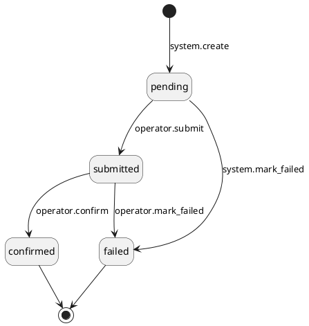
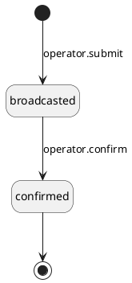

# PRD \- Phase 1D: External Wallet

## About the Document

### List of Personnel

| **Role** | **Name** |
| --- | --- |
| Product Manager | \[TBD\] |
| Tech Lead | \[TBD\] |
| Design | \[TBD\] |
| QA | \[TBD\] |
| Stakeholder | \[TBD\] |

---

## Overview

### Release Note

- Custody ops can create an External Wallet venue for tokens held outside platform-managed wallets.
- Ops can manually record incoming token movements to an External Wallet.
- Ops can manually process outgoing token movements from an External Wallet.
- Each External Wallet records a wallet provider, blockchain, wallet address, venue group, wallet type, wallet name, and optional internal note.

---

### Problem Statement

The custodian holds tokens in wallets outside the deposit, hot, and cold wallet infrastructure managed by the platform. The platform does not track these wallets or their movements today. Custody ops need a standard way to track these positions and movements with the Transaction and Movement model.

---

### Success Criteria

- Ops can track External Wallet balances and movements manually inside the platform.

---

### Solution Overview

1. An operator creates an External Wallet venue with its wallet details.
2. An operator records an incoming token movement against the External Wallet through the existing movement workflow.
3. An operator selects an External Wallet for an outgoing withdrawal or rebalance movement.
4. An operator manually enters the blockchain transaction hash and later records the transaction time after confirmation.
5. The system records the outgoing movement outcome and updates the balance records.

**In scope:**

- Create External Wallet venues with required wallet details and an optional internal note.
- Require maker-checker approval for External Wallet venue creation.
- Edit only the wallet name and optional internal note after creation.
- Reject duplicate wallet addresses on the same blockchain across External Wallet venues.
- Offer Metamask, Ledger, and Gnosis Safe in the fixed wallet provider list.
- Let any user select a fixed provider or enter another provider manually.
- Show External Wallet venues, details, balances, and movement records in operator views.
- Use External Wallet as the destination for incoming token movements.
- Use External Wallet as the source for unified withdrawals.
- Use External Wallet as the source or destination for rebalances.
- Manually process and confirm outgoing movements from an External Wallet.
- Record successful or failed outcomes for outgoing movements.
- Regenerate a failed outgoing movement through the existing movement workflow.
- Apply the existing Transaction and Movement workflows, KYT, Travel Rule, maker-checker, and balance controls.

---

### Out of Scope

| **Item** | **Reason** |
| --- | --- |
| Automatic on-chain detection through Blockchain Event Management | Deferred to a future phase |
| Automated outgoing execution through a venue integration | Deferred to a future phase |
| View Only Cold Wallet and its legacy transaction types | Removed in a separate workstream |
| Fiat or securities movements on External Wallet venues | External Wallet is a token venue |
| Client-facing visibility of External Wallet balances or movements | Venue operations are handled by custody ops |

---

### Actors

- **Operator User**: Custody ops staff who create and edit External Wallet venues and record incoming and outgoing movements.
- **Compliance User**: Reviews compliance results through the existing KYT and Travel Rule workflows when those workflows require review.
- **Any User**: A user who can select a fixed provider or enter another provider when creating an External Wallet.

---

### Assumptions & Dependencies

- The existing blockchain service provides the configured address format for each supported blockchain.
- The existing venue group model supplies the venue group used by an External Wallet.
- The existing Transaction and Movement workflows support manual movement booking and external movement outcomes.
- The existing KYT, Travel Rule, maker-checker, and balance controls apply to External Wallet operations.
- The fixed wallet provider list contains Metamask, Ledger, and Gnosis Safe.
- The configured confirmation depth is available before an operator confirms a manually processed outgoing movement.

---

### Glossary

| **Term** | **Definition** |
| --- | --- |
| External Wallet | A token venue for a wallet held outside the platform-managed deposit, hot, and cold wallet infrastructure. |
| Wallet Provider | The software or hardware used to manage an External Wallet. |
| Wallet Type | The classification of an External Wallet as `hot` or `cold`. |
| Venue Group | A logical grouping of venues used for asset segregation. |
| Transaction | The record of business intent behind a custody operation. |
| Movement | A directional record of tokens entering or leaving a custody venue. |
| KYT | Know Your Transaction screening applied to a movement. |
| Travel Rule | Compliance data exchange required for applicable digital asset transfers. |
| `transactedAt` | The timestamp when a movement actually occurred. |

---

## Functional Requirements

### Section 1: External Wallet Venue Lifecycle and Visibility

#### FR-1: \[Operator User\] Create an External Wallet venue

**Requirement Details**

As an Operator User, I want to create an External Wallet venue so that I can track tokens held outside platform-managed wallets.

**Precondition:** The Operator User can create venues through the existing venue workflow.

**Main Flow:**

1. The Operator User enters the wallet name, wallet provider, blockchain, wallet address, venue group, wallet type, and optional internal note; see Validations.
2. The system offers `Metamask`, `Ledger`, and `Gnosis Safe` as wallet provider options and accepts any user-entered provider value.
3. The system creates an External Wallet venue after the maker-checker request receives checker approval.
4. The system shows the External Wallet venue in operator venue lists and detail views.

**Validations:**

| **Check** | **Error Code** | **Error Message** |
| --- | --- | --- |
| The wallet name, wallet provider, blockchain, wallet address, venue group, and wallet type are supplied | `MISSING_REQUIRED_FIELD` | Supply all required External Wallet fields. |
| The blockchain exists | `NOT_FOUND` | The specified blockchain could not be found. |
| The venue group exists | `NOT_FOUND` | The specified venue group could not be found. |
| The wallet address satisfies the format configured for the selected blockchain | `INVALID_FORMAT` | The wallet address is not valid for the selected blockchain. |
| No External Wallet uses the same wallet address on the same blockchain | `CONFLICT` | An External Wallet with this address already exists on this blockchain. |
| The wallet type is `hot` or `cold` | `UNSUPPORTED_VALUE` | Wallet type must be `hot` or `cold`. |

**Design Constraints:**

- The system applies the complete validation set when the checker approves the maker-checker request.
- The system creates no venue before checker approval succeeds.

**Audit Log**

**Originating event:** `mch_request:create` · **Actor:** `operator` (maker)

> 🚩 **REVISIT:** `external_wallet:create` is a new operation. The platform registry has no operation for External Wallet venue creation. Register the operation before implementation.

| **Operation** | **Scope** | `externalMetadata` | `internalMetadata` | `externalSecurityMetadata` | `internalSecurityMetadata` |
| --- | --- | --- | --- | --- | --- |
| `external_wallet:create` | `internal_business` | — | `walletName`, `walletProvider`, `blockchainId`, `walletAddress`, `venueGroupId`, `walletType`, `internalNote` | — | `clientIp`, `userAgent`, `browser` |
| `mch_request:create` (failure) | `internal_business` | — | `errorCode`, `errorDetail`, `walletName`, `walletProvider`, `blockchainId`, `walletAddress`, `venueGroupId`, `walletType`, `internalNote` | — | `clientIp`, `userAgent`, `browser` |

**Mockups:**  
<https://www.figma.com/design/zOzC5MioQ9t1deERhBeGbg/-FE-UI--Token-Venues--Operator-User-?node-id=261-19113&t=GF5KPBTEbkjGAeGD-1> 

---

#### FR-2: \[Operator User\] Edit an External Wallet venue

**Requirement Details**

As an Operator User, I want to edit the wallet name and internal note so that I can keep External Wallet details accurate.

**Precondition:** The External Wallet venue exists.

**Main Flow:**

1. The Operator User submits an updated wallet name and optional internal note.
2. The system updates the External Wallet venue.

**Audit Log**

**Originating event:** `external_wallet:update` · **Actor:** `operator`

> 🚩 **REVISIT:** `external_wallet:update` is a new operation and originating event. The platform registry has no operation for External Wallet venue updates. Register the operation and originating event before implementation.

| **Operation** | **Scope** | `externalMetadata` | `internalMetadata` | `externalSecurityMetadata` | `internalSecurityMetadata` |
| --- | --- | --- | --- | --- | --- |
| `external_wallet:update` | `internal_business` | — | `walletName`, `internalNote` | — | `clientIp`, `userAgent`, `browser` |
| `external_wallet:update` (failure) | `internal_business` | — | `errorCode`, `errorDetail`, `walletName`, `internalNote` | — | `clientIp`, `userAgent`, `browser` |

**Mockups:**  
<https://www.figma.com/design/zOzC5MioQ9t1deERhBeGbg/-FE-UI--Token-Venues--Operator-User-?node-id=263-40126&t=GF5KPBTEbkjGAeGD-1> 

---

#### FR-3: \[Operator User\] View External Wallet venues and balances

**Requirement Details**

As an Operator User, I want to view External Wallet venues and balances so that I can track externally held tokens.

**Main Flow:**

1. The Operator User opens the External Wallet list and applies filters; see Filters.
2. The system returns each matching External Wallet with its venue ID, wallet name, wallet provider, blockchain, wallet address, venue group, wallet type, balance records, and `createdAt`.
3. The Operator User opens an External Wallet detail view.
4. The system adds the internal note and movement records to the detail view.

**Filters:**

| **Filter** | **Type** | **Allowed Values** |
| --- | --- | --- |
| Wallet Name | text (partial match) | — |
| Wallet Provider | text (partial match) | — |
| Blockchain | id reference (multi) | any blockchainIds |
| Venue Group | id reference (multi) | any venueGroupIds |
| Wallet Type | enum (multi) | `hot`, `cold` |
| Created At | date range (datetime) | — |

**Mockups:**  
<https://www.figma.com/design/zOzC5MioQ9t1deERhBeGbg/-FE-UI--Token-Venues--Operator-User-?node-id=260-11842&t=DyxNfHzFRgrxGkb0-1> 

---

### Section 2: External Wallet in Movement Workflows

#### FR-4: \[Operator User\] Book an Incoming Token Movement to an External Wallet

**Requirement Details**

As an Operator User, I want to book an incoming token movement to an External Wallet so that I can record tokens arriving in a wallet held outside platform-managed custody.

**Main Flow:**

1. The Operator User selects an External Wallet as the destination venue when booking an incoming token movement through the existing incoming movement workflow; see Validations.
2. The Operator User classifies and confirms the incoming movement through the existing movement workflow.

**Validations:**

| **Check** | **Error Code** | **Error Message** |
| --- | --- | --- |
| The selected External Wallet exists | `NOT_FOUND` | The specified External Wallet venue could not be found. |
| The selected asset is supported by the selected External Wallet blockchain | `UNSUPPORTED_VALUE` | The asset is not supported by the selected blockchain. |

**Audit Log**

**Originating event:** `incoming_movement:create_token` · **Actor:** `operator`

| **Operation** | **Scope** | `externalMetadata` | `internalMetadata` | `externalSecurityMetadata` | `internalSecurityMetadata` |
| --- | --- | --- | --- | --- | --- |
| `incoming_movement:create_token` | `internal_business` | — | `venueId`, `venueKind` | — | `clientIp`, `userAgent`, `browser` |
| `incoming_movement:create_token` (failure) | `internal_business` | — | `errorCode`, `errorDetail`, `venueId`, `venueKind` | — | `clientIp`, `userAgent`, `browser` |

**Originating event:** `incoming_movement:classify` · **Actor:** `operator`

| **Operation** | **Scope** | `externalMetadata` | `internalMetadata` | `externalSecurityMetadata` | `internalSecurityMetadata` |
| --- | --- | --- | --- | --- | --- |
| `incoming_movement:classify` | `internal_business` | — | `venueId`, `venueKind` | — | `clientIp`, `userAgent`, `browser` |
| `incoming_movement:classify` (failure) | `internal_business` | — | `errorCode`, `errorDetail`, `venueId`, `venueKind` | — | `clientIp`, `userAgent`, `browser` |

**Originating event:** `incoming_movement:confirm` · **Actor:** `operator`

| **Operation** | **Scope** | `externalMetadata` | `internalMetadata` | `externalSecurityMetadata` | `internalSecurityMetadata` |
| --- | --- | --- | --- | --- | --- |
| `incoming_movement:confirm` | `internal_business` | — | `venueId`, `venueKind` | — | `clientIp`, `userAgent`, `browser` |
| `incoming_movement:confirm` (failure) | `internal_business` | — | `errorCode`, `errorDetail`, `venueId`, `venueKind` | — | `clientIp`, `userAgent`, `browser` |

---

#### FR-5: \[Operator User\] Select an External Wallet as a Withdrawal Source Venue

**Requirement Details**

As an Operator User, I want to select an External Wallet as the source venue for an outgoing movement when I approve a unified withdrawal or regenerate a failed outgoing movement, so that I can settle tokens held externally.

**Main Flow:**

1. When the Operator User approves a unified withdrawal or regenerates a failed outgoing movement, the Operator User selects an External Wallet as the source venue for the outgoing movement; see Validations.
2. The system creates the outgoing movement against the selected External Wallet and records `executionMethod` as `manual`.

**Validations:**

| **Check** | **Error Code** | **Error Message** |
| --- | --- | --- |
| The selected External Wallet exists | `NOT_FOUND` | The specified External Wallet venue could not be found. |
| The selected asset is supported by the selected External Wallet blockchain | `UNSUPPORTED_VALUE` | The asset is not supported by the selected blockchain. |

**Design Constraints:**

- The system records `executionMethod` as `automated` for an outgoing movement created against a hot wallet, cold wallet, or deposit wallet venue.

**Audit Log**

**Originating event:** `unified_withdrawal:generate_underlying_outgoing_movement` · **Actor:** `operator`

| **Operation** | **Scope** | `externalMetadata` | `internalMetadata` | `externalSecurityMetadata` | `internalSecurityMetadata` |
| --- | --- | --- | --- | --- | --- |
| `unified_withdrawal:generate_underlying_outgoing_movement` | `internal_business` | — | `venueId`, `venueKind`, `executionMethod` | — | `clientIp`, `userAgent`, `browser` |
| `outgoing_movement:create` | `internal_business` | — | `venueId`, `venueKind`, `executionMethod` | — | `clientIp`, `userAgent`, `browser` |
| `unified_withdrawal:generate_underlying_outgoing_movement` (failure) | `internal_business` | — | `errorCode`, `errorDetail`, `venueId`, `venueKind`, `executionMethod` | — | `clientIp`, `userAgent`, `browser` |

**Originating event:** `unified_withdrawal:regenerate_outgoing_movement` · **Actor:** `operator`

| **Operation** | **Scope** | `externalMetadata` | `internalMetadata` | `externalSecurityMetadata` | `internalSecurityMetadata` |
| --- | --- | --- | --- | --- | --- |
| `unified_withdrawal:regenerate_outgoing_movement` | `internal_business` | — | `venueId`, `venueKind`, `executionMethod` | — | `clientIp`, `userAgent`, `browser` |
| `outgoing_movement:create` | `internal_business` | — | `venueId`, `venueKind`, `executionMethod` | — | `clientIp`, `userAgent`, `browser` |
| `unified_withdrawal:regenerate_outgoing_movement` (failure) | `internal_business` | — | `errorCode`, `errorDetail`, `venueId`, `venueKind`, `executionMethod` | — | `clientIp`, `userAgent`, `browser` |

**Mockups:**  
<https://www.figma.com/design/0hwU9K9w041Ty5IE36Cmfv/-FE-UI--Withdrawal-Transaction-2.0--Operator-User-?node-id=373-36327&t=j2NNg3qRssGyxNJW-1> 

---

#### FR-6: \[Operator User\] Select an External Wallet as a Rebalance Venue

**Requirement Details**

As an Operator User, I want to select an External Wallet as the source venue, destination venue, or both for a rebalance so that I can record token movements to or from externally held wallets.

**Main Flow:**

1. When the Operator User creates a rebalance, the Operator User selects an External Wallet as the source venue, destination venue, or both; see Validations.
2. The system creates the outgoing movement, the incoming movement, or both against the selected External Wallet venues, and records `executionMethod` as `manual` for the outgoing movement.

**Validations:**

| **Check** | **Error Code** | **Error Message** |
| --- | --- | --- |
| The selected External Wallet exists | `NOT_FOUND` | The specified External Wallet venue could not be found. |
| The selected asset is supported by the selected External Wallet blockchain | `UNSUPPORTED_VALUE` | The asset is not supported by the selected blockchain. |

**Design Constraints:**

- When the Operator User regenerates a failed rebalance movement, the system keeps the previously selected External Wallet venue and does not allow the operator to change it.

**Audit Log**

**Originating event:** `mch_request:create` · **Actor:** `operator` (maker)

> 🚩 **REVISIT:** Confirm whether rebalance creation uses maker-checker. The registry defines `mch_request:create` as the originating event for approval-driven rebalance creation. If the workflow creates a rebalance directly, the registry needs a registered rebalance creation originating event.

| **Operation** | **Scope** | `externalMetadata` | `internalMetadata` | `externalSecurityMetadata` | `internalSecurityMetadata` |
| --- | --- | --- | --- | --- | --- |
| `rebalance:create` | `internal_business` | — | `sourceVenueId`, `destinationVenueId`, `sourceVenueKind`, `destinationVenueKind`, `executionMethod` | — | `clientIp`, `userAgent`, `browser` |
| `outgoing_movement:create` | `internal_business` | — | `venueId`, `venueKind`, `executionMethod` | — | `clientIp`, `userAgent`, `browser` |
| `incoming_movement:create_token` | `internal_business` | — | `venueId`, `venueKind` | — | `clientIp`, `userAgent`, `browser` |
| `mch_request:create` (failure) | `internal_business` | — | `errorCode`, `errorDetail`, `sourceVenueId`, `destinationVenueId`, `sourceVenueKind`, `destinationVenueKind`, `executionMethod` | — | `clientIp`, `userAgent`, `browser` |

**Originating event:** `unified_rebalance:regenerate_outgoing_movement` · **Actor:** `operator`

| **Operation** | **Scope** | `externalMetadata` | `internalMetadata` | `externalSecurityMetadata` | `internalSecurityMetadata` |
| --- | --- | --- | --- | --- | --- |
| `outgoing_movement:create` | `internal_business` | — | `venueId`, `venueKind`, `executionMethod` | — | `clientIp`, `userAgent`, `browser` |
| `unified_rebalance:regenerate_outgoing_movement` (failure) | `internal_business` | — | `errorCode`, `errorDetail`, `venueId`, `venueKind`, `executionMethod` | — | `clientIp`, `userAgent`, `browser` |

**Mockups:**

---

#### FR-7: \[Operator User\] Manually Process an External Wallet Outgoing Movement

**Requirement Details**

As an Operator User, I want to manually process an outgoing movement from an External Wallet by recording the blockchain transaction hash so that the platform reflects the external transfer submission.

**Precondition:** An approved outgoing movement uses an External Wallet as its source venue.

**Main Flow:**

1. The Operator User opens the approved outgoing movement and selects manual processing; see Validations.
2. The system presents the manual processing form without calling a venue integration.
3. The Operator User enters `txHash` and submits the manual processing action; see Validations.
4. The system changes the movement status to `submitted` and sets `executionStatus` to `broadcasted`.

**Validations:**

| **Check** | **Error Code** | **Error Message** |
| --- | --- | --- |
| The outgoing movement uses an External Wallet as its source venue | `CONFLICT` | Manual processing is available only for an outgoing movement from an External Wallet. |
| The movement status is `pending` at manual processing | `CONFLICT` | Manual processing requires status `pending`. |
| The movement has passed the existing approval and required compliance checks | `FORBIDDEN` | The movement has not passed the required approval or compliance checks. |
| `txHash` uses the format configured for the selected blockchain | `INVALID_FORMAT` | The transaction hash is invalid for the selected blockchain. |
| No outgoing movement for the same blockchain, `txHash`, and source venue exists | `CONFLICT` | A movement for this transaction hash already exists for this venue. |

**Audit Log**

**Originating event:** `outgoing_movement:submit` · **Actor:** `operator`

| **Operation** | **Scope** | `externalMetadata` | `internalMetadata` | `externalSecurityMetadata` | `internalSecurityMetadata` |
| --- | --- | --- | --- | --- | --- |
| `outgoing_movement:submit` | `internal_business` | — | `txHash`, `status`, `executionStatus`, `venueId`, `venueKind`, `executionMethod` | — | `clientIp`, `userAgent`, `browser` |
| `outgoing_movement:submit` (failure) | `internal_business` | — | `errorCode`, `errorDetail`, `txHash`, `venueId`, `venueKind` | — | `clientIp`, `userAgent`, `browser` |

**Mockups:**  
<https://www.figma.com/design/2LRTPtku3e12ggDmg57Y32/-FE-UI--Outgoing-Token-Movement--Operator-User-?node-id=344-26253&t=MpJUjdUOyI0Y9DO6-1> 

---

#### FR-8: \[Operator User\] Confirm an External Wallet Outgoing Movement

**Requirement Details**

As an Operator User, I want to confirm an outgoing movement from an External Wallet after the blockchain transaction reaches the configured confirmation depth so that the platform completes the external transfer and applies the balance posting.

**Precondition:** A submitted outgoing movement uses an External Wallet as its source venue.

**Main Flow:**

1. After the blockchain transaction reaches the configured confirmation depth, the Operator User enters `transactedAt` and confirms the movement; see Validations.
2. The system changes the movement status to `confirmed`, sets `executionStatus` to `confirmed`, and applies the existing balance posting for the linked transaction type.

**Validations:**

| **Check** | **Error Code** | **Error Message** |
| --- | --- | --- |
| The movement status is `submitted` at confirmation | `CONFLICT` | Confirmation requires status `submitted`. |
| `transactedAt` is supplied | `MISSING_REQUIRED_FIELD` | Supply the transaction time. |
| `transactedAt` is a valid timestamp in the configured timezone basis | `INVALID_FORMAT` | The transaction time is invalid. |
| The blockchain transaction reaches the configured confirmation depth | `CONFLICT` | The transaction has not reached the configured confirmation depth. |

**Alternate Flows:**

- When the outgoing movement links to a unified withdrawal, the existing withdrawal posting debits the Client Account and credits the source venue.
- When the outgoing movement links to a rebalance, the existing rebalance posting debits In-Transit and credits the source venue.
- When the outgoing movement belongs to a rebalance, the paired incoming movement clears In-Transit through the existing rebalance workflow.

**Design Constraints:**

- The system releases the source-venue earmark when the movement reaches `confirmed` or `failed`.
- The system keeps a failed movement terminal and uses the existing regeneration workflow for another execution attempt.

**Audit Log**

**Originating event:** `outgoing_movement:confirm` · **Actor:** `operator`

> 🚩 **REVISIT:** Confirm the balance audit operation for External Wallet confirmation. The registry provides `balance:update`, but the requirements do not identify the exact balance writes for each linked transaction type.

| **Operation** | **Scope** | `externalMetadata` | `internalMetadata` | `externalSecurityMetadata` | `internalSecurityMetadata` |
| --- | --- | --- | --- | --- | --- |
| `outgoing_movement:confirm` | `internal_business` | — | `transactedAt`, `status`, `executionStatus`, `venueId`, `venueKind`, `executionMethod` | — | `clientIp`, `userAgent`, `browser` |
| `unified_withdrawal:complete` | `external_business` | `transactedAt` | `venueId` | — | `clientIp`, `userAgent`, `browser` |
| `unified_rebalance:complete` | `internal_business` | — | `transactedAt`, `venueId`, `venueKind` | — | `clientIp`, `userAgent`, `browser` |
| `balance:update` | `internal_business` | — | `venueId`, `transactionId`, `movementId` | — | `clientIp`, `userAgent`, `browser` |
| `outgoing_movement:confirm` (failure) | `internal_business` | — | `errorCode`, `errorDetail`, `transactedAt`, `venueId`, `venueKind` | — | `clientIp`, `userAgent`, `browser` |

Mockups:  
<https://www.figma.com/design/2LRTPtku3e12ggDmg57Y32/-FE-UI--Outgoing-Token-Movement--Operator-User-?node-id=345-54611&t=MpJUjdUOyI0Y9DO6-1> 

---

## Non-Functional Requirements

N/A

---

## Technical Specifications

### Data Model

#### ExternalWallet Data Model

> Includes standard system fields: `id`, `createdAt`, `createdBy`, `updatedAt`, `updatedBy`. These are not repeated in the table below.

| **Field Name** | **Non-null** | **Mutable** | **Client Visible** | **Data Type** | **Field Profile** | **Description** | **Rules/Constraints** |
| --- | --- | --- | --- | --- | --- | --- | --- |
| `walletName` | Y | Y | — | string | `text_single_line` | Name of the External Wallet venue | — |
| `walletProvider` | Y | — | — | string | `text_single_line` | Software or hardware used to manage the External Wallet | Fixed options: `Metamask`, `Ledger`, `Gnosis Safe`; any other operator-entered value is accepted |
| `blockchainId` | Y | — | — | uuid | `uuid` | FK → Blockchain | Blockchain must exist |
| `walletAddress` | Y | — | — | alphanumeric | `alphanumeric` | On-chain address of the External Wallet | Format validated against the address pattern configured for `blockchainId` |
| `venueGroupId` | Y | — | — | uuid | `uuid` | FK → VenueGroup | Venue group must exist |
| `walletType` | Y | — | — | enum | `enum` | walletType: `hot` \| `cold` | — |
| `internalNote` | — | Y | — | string | `remark_single_line` | Operator-only note about the External Wallet | — |

Indexes:

- `uq_externalwallet_blockchain_address` unique on (`blockchainId`, `walletAddress`), no two External Wallets share an address on the same blockchain
- `idx_externalwallet_blockchainId` on `blockchainId`, supports filtering by blockchain
- `idx_externalwallet_venueGroupId` on `venueGroupId`, supports filtering by venue group
- `idx_externalwallet_walletType` on `walletType`, supports filtering by wallet type
- `idx_externalwallet_createdAt` on `createdAt`, supports filtering by created date range

Relationships:

- `IncomingMovement.venueId` → `ExternalWallet.id` (many-to-one)
- `OutgoingMovement.venueId` → `ExternalWallet.id` (many-to-one)

#### OutgoingMovement Data Model

> Existing model. Only the fields this PRD adds or changes are listed.

| **Change** | **Field Name** | **Non-null** | **Mutable** | **Client Visible** | **Data Type** | **Field Profile** | **Description** | **Rules/Constraints** |
| --- | --- | --- | --- | --- | --- | --- | --- | --- |
| New | `executionMethod` | Y | — | — | enum | `enum` | Execution mechanism for the movement: `manual` / `automated` | `manual` when the source venue is an External Wallet (FR-5, FR-6); `automated` when the source venue is a hot wallet, cold wallet, or deposit wallet |
| Changed | `venueKind` | Y | — | — | enum | `enum` | Venue category of the source venue referenced by `venueId` | Adds `external_wallet` to the previously accepted `hot_wallet`, `cold_wallet`, `deposit_wallet` values (FR-5, FR-6) |

**Indexes:**

- `uq_outgoing_movement_blockchain_txhash_venue` unique on (`blockchainId`, `txHash`, `venueId`), enforced at manual processing when the source venue is an External Wallet (FR-7)

**Relationships:**

- `OutgoingMovement.venueId` → `ExternalWallet.id` (many-to-one)

#### IncomingMovement Data Model

> Existing model. Only the fields this PRD adds or changes are listed.

| **Change** | **Field Name** | **Non-null** | **Mutable** | **Client Visible** | **Data Type** | **Field Profile** | **Description** | **Rules/Constraints** |
| --- | --- | --- | --- | --- | --- | --- | --- | --- |
| Changed | `venueKind` | Y | — | — | enum | `enum` | Venue category of the destination venue referenced by `venueId` | Adds `external_wallet` to the previously accepted `hot_wallet`, `cold_wallet`, `deposit_wallet` values (FR-4, FR-6) |

Relationships:

- `IncomingMovement.venueId` → `ExternalWallet.id` (many-to-one)

---

### Status Diagram

#### OutgoingMovement.status Status

| **Status** | **Operator Label** | **Client Label** | **Meaning** | **Preconditions** | **Next States** | **Downstream Logic** |
| --- | --- | --- | --- | --- | --- | --- |
| `pending` | Pending | — | The outgoing movement is created against the selected External Wallet and awaits manual processing. | — | `submitted`, `failed` | Records the outgoing movement against the External Wallet venue and sets `executionMethod` to `manual` (FR-5, FR-6). |
| `submitted` | Submitted | — | The operator recorded the blockchain transaction hash for the movement. | Approval and required compliance checks pass; `txHash` matches the format configured for the selected blockchain; no other movement uses the same blockchain, `txHash`, and venue (FR-7) | `confirmed`, `failed` | Sets `executionStatus` to `broadcasted` (FR-7). |
| `confirmed` | Confirmed | — | The blockchain transaction reached finality and the movement is complete. | The blockchain transaction reaches the configured confirmation depth (FR-8) | — | Sets `executionStatus` to `confirmed`, applies the balance posting for the linked transaction type, and releases the source-venue earmark (FR-8). |
| `failed` | Failed | — | The movement did not complete and stays terminal. | — | — | Releases the source-venue earmark; the operator regenerates a new movement against the same transaction through the existing movement workflow (FR-5, FR-6). |

#### OutgoingMovement.executionStatus Status

| **Status** | **Operator Label** | **Client Label** | **Meaning** | **Preconditions** | **Next States** | **Downstream Logic** |
| --- | --- | --- | --- | --- | --- | --- |
| `broadcasted` | Broadcasted | — | The operator recorded the blockchain transaction hash for manual processing. | — | `confirmed` | Sets the outgoing movement `status` to `submitted` (FR-7). |
| `confirmed` | Confirmed | — | The blockchain transaction reached the configured confirmation depth. | The blockchain transaction reaches the configured confirmation depth (FR-8) | — | Sets the outgoing movement `status` to `confirmed` and triggers the balance posting for the linked transaction type (FR-8). |

---

### API Specifications

For API specifications, refer to the OpenAPI spec on Apidog.

---

### Error Handling

N/A

---

## Appendix

### Research References

- \[To be added by PM — include relevant research links, competitor analysis, design references\]
